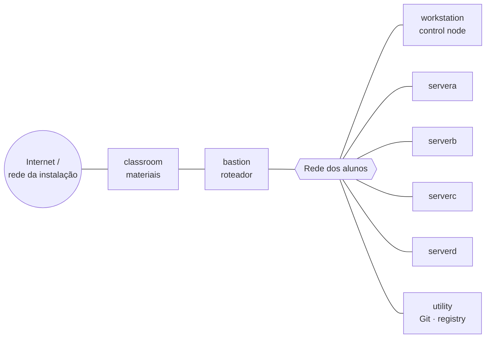

# Ambiente oficial de laboratório

Resumo autoral da seção *Orientation to the Classroom Environment* (PDF p. 8–10).
Endereços IP do ambiente não são reproduzidos aqui: use os nomes de host.

## Máquinas e papéis

Todas as máquinas estão no domínio DNS **`lab.example.com`**.

| Máquina | Papel no curso |
|---------|----------------|
| `workstation` | Estação gráfica do aluno. **Onde você trabalha**: VS Code, Git, `ansible-navigator`, comando `lab`. É o *control node* |
| `servera`, `serverb`, `serverc`, `serverd` | **Managed hosts** que os playbooks configuram |
| `utility` | Serviços de apoio específicos do curso (no Capítulo 1: servidor Git e registry de containers local com as imagens do AAP) |
| `bastion` | Roteador que liga as VMs aos servidores centrais. **Deve estar sempre ligado** |
| `classroom` (`content`, `materials`) | Servidor que hospeda os materiais da sala de aula |

## Visão lógica

## Como isso se encaixa no Ansible

| Conceito Ansible | No ambiente |
|------------------|-------------|
| Control node | `workstation` (o playbook roda em um execution environment iniciado ali) |
| Managed hosts | `servera`–`serverd` |
| Repositório Git remoto | Serviço Git em `utility` |
| Registry de imagens (EE e development tools) | Registry em `utility`, espelhando imagens de `registry.redhat.io` |

> ⚠️ As credenciais do ambiente aparecem nos enunciados das atividades. Não as copie
> para este repositório nem para o diário.

---
[← Roteiro de estudos](roteiro-de-estudos.md) | [Índice](README.md) | [Próximo: Preparação para os laboratórios →](preparacao-para-os-laboratorios.md)
