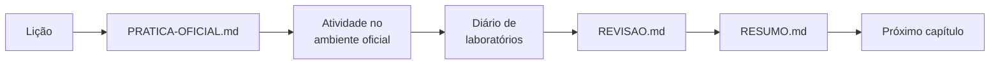

# Como usar este repositório

## O que este repositório é (e o que não é)

- **É** um guia autoral: explica os conceitos de cada seção com palavras próprias,
  traz exemplos YAML originais e prepara você para as atividades oficiais.
- **Não é** tradução nem cópia da apostila, e não contém soluções dos laboratórios.
  As atividades práticas acontecem **somente** no ambiente oficial da Red Hat.

## Estrutura

| Pasta | Conteúdo |
|-------|----------|
| [00-comecar-aqui](README.md) | Sobre o curso, ambiente e comando `lab` |
| [01-fundamentos-essenciais](../01-fundamentos-essenciais/README.md) | Vocabulário e modelos mentais antes do Capítulo 1 |
| [capitulos](../README.md#conteúdo) | Um diretório por capítulo, com lições, prática, revisão e resumo |
| [consulta-rapida](../consulta-rapida/comandos-ansible.md) | Comandos, configuração, troubleshooting e glossário |
| [exemplos-originais](../exemplos-originais/README.md) | Projetos pequenos e validados, com hostnames fictícios |
| [certificacao-ex294](../certificacao-ex294/objetivos-publicos-verificados.md) | Relação entre o curso e o exame |
| [progresso](../progresso/estado-do-projeto.md) | Estado do repositório, checklist, diário e dificuldades |
| [modelos](../modelos/modelo-licao.md) | Modelos de lição, capítulo e prática |

## Anatomia de uma lição

| Parte | Pergunta que responde |
|-------|-----------------------|
| Identificação | Qual seção, objetivo, pré-requisitos e páginas |
| A — Problema | Por que isso existe? |
| B — Modelo mental | Quem faz o quê, onde? |
| C — Entendimento progressivo | Como funciona, do simples ao completo; o que confunde com o quê |
| D — Exemplo autoral | Como fica em YAML/comandos? |
| E — Execução e verificação | Como rodar e como saber se deu certo? |
| F — Troubleshooting | O que costuma dar errado? |
| G — Preparação para o lab | O que dominar antes da atividade oficial? |
| H — Fixação | Consigo responder sem olhar? (respostas recolhíveis) |
| I — Essencial | O que levar na memória? |

## Ciclo de estudo de cada capítulo

## Símbolos

| Símbolo | Significado |
|---------|-------------|
| 📘 | Informação de documentação pública, fora da apostila |
| ⚠️ | Alerta: segurança, perda de dados ou erro frequente |
| ✅ | Documentado e validado (no checklist: concluído por você) |
| 🟡 | Parcial |
| ⏳ | Aguardando PDF |

## Status: documentação × aprendizagem

O estado do **repositório** (o que já foi escrito) fica em
[estado-do-projeto.md](../progresso/estado-do-projeto.md). O seu **estudo** fica no
[checklist geral](../progresso/checklist-geral.md) e no
[diário de laboratórios](../progresso/diario-de-laboratorios.md). Uma lição escrita
não significa laboratório feito.

---
[← Sobre o curso](sobre-o-curso.md) | [Índice](README.md) | [Próximo: Roteiro de estudos →](roteiro-de-estudos.md)
