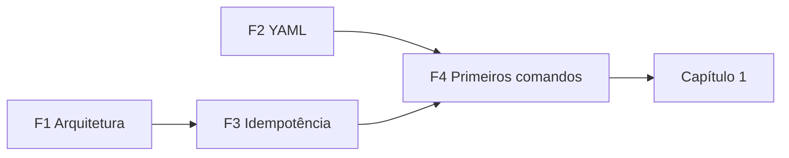

# 01 — Fundamentos essenciais

Módulo introdutório **autoral**, sem correspondência direta com uma seção oficial.
Ele monta o vocabulário e os modelos mentais que o AU294 usa desde o Capítulo 1,
sem antecipar procedimentos que o curso ensina depois (inventários e playbooks
completos ficam para o Capítulo 2).

## Para quem é

Você conhece Linux, Shell, serviços e redes (nível RHCSA), mas ainda está
construindo a forma de pensar da automação declarativa.

## Lições

| # | Lição | Pergunta central | Ligação com o curso |
|---|-------|------------------|---------------------|
| F1 | [Arquitetura Ansible](arquitetura-ansible.md) | Quem executa o quê, onde e por qual caminho? | Cap. 1 |
| F2 | [YAML para Ansible](yaml-para-ansible.md) | Como ler e escrever YAML sem errar a indentação? | Cap. 1 em diante |
| F3 | [Automação e idempotência](automacao-idempotencia.md) | Por que "descrever o estado" é diferente de "rodar comandos"? | Cap. 1 a 4 |
| F4 | [Primeiros comandos](primeiros-comandos.md) | Quais CLIs existem e qual usar em cada momento? | Cap. 1 e 2 |

## Mapa do módulo

## Ao terminar este módulo você deve conseguir

- [ ] Desenhar control node, execution environment e managed hosts, com os protocolos de conexão.
- [ ] Explicar a diferença entre playbook, play, task e módulo.
- [ ] Ler um arquivo YAML e dizer o que é mapa, lista e valor escalar.
- [ ] Explicar por que `ok` na segunda execução é sinal de automação bem escrita.
- [ ] Dizer para que servem `ansible-navigator`, `ansible-playbook`, `ansible-config` e `ansible-lint`.

---
[← Preparação para os laboratórios](../00-comecar-aqui/preparacao-para-os-laboratorios.md) | [Início](../README.md) | [Próximo: F1 Arquitetura Ansible →](arquitetura-ansible.md)
