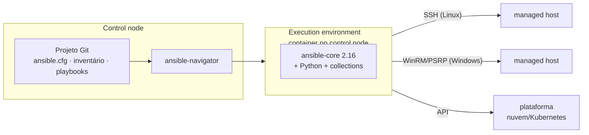

# F1 — Arquitetura Ansible

> Lição autoral de fundamentos. Aprofundada na [seção 1.1](../capitulos/01-introducao-ansible/1.1-automatizando-tarefas-com-ansible.md).

## A pergunta central

Quando você executa um playbook, **onde** o código roda, **como** ele chega aos
servidores e **o que** precisa existir em cada lado?

## Os três lugares

| Lugar | Contém | Ponte com o que você já conhece |
|-------|--------|---------------------------------|
| **Control node** | Arquivos do projeto e as CLIs | Sua estação de administração, de onde você faria `ssh` em cada servidor |
| **Execution environment** | O motor (`ansible-core`), Python e collections, empacotados em imagem de container | Um "kit de ferramentas" congelado em versão, igual para toda a equipe |
| **Managed host** | Nada específico do Ansible além de **SSH + Python** | O servidor que você administraria manualmente |

## O caminho de uma task

1. O motor lê o inventário e descobre os hosts do play.
2. Para cada task, abre (ou reaproveita) a conexão SSH com o `remote_user`.
3. Copia o módulo para um diretório temporário no host.
4. Executa o módulo (com `sudo`, se houver `become`).
5. O módulo devolve JSON com o resultado; o temporário é removido.

Por isso o modelo se chama **agentless** e **push**: nada fica rodando no managed
host esperando ordens; o control node empurra o trabalho quando você executa.

## O vocabulário que vai aparecer em todo o curso

| Termo | Analogia operacional (aproximada) |
|-------|-----------------------------------|
| Inventário | Sua planilha de servidores, agrupada por função |
| Playbook | O runbook, só que executável |
| Play | "Nestes servidores, faça esta lista" |
| Task | Uma linha do runbook, com nome |
| Módulo | A ferramenta que executa aquela linha de forma segura (como `dnf`, `useradd`, `systemctl`, mas declarativa) |
| Collection | Pacote com módulos, plug-ins e roles, distribuído à parte do motor |
| Plug-in | Extensão do motor: como conectar, de onde ler inventário, como mostrar a saída |

## Erros de modelo mental comuns

| Crença errada | Realidade |
|---------------|-----------|
| "Preciso instalar o Ansible nos servidores" | Só no control node (ou no EE). Os managed hosts precisam de SSH e Python |
| "`ansible.builtin.ping` usa ICMP" | Ele testa SSH + Python, o mesmo caminho das tasks |
| "Se uma task falha, o playbook para para todos" | Para **aquele host**; os demais seguem |
| "AAP e `ansible-core` são a mesma coisa" | O AAP é o produto empresarial que inclui e suporta o `ansible-core`, além de muito mais |

---
[← Fundamentos (índice)](README.md) | [Índice](README.md) | [Próximo: F2 YAML para Ansible →](yaml-para-ansible.md)
