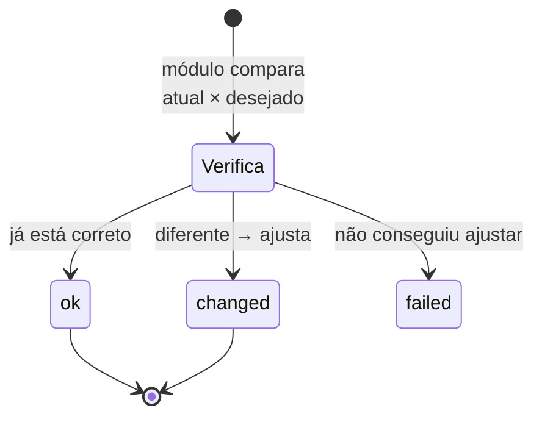

# F3 — Automação e idempotência

> Lição autoral de fundamentos. Base para a [seção 1.1](../capitulos/01-introducao-ansible/1.1-automatizando-tarefas-com-ansible.md) e para os Capítulos 2 a 4.

## Imperativo × declarativo

| | Imperativo (script Shell) | Declarativo (Ansible) |
|---|---------------------------|-----------------------|
| Você descreve | **Os passos** | **O estado final** |
| Exemplo | `useradd ana; usermod -aG wheel ana` | "o usuário `ana` existe e está no grupo `wheel`" |
| Reexecutar | Pode falhar ou duplicar efeitos | Seguro: só corrige o que diverge |
| Quem verifica o estado atual | Você, com `if`s | O módulo |

## Idempotência na prática

Uma operação é **idempotente** quando aplicá-la uma ou várias vezes produz o mesmo
resultado. Em Ansible, isso aparece no resultado de cada task:

O teste prático de um bom playbook: **rode duas vezes**. A segunda execução deve
terminar com `changed=0`.

## Por que isso importa para quem administra RHEL

| Situação | Sem idempotência | Com idempotência |
|----------|------------------|------------------|
| Alguém editou um arquivo à mão | Você descobre na próxima pane | A próxima execução devolve o estado declarado (correção de *drift*) |
| Playbook interrompido no meio | Reexecutar pode duplicar ações | Reexecute sem medo; o que já está pronto vira `ok` |
| Auditoria | "Rodei o script ontem" | O playbook **é** a descrição do estado esperado |

## O que quebra a idempotência

| Prática | Problema | Alternativa (capítulos futuros) |
|---------|----------|---------------------------------|
| `ansible.builtin.command`/`shell` para tudo | O Ansible não sabe se algo mudou: sempre `changed` | Usar o módulo específico (`dnf`, `user`, `service`, `lineinfile`...) |
| Acrescentar linhas com `echo >>` | Duplica a cada execução | Módulo que garante a linha (`lineinfile`, Cap. 5) |
| Baixar "a versão mais nova" sem fixar | Resultado muda com o tempo | Fixar versões no código |

## Fixação

1. Um playbook sempre termina com `changed=3`, mesmo sem mudanças no servidor. O que suspeitar?
2. Explique "correção de drift" em uma frase.

Respostas

1. Tasks não idempotentes, tipicamente `command`/`shell` sem controle de mudança, ou ações que reescrevem algo a cada execução.
2. Reaplicar o estado declarado para desfazer alterações manuais ou acidentais, mexendo só no que divergiu.

---
[← F2 YAML para Ansible](yaml-para-ansible.md) | [Índice](README.md) | [Próximo: F4 Primeiros comandos →](primeiros-comandos.md)
