# AU294 · Ansible Automation Platform 2.6 — Guia de Estudos

> Guia pessoal e autoral para estudar o curso **Red Hat Enterprise Linux Automation
> with Ansible (AU294)**, edição 2, baseado em **Red Hat Ansible Automation Platform
> 2.6**, **RHEL 10** e **ansible-core 2.16**, com foco na preparação para o **EX294**.

Este repositório **não substitui nem reproduz** a apostila oficial. Ele explica os
conceitos com palavras próprias, traz exemplos YAML originais e validados e faz a
ponte para os laboratórios, que continuam sendo executados no ambiente da Red Hat.

---

## Início rápido

1. Leia [Comece aqui](00-comecar-aqui/README.md): sobre o curso, ambiente oficial e comando `lab`.
2. Estude os [Fundamentos essenciais](01-fundamentos-essenciais/README.md) **antes** do Capítulo 1.
3. Para cada capítulo: lições → `PRATICA-OFICIAL.md` → laboratório oficial → `REVISAO.md` → `RESUMO.md`.
4. Registre cada laboratório no [diário](progresso/diario-de-laboratorios.md).
5. Marque o avanço no [checklist geral](progresso/checklist-geral.md). O estado do repositório está em [estado-do-projeto.md](progresso/estado-do-projeto.md).

## Progressão do aprendizado

```mermaid
flowchart LR
    F[Fundamentos] --> C1[1. Introdução<br/>ao Ansible]
    C1 --> C2[2. Inventários<br/>e playbooks]
    C2 --> C3[3. Variáveis<br/>e Vault]
    C3 --> C4[4. Controle<br/>de tarefas]
    C4 --> C5[5. Arquivos e<br/>templates]
    C5 --> C6[6. Automação<br/>em escala]
    C6 --> C7[7. Roles e<br/>collections]
    C7 --> C8[8. Administração<br/>de RHEL]
    C8 --> C9[9. Revisão geral]
    C9 --> EX[EX294]
```

## Conteúdo

| Módulo | Tema | PDF | Status |
|--------|------|-----|--------|
| [00 — Comece aqui](00-comecar-aqui/README.md) | Sobre o curso, ambiente oficial, comando `lab` | p. 1–11 | ✅ |
| [01 — Fundamentos essenciais](01-fundamentos-essenciais/README.md) | Arquitetura, YAML, idempotência, primeiras CLIs | — | ✅ |
| [Capítulo 1](capitulos/01-introducao-ansible/README.md) | An Introduction to Ansible | p. 12–61 | ✅ |
| [Capítulo 2](capitulos/02-desenvolvendo-automacao/README.md) | Introduction to Developing Automation Content | p. 62–140 | ✅ |
| [Capítulo 3](capitulos/03-variaveis-e-vault/README.md) | Developing Automation Content: Variables | p. 141–225 | ✅ |
| [Capítulo 4](capitulos/04-controle-de-tarefas/README.md) | Developing Automation Content: Task Control | p. 226–291 | ✅ |
| [Capítulo 5](capitulos/05-deploy-de-arquivos/README.md) | Developing Automation Content: Deploying Files | p. 292–339 | ✅ |
| [Capítulo 6](capitulos/06-automacao-em-escala/README.md) | Developing Automation Content at Scale | p. 340–384 | ✅ |
| [Capítulo 7](capitulos/07-roles-e-collections/README.md) | Reusing Code with Ansible Roles and Content Collections | p. 385–452 | ✅ |
| [Capítulo 8](capitulos/08-administracao-linux/README.md) | Automating Linux Administration Tasks (partes A e B) | p. 453–569 | ✅ |
| [Capítulo 9](capitulos/09-revisao-geral/README.md) | Comprehensive Review | p. 570–615 | ⏳ |

Legenda: ✅ documentado e validado · 🟡 parcial · ⏳ aguardando PDF. Os capítulos são
desenvolvidos **um por vez**, à medida que o PDF de cada um é recebido.

## Consulta rápida

| Arquivo | Para que serve |
|---------|----------------|
| [comandos-ansible.md](consulta-rapida/comandos-ansible.md) | Comandos agrupados por tarefa |
| [configuracao-ansible-e-navigator.md](consulta-rapida/configuracao-ansible-e-navigator.md) | `ansible.cfg`, `ansible-navigator.yml` e precedência em uma página |
| [modulos-e-collections.md](consulta-rapida/modulos-e-collections.md) | Módulos citados, fontes de collections e como consultar documentação |
| [inventory-e-host-patterns.md](consulta-rapida/inventory-e-host-patterns.md) | Sintaxe INI, ranges, `:children`, variáveis de conexão, consultas e host patterns |
| [playbooks-e-controle.md](consulta-rapida/playbooks-e-controle.md) | Esqueleto de play, usuário e privilégio, loops, condicionais, handlers, tratamento de falhas, opções de execução |
| [troubleshooting.md](consulta-rapida/troubleshooting.md) | Sintoma → causa provável → como verificar |
| [glossario.md](consulta-rapida/glossario.md) | Termos em ordem alfabética |
| [variaveis-e-precedencia.md](consulta-rapida/variaveis-e-precedencia.md) | Precedência, sintaxe, facts, variáveis mágicas e Ansible Vault |
| [roles-e-templates.md](consulta-rapida/roles-e-templates.md) | Templates Jinja2, filtros e roles |

## Exemplos e certificação

- [Exemplos originais](exemplos-originais/README.md): projetos pequenos com hostnames fictícios, validados com `ansible-lint` e `--syntax-check`.
- [Certificação EX294](certificacao-ex294/objetivos-publicos-verificados.md): objetivos públicos (🟡 a conferir), [matriz de competências](certificacao-ex294/matriz-de-competencias.md) e [roteiro de revisão](certificacao-ex294/roteiro-de-revisao.md).

## Checklist de conclusão por capítulo

- [ ] Fundamentos essenciais
- [ ] Capítulo 1 — lições, quiz, guided exercises, revisão
- [ ] Capítulo 2 — lições, guided exercises, lab `develop-review`, revisão
- [ ] Capítulo 3 — lições, guided exercises, lab `variables-review`, revisão
- [ ] Capítulo 4 — lições, guided exercises, lab `control-review`, revisão
- [ ] Capítulo 5 — lições, guided exercises, lab `files-review`, revisão
- [ ] Capítulo 6 — lições, guided exercises, lab `scale-review`, revisão
- [ ] Capítulo 7 — lições, quiz, guided exercises, lab `roles-review`, revisão
- [ ] Capítulo 8 — lições, guided exercises, lab `system-review`, revisão
- [ ] Capítulo 9 — revisão integrada

> Marque aqui quando **você** concluir o estudo. O checklist detalhado está em
> [progresso/checklist-geral.md](progresso/checklist-geral.md).

## Três "Ansibles" que não são a mesma coisa

| Produto | O que é |
|---------|---------|
| **ansible-core** | Motor, linguagem, CLIs e módulos `ansible.builtin` (2.16 neste curso) |
| **Pacote `ansible` (comunitário)** | `ansible-core` + seleção de collections da comunidade |
| **Red Hat Ansible Automation Platform** | Produto empresarial: automation controller, execution environments e development tools suportados, conteúdo certificado |

## Referências públicas

- Documentação do Ansible Automation Platform 2.6: <https://docs.redhat.com/en/documentation/red_hat_ansible_automation_platform/2.6>
- Documentação do ansible-core: <https://docs.ansible.com/>
- Documentação do ansible-navigator: <https://ansible.readthedocs.io/projects/navigator/>
- Exame EX294: <https://www.redhat.com/en/services/training/ex294-red-hat-certified-engineer-rhce-exam-red-hat-enterprise-linux>

## Aviso

Repositório de estudo pessoal. Ele não contém o PDF do curso, extrações de texto,
soluções de laboratório, senhas do ambiente nem credenciais. Red Hat, Red Hat
Enterprise Linux e Ansible são marcas da Red Hat, Inc. O conteúdo oficial do curso
pertence à Red Hat e não está incluído aqui.
