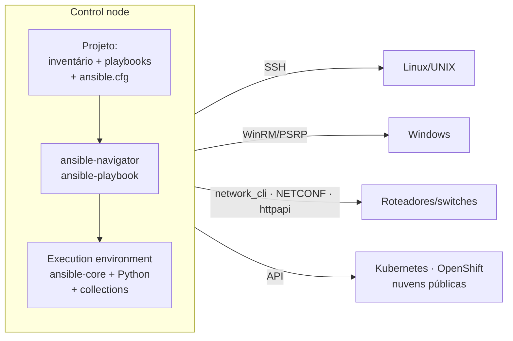
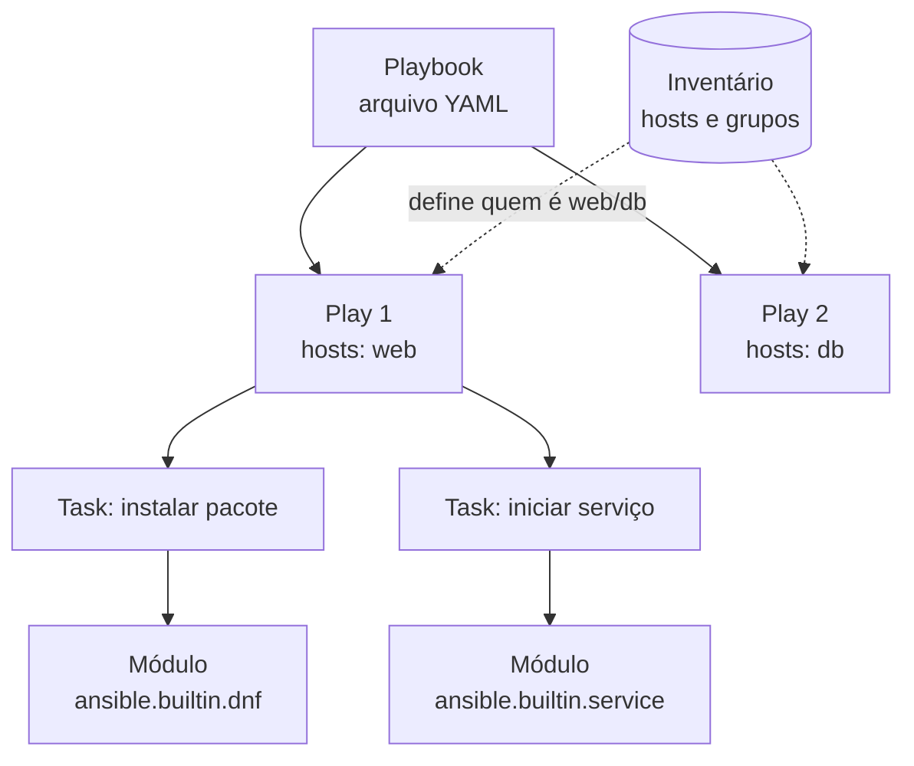

# 1.1 — Automatizando tarefas com Ansible

| Campo | Valor |
|-------|-------|
| Curso | AU294 — Ansible Automation Platform 2.6 (edição 2) |
| Capítulo / seção | Capítulo 1 · Seção 1.1 |
| Título original | Automating Tasks with Ansible |
| Título em português | Automatizando tarefas com Ansible |
| Objetivo | Explicar por que automatizar com Ansible, os conceitos fundamentais (playbook, play, task, module, inventário, idempotência) e a arquitetura básica |
| Pré-requisitos | [F1 — Arquitetura Ansible](../../01-fundamentos-essenciais/arquitetura-ansible.md), [F3 — Automação e idempotência](../../01-fundamentos-essenciais/automacao-idempotencia.md) |
| Referência | PDF p. 13–19 · Quiz 1.2 p. 20–21 |

## Parte A — O problema que a tecnologia resolve

### O custo do trabalho manual

Pense em uma tarefa que você já fez muitas vezes como administrador RHEL: preparar
um servidor novo. Ajustar `chronyd`, criar usuários, instalar pacotes, abrir portas
no `firewalld`, configurar `sudoers`. Em um servidor, um runbook resolve. Em
quarenta, aparecem os problemas que o curso descreve:

| Problema do processo manual | Consequência operacional |
|-----------------------------|--------------------------|
| Passos esquecidos ou feitos em ordem diferente | Servidores "iguais" que se comportam de forma diferente (*configuration drift*) |
| Erro humano em configuração ou deploy | Indisponibilidade |
| Lentidão | Menos tempo para trabalho crítico; resposta lenta ao negócio |
| Não escala | Cada servidor novo custa o mesmo esforço do primeiro |
| Releases demoradas | Atualizações e funcionalidades chegam tarde |

O Ansible ataca esses pontos com uma plataforma de automação **agentless**: você
descreve o estado desejado uma vez, e o mesmo texto é aplicado a 1 ou 1.000 hosts,
sempre do mesmo jeito.

### Infraestrutura como código (IaC)

**IaC** significa descrever o **estado desejado** da infraestrutura em uma linguagem
legível por pessoas e deixar uma ferramenta garantir que a realidade corresponda à
descrição. Como os playbooks do Ansible são **arquivos de texto**, eles entram no Git:

- histórico de quem mudou o quê e quando;
- revisão de código antes de aplicar uma mudança;
- volta a uma configuração anterior com `git revert`/`git checkout`;
- o mesmo arquivo aplicado em desenvolvimento, teste e produção.

> **Ponte com RHCSA:** um runbook em Markdown diz *como* fazer; um playbook diz
> *qual estado* deve existir e uma máquina o aplica. O ganho real vem quando a
> mudança só é feita pelo código (com revisão), nunca "na mão" no servidor.

### Mitigar o erro humano exige processo, não só ferramenta

Automatizar um erro só o espalha mais rápido. O curso enfatiza que o código de
automação precisa de **revisão** e **controle de versão**. Por isso o Capítulo 1
ensina Git e `ansible-lint` antes de você escrever o primeiro playbook de verdade.

## Parte B — Modelo mental e arquitetura

### Control node e managed hosts



| Papel | O que é | O que precisa ter |
|-------|---------|-------------------|
| **Control node** | Máquina de onde o Ansible é executado e onde ficam os arquivos do projeto | Ansible (ou `ansible-navigator` + um container engine para usar execution environments) |
| **Managed host** | Sistema que o Ansible configura | Para Linux: SSH acessível e Python. **Nenhum agente instalado** |

No AAP 2.x, o motor do Ansible costuma rodar **dentro de um container** chamado
**automation execution environment (EE)**: uma imagem baseada em RHEL UBI com
`ansible-core`, dependências Python e Ansible Content Collections. O
`ansible-navigator` é a CLI que lê o inventário e o playbook e os executa dentro
desse container. Você verá isso em detalhe nas seções 1.3 e 1.5.

### Como funciona "sem agente"

1. O control node abre uma conexão (SSH no Linux).
2. Envia um pequeno programa: o **módulo** da task.
3. O módulo roda no managed host, compara o estado atual com o desejado e só muda
   o necessário.
4. Devolve o resultado em JSON (`ok`, `changed`, `failed`...) e é removido.

Consequência prática: não há daemon para instalar, atualizar ou proteger nos
managed hosts. A superfície de ataque é o SSH que você já administra.

### A hierarquia de conteúdo



| Termo | Definição curta |
|-------|-----------------|
| **Playbook** | Arquivo de texto em **YAML** com um ou mais plays |
| **Play** | Associa um grupo de hosts a uma lista ordenada de tasks |
| **Task** | Uma ação com nome, que chama um módulo com argumentos |
| **Module** | Programa pequeno que garante um aspecto do estado (arquivo, pacote, serviço, montagem...) |
| **Inventory** | Lista de managed hosts e grupos; estática (arquivo) ou dinâmica (fonte externa) |
| **Plug-in** | Código que estende o núcleo: conexão, inventário, formato de saída etc. |
| **Collection** | Pacote de distribuição de conteúdo: módulos, plug-ins, roles e documentação |

Regra de execução importante: as tasks de um play rodam **em ordem**. Se uma task
falhar em um host, o Ansible normalmente **para o restante do playbook para aquele
host** (os outros continuam). Esse comportamento pode ser alterado; o Capítulo 4
trata disso.

## Parte C — Entendimento progressivo

### 1. O que é o Ansible

O curso define o Ansible por três propriedades:

| Propriedade | Significado prático |
|-------------|---------------------|
| **Simples** | Playbooks legíveis por quem não é programador; equipes diferentes leem o mesmo arquivo |
| **Poderoso** | Deploy de aplicações, gerência de configuração, automação de fluxos e de rede |
| **Agentless** | Conecta por OpenSSH ou WinRM, envia módulos, remove-os ao final |

Características dos playbooks que aparecem no curso: suporte multiplataforma
(Linux, Windows, UNIX, rede; físico, virtual, nuvem, containers), texto legível,
descrição precisa do ambiente, versionamento como código-fonte, **inventários
dinâmicos** e integração com outras ferramentas de orquestração.

### 2. Breve histórico

- **2012:** criado por Michael DeHaan, com a meta de ser simples e agentless. O nome
  vem da ficção científica (um dispositivo de comunicação instantânea a grandes distâncias).
- **2013:** fundação da empresa Ansible, Inc. (inicialmente AnsibleWorks, Inc.).
- **Outubro de 2015:** aquisição pela Red Hat.

### 3. Três "Ansibles" que não são a mesma coisa

Este é o ponto conceitual mais cobrado do capítulo.

| Produto | O que contém | Versionamento |
|---------|--------------|---------------|
| **Ansible Core** (`ansible-core`) | Motor e linguagem, runtime, CLIs (`ansible`, `ansible-playbook`, `ansible-config`...) e só os módulos essenciais (`ansible.builtin`) | Próprio: 2.15, **2.16**... |
| **Ansible comunitário** (pacote `ansible`) | `ansible-core` **mais** uma seleção grande de collections mantidas pela comunidade ("baterias incluídas") | Próprio ciclo de releases |
| **Red Hat Ansible Automation Platform** | Produto empresarial por assinatura: UI web e API centralizadas, RBAC, logs, **automation controller** (antigo Ansible Tower), conteúdo certificado e suporte | Alinhado ao `ansible-core` |

Por que houve a separação? Até a versão 2.9 o Ansible era um pacote único com
motor e milhares de módulos. Isso gerava três problemas:

1. **Atualizações raras:** módulo novo só chegava com release maior (a cada 3–6 meses).
2. **Pacote inchado:** todo mundo recebia tudo, mesmo usando pouco.
3. **Rigidez de versões:** impossível atualizar um conjunto de módulos sem trocar o motor.

A partir da 2.10 o motor passou a se chamar `ansible-base` e, desde a **2.11**,
`ansible-core`. Os módulos fora do núcleo passaram a ser distribuídos em
**Ansible Content Collections**, instaladas conforme a necessidade (Capítulo 7).

Alinhamento de versões citado no curso:

| AAP | ansible-core |
|-----|--------------|
| 2.4 | 2.15 |
| 2.5 | 2.16 |
| **2.6** | **2.16** |

> **Consequência para o estudo:** "o módulo X existe?" depende de **qual collection
> está instalada no execution environment**, não só da versão do `ansible-core`.
> É por isso que o curso escreve módulos com o nome completo, como
> `ansible.builtin.ping` (FQCN — *fully qualified collection name*).

### 4. Ansible development tools

São um conjunto de ferramentas de linha de comando para quem **cria** conteúdo
Ansible: verificar, testar e executar de forma consistente. Não são um produto
separado. No curso elas são usadas integradas ao VS Code (seção 1.3).

📘 *Fonte externa (documentação do projeto `ansible-dev-tools`):* na comunidade, o
pacote Python `ansible-dev-tools` agrupa as ferramentas; no AAP 2.6 elas são
entregues com suporte pelo RPM `ansible-dev-tools` ou pela imagem de container
correspondente.

### 5. Idempotência

Tasks, plays e playbooks são projetados para serem **idempotentes**: executar
várias vezes leva ao mesmo resultado, e **se o sistema já está no estado desejado,
nada é alterado**.

| Abordagem | Exemplo | Rodar 2 vezes |
|-----------|---------|---------------|
| Imperativa (script) | `useradd ana` | Segunda execução falha: "user already exists" |
| Declarativa (módulo) | `ansible.builtin.user` com `name: ana` e `state: present` | Primeira: `changed`. Segunda: `ok` (nada a fazer) |

A idempotência é o que torna seguro reaplicar um playbook para **corrigir drift**:
se alguém alterou um arquivo à mão, a próxima execução devolve o estado declarado,
e o restante permanece intocado.

### 6. A "Ansible Way"

| Princípio do curso | Leitura prática |
|--------------------|-----------------|
| Complexidade mata a produtividade | Prefira a solução simples e legível |
| Otimizado para leitura | Nomeie tasks como frases; o playbook é documentação |
| Pense de forma declarativa | Descreva o estado, não a sequência de comandos; o Ansible decide se precisa agir |

### 7. Casos de uso

| Caso de uso | Exemplo concreto |
|-------------|------------------|
| Gerência de configuração | Manter `/etc/chrony.conf` idêntico em toda a frota |
| Deploy de aplicações | Publicar uma nova versão em várias camadas, com o automation controller cuidando do ciclo |
| Provisionamento | PXE, kickstart em bare metal, criação de VMs e instâncias em nuvem |
| Entrega contínua | Etapa de deploy em um pipeline CI/CD |
| Segurança e conformidade | Varredura e remediação automatizadas de uma política |
| Orquestração | Coordenar várias peças (banco → app → balanceador) como um todo |

**Containers:** o Ansible pode rodar *dentro* de containers (é o caso do EE) e
também *gerenciar* containers: instalar Podman ou Docker, controlar containers e
fazer deploy em Kubernetes.

### 8. Ansible e Terraform

| | Terraform | Ansible |
|---|-----------|---------|
| Ponto forte | **Provisionar** infraestrutura (VMs, redes, bancos) | **Configurar** o que existe e fazer deploy de aplicações |
| Linguagem | HCL declarativa | YAML declarativo |
| Estado | Mantém um *state file* | Não mantém arquivo de estado: consulta o host a cada execução |
| Fase típica | **Day 0** | **Day 1 e Day 2** |

Padrão comum: o Terraform cria as VMs e suas saídas alimentam um **inventário**
para o Ansible configurar as máquinas recém-criadas. As ferramentas se complementam.

### 9. Suporte

O AAP oferece suporte oficial às ferramentas centrais, **Red Hat Certified Ansible
Content Collections**, ferramentas on-premise para distribuição de conteúdo,
gerência de tarefas e escala de execução, e serviços em nuvem para descoberta de
conteúdo certificado, colaboração e análise operacional.

## Parte D — Exemplo autoral incremental

Objetivo: ver os conceitos (inventário → play → task → módulo) em um projeto mínimo
e sem efeitos colaterais. Arquivos completos em
[exemplos-originais/cap01-projeto-base](../../exemplos-originais/cap01-projeto-base/).

**Passo 1 — o inventário diz *quem*:**

```ini
# inventory (hostnames fictícios do domínio reservado example.net)
[web]
web01.example.net
web02.example.net

[db]
db01.example.net
```

**Passo 2 — o playbook diz *o quê*:**

```yaml
---
- name: Verificar se os managed hosts estão prontos para o Ansible   # play
  hosts: all                    # alvo: todos os hosts do inventário
  gather_facts: false           # pula a coleta de facts (Capítulo 3)

  tasks:
    - name: Testar conexão SSH e interpretador Python                 # task
      ansible.builtin.ping:     # módulo (FQCN); sem argumentos
```

- `hosts:` liga o play ao inventário.
- `tasks:` é uma **lista** (itens com `-`), executada em ordem.
- `ansible.builtin.ping` **não é** o `ping` ICMP: ele abre a conexão SSH, executa
  um módulo Python e responde `pong`. Testa exatamente o caminho que o Ansible usa.

**Passo 3 — o módulo garante *estado* (idempotência).** Um exemplo ilustrativo
(não faz parte do projeto-base, pois exigiria `become` e um host real):

```yaml
    - name: Garantir que o chrony está instalado
      ansible.builtin.dnf:
        name: chrony
        state: present          # "presente", não "instale agora"
```

Na primeira execução em um host sem o pacote: `changed`. Nas seguintes: `ok`.

## Parte E — Execução e verificação

Esta lição é conceitual. A execução real começa nos guided exercises 1.4 e 1.6,
no ambiente oficial.

| Item | Valor |
|------|-------|
| Comando (no curso) | `ansible-navigator run verificar-conectividade.yml -m stdout` |
| `become` | Não: `ping` e `debug` não exigem root |
| Saída esperada | `ok` por host em cada task e um `PLAY RECAP` com `changed=0` |
| Status do exemplo | ✅ YAML validado, `ansible-playbook --syntax-check` e `ansible-lint` (perfil *production*) sem erros com ansible-core 2.16.19 · ⚠️ não executado contra hosts (os nomes são fictícios) |

Como ler o `PLAY RECAP`:

| Contador | Significado |
|----------|-------------|
| `ok` | Task executada; estado já estava correto ou a task só leu informação |
| `changed` | O módulo alterou algo no host |
| `unreachable` | O Ansible não conseguiu conectar (DNS, rede, SSH, autenticação) |
| `failed` | Conectou, mas a task falhou |
| `skipped` | Task não executada (condição falsa, Capítulo 4) |

## Parte F — Troubleshooting (conceitual)

| Sintoma | Causa provável | Como pensar |
|---------|----------------|-------------|
| "Módulo não encontrado" | Collection ausente no ambiente de execução | O `ansible-core` só traz `ansible.builtin`; verifique as collections do EE |
| Host `unreachable` | Problema de conexão, não da task | Teste nome/DNS, porta 22, usuário e chave SSH antes de mexer no playbook |
| Segunda execução ainda mostra `changed` | Task não idempotente (ex.: `command`/`shell` sem controle) | Prefira um módulo declarativo específico |
| Um host falhou e os outros seguiram | Comportamento padrão: a falha interrompe o play **para aquele host** | Corrija e reexecute; a idempotência garante que os já corretos não mudam |

## Parte G — Preparação para o laboratório

Atividade associada: **1.2 Quiz — Automating Tasks with Ansible** (PDF p. 20–21,
sem comando `lab`). Ver [PRATICA-OFICIAL.md](PRATICA-OFICIAL.md#12-quiz-automating-tasks-with-ansible).

Antes do quiz você deve conseguir explicar, sem consulta:

- o que significa *agentless* e qual protocolo o Ansible usa por padrão no Linux;
- que tipo de arquivo descreve as ações e em que formato ele é escrito;
- o que o `ansible-core` contém e o que **não** contém;
- o nome da propriedade que permite reexecutar sem mudanças desnecessárias.

## Parte H — Fixação

1. Um colega diz: "Ansible é client/server; precisamos instalar o cliente em todos os servidores". Corrija a afirmação.
2. Qual a diferença entre o pacote `ansible-core` e o pacote comunitário `ansible`? Em qual deles está, por exemplo, um módulo de uma collection de nuvem?
3. Ordene do maior para o menor: task, playbook, module, play. Qual deles é efetivamente executado no managed host?
4. Um script `setup.sh` faz `echo "server ntp.example.net" >> /etc/chrony.conf`. O que acontece ao rodá-lo três vezes? Como um módulo declarativo evitaria o problema?
5. A equipe usa Terraform para criar VMs. Onde o Ansible entra e como as duas ferramentas podem se conectar?

<details>
<summary>Respostas comentadas</summary>

1. O Ansible é **agentless**: não há cliente instalado. O control node se conecta por SSH (Linux) ou WinRM (Windows), envia o módulo, executa e remove. Nos managed hosts Linux basta SSH e Python.
2. `ansible-core` é o motor com CLIs e apenas `ansible.builtin`. O pacote `ansible` inclui o `ansible-core` mais uma seleção de collections da comunidade. Um módulo de nuvem vem de uma collection: está no pacote comunitário (ou é instalado à parte com o `ansible-core`). No AAP, vem das collections presentes no execution environment.
3. Playbook ⊃ play ⊃ task ⊃ module. Quem roda no host é o **módulo**, chamado pela task.
4. A linha é acrescentada três vezes: não é idempotente. Um módulo como `ansible.builtin.lineinfile` (Capítulo 5) verifica se a linha já existe e só altera se necessário.
5. Terraform faz o Day 0 (provisionar). Ansible faz Day 1/Day 2 (configurar, implantar, manter). As saídas do Terraform podem gerar o inventário usado pelo Ansible.

</details>

## Parte I — Essencial para memorizar

- Ansible = linguagem simples (playbooks YAML) + motor de execução; **agentless**, SSH/WinRM.
- Control node executa; managed hosts só precisam de SSH + Python (Linux).
- Playbook → plays → tasks (em ordem) → módulos. Inventário define os alvos.
- Idempotência: estado já correto ⇒ `ok`, nada muda.
- `ansible-core` ≠ pacote `ansible` ≠ Ansible Automation Platform. AAP 2.6 ⇔ ansible-core 2.16.
- Módulos fora de `ansible.builtin` vêm de **collections**; use FQCN.
- Terraform (Day 0) e Ansible (Day 1/2) são complementares.

---
[← Capítulo 1 (índice)](README.md) | [Índice do capítulo](README.md) | [Próximo: 1.3 Ambiente de desenvolvimento →](1.3-configurando-o-ambiente-de-desenvolvimento.md)
