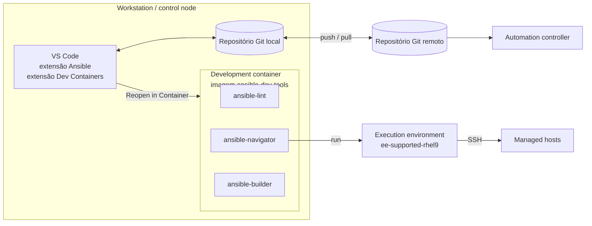
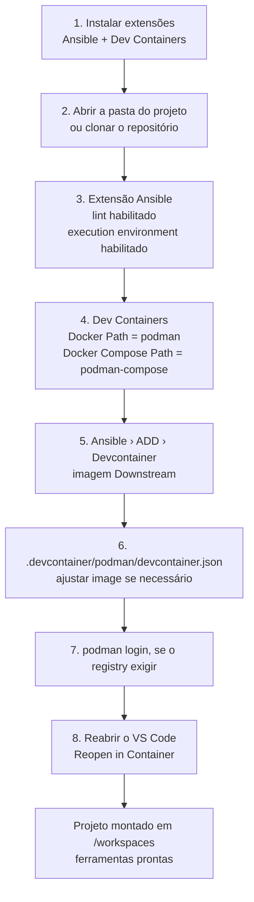
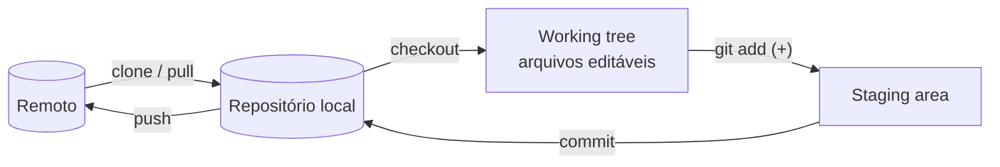

# 1.3 — Configurando seu ambiente de desenvolvimento Ansible

| Campo | Valor |
|-------|-------|
| Curso | AU294 — Ansible Automation Platform 2.6 (edição 2) |
| Capítulo / seção | Capítulo 1 · Seção 1.3 |
| Título original | Configuring Your Ansible Development Environment |
| Título em português | Configurando seu ambiente de desenvolvimento Ansible |
| Objetivo | Instalar e configurar um ambiente de desenvolvimento com as Ansible development tools, VS Code, development container e Git |
| Pré-requisitos | [1.1](1.1-automatizando-tarefas-com-ansible.md), [F2 — YAML para Ansible](../../01-fundamentos-essenciais/yaml-para-ansible.md) |
| Referência | PDF p. 22–34 · Guided Exercise 1.4 p. 35–43 |

## Parte A — O problema que a tecnologia resolve

"Na minha máquina funciona" também acontece com Ansible. Cada desenvolvedor tem
uma versão diferente de `ansible-core`, de Python, de collections e de bibliotecas.
O playbook passa no notebook de um e falha no servidor de produção de outro.

O curso resolve isso com três ideias combinadas:

1. **Ferramentas padronizadas** (Ansible development tools) para escrever, verificar e executar conteúdo.
2. **Ambiente em container**: o editor trabalha dentro de um *development container*, e os playbooks rodam dentro de um *execution environment*. Todos usam as mesmas versões.
3. **Git** para versionar, revisar e compartilhar o código, inclusive com o automation controller.

O resultado é que você passa mais tempo escrevendo automação e menos tempo
consertando o próprio ambiente.

## Parte B — Modelo mental e arquitetura



Dois containers diferentes aparecem neste capítulo. Não os confunda:

| Container | Para que serve | Imagem citada no curso |
|-----------|----------------|------------------------|
| **Development container** | Ambiente onde o VS Code e as ferramentas de desenvolvimento rodam | `ansible-automation-platform-26/ansible-dev-tools-rhel9` |
| **Automation execution environment** | Ambiente onde o **playbook** roda (ansible-core + collections) | `ansible-automation-platform-26/ee-supported-rhel9` |

## Parte C — Entendimento progressivo

### 1. As Ansible development tools

Conjunto de ferramentas com suporte oficial, incluído em toda assinatura do AAP,
que padroniza o ciclo de criar, testar e gerenciar conteúdo. O curso usa um
subconjunto, focado no desenvolvimento de playbooks:

| Ferramenta | Comando | Papel |
|------------|---------|-------|
| **Ansible lint** | `ansible-lint` | Analisa o conteúdo em busca de erros comuns e padrões obsoletos **antes do commit** |
| **Automation content navigator** | `ansible-navigator` | Executa e testa conteúdo **dentro de execution environments**; facilita o diagnóstico |
| **Execution environment builder** | `ansible-builder` | Cria execution environments **personalizados e portáteis** para usar do notebook ao automation controller |

**Instalação no RHEL 10.** No início, o AAP não entregava RPMs dessas ferramentas
para o RHEL 10; o caminho suportado era a **imagem de container** das development
tools. Hoje há também o RPM **`ansible-dev-tools`**, que agrupa `ansible-lint`,
`ansible-navigator`, `ansible-builder` e outros. Para instalá-lo, habilite antes o
repositório do AAP correspondente à sua versão, por exemplo
`ansible-automation-platform-2.6-for-rhel-10-x86_64-rpms`.

```bash
# Em um RHEL 10 registrado com assinatura do AAP (não é necessário no curso)
sudo subscription-manager repos \
  --enable ansible-automation-platform-2.6-for-rhel-10-x86_64-rpms
sudo dnf install ansible-dev-tools
ansible-navigator --version          # confirma a instalação
```

### 2. Por que VS Code

O VS Code é extensível. Para Ansible, o curso destaca:

| Recurso | Benefício |
|---------|-----------|
| **Extensão Ansible** | Integra o `ansible-lint` para apontar erros e boas práticas **em tempo real**; pode usar um execution environment para dar feedback mais preciso |
| **Extensão Dev Containers** | Roda o ambiente de desenvolvimento inteiro dentro de um container (a imagem das development tools) |
| **Controle de versão nativo** | Git integrado: acompanhar mudanças, branches, commits e conflitos pela interface |
| **Syntax highlighting** | Cores diferentes para chaves, valores, strings e comentários: estrutura YAML mais legível |
| **IntelliSense** | Sugestões de módulos, parâmetros e variáveis conforme você digita |

### 3. O fluxo de configuração no VS Code



Pontos que exigem atenção:

- **Por que trocar Docker por Podman?** A extensão Dev Containers espera Docker por
  padrão. No RHEL o engine é o **Podman**, então os caminhos do executável
  (`podman`) e do compose (`podman-compose`) precisam ser informados.
- **Imagem "Downstream"** = imagem suportada pela Red Hat
  (`registry.redhat.io/ansible-automation-platform-26/ansible-dev-tools-rhel9`),
  incluída na assinatura do AAP. É comum espelhá-la em um registry da rede local;
  o ambiente do curso faz isso.
- O assistente cria o diretório **`.devcontainer/`** na raiz do projeto. O arquivo
  `podman/devcontainer.json` define, entre outras coisas, a chave **`image`**.
- Se o registry exige autenticação, faça `podman login <registry>` em um terminal
  **antes** de reabrir o VS Code.
- Depois de conectado, o canto inferior esquerdo do VS Code mostra o status da
  conexão remota, e o projeto aparece dentro do container em **`/workspaces`**.

### 4. Executar um playbook pelo VS Code

Clique com o botão direito no playbook › **Run Ansible Playbook via…** ›
**Run playbook via 'ansible-navigator run'**. Um painel de terminal mostra a saída.
Você também pode digitar o comando no terminal integrado (seção 1.5 explica qual
configuração vale em cada caso).

### 5. Git: o mínimo necessário para um projeto Ansible

Git é um **sistema de controle de versão distribuído (DVCS)**. Benefícios citados
no curso: revisar e restaurar versões antigas, comparar versões, registrar quem
mudou o quê e quando, colaborar e resolver conflitos.



| Estado do arquivo | Significado |
|-------------------|-------------|
| **Modified** | Diferente da última versão do repositório |
| **Staged** | Marcado para entrar no próximo commit, ainda não gravado |
| **Committed** | Gravado no repositório **local** |

Conceitos que confundem quem vem de outras ferramentas:

| A | B | Diferença essencial |
|---|---|--------------------|
| `clone` | `pull` | `clone` copia o repositório inteiro, com todo o histórico, uma vez; `pull` traz as novidades depois |
| `commit` | `push` | `commit` grava **localmente**; só o `push` envia ao remoto |
| `fetch` | `pull` | `fetch` só baixa; `pull` = fetch + integrar ao branch + atualizar a working tree |
| Working tree "suja" (*dirty*) | Working tree limpa | Há alterações ainda não commitadas × tudo commitado |
| Configuração `--global` | Configuração do projeto | `~/.gitconfig` vale para todos os repositórios; sem `--global`, só para o atual |

Equivalência entre a interface do VS Code e a CLI:

| Ação | VS Code | CLI |
|------|---------|-----|
| Identificar-se | — | `git config --global user.name 'Nome'` · `git config --global user.email nome@example.net` |
| Clonar | *Source Control* › **Clone Repository**, ou *Command Palette* (`Ctrl+Shift+P`/`F1`) › `Git: Clone` | `git clone <url>` |
| Ver alterações | Ícone *Source Control* (`Ctrl+Shift+G`); `A` = adicionado, `M` = modificado | `git status` · `git diff` |
| Preparar | Sinal **+** ao lado do arquivo (o **−** remove da área de staging) | `git add <arquivo>` · `git restore --staged <arquivo>` |
| Gravar | Mensagem + **Commit** | `git commit -m "mensagem"` |
| Enviar | *More Actions (…)* › **Push** | `git push` |
| Receber | *More Actions (…)* › **Pull** | `git pull` |
| Sincronizar | Ação de sincronizar na barra de status (pull e depois push) | `git pull && git push` |

Boas práticas do curso: **mensagens de commit curtas e significativas**, com
referência a issues, tickets ou pessoas quando aplicável, e **pull frequente** para
acompanhar o trabalho dos colegas. O repositório remoto também é a forma de
entregar o código ao **automation controller**.

## Parte D — Exemplo autoral incremental

### Passo 1 — Preparar a identidade Git (uma vez por usuário)

```bash
git config --global user.name 'Ana Exemplo'
git config --global user.email ana@example.net
git config --global --list            # confere o que ficou em ~/.gitconfig
```

### Passo 2 — `devcontainer.json` comentado (ilustrativo)

O assistente da extensão gera o arquivo completo; normalmente você só altera
`image`. O exemplo abaixo usa um registry fictício e mostra a estrutura
(o arquivo real é JSON com comentários, aceito pelo VS Code):

```jsonc
// .devcontainer/podman/devcontainer.json  (trecho ilustrativo, não copiado do curso)
{
  "name": "ansible-dev-container-podman",                     // nome exibido no "Reopen in Container"
  "image": "registry.example.net/aap26/ansible-dev-tools-rhel9:latest", // imagem do development container
  "containerUser": "root",
  "runArgs": [
    "--rm"                                                    // remove o container ao sair
    // ...demais argumentos gerados pelo assistente...
  ]
}
```

> ⚠️ Argumentos como `--tls-verify=false` desligam a verificação TLS do registry.
> Aceitável em laboratório com certificado autoassinado; **não** em produção.

### Passo 3 — Configurações equivalentes em `settings.json`

📘 *Fonte externa (documentação das extensões; confira os nomes na sua versão):*
as caixas marcadas na interface viram chaves em `settings.json`. Configurações de
**Workspace** ficam em `.vscode/settings.json` no projeto; as de **User**, em
`~/.config/Code/User/settings.json`.

```jsonc
{
  // Extensão Ansible (Workspace)
  "ansible.validation.lint.enabled": true,
  "ansible.executionEnvironment.enabled": true,

  // Extensão Dev Containers (User): usar Podman em vez de Docker
  "dev.containers.dockerPath": "podman",
  "dev.containers.dockerComposePath": "podman-compose"
}
```

### Passo 4 — Ciclo de trabalho de uma alteração

```bash
git pull                                   # começa atualizado
# ... edita site.yml no VS Code; o ansible-lint marca problemas em tempo real ...
ansible-lint site.yml                      # confirma antes do commit
git add site.yml
git commit -m "Corrige nome da task de NTP (TICKET-123)"
git push
```

## Parte E — Execução e verificação

| Verificação | Como | Resultado esperado |
|-------------|------|--------------------|
| Extensões instaladas | *Extensions* › INSTALLED | Ansible e Dev Containers presentes |
| Lint ativo | Abrir um playbook com um erro proposital (ex.: módulo sem FQCN) | Sublinhado e item no painel *Problems* |
| Conectado ao development container | Canto inferior esquerdo do VS Code | Indicação da conexão com o container |
| Projeto no container | Terminal integrado: `pwd` | Caminho sob `/workspaces/` |
| Ferramentas disponíveis | `ansible-navigator --version` · `ansible-lint --version` | Versões exibidas |
| Execução | *Run playbook via 'ansible-navigator run'* | `PLAY RECAP` com `failed=0` e `unreachable=0` |
| Git | `git status` / ícone *Source Control* | Contador de alterações; após o push, working tree limpa |

## Parte F — Troubleshooting

| Sintoma | Causa provável | Como verificar / corrigir |
|---------|----------------|---------------------------|
| Notificação **Reopen in Container** não aparece | Notificação expirou, ou o VS Code não detectou `.devcontainer/` | Clique no ícone de janela remota (canto inferior esquerdo) › *Reopen in Container*; confirme que `.devcontainer/` está na raiz da pasta aberta |
| Erro ao criar o container citando Docker | Dev Containers ainda configurada para Docker | Ajuste *Docker Path* = `podman` e *Docker Compose Path* = `podman-compose` |
| `unauthorized` / `authentication required` ao baixar a imagem | Registry exige login | `podman login <registry>` no terminal e reabra o VS Code |
| `x509: certificate signed by unknown authority` | Registry com certificado autoassinado | Em laboratório, argumento `--tls-verify=false`; em produção, confie na CA do registry |
| Primeira abertura muito lenta | Download da imagem de vários GB | Normal na primeira vez; acompanhe o log do container |
| Lint não marca nada | Lint desabilitado ou `ansible-lint` ausente no ambiente | Confira *Ansible › Validation › Lint: Enabled* e `ansible-lint --version` no terminal |
| Clicar em **Create** parece não fazer nada | O assistente só registra um log | Procure a mensagem de criação do devcontainer e o diretório `.devcontainer/` |
| `git push` rejeitado (*non-fast-forward*) | O remoto tem commits que você não tem | `git pull`, resolva conflitos, depois `git push`. Não use `--force` em repositório compartilhado |
| Commit com autor errado | `user.name`/`user.email` não configurados | `git config --global ...` e confira com `git log -1` |

## Parte G — Preparação para o laboratório

Atividade associada: **1.4 Guided Exercise — Configuring Your Ansible Development
Environment** (`intro-devenv`, PDF p. 35–43). Ver
[PRATICA-OFICIAL.md](PRATICA-OFICIAL.md#14-guided-exercise-configuring-your-ansible-development-environment).

Você deve conseguir, sem olhar o roteiro:

- clonar um repositório pelo VS Code e abrir a pasta;
- localizar as configurações da extensão Ansible (lint e execution environment) e da Dev Containers;
- explicar a diferença entre configurações de **User** e de **Workspace**;
- criar o devcontainer e reabrir o projeto dentro dele;
- executar um playbook pelo menu de contexto e ler o `PLAY RECAP`;
- fazer stage, commit e push pela interface.

## Parte H — Fixação

1. Qual a diferença entre o development container e o automation execution environment?
2. Você clonou um projeto que já tem `.devcontainer/`, mas a imagem está em um registry privado. O que fazer antes de *Reopen in Container*?
3. Um colega fez `git commit` e diz que "já está no servidor". Está certo?
4. Você editou `site.yml` e `inventory`, mas só quer enviar `site.yml` agora. Como fazer na CLI e no VS Code?
5. Para que serve cada ferramenta: `ansible-lint`, `ansible-navigator`, `ansible-builder`?

<details>
<summary>Respostas comentadas</summary>

1. O **development container** hospeda o ambiente de edição e as ferramentas (imagem `ansible-dev-tools`). O **execution environment** é onde o playbook efetivamente roda, com `ansible-core` e collections (imagem `ee-supported`). O primeiro serve para *desenvolver*; o segundo, para *executar*, igual em desenvolvimento e produção.
2. Rodar `podman login <registry>` em um terminal e, se necessário, ajustar a chave `image` do `devcontainer.json`. Depois fechar e reabrir o VS Code.
3. Não. `commit` grava no repositório **local**. Falta o `push`.
4. CLI: `git add site.yml` e `git commit`, deixando `inventory` apenas modificado. VS Code: clicar **+** só em `site.yml` (ele vai para *Staged Changes*) e fazer o commit.
5. `ansible-lint`: análise estática de erros e boas práticas. `ansible-navigator`: executar e inspecionar conteúdo dentro de execution environments. `ansible-builder`: construir execution environments personalizados.

</details>

## Parte I — Essencial para memorizar

- Development tools: **lint** (verificar), **navigator** (executar em EE), **builder** (criar EE).
- RHEL 10: RPM `ansible-dev-tools` (repositório do AAP 2.6) ou imagem de container.
- VS Code: extensões **Ansible** + **Dev Containers**; com Podman, ajuste `podman`/`podman-compose`.
- `.devcontainer/podman/devcontainer.json` → chave `image`; projeto montado em `/workspaces`.
- Git: modified → staged → committed (local) → push (remoto). `pull` = fetch + merge.
- Workspace settings: `.vscode/settings.json`; User settings: `~/.config/Code/User/settings.json`.
- `--tls-verify=false` só em laboratório.

---
[← 1.1 Automatizando tarefas](1.1-automatizando-tarefas-com-ansible.md) | [Índice do capítulo](README.md) | [Próximo: 1.5 Configurando o Ansible →](1.5-configurando-ajustes-do-ansible.md)
