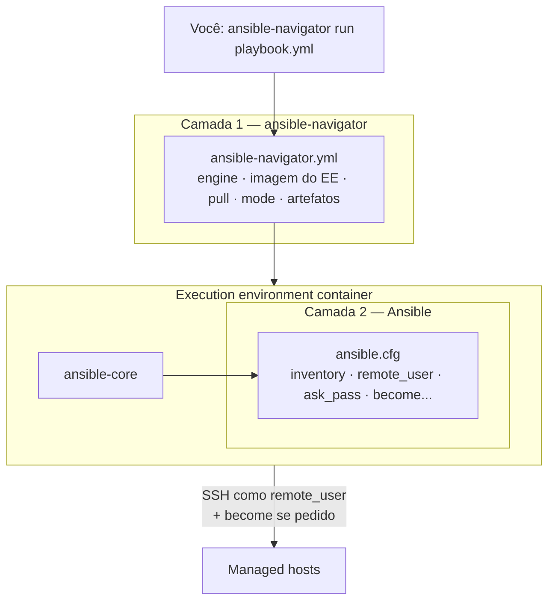

# 1.5 — Configurando os ajustes do Ansible

| Campo | Valor |
|-------|-------|
| Curso | AU294 — Ansible Automation Platform 2.6 (edição 2) |
| Capítulo / seção | Capítulo 1 · Seção 1.5 |
| Título original | Configuring Ansible Settings |
| Título em português | Configurando os ajustes do Ansible |
| Objetivo | Configurar o comportamento do Ansible e do `ansible-navigator` com os arquivos `ansible.cfg` e `ansible-navigator.yml` |
| Pré-requisitos | [1.1](1.1-automatizando-tarefas-com-ansible.md), [1.3](1.3-configurando-o-ambiente-de-desenvolvimento.md), [F2 — YAML](../../01-fundamentos-essenciais/yaml-para-ansible.md), [F4 — Primeiros comandos](../../01-fundamentos-essenciais/primeiros-comandos.md) |
| Referência | PDF p. 44–54 · Guided Exercise 1.6 p. 55–60 |

## Parte A — O problema que a tecnologia resolve

Antes de rodar o primeiro playbook, o Ansible precisa de respostas:

- Onde está o inventário?
- Com qual usuário conectar nos managed hosts? Com chave ou senha?
- Precisa virar `root`? Com `sudo` ou `su`? Pede senha?
- Qual execution environment usar? Baixar a imagem sempre ou só se faltar?
- A saída é interativa ou texto puro?

Tudo isso pode ir em variáveis de ambiente ou em opções na linha de comando, mas
digitar `--eei ... --pp ... --mode ...` toda vez é lento e propenso a erro. A
solução recomendada pelo curso é **arquivos de configuração versionados na raiz do
projeto**, que todos os colaboradores compartilham:

```text
projeto/
├── ansible-navigator.yml   # como o ansible-navigator executa (EE, modo, artefatos)
├── ansible.cfg             # como o Ansible se comporta (inventário, conexão, become)
├── inventory
└── playbook.yml
```

## Parte B — Modelo mental e arquitetura

Pense em **duas camadas**, cada uma com seu arquivo:



- O **`ansible-navigator.yml`** decide *em que ambiente* o Ansible roda.
- O **`ansible.cfg`** decide *como* o Ansible se comporta dentro desse ambiente.
- O projeto é montado dentro do container, então o `ansible.cfg` da raiz do projeto
  é encontrado também lá dentro.

### Precedência: o primeiro arquivo encontrado vence

Ambos os arquivos seguem um modelo em camadas. O Ansible procura nesta ordem e
**usa o primeiro arquivo que encontrar** (um arquivo inteiro, não uma mistura de
chaves de vários arquivos):

| Prioridade | Nível | `ansible-playbook` / Ansible | `ansible-navigator` |
|:---:|-------|------------------------------|---------------------|
| 1 (maior) | Variável de ambiente | `$ANSIBLE_CONFIG` | `$ANSIBLE_NAVIGATOR_CONFIG` |
| 2 | Diretório do projeto (diretório atual) | `./ansible.cfg` | `./ansible-navigator.yml` |
| 3 | Home do usuário | `~/.ansible.cfg` | `~/.ansible-navigator.yml` |
| 4 (menor) | Sistema | `/etc/ansible/ansible.cfg` | *(não há padrão de sistema)* |

Repare no **ponto** inicial dos arquivos na home (`~/.ansible.cfg`,
`~/.ansible-navigator.yml`) e na ausência dele no projeto.

Benefícios do modelo: padrões para todo o sistema, ajustes do usuário, ajustes por
projeto que vencem os anteriores e uma "chave mestra" temporária pela variável de
ambiente.

## Parte C — Entendimento progressivo

### 1. Estrutura do `ansible.cfg`

Formato INI: **seções** entre colchetes e pares `chave = valor`. Para o básico,
duas seções bastam:

| Seção | Função |
|-------|--------|
| `[defaults]` | Valores padrão de operação: inventário, usuário remoto, autenticação, conexão |
| `[privilege_escalation]` | Como virar outro usuário (normalmente `root`) no managed host |

### 2. Parâmetros essenciais

| Seção | Parâmetro | Padrão | O que controla |
|-------|-----------|--------|----------------|
| `[defaults]` | `inventory` | — | Caminho de um arquivo de inventário **ou de um diretório** com várias fontes |
| `[defaults]` | `remote_user` | ver nota | Usuário da conexão SSH nos managed hosts |
| `[defaults]` | `ask_pass` | `false` | Pedir senha SSH (`true` = senha; `false` = chave pública) |
| `[privilege_escalation]` | `become` | `false` | Trocar de usuário automaticamente após conectar |
| `[privilege_escalation]` | `become_method` | `sudo` | Como trocar (`sudo` = `ansible.builtin.sudo`; alternativa: `su` = `ansible.builtin.su`) |
| `[privilege_escalation]` | `become_user` | `root` | Usuário de destino da escalada |
| `[privilege_escalation]` | `become_ask_pass` | `false` | Pedir a senha do `become_method` |

**Nota sobre `remote_user`:** segundo o curso, quando o playbook roda em um
execution environment pelo `ansible-navigator` e `remote_user` não está definido,
o Ansible tenta conectar como **`root`**. 📘 *Fonte externa:* a descrição oficial
do parâmetro diz que, em branco, vale o padrão do plug-in de conexão, normalmente
o usuário que executa o Ansible. Dentro do container, esse usuário é o do processo
do EE. **Conclusão prática: sempre defina `remote_user` no projeto.**

**`become` global ou pontual?** Dá para ligar `become = true` para tudo, mas a
prática recomendada é deixar `false` e habilitar escalada apenas nos plays, roles,
blocks ou tasks que precisam (Capítulo 2 em diante). Se todos os valores de
`[privilege_escalation]` forem os padrões, omitir a seção dá o mesmo resultado.

### 3. Gerar um `ansible.cfg` de referência

Em vez de escrever do zero, gere um arquivo com **todas** as opções comentadas:

```bash
# Com ansible-core instalado localmente (comando citado em /etc/ansible/ansible.cfg)
ansible-config init --disabled > ansible.cfg

# Ou pelo ansible-navigator, dentro do execution environment
ansible-navigator config init --disabled \
  --eei ee-supported-rhel9 --pp never --mode stdout > ansible.cfg
```

| Opção | Significado |
|-------|-------------|
| `--disabled` | Gera tudo **comentado**: valem os padrões até você descomentar o que quer mudar |
| `--eei` | *Execution environment image* a usar |
| `--pp never` | *Pull policy*: nunca baixar (usa a imagem local) |
| `--mode stdout` | Saída em texto, redirecionável para arquivo |

Diferença entre os dois: o `ansible-config` escreve caminhos com a home de quem
executou (ex.: `/home/ana`); o `ansible-navigator`, com `/home/runner`, a home
usada dentro do container. Sem `--disabled`, todas as opções saem
**descomentadas com o valor padrão**, o que esconde quais você realmente mudou.
Por isso não é recomendado.

### 4. Escalada de privilégio e `sudoers`

Instalar pacotes ou criar usuários exige privilégio. Se você conecta como usuário
comum, precisa de `become`. No RHEL 8, 9 e 10, o `/etc/sudoers` padrão permite que
membros do grupo **`wheel`** usem `sudo` **com senha**.

Para conceder `sudo` a outro usuário ou grupo, crie um arquivo em
**`/etc/sudoers.d/`**, de propriedade do `root`. Exemplo autoral para um usuário de
automação:

```text
# /etc/sudoers.d/automacao  (dono root; modo 0440 é o usual)
# Com senha:
#   automacao  ALL=(ALL)  ALL
# Sem senha (comum para contas de automação com chave SSH):
automacao  ALL=(ALL)  NOPASSWD: ALL
```

📘 *Fonte externa (sudo(8)/visudo(8)):* valide antes de confiar no arquivo:
`sudo visudo -cf /etc/sudoers.d/automacao`. Um erro de sintaxe em `sudoers` pode
bloquear todo uso de `sudo` no host.

| Situação no managed host | Configuração no `ansible.cfg` |
|--------------------------|-------------------------------|
| `NOPASSWD` para o usuário remoto | `become_ask_pass = false` |
| `sudo` pede senha | `become_ask_pass = true` (ou `-K`/`--ask-become-pass` na execução) |

Pense nas implicações de segurança: `NOPASSWD: ALL` facilita a automação, mas quem
obtiver a chave SSH dessa conta vira `root`. Cada organização equilibra isso de um
jeito (escopo de comandos, chaves protegidas, contas dedicadas).

### 5. Conexão e autenticação SSH

Por padrão o Ansible conecta por **SSH**. Para autenticação por chave (recomendada):

```bash
ssh-keygen                                   # gera o par de chaves, se ainda não existir
ssh-copy-id automacao@web01.example.net      # instala a chave pública no usuário remoto
ssh automacao@web01.example.net true         # teste: deve entrar sem pedir senha
```

O usuário do `ssh-copy-id` deve ser o mesmo de `remote_user`. Com uma chave privada
que autentica nesse usuário, o Ansible entra automaticamente. Para autenticação por
senha, use `ask_pass = true`, o que exige o modo `stdout` no navigator (veja adiante).

### 6. Outros parâmetros comuns de `[defaults]`

| Parâmetro | Padrão | Uso | Cuidado |
|-----------|--------|-----|---------|
| `host_key_checking` | `True` | `False` desliga a verificação da chave de host SSH (sem prompt para hosts novos) | Útil em laboratório e ambientes temporários; **não** em produção (risco de *man-in-the-middle*) |
| `timeout` | `10` | Timeout da conexão SSH, em segundos | Aumente em redes lentas ou instáveis |
| `log_path` | (desligado) | Arquivo onde o **`ansible-playbook`** registra a saída | O arquivo pode conter dados sensíveis; não versione |
| `private_key_file` | — | Chave privada SSH específica | Alternativa a `~/.ssh/config` ou agente SSH |
| `transport` | `ssh` | Plug-in de conexão: `ssh` (`ansible.builtin.ssh`), `local` (`ansible.builtin.local`), `paramiko_ssh` (`ansible.builtin.paramiko_ssh`) | Veja a correção abaixo |

> ⚠️ **Correção verificada localmente:** o PDF apresenta essa configuração com o nome
> `connection`. No `ansible-core` 2.16, a chave do `ansible.cfg` para o plug-in de
> conexão chama-se **`transport`** (opção `DEFAULT_TRANSPORT`, variável
> `ANSIBLE_TRANSPORT`). Um `connection = local` em `[defaults]` foi **ignorado**
> sem aviso no teste com `ansible-config dump --only-changed` (ansible-core 2.16.19).
> Em playbooks e inventários, a palavra-chave/variável é `connection`/`ansible_connection`.

Mudanças em `host_key_checking`, conexão ou `private_key_file` alteram como o
Ansible entra nos hosts: teste com cuidado antes de usar em fluxos reais.

### 7. Ver a configuração efetiva

```bash
ansible-navigator config                  # TUI interativa
ansible-navigator config -m interactive   # força o modo interativo se o projeto usa stdout
```

A tabela mostra, para cada parâmetro: **Name**, **Default**, **Source** e **Current**.
A coluna que mais confunde é **Default**:

| Coluna `Default` | Significa |
|------------------|-----------|
| `True` | O parâmetro **está usando o valor padrão** (ninguém o definiu) |
| `False` | O valor **foi definido** em algum lugar; a coluna `Source` diz onde (arquivo ou variável de ambiente) |

Assim, uma linha com `Default = False` e `Current = False` significa "alguém
escreveu explicitamente `false`", e não "está no padrão".

Navegação na TUI: digite o número da linha para ver detalhes (descrição, variável
de ambiente equivalente, chave INI, origem); `:f texto` filtra; **Esc** volta;
`:q` + Enter sai.

📘 *Fonte externa (ansible-core):* com o `ansible-core` instalado localmente,
`ansible --version` mostra a linha `config file = ...` e
`ansible-config dump --only-changed` lista só o que foi alterado, com a origem.

### 8. `ansible-navigator`: da linha de comando ao arquivo

Tudo pode ser passado como opção:

```bash
ansible-navigator images \
  --eei registry.example.net/aap26/ee-supported-rhel9 \
  --pp missing --tls-verify=false --pae false --mode stdout
```

| Opção curta | Opção longa / chave no arquivo | Significado |
|-------------|--------------------------------|-------------|
| `--eei` | `--execution-environment-image` · `execution-environment.image` | Imagem do EE |
| `--pp` | `--pull-policy` · `execution-environment.pull.policy` | `always`, `missing`, `never` (📘 também existe `tag`) |
| — | `execution-environment.pull.arguments` | Argumentos extras para o `podman pull` (ex.: `--tls-verify=false`) |
| `--pae` | `--playbook-artifact-enable` · `playbook-artifact.enable` | Gerar ou não o JSON de artefato |
| `-m` | `--mode` · `mode` | `interactive` (padrão, TUI) ou `stdout` |
| `--ce` | `--container-engine` · `execution-environment.container-engine` | `podman`, `docker` ou `auto` |

Isso serve para testes rápidos. Para uso real, a recomendação é um **arquivo de
configuração** (JSON ou YAML; o curso usa YAML). Ordem de busca (primeiro
encontrado vence):

1. arquivo apontado por `ANSIBLE_NAVIGATOR_CONFIG`;
2. `ansible-navigator.yml` no diretório do projeto;
3. `~/.ansible-navigator.yml` na home.

### 9. As chaves do `ansible-navigator.yml`

| Chave | Função | Observação |
|-------|--------|------------|
| `execution-environment.container-engine` | Engine de containers | Deve corresponder ao que está instalado (`podman` no RHEL) |
| `execution-environment.enabled` | Rodar dentro de um EE? | `false` = usa o Python e o Ansible locais do control node |
| `execution-environment.image` | Imagem do EE | Use nome completo com registry e tag |
| `execution-environment.pull.policy` | Quando baixar | `missing` evita downloads repetidos |
| `execution-environment.pull.arguments` | Argumentos extras do pull | `--tls-verify=false` só em desenvolvimento/registry autoassinado |
| `mode` | `interactive` ou `stdout` | **`stdout` é obrigatório** para prompts de senha, scripts e pipelines CI; `-m` sobrepõe na hora |
| `playbook-artifact.enable` | Gerar JSON de cada execução | Útil para revisar e diagnosticar; **precisa estar desligado** quando o playbook pede senha; `--pae false` sobrepõe na hora |

📘 *Fonte externa (verificado com `ansible-navigator settings --effective`,
versão 26.10.0):* o artefato é salvo por padrão como
`{playbook_dir}/{playbook_name}-artifact-{time_stamp}.json`, e o log do navigator
vai para `ansible-navigator.log` no diretório atual. Ambos estão no
[`.gitignore`](../../.gitignore) deste repositório.

### 10. Comentários nos arquivos

| Arquivo | `#` no início da linha | `;` |
|---------|------------------------|-----|
| `ansible.cfg` | Comenta a linha inteira | Comenta **tudo à direita**, inclusive no meio da linha |
| `ansible-navigator.yml` | Comentário YAML | Não é comentário |

> ⚠️ **Verificado localmente (ansible-core 2.16.19):** em `ansible.cfg`, `#` **no meio
> da linha não é comentário**. `timeout = 30 # teste` gera erro de tipo, porque o
> valor lido é `30 # teste`. Use `;` para comentário na mesma linha.

### 11. Extensão Ansible do VS Code e execution environments

A extensão oferece destaque de sintaxe, autocompletar, lint e execução integrada,
**localmente ou em um EE**. Configurações salvas em `settings.json` (User ou
Workspace). Para usar um EE com Podman, ajuste em *Settings* › filtro `ansible`:

| Configuração da extensão | Valor típico |
|--------------------------|--------------|
| *Ansible › Execution Environment: Enabled* | marcado |
| *Container Engine* | `podman` |
| *Image* | a mesma imagem do `ansible-navigator.yml` |
| *Pull Arguments* | `--tls-verify=false` (só laboratório) |
| *Pull Policy* | `missing` |

> **Atenção (destaque do curso):** essas configurações do VS Code valem **apenas**
> quando você executa pelo menu *Run playbook via 'ansible-navigator run'*. Se você
> digita `ansible-navigator run` no terminal integrado, vale o
> `ansible-navigator.yml` do projeto. **Mantenha os dois iguais.**

## Parte D — Exemplo autoral incremental

Projeto completo em [exemplos-originais/cap01-projeto-base](../../exemplos-originais/cap01-projeto-base/).

**Passo 1 — `ansible.cfg` mínimo:**

```ini
[defaults]
inventory = ./inventory
remote_user = automacao
ask_pass = false
```

**Passo 2 — explicitar a escalada (opcional, são os padrões):**

```ini
[privilege_escalation]
become = false            ; ligue become só onde precisar
become_method = sudo
become_user = root
become_ask_pass = false   ; o managed host usa NOPASSWD para "automacao"
```

**Passo 3 — `ansible-navigator.yml`:**

```yaml
---
ansible-navigator:
  execution-environment:
    container-engine: podman
    enabled: true
    image: registry.redhat.io/ansible-automation-platform-26/ee-supported-rhel9:latest
    pull:
      policy: missing
  mode: stdout
  playbook-artifact:
    enable: false
```

**Passo 4 — sobrepor temporariamente sem editar arquivos:**

```bash
ansible-navigator config -m interactive        # só desta vez, TUI
ANSIBLE_CONFIG=/tmp/teste.cfg ansible-navigator run verificar-conectividade.yml
```

⚠️ No segundo comando, a variável precisa ser visível **dentro do container** e o
caminho precisa existir lá. 📘 *Fonte externa:* o `ansible-navigator` repassa ao EE
variáveis `ANSIBLE_*`, mas um arquivo fora do diretório do projeto não está montado
no container. Prefira arquivos dentro do projeto.

## Parte E — Execução e verificação

| Verificação | Comando | Esperado |
|-------------|---------|----------|
| Qual `ansible.cfg` está em uso | `ansible-navigator config -m interactive` → `:f ansible.cfg` | Linha *Config file* apontando para o projeto (no container: `/workspaces/<projeto>/ansible.cfg`) |
| Origem de um valor | Número da linha de *Default remote user* | `source` = caminho do `ansible.cfg`; `env` = `ANSIBLE_REMOTE_USER`; `ini` = `remote_user` em `defaults` |
| Imagem do EE presente | `ansible-navigator images` | Imagem listada; com `missing`, baixada só na primeira vez |
| Conectividade | `ansible-navigator run verificar-conectividade.yml` | `ok` em todos os hosts; `unreachable=0` |
| Artefatos desligados | `ls *-artifact-*.json` após uma execução | Nenhum arquivo novo |

Status dos exemplos: ✅ `ansible.cfg` lido corretamente por `ansible-config dump
--only-changed` e inventário resolvido por `ansible-inventory --graph`;
`ansible-navigator.yml` aceito pelo `ansible-navigator settings --effective`
(26.10.0); playbook aprovado em `--syntax-check` e `ansible-lint`. ⚠️ Não executado
contra hosts reais.

## Parte F — Troubleshooting

| Sintoma | Causa provável | Como verificar / corrigir |
|---------|----------------|---------------------------|
| Alteração no `ansible.cfg` "não pega" | Outro arquivo com prioridade maior (`$ANSIBLE_CONFIG`) ou você está em outro diretório | Ordem: `$ANSIBLE_CONFIG` → `./ansible.cfg` → `~/.ansible.cfg` → `/etc/ansible/ansible.cfg`. Confira com `ansible-navigator config` |
| `ansible.cfg` do projeto ignorado, com aviso de *world writable directory* | 📘 Por segurança, o Ansible não carrega `ansible.cfg` de diretório gravável por todos (verificado: `config file = None`) | `chmod o-w <diretório>`, ou aponte com `ANSIBLE_CONFIG` |
| Tentou conectar como `root` | `remote_user` ausente (padrão no EE) | Defina `remote_user` no `ansible.cfg` |
| `Permission denied (publickey...)` → `unreachable` | Chave pública não instalada para o `remote_user` | `ssh-copy-id <remote_user>@<host>`; teste `ssh <remote_user>@<host>` |
| `Missing sudo password` | `sudo` exige senha e `become_ask_pass = false` | Configure `NOPASSWD` no host ou use `become_ask_pass = true` (com `mode: stdout` e artefatos desligados) |
| Prompt de senha trava ou não aparece | Modo `interactive` ou artefatos ligados | `mode: stdout` e `playbook-artifact.enable: false` (ou `-m stdout --pae false`) |
| Erro de tipo em valor numérico/booleano do `ansible.cfg` | `#` no meio da linha | Use `;` ou mova o comentário para a linha de cima |
| `connection = local` não muda nada | Chave errada para o `ansible.cfg` | Use `transport = local` |
| Falha ao baixar a imagem do EE | Registry com certificado autoassinado ou login ausente | `podman login`; em laboratório, `pull.arguments: ["--tls-verify=false"]` |
| Pelo menu do VS Code funciona, pelo terminal não (ou o contrário) | Configurações divergentes | Iguale as configurações da extensão e o `ansible-navigator.yml` |
| Erro de engine ao iniciar o navigator | `container-engine` não instalado | `podman --version`; ajuste a chave |

## Parte G — Preparação para o laboratório

Atividade associada: **1.6 Guided Exercise — Configuring Ansible Settings**
(`intro-configure`, PDF p. 55–60). Ver
[PRATICA-OFICIAL.md](PRATICA-OFICIAL.md#16-guided-exercise-configuring-ansible-settings).

Você deve conseguir, sem consulta:

- escrever do zero um `ansible-navigator.yml` com engine, imagem, política de pull, argumentos de pull, modo e artefatos;
- escrever um `ansible.cfg` com inventário, usuário remoto e `ask_pass`;
- listar e baixar imagens com `ansible-navigator images`;
- encontrar, na TUI do `ansible-navigator config`, a origem de um parâmetro;
- explicar por que os artefatos devem ser desligados quando há prompts de senha.

## Parte H — Fixação

1. Existem `~/.ansible.cfg` com `remote_user = ana` e `./ansible.cfg` com `remote_user = automacao`. Qual usuário será usado? E se `ANSIBLE_CONFIG=/etc/ansible/ansible.cfg` estiver exportada?
2. Na TUI do `ansible-navigator config`, *Default become* aparece com `Default = False` e `Current = False`. O que isso significa?
3. Um playbook precisa pedir a senha do `sudo` na execução. Quais duas configurações do `ansible-navigator` são obrigatórias?
4. Por que gerar o `ansible.cfg` com `--disabled`?
5. Diagnóstico: o colega adicionou `timeout = 60  # rede lenta` e agora toda execução falha com erro de tipo. Explique e corrija.
6. Qual é o risco de `host_key_checking = False` e quando ele é aceitável?

<details>
<summary>Respostas comentadas</summary>

1. `automacao`: o `./ansible.cfg` do projeto tem prioridade sobre o da home, e só **um** arquivo é usado. Com `ANSIBLE_CONFIG` exportada, vale o arquivo apontado por ela (maior prioridade), qualquer que seja o seu conteúdo.
2. O valor **foi definido explicitamente** (não está usando o padrão) e esse valor é `False`. A coluna `Source` mostra o arquivo.
3. `mode: stdout` (ou `-m stdout`) e `playbook-artifact.enable: false` (ou `--pae false`).
4. Todas as opções saem comentadas: o arquivo serve de referência, os padrões continuam valendo e fica claro o que você descomentou e mudou. Sem `--disabled`, tudo fica ativo com o valor padrão e você perde essa visibilidade.
5. No `ansible.cfg`, `#` só comenta no início da linha. O valor lido virou `60  # rede lenta`, que não é inteiro. Corrija para `timeout = 60 ; rede lenta` ou ponha o comentário na linha anterior.
6. Sem verificar a chave de host, o Ansible aceita qualquer servidor que responda pelo nome: abre espaço para *man-in-the-middle*. Aceitável em laboratório ou em ambientes efêmeros recriados a todo momento; não em produção.

</details>

## Parte I — Essencial para memorizar

- Dois arquivos na raiz do projeto: `ansible.cfg` (comportamento do Ansible) e `ansible-navigator.yml` (ambiente de execução).
- Precedência: variável de ambiente → projeto → home (com ponto) → `/etc/ansible/ansible.cfg` (navigator não tem nível de sistema). **Só o primeiro arquivo encontrado vale.**
- `[defaults]`: `inventory`, `remote_user`, `ask_pass`. `[privilege_escalation]`: `become` (false), `become_method` (sudo), `become_user` (root), `become_ask_pass` (false).
- Sem `remote_user`, no EE o Ansible tenta `root`.
- `ansible-config init --disabled > ansible.cfg` gera referência comentada.
- `ansible-navigator config`: coluna `Default = True` = valor padrão em uso.
- Navigator: `stdout` + artefatos desligados para prompts de senha. `-m` e `--pae` sobrepõem na hora.
- `--tls-verify=false` e `host_key_checking = False`: só laboratório.
- `ansible.cfg`: `;` comenta inline; `#` só no início da linha. Plug-in de conexão: chave `transport`.
- VS Code (menu) e terminal (`ansible-navigator.yml`) usam configurações diferentes: mantenha-as iguais.

---
[← 1.3 Ambiente de desenvolvimento](1.3-configurando-o-ambiente-de-desenvolvimento.md) | [Índice do capítulo](README.md) | [Próximo: Prática oficial →](PRATICA-OFICIAL.md)
