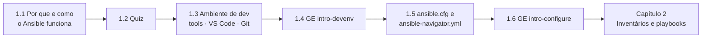

# Capítulo 1 — An Introduction to Ansible

**Título em português:** Uma introdução ao Ansible
**Status:** ✅ documentado e validado (documentação; o estudo é marcado por você no checklist)
**Referência:** PDF p. 12–61 · arquivo `AU294_AAP2.6_C01_Introducao_Ansible_p012-061.pdf` (não versionado)

## Objetivo do capítulo

Entender os conceitos fundamentais do Ansible e onde ele se aplica, montar o
ambiente de desenvolvimento com as Ansible development tools no VS Code e
configurar o comportamento do Ansible para um projeto.

## Por que este capítulo importa

Tudo o que vem depois (inventários, playbooks, variáveis, roles, administração de
RHEL) roda sobre o que este capítulo monta: um projeto versionado em Git, aberto em
um development container, com `ansible.cfg` e `ansible-navigator.yml` corretos e
execução dentro de um execution environment. Erros de configuração aqui viram
`unreachable` e "parâmetro ignorado" nos capítulos seguintes.

## Seções e atividades (ordem oficial)

| Seção | Tipo | Título original | Material | PDF |
|-------|------|-----------------|----------|-----|
| 1.1 | Conceito | Automating Tasks with Ansible | [lição](1.1-automatizando-tarefas-com-ansible.md) | p. 13–19 |
| 1.2 | Quiz | Automating Tasks with Ansible | [prática](PRATICA-OFICIAL.md#12-quiz-automating-tasks-with-ansible) | p. 20–21 |
| 1.3 | Conceito | Configuring Your Ansible Development Environment | [lição](1.3-configurando-o-ambiente-de-desenvolvimento.md) | p. 22–34 |
| 1.4 | Guided Exercise | Configuring Your Ansible Development Environment | [prática](PRATICA-OFICIAL.md#14-guided-exercise-configuring-your-ansible-development-environment) | p. 35–43 |
| 1.5 | Conceito | Configuring Ansible Settings | [lição](1.5-configurando-ajustes-do-ansible.md) | p. 44–54 |
| 1.6 | Guided Exercise | Configuring Ansible Settings | [prática](PRATICA-OFICIAL.md#16-guided-exercise-configuring-ansible-settings) | p. 55–60 |
| 1.7 | Summary | Summary | [RESUMO.md](RESUMO.md) | p. 61 |

Não há lab de fim de capítulo; portanto, nenhuma atividade usa `lab grade`.

## Arquivos do capítulo

- [PRATICA-OFICIAL.md](PRATICA-OFICIAL.md): ponte com o quiz e os guided exercises.
- [REVISAO.md](REVISAO.md): 21 questões autorais (conceito, configuração, diagnóstico).
- [RESUMO.md](RESUMO.md): síntese, comandos e arquivos de configuração em uma tela.
- Exemplo validado: [exemplos-originais/cap01-projeto-base](../../exemplos-originais/cap01-projeto-base/).

## Pré-requisitos recomendados

[00 — Comece aqui](../../00-comecar-aqui/README.md) ·
[01 — Fundamentos essenciais](../../01-fundamentos-essenciais/README.md)

## Checklist (marcado por você)

- [ ] 1.1 lida e Parte H respondida
- [ ] 1.2 Quiz respondido antes de ver a solução
- [ ] 1.3 lida e Parte H respondida
- [ ] 1.4 Guided Exercise `intro-devenv` concluído
- [ ] 1.5 lida e Parte H respondida
- [ ] 1.6 Guided Exercise `intro-configure` concluído
- [ ] [REVISAO.md](REVISAO.md) respondida
- [ ] Registro no [diário de laboratórios](../../progresso/diario-de-laboratorios.md)

---
[← Fundamentos essenciais](../../01-fundamentos-essenciais/README.md) | [Índice geral](../../README.md) | [Próximo: 1.1 Automatizando tarefas →](1.1-automatizando-tarefas-com-ansible.md)
