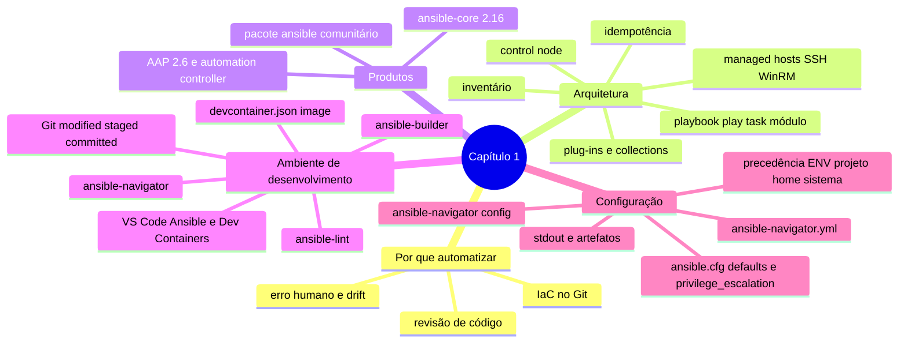

# Resumo — Capítulo 1

Síntese autoral para revisão rápida. Correspondência oficial: seção 1.7 Summary
(PDF p. 61).

## Em uma frase por seção

| Seção | Ideia central |
|-------|---------------|
| 1.1 | Ansible é uma plataforma **agentless** (SSH/WinRM) que aplica um **estado desejado** descrito em playbooks YAML, de forma **idempotente**; `ansible-core`, pacote `ansible` e AAP são coisas diferentes |
| 1.3 | Um ambiente de desenvolvimento padronizado = **development tools** (lint, navigator, builder) + **VS Code** (extensões Ansible e Dev Containers, com Podman) + **Git** |
| 1.5 | O projeto carrega sua configuração em **`ansible.cfg`** (comportamento do Ansible) e **`ansible-navigator.yml`** (execution environment e saída), respeitando uma ordem de precedência em que só o primeiro arquivo encontrado vale |

## Mapa do capítulo



## Tabela de comandos do capítulo

| Tarefa | Comando |
|--------|---------|
| Instalar as development tools (RHEL 10 + AAP 2.6) | `dnf install ansible-dev-tools` (após habilitar `ansible-automation-platform-2.6-for-rhel-10-x86_64-rpms`) |
| Identidade Git | `git config --global user.name '...'` · `git config --global user.email ...` |
| Ciclo Git | `git clone` · `git status` · `git add` · `git commit -m` · `git push` · `git pull` |
| Login em registry | `podman login <registry>` |
| Gerar `ansible.cfg` de referência | `ansible-config init --disabled > ansible.cfg` |
| Idem, pelo navigator | `ansible-navigator config init --disabled --eei  --pp never --mode stdout > ansible.cfg` |
| Configuração efetiva | `ansible-navigator config [-m interactive]` |
| Imagens de EE | `ansible-navigator images [--eei  --pp missing]` |
| Executar playbook | `ansible-navigator run <playbook>.yml [-m stdout] [--pae false]` |
| Chave SSH | `ssh-keygen` · `ssh-copy-id <remote_user>@<host>` |
| Validar sudoers (📘) | `visudo -cf /etc/sudoers.d/<arquivo>` |
| Lint | `ansible-lint <playbook>.yml` |

## Arquivos de configuração em uma tela

```ini
# ansible.cfg
[defaults]
inventory = ./inventory      ; arquivo ou diretório
remote_user = automacao      ; sem isso, no EE: root
ask_pass = false             ; chave SSH

[privilege_escalation]       ; todos abaixo são os padrões
become = false
become_method = sudo
become_user = root
become_ask_pass = false
```

```yaml
# ansible-navigator.yml
---
ansible-navigator:
  execution-environment:
    container-engine: podman
    enabled: true
    image: registry.redhat.io/ansible-automation-platform-26/ee-supported-rhel9:latest
    pull:
      policy: missing          # always | missing | never
  mode: stdout                 # interactive (padrão) | stdout
  playbook-artifact:
    enable: false
```

| Precedência | Ansible | Navigator |
|-------------|---------|-----------|
| 1 | `$ANSIBLE_CONFIG` | `$ANSIBLE_NAVIGATOR_CONFIG` |
| 2 | `./ansible.cfg` | `./ansible-navigator.yml` |
| 3 | `~/.ansible.cfg` | `~/.ansible-navigator.yml` |
| 4 | `/etc/ansible/ansible.cfg` | — |

## Alertas operacionais

- ⚠️ `--tls-verify=false` e `host_key_checking = False` são para laboratório, não produção.
- ⚠️ `NOPASSWD: ALL` torna a chave SSH da conta de automação equivalente a `root`.
- ⚠️ Prompt de senha exige `mode: stdout` e artefatos desligados.
- ⚠️ `ansible.cfg` em diretório gravável por todos é ignorado.
- ⚠️ No `ansible.cfg`, `#` no meio da linha não comenta; use `;`. A chave do plug-in de conexão é `transport`.
- ⚠️ `log_path` e artefatos podem guardar dados sensíveis: não versione.
- ⚠️ `commit` não publica nada: só o `push` envia ao remoto.

## Ligação com o próximo capítulo

O Capítulo 2 usa este projeto configurado para **construir inventários** e
**escrever playbooks** com um ou mais plays, além de diagnosticar playbooks e
managed hosts.

---
[← Revisão](REVISAO.md) | [Índice do capítulo](README.md) | [Próximo capítulo →](../02-desenvolvendo-automacao/README.md)
