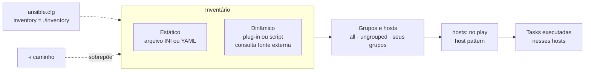

# 2.1 — Construindo um inventário Ansible

| Campo | Valor |
|-------|-------|
| Curso | AU294 — Ansible Automation Platform 2.6 (edição 2) |
| Capítulo / seção | Capítulo 2 · Seção 2.1 |
| Título original | Building an Ansible Inventory |
| Título em português | Construindo um inventário Ansible |
| Objetivo | Descrever os conceitos de inventário e criar, organizar e consultar um inventário estático |
| Pré-requisitos | [1.5 — ansible.cfg](../01-introducao-ansible/1.5-configurando-ajustes-do-ansible.md), [F1 — Arquitetura](../../01-fundamentos-essenciais/arquitetura-ansible.md) |
| Referência | PDF p. 63–69 · Guided Exercise 2.2 p. 70–75 |

## Parte A — O problema que a tecnologia resolve

Todo playbook começa com a pergunta "**em quais máquinas?**". Sem um inventário,
você teria de escrever nomes de servidores dentro de cada playbook, e cada mudança
na frota (um servidor novo, um desligado, um que mudou de datacenter) exigiria
editar todos eles.

O inventário separa **o que fazer** (playbooks) de **onde fazer** (lista de hosts e
grupos). Os playbooks apontam para **grupos** como `web` ou `producao`; quem decide
quais máquinas estão em cada grupo é o inventário.

> **Ponte com RHCSA:** pense no `/etc/hosts` mais uma planilha de CMDB: nomes,
> agrupamentos por função, local e ambiente, e alguns dados por máquina (porta SSH,
> usuário, endereço alternativo).

## Parte B — Modelo mental e arquitetura



| Peça | Papel |
|------|-------|
| **Host** | Um managed host: nome (FQDN ou curto) ou endereço IP |
| **Grupo** | Conjunto nomeado de hosts; um host pode estar em vários grupos |
| **Grupo de grupos** (`:children`) | Grupo cujos membros são outros grupos, em qualquer profundidade |
| **`all`** | Grupo implícito com todos os hosts listados explicitamente |
| **`ungrouped`** | Grupo implícito com os hosts que não pertencem a nenhum outro grupo |
| **Variáveis de inventário** | Valores por host ou por grupo (porta, usuário, endereço de conexão...) |

## Parte C — Entendimento progressivo

### 1. Estático × dinâmico

| Tipo | Como funciona | Quando usar |
|------|---------------|-------------|
| **Estático** | Arquivo de texto que você mantém, em formato **INI** (o mais comum, usado no curso) ou **YAML** | Frota estável, laboratório, exame |
| **Dinâmico** | Um **plug-in de inventário** (ou script) consulta uma fonte externa na hora da execução: nuvem, CMDB, plataforma de containers | Ambientes que mudam o tempo todo (nuvem, autoscaling) |

Para o dinâmico, normalmente você escreve um arquivo de configuração do plug-in com
credenciais e filtros e o passa com `-i`. Estático e dinâmico podem ser **combinados**:
por exemplo, grupos definidos no arquivo e preenchidos pelos hosts vindos da nuvem.
O curso não usa inventários dinâmicos nos laboratórios.

### 2. O arquivo INI mínimo

Uma linha por host. Nomes FQDN, nomes curtos e IPs são aceitos, em qualquer ordem.
Linhas começando com `#` são comentários.

🔎 *Verificado localmente (ansible-core 2.16.19):* no inventário INI, `#` também
funciona como comentário **no fim da linha** de um host, mas `;` **não**: um
`host.example.net ; comentário` invalida o arquivo. É o oposto do `ansible.cfg`
(seção 1.5), onde `;` comenta no meio da linha e `#` não.

```ini
# Hosts soltos (vão para o grupo "ungrouped")
bastiao.example.net
192.0.2.10
```

### 3. Grupos: organize por mais de um critério

Cada grupo começa com o nome entre colchetes. A recomendação do curso é organizar
os hosts em **vários grupos**, por função, localização, ambiente ou qualquer outro
critério útil. O mesmo host aparece em quantos grupos fizer sentido:

```ini
[db]
db01.sp.example.net
db01.rj.example.net

[sp]
db01.sp.example.net

[producao]
db01.sp.example.net
```

Assim um play pode mirar "todos os bancos", "tudo em São Paulo" ou "toda a produção"
sem duplicar playbooks.

### 4. Grupos de grupos (`:children`)

```ini
[sp]
app01.sp.example.net

[rj]
app01.rj.example.net

[brasil:children]   # membros são GRUPOS, não hosts
sp
rj

[brasil]            # opcional: o mesmo grupo também pode ter hosts próprios
app01.bsb.example.net
```

Os hosts próprios de `brasil` são **somados** aos herdados dos grupos filhos. O
aninhamento pode ter qualquer profundidade.

### 5. Intervalos (*ranges*)

Sintaxe `[INÍCIO:FIM]` e, com passo, `[INÍCIO:FIM:PASSO]`. Vale em nomes de host,
endereços IPv4 e IPv6. Os limites são **inclusivos**.

| Expressão | Expande para |
|-----------|--------------|
| `app[01:04].example.net` | `app01` … `app04` |
| `app[1:4].example.net` | `app1` … `app4` (sem zero à esquerda) |
| `app[01:10:3].example.net` | `app01`, `app04`, `app07`, `app10` |
| `[a:c].dns.example.net` | `a.dns`, `b.dns`, `c.dns` (intervalo alfabético) |
| `192.0.2.[10:20]` | `192.0.2.10` … `192.0.2.20` |
| `2001:db8::[a:f]` | `2001:db8::a` … `2001:db8::f` |

⚠️ **Zeros à esquerda fazem parte do nome.** `app[01:04]` gera `app01`, nunca
`app1`. Consultar `app1.example.net` nesse inventário dá "host não encontrado".

### 6. Variáveis no inventário

Por host, na mesma linha; por grupo, em uma seção `[grupo:vars]`:

```ini
[app]
app01.sp.example.net ansible_port=2222
app01.rj.example.net ansible_host=203.0.113.21   # nome legível, conexão por este IP

[app:vars]
ansible_user=deploy
```

| Variável de conexão | Função |
|---------------------|--------|
| `ansible_host` | Endereço real de conexão quando o nome do inventário não serve (vários IPs, nome não resolvível) |
| `ansible_port` | Porta SSH diferente de 22 |
| `ansible_user` | Usuário da conexão para aquele host/grupo |
| `ansible_connection` | Plug-in de conexão (`ssh`, `local`...) |
| `ansible_ssh_private_key_file` | Chave privada específica |

Variáveis em geral (e onde mais defini-las) são tema do Capítulo 3. Aqui interessa
saber que o inventário guarda **o que torna cada host diferente**.

### 7. Onde o inventário é lido

| Origem | Observação |
|--------|------------|
| `/etc/ansible/hosts` | Padrão do sistema. Na prática **não** se usa |
| `inventory =` no `ansible.cfg` | Prática comum: o projeto aponta para o seu inventário |
| `-i CAMINHO` / `--inventory CAMINHO` | Na linha de comando; sobrepõe o `ansible.cfg` naquela execução |

### 8. Consultar e verificar: `ansible-navigator inventory`

| Comando | O que mostra |
|---------|--------------|
| `ansible-navigator inventory -i inventory -m stdout --list` | JSON com todos os grupos, hosts e `_meta.hostvars` |
| `ansible-navigator inventory -i inventory -m stdout --graph` | Árvore de grupos e hosts |
| `ansible-navigator inventory -i inventory -m stdout --graph producao` | Árvore de um grupo só (inclui filhos) |
| `ansible-navigator inventory -i inventory -m stdout --host app01.sp.example.net` | Variáveis do host (`{}` se não houver) ou erro se o host não existe |
| `ansible-navigator inventory -i inventory` | TUI: `:0` navega grupos, `:1` navega hosts, `Esc` volta |

Na TUI, de 0 a 9 os dois-pontos são opcionais; a partir da linha 10, obrigatórios
(`:10`).

📘 *Fonte externa:* com `ansible-core` local, `ansible-inventory --graph`,
`--list` e `--host` têm as mesmas opções.

### 9. Diferenças que confundem

| A | B | Diferença essencial |
|---|---|--------------------|
| Grupo | Host | Grupo é um nome lógico; host é uma máquina. **Não podem ter o mesmo nome** (o Ansible avisa) |
| `all` | `ungrouped` | `all` = todos os hosts; `ungrouped` = só os que não estão em nenhum outro grupo |
| `[grupo]` | `[grupo:children]` | Membros são hosts × membros são grupos |
| `[grupo:vars]` | Variável na linha do host | Vale para todos os hosts do grupo × só para aquele host |
| Nome no inventário | `ansible_host` | Identificador usado nos plays e na saída × endereço usado para conectar |
| Inventário | Host pattern | A lista de máquinas × a expressão do play que escolhe parte dela (Capítulo 6) |

## Parte D — Exemplo autoral incremental

Inventário completo e validado em
[exemplos-originais/cap02-inventario-e-playbooks/inventory](../../exemplos-originais/cap02-inventario-e-playbooks/inventory).

**Passo 1 — host solto e grupos por função (com ranges):**

```ini
bastiao.example.net            # antes de qualquer [grupo]: vai para ungrouped

[ntp]
ntp[1:2].sp.example.net

[db]
db01.sp.example.net
db01.rj.example.net

[app]
app[01:04].sp.example.net
app01.rj.example.net ansible_host=203.0.113.21
```

**Passo 2 — os mesmos hosts por localização e ambiente (com passo):**

```ini
[producao]
db01.sp.example.net
app[01:04:2].sp.example.net    # app01 e app03

[homologacao]
db01.rj.example.net
app01.rj.example.net
app[02:04:2].sp.example.net    # app02 e app04
```

**Passo 3 — grupo de grupos e variável de grupo** (continuação do mesmo arquivo:
sozinho, este trecho falha, porque `sp`, `rj` e `app` precisam existir):

```ini
[brasil:children]
sp
rj

[app:vars]
ansible_port=2222
```

**Equivalente em YAML (📘 fonte externa, para reconhecer o formato):**

```yaml
all:
  hosts:
    bastiao.example.net:
  children:
    db:
      hosts:
        db01.sp.example.net:
        db01.rj.example.net:
    app:
      hosts:
        app01.rj.example.net:
          ansible_host: 203.0.113.21
      vars:
        ansible_port: 2222
    brasil:
      children:
        sp:
        rj:
```

## Parte E — Execução e verificação

```bash
ansible-navigator inventory -m stdout --graph               # usa inventory= do ansible.cfg
ansible-navigator inventory -m stdout --graph producao
ansible-navigator inventory -m stdout --host app01.rj.example.net
```

Resultado esperado do último comando:

```json
{
    "ansible_host": "203.0.113.21",
    "ansible_port": 2222
}
```

Repare que `ansible_port` veio do grupo `app` (`[app:vars]`) e `ansible_host`, da
linha do próprio host.

Status: ✅ verificado com `ansible-inventory --graph` e `--host` (ansible-core
2.16.19). Os comportamentos de ranges com passo, ranges alfabéticos, zeros à
esquerda, grupo com hosts próprios e filhos, e o aviso de host com nome de grupo
foram reproduzidos também com `ansible-navigator inventory` em modo local
(`--ee false`). ⚠️ Nenhum host foi contatado: inventário só define alvos.

## Parte F — Troubleshooting

| Sintoma | Causa provável | Como verificar / corrigir |
|---------|----------------|---------------------------|
| `ERROR! You must pass a single valid host to --host parameter` | O host não existe no inventário com **esse nome exato** (zero à esquerda, domínio, digitação) | `--graph` e compare letra a letra |
| `Failed to parse ... with ini plugin: Expected key=value, got: <host>` | Um host foi listado **depois** de uma seção `[grupo:vars]` (verificado localmente: o arquivo inteiro deixa de ser lido) | Hosts soltos vão no topo; cada host fica sob um `[grupo]` |
| `No inventory was parsed, only implicit localhost is available` | Caminho errado em `-i`/`inventory=` ou arquivo com erro de sintaxe | Confira o caminho e leia os avisos de parse acima dessa linha |
| `Expected key=value host variable assignment, got: ;` | Comentário com `;` no fim da linha de um host | No inventário use `#` para comentar |
| `Found both group and host with same name` | Um host e um grupo com o mesmo nome | Renomeie o grupo (ex.: `web` → `webservers`) |
| `Section [x:children] includes undefined group: <g>` | Em `[x:children]` há um nome que não é grupo definido (às vezes, um **host** listado por engano) | Hosts vão em `[x]`; em `[x:children]` só grupos que existem |
| Host "some" de um play | Está em um grupo diferente do que você imagina | `--graph <grupo>` antes de executar |
| Conecta no IP errado | `ansible_host` incorreto | `--host <nome>` mostra o valor efetivo |

## Parte G — Preparação para o laboratório

Atividade associada: **2.2 Guided Exercise — Building an Ansible Inventory**
(`develop-inventory`, PDF p. 70–75). Ver
[PRATICA-OFICIAL.md](PRATICA-OFICIAL.md#22-guided-exercise-building-an-ansible-inventory).

Você deve conseguir, sem consulta:

- transformar uma tabela de servidores (função, cidade, ambiente) em grupos INI;
- usar um range para uma sequência de hosts;
- criar um grupo pai com `:children`;
- conferir o resultado com `--list`, `--graph <grupo>` e a TUI.

## Parte H — Fixação

1. Um host listado só em `[db]` pertence a quais grupos implícitos?
2. Escreva uma linha INI que gere `web01`, `web03` e `web05` em `example.net`.
3. `[cloud:children]` lista `aws` e `gcp`, e existe também uma seção `[cloud]` com `bastion.example.net`. Quais hosts estão em `cloud`?
4. Diagnóstico: o inventário tem `srv[01:10].example.net` e `--host srv1.example.net` dá erro. Por quê?
5. Diagnóstico: depois de acrescentar `novo.example.net` ao **final** do arquivo, abaixo de `[app:vars]`, nada mais funciona. Explique.
6. Quando faz sentido usar `ansible_host`?

<details>
<summary>Respostas comentadas</summary>

1. Apenas a `all`. Ele **não** está em `ungrouped`, porque pertence a um grupo (`db`).
2. `web[01:05:2].example.net`
3. Todos os hosts de `aws` e de `gcp` **mais** `bastion.example.net`: hosts próprios e herdados se somam.
4. O zero à esquerda faz parte do padrão: o range gerou `srv01`…`srv10`. O nome correto é `srv01.example.net`.
5. Dentro de `[app:vars]` toda linha deve ser `chave=valor`; o parser INI rejeita o host e o **arquivo inteiro** deixa de ser carregado. Coloque o host sob um `[grupo]` ou no topo do arquivo.
6. Quando o nome do inventário não é o endereço certo para conectar: host com várias interfaces, nome sem DNS, acesso por um IP específico. O nome continua legível nos plays e na saída.

</details>

## Parte I — Essencial para memorizar

- Inventário = **onde**; playbook = **o quê**. Estático (INI/YAML) ou dinâmico (plug-in).
- `[grupo]`, `[grupo:children]`, `[grupo:vars]`. Hosts soltos no topo do arquivo.
- Grupos implícitos: `all` e `ungrouped`. Host em vários grupos é o normal.
- Ranges `[1:5]`, com passo `[1:9:2]`, alfabéticos `[a:c]`; zeros à esquerda contam.
- `ansible_host`, `ansible_port`, `ansible_user` ajustam a conexão por host/grupo.
- Local: `inventory=` no `ansible.cfg` ou `-i`; não use `/etc/ansible/hosts`.
- Verifique sempre: `ansible-navigator inventory -m stdout --graph [grupo]` · `--host <nome>` · `--list`.

---
[← Capítulo 2 (índice)](README.md) | [Índice do capítulo](README.md) | [Próximo: 2.3 Desenvolvendo playbooks →](2.3-desenvolvendo-playbooks.md)
