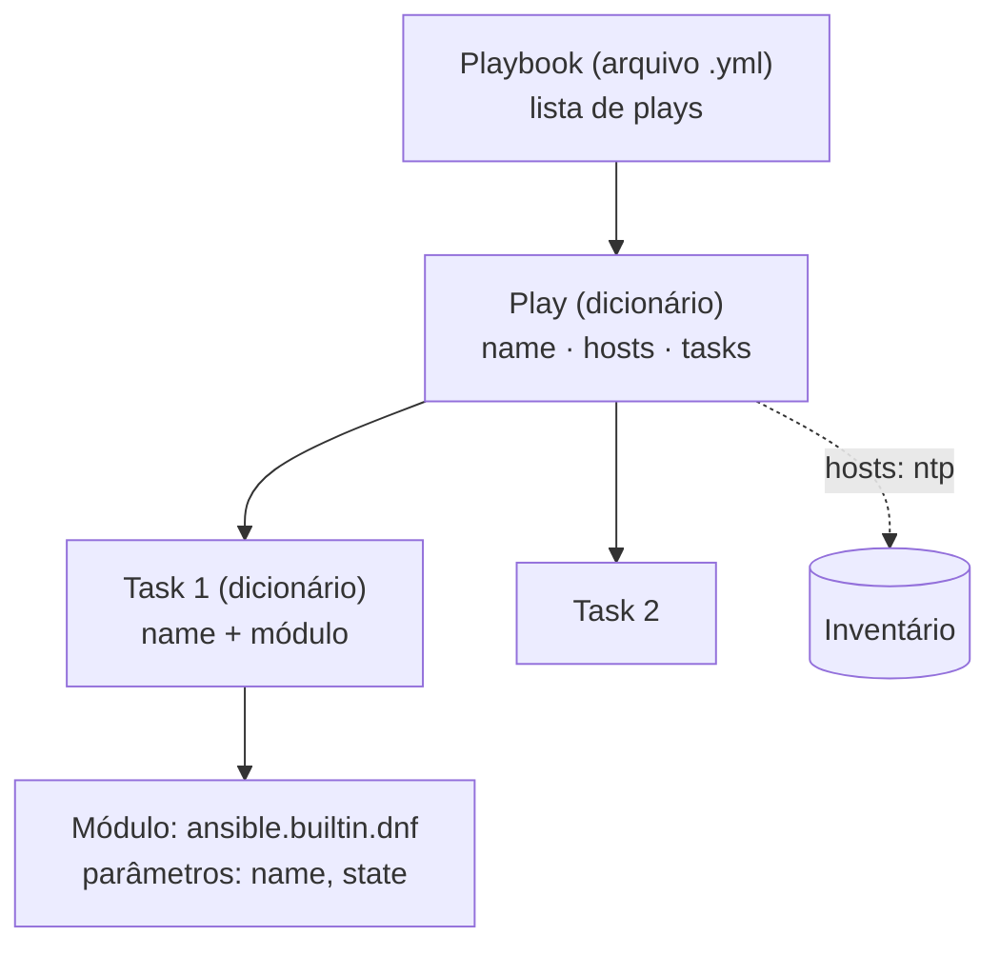

# 2.3 — Desenvolvendo playbooks

| Campo | Valor |
|-------|-------|
| Curso | AU294 — Ansible Automation Platform 2.6 (edição 2) |
| Capítulo / seção | Capítulo 2 · Seção 2.3 |
| Título original | Developing Playbooks |
| Título em português | Desenvolvendo playbooks |
| Objetivo | Escrever e executar playbooks com um único play, ler a saída e usar artefatos, verbosidade, verificação de sintaxe e modo de checagem |
| Pré-requisitos | [2.1](2.1-construindo-um-inventario.md), [F2 — YAML](../../01-fundamentos-essenciais/yaml-para-ansible.md), [1.5](../01-introducao-ansible/1.5-configurando-ajustes-do-ansible.md) |
| Referência | PDF p. 76–85 · Guided Exercise 2.4 p. 86–93 |

## Parte A — O problema que a tecnologia resolve

Com inventário e configuração prontos, falta descrever **o trabalho**. Um playbook
transforma um procedimento manual ("instalar o chrony, publicar o
`/etc/chrony.conf`, iniciar o serviço, abrir o firewall") em um arquivo que:

- roda do mesmo jeito em 1 ou em 100 hosts;
- documenta a si mesmo (cada passo tem nome);
- pode ser reexecutado com segurança, porque cada task descreve um **estado**;
- vai para o Git e passa por revisão.

## Parte B — Modelo mental e arquitetura



| Termo | Definição do curso, em palavras próprias |
|-------|------------------------------------------|
| **Playbook** | Arquivo YAML que define um ou mais plays |
| **Play** | Sequência de tasks aplicadas, **em ordem**, a hosts escolhidos no inventário |
| **Task** | Uma ação específica que descreve o estado desejado; também documenta o passo |
| **Module** | Programa que o Ansible executa para cumprir a task |
| **Module parameters** | Opções passadas ao módulo para controlar seu comportamento |

## Parte C — Entendimento progressivo

### 1. YAML aplicado ao playbook

Regras que o curso destaca (revise [F2](../../01-fundamentos-essenciais/yaml-para-ansible.md)):

- extensão `.yml` ou `.yaml`; YAML é para **dados**, não para documentos;
- indentação só com **espaços** (tab é proibido); a quantidade de espaços é livre,
  mas itens do mesmo nível ficam na mesma coluna e filhos ficam mais à direita;
- `#` inicia comentário; não há comentário de várias linhas (cada linha leva o seu `#`);
- `---` marca o início do arquivo; `...` pode marcar o fim (raramente usado).

### 2. Anatomia de um play

```yaml
---                                         # início do documento
- name: Configurar servidores NTP           # item da lista de plays (dash + espaço)
  hosts: ntp                                # host pattern: grupo do inventário
  become: true                              # (2.5) escalada para root neste play
  tasks:                                    # lista ordenada de tasks
    - name: Garantir que o chrony está instalado
      ansible.builtin.dnf:                  # módulo (FQCN)
        name: chrony                        # parâmetros do módulo
        state: present
```

| Chave do play | Função | Obrigatória? |
|---------------|--------|--------------|
| `name` | Rótulo exibido na execução; documenta o objetivo | Não, mas recomendada |
| `hosts` | **Host pattern**: nomes ou grupos do inventário (`all`, `ntp`, um FQDN...) | Sim |
| `tasks` | Lista de tasks, executadas em ordem | Sim, para fazer algo |

Duas propriedades de YAML explicam o comportamento:

| Estrutura | Ordem importa? | Consequência |
|-----------|----------------|--------------|
| **Lista** (plays, tasks) | **Sim** | Plays e tasks rodam na ordem escrita |
| **Dicionário** (chaves de um play ou de uma task) | Não | `hosts` antes ou depois de `name` dá no mesmo; cada chave deve ser única |

### 3. Anatomia de uma task

Cada task é um dicionário com, tipicamente, duas chaves:

- **`name`**: descrição do passo (opcional, mas nomeie todas: é o que aparece na saída);
- **o módulo**, cujo valor é um dicionário de parâmetros, um nível mais à direita.

Escreva o nome como um **estado** ("Garantir que o chronyd está ativo"), não como
uma ordem ("Iniciar chronyd"). Isso reforça o pensamento declarativo.

### 4. Encontrando módulos

| Fonte | O que oferece |
|-------|---------------|
| `ansible.builtin` | Única collection que vem no pacote `ansible-core`. **Sempre disponível** |
| Execution environment `ee-supported-rhel9` (padrão do AAP 2.6) | `ansible.builtin` **mais** várias outras collections (ex.: `ansible.posix`, com `firewalld`) |
| Automation hub (Red Hat Hybrid Cloud Console) | Collections certificadas e com suporte |
| Private automation hub | Collections curadas pela sua organização |
| Ansible Galaxy | Collections da comunidade (sem suporte formal da Red Hat) |

Collections baixadas podem ser instaladas no diretório `collections` do projeto
(detalhes no Capítulo 7).

```bash
ansible-navigator collections              # TUI: collections do EE; ":<n>" detalha e lista módulos
ansible-navigator doc -l -m stdout         # lista módulos disponíveis no EE (2.5 aprofunda)
```

### 5. FQCN: o nome completo do módulo

`ansible.builtin.copy` = *namespace* `ansible` + *collection* `builtin` + módulo
`copy`. Como várias collections podem ter um módulo chamado `copy`, o FQCN elimina
ambiguidades. Versões antigas usavam só o nome curto; o Ansible ainda tenta
resolvê-lo, mas a boa prática (e o `ansible-lint`) exige FQCN.

### 6. Executar

| Forma | Configuração usada |
|-------|--------------------|
| VS Code: botão direito no playbook › **Run Ansible Playbook via › Run playbook via 'ansible-navigator run'** | Configurações da extensão Ansible |
| Terminal integrado: `ansible-navigator run ntp.yml` | `ansible-navigator.yml` do projeto (com `mode: stdout`, a saída vai direto ao terminal) |

### 7. Ler a saída

```text
PLAY [Configurar servidores NTP com chrony] ************************************

TASK [Gathering Facts] *********************************************************
ok: [ntp1.sp.example.net]

TASK [Garantir que o pacote chrony está instalado] *****************************
changed: [ntp1.sp.example.net]
...
PLAY RECAP *********************************************************************
ntp1.sp.example.net : ok=5  changed=4  unreachable=0  failed=0  skipped=0 ...
```

*(Saída ilustrativa, montada para este exemplo.)*

- O texto entre colchetes de `PLAY` e `TASK` é o **`name`** que você escreveu.
- **`Gathering Facts`** é uma task especial que roda o módulo `ansible.builtin.setup`
  no início de cada play, por padrão (facts são tema do Capítulo 3). Dá para
  desligá-la com `gather_facts: false`.
- `changed` = o módulo alterou o host; `ok` = já estava no estado pedido.
- **Rode de novo:** em um playbook idempotente, a segunda execução termina com
  `changed=0`.

### 8. `ansible-playbook` × `ansible-navigator run`

| | `ansible-navigator run` | `ansible-playbook` |
|---|-------------------------|--------------------|
| Onde roda | Dentro de um **execution environment** | No Python e nas collections **do control node** |
| Opções | Aceita as mesmas de `ansible-playbook` (repassadas) | — |
| Suporte Red Hat | Ferramenta principal do AAP 2.6 | Suporte **limitado** no RHEL 9 e posteriores |

### 9. Artefatos de playbook e `replay`

Com artefatos habilitados (padrão), cada `run` grava um JSON chamado
`<playbook>-artifact-<data/hora>.json`, por exemplo
`ntp-artifact-2026-10-27T14:05:31.123456+00:00.json`.

```bash
ansible-navigator replay ntp-artifact-2026-10-27T14:05:31.123456+00:00.json
```

- Serve para revisar uma execução, diagnosticar ou guardar para conformidade.
- Pode ser enviado a outra pessoa ou ao suporte: ela vê o resultado **sem** precisar
  do projeto inteiro (inventário, variáveis, roles).
- A maioria pode ser apagada; se for guardar um, renomeie para identificá-lo.
- ⚠️ Se o playbook vai **perguntar algo** (senha), use `--pae false` e `-m stdout`,
  ou a execução pode travar.

### 10. Verbosidade

| Opção | Acrescenta |
|-------|------------|
| `-v` | Resultado das tasks |
| `-vv` | Resultado e configuração das tasks |
| `-vvv` | Detalhes das conexões com os managed hosts |
| `-vvvv` | Opções extras dos plug-ins de conexão: usuário usado no host, scripts executados |
| `-vvvvv` | Depuração interna do Ansible (estratégia, plug-ins) |
| `-vvvvvv` | Estado interno completo; útil a desenvolvedores do Ansible |

Na prática: `-v` para ver o retorno dos módulos, `-vvv`/`-vvvv` para problemas de
conexão e usuário.

### 11. Antes de executar: sintaxe e simulação

| Opção | O que faz | O que **não** garante |
|-------|-----------|------------------------|
| `--syntax-check` | Valida a estrutura do playbook (YAML e palavras-chave) e mostra `playbook: <caminho>` se estiver tudo certo | Que os hosts existem ou que as tasks vão funcionar |
| `--check` | **Dry run**: conecta e informa o que *mudaria* (`changed`), sem alterar os hosts | Exatidão total: tasks que dependem do efeito de outras podem divergir (📘 nem todo módulo suporta check mode) |

📘 *Fonte externa:* `--diff` mostra as diferenças de conteúdo que seriam aplicadas
em arquivos; combina bem com `--check`.

## Parte D — Exemplo autoral incremental

Arquivo validado:
[exemplos-originais/cap02-inventario-e-playbooks/ntp.yml](../../exemplos-originais/cap02-inventario-e-playbooks/ntp.yml).

**Passo 1 — o esqueleto do play:**

```yaml
---
- name: Configurar servidores NTP com chrony
  hosts: ntp
  become: true
  tasks:
```

**Passo 2 — pacote e arquivo (estado, não comando):**

```yaml
    - name: Garantir que o pacote chrony está instalado
      ansible.builtin.dnf:
        name: chrony
        state: present          # present: não atualiza se já existir; latest: atualiza

    - name: Publicar o arquivo de configuração do chrony
      ansible.builtin.copy:
        src: files/chrony.conf  # caminho relativo ao diretório do playbook
        dest: /etc/chrony.conf
        owner: root
        group: root
        mode: '0644'            # entre aspas para não virar octal implícito
```

**Passo 3 — serviço e firewall:**

```yaml
    - name: Garantir que o chronyd está ativo e habilitado no boot
      ansible.builtin.systemd_service:
        name: chronyd
        state: started
        enabled: true

    - name: Liberar o serviço ntp no firewall (runtime e permanente)
      ansible.posix.firewalld:
        service: ntp
        permanent: true         # grava na configuração permanente
        immediate: true         # e aplica já, sem reload
        state: enabled
```

| Parâmetro | Por que assim |
|-----------|---------------|
| `state: present` × `latest` | `present` só garante que existe; `latest` atualiza a cada execução se houver versão nova |
| `mode: '0644'` | Sem aspas, `0644` é interpretado como número; o `ansible-lint` acusa `yaml[octal-values]` |
| `permanent` + `immediate` | Só `permanent` grava sem aplicar; só `immediate` aplica e se perde no reboot |

## Parte E — Execução e verificação

```bash
ansible-navigator run ntp.yml --syntax-check   # 1. estrutura
ansible-navigator run ntp.yml --check          # 2. o que mudaria
ansible-navigator run ntp.yml                  # 3. aplica
ansible-navigator run ntp.yml                  # 4. prova de idempotência: changed=0
```

| Item | Valor |
|------|-------|
| Alvo | Grupo `ntp` do inventário |
| `become` | Sim: `dnf`, `/etc/chrony.conf`, systemd e firewalld exigem root |
| Esperado na 1ª execução | `changed` nas tasks de pacote, arquivo, serviço e firewall |
| Esperado na 2ª execução | Tudo `ok`, `changed=0` |
| Verificação no host (📘) | `chronyc sources` · `systemctl is-enabled chronyd` · `firewall-cmd --list-services` |
| Status do exemplo | ✅ YAML, `--syntax-check` e `ansible-lint` (perfil *production*) sem erros · ⚠️ não executado contra hosts |

## Parte F — Troubleshooting

| Sintoma | Causa provável | Como verificar / corrigir |
|---------|----------------|---------------------------|
| `couldn't resolve module/action 'ansible.posix.firewalld'` | Collection ausente no ambiente de execução | Rode pelo `ansible-navigator` com o EE `ee-supported`; ou instale a collection |
| `Syntax Error while loading YAML` / `mapping values are not allowed` | Faltou espaço após `:` (ex.: `name:Play`) ou indentação errada | A mensagem indica a linha **aproximada**; olhe também a linha anterior |
| `found character '\t'` | Tab no arquivo | Configure o editor para inserir espaços |
| Task listada fora do play / erro de chave inesperada | Task na mesma coluna de `tasks:` | Itens de `tasks:` ficam mais à direita |
| `changed` em toda execução | Task não idempotente ou `state: latest` com atualizações saindo | Prefira `present`; evite `command`/`shell` (2.5) |
| Execução trava sem prompt | Pedido de entrada com artefatos ligados ou modo interativo | `--pae false -m stdout` |
| `src` não encontrado no `copy` | Caminho relativo errado | `src` relativo é procurado a partir do diretório do playbook (e de `files/`) |

## Parte G — Preparação para o laboratório

Atividade associada: **2.4 Guided Exercise — Developing Playbooks**
(`develop-singleplay`, PDF p. 86–93). Ver
[PRATICA-OFICIAL.md](PRATICA-OFICIAL.md#24-guided-exercise-developing-playbooks).

Você deve conseguir:

- escrever um play do zero, com a indentação correta em cada nível;
- escolher os módulos de pacote, arquivo, serviço e firewall pelo FQCN;
- validar com `--syntax-check` antes de executar;
- usar `ansible-navigator replay` em um artefato;
- explicar por que a segunda execução não muda nada.

## Parte H — Fixação

1. O que acontece se você trocar a ordem de duas tasks? E a ordem das chaves `name` e `hosts` de um play?
2. Por que `ansible.builtin.dnf` está sempre disponível, mas `ansible.posix.firewalld` depende do ambiente?
3. Diferencie `--syntax-check` de `--check`.
4. Diagnóstico: um colega escreveu `mode: 0644` e o lint reclamou. Qual o risco e a correção?
5. Diagnóstico: o playbook passou no `--syntax-check`, mas falhou na execução com `UNREACHABLE`. Contradição?
6. Para que serve um artefato de playbook além de rever a saída?

<details>
<summary>Respostas comentadas</summary>

1. Tasks estão em uma **lista**: a ordem muda a execução (ex.: iniciar o serviço antes de instalar o pacote falha). As chaves de um play estão em um **dicionário**: a ordem é irrelevante.
2. `ansible.builtin` vem no `ansible-core`; `ansible.posix` é outra collection, presente no `ee-supported-rhel9`, mas não necessariamente em outro ambiente.
3. `--syntax-check` só valida a estrutura, sem contatar hosts. `--check` conecta e simula a execução, informando o que mudaria sem mudar nada.
4. Sem aspas, o YAML pode tratar `0644` como inteiro e o modo pode ser aplicado errado. Use `mode: '0644'` (ou `mode: u=rw,g=r,o=r`).
5. Não. A verificação de sintaxe não contata hosts; `UNREACHABLE` é um problema de conexão (nome, rede, SSH, usuário), tratado em 2.7.
6. Para enviar a outra pessoa ou ao suporte, que reproduz a saída com `ansible-navigator replay` sem precisar do projeto, e para guardar evidência de execução (conformidade).

</details>

## Parte I — Essencial para memorizar

- Playbook = lista de plays; play = `name` + `hosts` + `tasks`; task = `name` + módulo + parâmetros.
- Listas têm ordem (plays, tasks); dicionários não (chaves).
- Só espaços. `---` no início. Nomeie plays e tasks como estados.
- Módulos: `ansible.builtin` sempre; demais vêm de collections (EE, automation hub, Galaxy). Use **FQCN**.
- `Gathering Facts` = `ansible.builtin.setup`, automático no início do play.
- Ordem segura: `--syntax-check` → `--check` → execução → reexecução (`changed=0`).
- Artefatos: `<playbook>-artifact-<data>.json`; `ansible-navigator replay`; `--pae false` quando houver prompt.
- Verbosidade até `-vvvvvv`; `-vvv`/`-vvvv` para conexão.

---
[← 2.1 Inventário](2.1-construindo-um-inventario.md) | [Índice do capítulo](README.md) | [Próximo: 2.5 Múltiplos plays →](2.5-playbooks-com-multiplos-plays.md)
