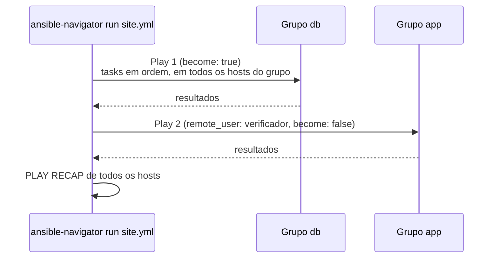

# 2.5 — Desenvolvendo playbooks com múltiplos plays

| Campo | Valor |
|-------|-------|
| Curso | AU294 — Ansible Automation Platform 2.6 (edição 2) |
| Capítulo / seção | Capítulo 2 · Seção 2.5 |
| Título original | Developing Playbooks with Multiple Plays |
| Título em português | Desenvolvendo playbooks com múltiplos plays |
| Objetivo | Escrever playbooks com vários plays, ajustar usuário remoto e escalada por play, escolher módulos e dominar a sintaxe YAML usada em playbooks |
| Pré-requisitos | [2.3](2.3-desenvolvendo-playbooks.md), [1.5 — escalada de privilégio](../01-introducao-ansible/1.5-configurando-ajustes-do-ansible.md) |
| Referência | PDF p. 94–102 · Guided Exercise 2.6 p. 103–109 |

## Parte A — O problema que a tecnologia resolve

Implantações reais envolvem **papéis diferentes**: primeiro prepara-se o banco,
depois as aplicações, por fim testa-se de outro ponto da rede. Cada etapa tem um
alvo diferente, às vezes um usuário diferente, e nem todas precisam de `root`.

Um playbook com **vários plays** orquestra isso em um arquivo só: o play 1 roda nos
bancos; quando termina, o play 2 roda nas aplicações; o play 3 verifica de fora.
Cada play carrega suas próprias regras de conexão e privilégio.

## Parte B — Modelo mental e arquitetura



- Cada play é um **item de nível superior** na lista do playbook.
- Os plays rodam **em sequência**: o segundo só começa quando o primeiro termina.

## Parte C — Entendimento progressivo

### 1. Estrutura com dois plays

```yaml
---
- name: Preparar os servidores de banco de dados   # play 1
  hosts: db
  become: true
  tasks:
    - name: Garantir que o MariaDB está instalado
      ansible.builtin.dnf:
        name: mariadb-server
        state: present

- name: Verificar o banco a partir das aplicações   # play 2: mesmo nível do play 1
  hosts: app
  become: false
  tasks:
    - name: Aguardar a porta 3306 aceitar conexões
      ansible.builtin.wait_for:
        host: db01.sp.example.net
        port: 3306
```

### 2. Usuário remoto por play

Por padrão, com `ansible-navigator run`, o Ansible conecta como o usuário atual
**dentro do execution environment, que é `root`**. Com `ansible-playbook` (sem EE),
o padrão é o usuário que executou o comando.

O usuário pode ser definido em vários lugares. O Ansible usa o **primeiro** que
encontrar nesta ordem:

| Prioridade | Onde | Exemplo |
|:---:|------|---------|
| 1 | Variável `ansible_user` do host ou do grupo (inventário) | `db01 ansible_user=dba` |
| 2 | `remote_user` no **play** | `remote_user: verificador` |
| 3 | `remote_user` no `ansible.cfg` | `remote_user = automacao` |
| 4 | Padrão (no EE: `root`) | — |

### 3. Escalada de privilégio por play

As mesmas opções do `[privilege_escalation]` existem como **palavras-chave do play**
(e também de tasks), no mesmo nível de `hosts` e `tasks`, e **sobrepõem** o `ansible.cfg`:

| Palavra-chave | Valores | Efeito |
|---------------|---------|--------|
| `become` | `true` / `false` | Liga/desliga a escalada naquele play (ou task) |
| `become_method` | `sudo`, `su`... | Como trocar de usuário |
| `become_user` | `root` (padrão), outro usuário | Para quem trocar |

Booleanos: `yes`/`no` funcionam, mas a prática recomendada é **`true`/`false`**
(o `ansible-lint` cobra isso).

```yaml
- name: Ajustar arquivos da aplicação como o dono dela
  hosts: app
  remote_user: automacao     # entra como automacao...
  become: true
  become_user: appsvc        # ...e executa as tasks como appsvc
  become_method: sudo
  tasks:
    - name: Garantir o diretório de cache da aplicação
      ansible.builtin.file:
        path: /srv/app/cache
        state: directory
        mode: '0750'
```

### 4. Escolhendo módulos

Uma seleção do curso, agrupada por finalidade:

| Categoria | Módulos |
|-----------|---------|
| Arquivos | `ansible.builtin.copy`, `ansible.builtin.file`, `ansible.builtin.lineinfile`, `ansible.posix.synchronize` |
| Software | `ansible.builtin.package` (detecta o gerenciador), `ansible.builtin.dnf`, `ansible.builtin.apt`, `ansible.builtin.pip` |
| Sistema | `ansible.posix.firewalld`, `ansible.builtin.reboot`, `ansible.builtin.service`, `ansible.builtin.systemd_service`, `ansible.builtin.user` |
| Web | `ansible.builtin.get_url`, `ansible.builtin.uri` |

Como descobrir e estudar módulos **no ambiente de execução**:

| Comando | Para quê |
|---------|----------|
| `ansible-navigator doc -l -m stdout` | Lista os módulos do EE com uma frase de descrição |
| `ansible-navigator doc ansible.builtin.user -m stdout` | Documentação completa: descrição, parâmetros, **exemplos** |
| `ansible-navigator doc ansible.builtin.user` | A mesma documentação, navegável em YAML na TUI |
| `ansible-navigator -s doc ansible.builtin.user` | **Snippet**: esqueleto de task com todos os parâmetros comentados, para usar como modelo |
| `ansible-navigator collections` | TUI para explorar collections e seus módulos |

> Com `ansible-playbook` (sem EE), o equivalente é `ansible-doc`, que mostra apenas
> o que está instalado **no control node**, e não o conteúdo do EE.

💡 **Para o EX294:** sem internet no exame, `ansible-navigator doc <módulo> -m stdout`
e a seção **EXAMPLES** são a sua referência.

### 5. Comandos arbitrários: `command`, `shell`, `raw`

Quando não existe módulo para a tarefa:

| Módulo | Executa | Requer Python no host | Shell (`$VAR`, `|`, `>`) |
|--------|---------|-----------------------|--------------------------|
| `ansible.builtin.command` | O comando diretamente (`cmd:`) | Sim | **Não** |
| `ansible.builtin.shell` | Pelo shell do host | Sim | Sim |
| `ansible.builtin.raw` | Direto pelo shell remoto, sem o subsistema de módulos | **Não** (útil para instalar Python ou em equipamentos sem Python) | Sim |

⚠️ Os três **não são idempotentes por natureza**: rodam sempre e reportam `changed`.
Regras do curso:

1. Procure primeiro um módulo específico.
2. Se precisar, prefira `command`; use `shell` ou `raw` só pelas funções especiais.
3. Use `creates`/`removes` para dar alguma idempotência:

| Parâmetro | Roda o comando só se... |
|-----------|-------------------------|
| `creates: /caminho` | o arquivo **não** existe (supõe-se que o comando o cria) |
| `removes: /caminho` | o arquivo **existe** (supõe-se que o comando o remove) |

```yaml
- name: Inicializar o diretório de dados do serviço (só na primeira vez)
  ansible.builtin.command:
    cmd: /usr/local/bin/init-dados.sh
    creates: /srv/dados/.inicializado
```

Exemplo de troca por módulo idempotente (cenário próprio):

```yaml
# NÃO idempotente: reescreve o arquivo e reporta changed em toda execução
- name: Definir banner (forma ruim)
  ansible.builtin.shell:
    cmd: echo "Acesso restrito" > /etc/issue.net

# Idempotente: só altera se o conteúdo for diferente
- name: Definir banner (forma boa)
  ansible.builtin.copy:
    dest: /etc/issue.net
    content: "Acesso restrito\n"
    mode: '0644'
```

### 6. Sintaxe YAML que aparece em playbooks

| Elemento | Forma | Observação |
|----------|-------|------------|
| Comentário | `# texto` ou `valor  # texto` | Antes do `#` na mesma linha, deixe um espaço |
| String sem aspas | `msg: Banco pronto` | Aspas não são obrigatórias, mesmo com espaços |
| Aspas simples | `'C:\temp'` | Literal: `\` não é escape. Variáveis `{{ }}` continuam funcionando |
| Aspas duplas | `"linha\n"` | Interpreta escapes (`\n`, `\t`) |
| Bloco literal `\|` | várias linhas | **Preserva** as quebras de linha (bom para conteúdo de arquivo) |
| Bloco dobrado `>` | várias linhas | Converte quebras em espaços (bom para comandos longos) |
| Dicionário em bloco | `nome: x` em linhas | Forma recomendada |
| Dicionário inline | `{nome: x, porta: 80}` | Evite; aparece mais em listas de roles |
| Lista em bloco | `- a` em linhas | Forma recomendada |
| Lista inline | `[a, b, c]` | Evite: mais difícil de ler |

```yaml
- name: Publicar o resolv.conf de laboratório (conteúdo de várias linhas)
  ansible.builtin.copy:
    dest: /etc/resolv.conf
    mode: '0644'
    content: |
      search example.net
      nameserver 192.0.2.53
      nameserver 192.0.2.54
```

### 7. Forma abreviada obsoleta

```yaml
# Evite (chave=valor na mesma linha): não é YAML nativo
- name: Forma abreviada
  ansible.builtin.service: name=chronyd state=started enabled=true

# Prefira (uma chave por linha)
- name: Forma expandida
  ansible.builtin.service:
    name: chronyd
    state: started
    enabled: true
```

Motivos do curso: a forma expandida é YAML nativo, mais fácil de manter, empilha
as chaves verticalmente e funciona melhor com o destaque de sintaxe.

### 8. Diferenças que confundem

| A | B | Diferença essencial |
|---|---|--------------------|
| `remote_user` | `become_user` | Com quem **conecta** × para quem **troca** depois de conectar |
| `remote_user` no play | `ansible_user` no inventário | A variável do inventário vence o play |
| `command` | `shell` | Sem shell × com shell (pipes, redirecionamento, variáveis) |
| `shell` | `raw` | Usa o subsistema de módulos (precisa de Python) × não usa |
| `\|` | `>` | Preserva quebras × junta as linhas |
| Aspas simples | Aspas duplas | Literal × interpreta escapes |

## Parte D — Exemplo autoral incremental

Arquivo completo e validado:
[exemplos-originais/cap02-inventario-e-playbooks/site.yml](../../exemplos-originais/cap02-inventario-e-playbooks/site.yml).

**Passo 1 — play de preparação, com root:**

```yaml
---
- name: Preparar os servidores de banco de dados
  hosts: db
  become: true
  tasks:
    - name: Garantir que o MariaDB está instalado
      ansible.builtin.dnf:
        name:                   # o parâmetro name aceita uma LISTA de pacotes
          - mariadb-server
          - mariadb
        state: present

    - name: Garantir que o MariaDB está ativo e habilitado no boot
      ansible.builtin.systemd_service:
        name: mariadb
        state: started
        enabled: true
```

**Passo 2 — segundo play, outro alvo, outro usuário, sem root:**

```yaml
- name: Verificar, a partir das aplicações, se o banco responde
  hosts: app
  remote_user: verificador      # vence o remote_user do ansible.cfg só aqui
  become: false
  gather_facts: false           # não precisa de facts para um teste de porta
  tasks:
    - name: Aguardar a porta 3306 do banco de produção aceitar conexões
      ansible.builtin.wait_for:
        host: db01.sp.example.net
        port: 3306
        timeout: 15
```

## Parte E — Execução e verificação

```bash
ansible-navigator run site.yml --syntax-check
ansible-navigator run site.yml --list-hosts     # quais hosts cada play atinge (📘)
ansible-navigator run site.yml
```

| Item | Valor |
|------|-------|
| Play 1 | Grupo `db`, como `automacao` com `sudo` para `root` |
| Play 2 | Grupo `app`, como `verificador`, sem escalada |
| Esperado | Play 1 com `changed` na primeira execução; play 2 com `ok` se a porta responder |
| Como confirmar o usuário usado | `-vvv`: linhas `ESTABLISH SSH CONNECTION FOR USER: ...` |
| Status do exemplo | ✅ `--syntax-check` e `ansible-lint` (perfil *production*) sem erros · ⚠️ não executado contra hosts |

## Parte F — Troubleshooting

| Sintoma | Causa provável | Como verificar / corrigir |
|---------|----------------|---------------------------|
| Conectou com o usuário "errado" | `ansible_user` no inventário vence o `remote_user` do play | `ansible-navigator inventory -m stdout --host <h>`; `-vvv` |
| Erro de permissão em `/etc`, `dnf`, systemd | Play sem `become: true` | Ative a escalada no play (ou na task) |
| `Missing sudo password` | Usuário remoto sem `NOPASSWD` | Ver [1.5](../01-introducao-ansible/1.5-configurando-ajustes-do-ansible.md#4-escalada-de-privilégio-e-sudoers) e 2.7 |
| Task `command` sempre `changed` | Natureza do módulo | Use módulo específico ou `creates`/`removes` |
| Pipe/redirecionamento não funciona no `command` | `command` não usa shell | Troque por `shell` (ou, melhor, por um módulo) |
| Segundo play indentado sob `tasks` do primeiro | Play escrito com a indentação de uma task | Plays começam na coluna do primeiro `- name:` do arquivo |

## Parte G — Preparação para o laboratório

Atividade associada: **2.6 Guided Exercise — Developing Playbooks with Multiple
Plays** (`develop-multiplay`, PDF p. 103–109). Ver
[PRATICA-OFICIAL.md](PRATICA-OFICIAL.md#26-guided-exercise-developing-playbooks-with-multiple-plays).

Você deve conseguir:

- escrever dois plays no mesmo arquivo, com alvos e `become` diferentes;
- passar uma **lista** de pacotes a um módulo;
- testar um serviço de um host a partir de outro (módulos de rede/web);
- contar a indentação de cada nível sem ajuda do editor.

## Parte H — Fixação

1. Um play define `remote_user: ops` e o host tem `ansible_user=admin` no inventário. Com qual usuário o Ansible conecta?
2. Qual a diferença entre `become_user: appsvc` e `remote_user: appsvc`?
3. Você precisa contar linhas de um log com `wc -l < /var/log/app.log`. `command` ou `shell`? Há opção melhor?
4. Escreva uma task que rode `/opt/setup.sh` apenas se `/opt/.setup-ok` não existir.
5. Diagnóstico: um play precisa conectar como `ops` e executar as tasks como o usuário `appsvc`, via `sudo`. Quais palavras-chave do play você usa?
6. Como obter rapidamente um esqueleto de task com todos os parâmetros de `ansible.builtin.user`?

<details>
<summary>Respostas comentadas</summary>

1. `admin`: a variável `ansible_user` do inventário tem prioridade sobre o `remote_user` do play.
2. `remote_user` é a conta usada na **conexão SSH**; `become_user` é a conta para a qual o Ansible **troca** (via `become_method`) depois de conectar.
3. `shell`, porque há redirecionamento (`<`). Melhor ainda seria evitar o comando: por exemplo, ler o arquivo com um módulo e tratar o conteúdo (técnicas dos próximos capítulos).
4. Exemplo:
   ```yaml
   - name: Executar o setup só na primeira vez
     ansible.builtin.command:
       cmd: /opt/setup.sh
       creates: /opt/.setup-ok
   ```
5. `remote_user: ops`, `become: true`, `become_user: appsvc` e `become_method: sudo`.
6. `ansible-navigator -s doc ansible.builtin.user`.

</details>

## Parte I — Essencial para memorizar

- Vários plays = vários itens de nível superior; rodam em sequência.
- Usuário de conexão: `ansible_user` (inventário) > `remote_user` (play) > `remote_user` (`ansible.cfg`) > padrão (`root` no EE).
- `become`, `become_user`, `become_method` no play sobrepõem o `ansible.cfg`. Booleanos: `true`/`false`.
- Módulos: `ansible-navigator doc -l`, `doc <módulo>`, `doc <módulo> -s`, `collections`.
- `command` (sem shell) → `shell` (com shell) → `raw` (sem Python). Evite os três; use `creates`/`removes`.
- YAML: `|` preserva, `>` dobra; aspas simples literais, duplas com escapes; evite inline e a forma `chave=valor`.

---
[← 2.3 Desenvolvendo playbooks](2.3-desenvolvendo-playbooks.md) | [Índice do capítulo](README.md) | [Próximo: 2.7 Troubleshooting →](2.7-troubleshooting-de-playbooks-e-hosts.md)
