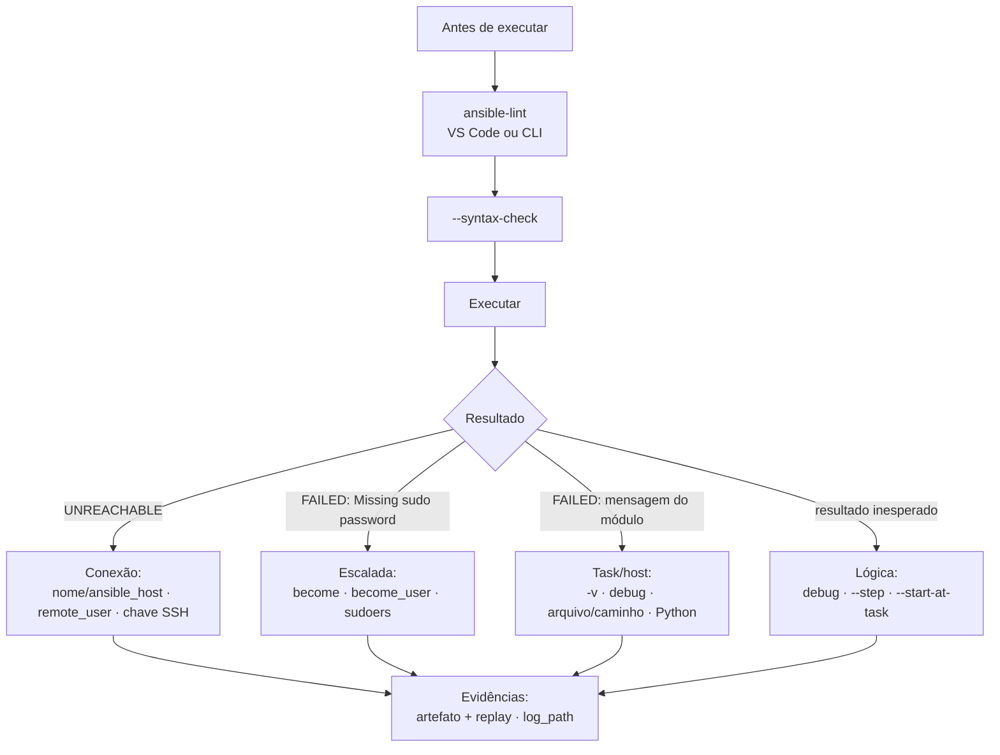

# 2.7 — Troubleshooting de playbooks e managed hosts

| Campo | Valor |
|-------|-------|
| Curso | AU294 — Ansible Automation Platform 2.6 (edição 2) |
| Capítulo / seção | Capítulo 2 · Seção 2.7 |
| Título original | Troubleshooting Playbooks and Managed Hosts |
| Título em português | Troubleshooting de playbooks e managed hosts |
| Objetivo | Diagnosticar e corrigir problemas comuns em playbooks e falhas nos managed hosts durante a execução |
| Pré-requisitos | [2.3](2.3-desenvolvendo-playbooks.md), [2.5](2.5-playbooks-com-multiplos-plays.md), [1.5](../01-introducao-ansible/1.5-configurando-ajustes-do-ansible.md) |
| Referência | PDF p. 110–118 · Guided Exercise 2.8 p. 119–126 |

## Parte A — O problema que a tecnologia resolve

Um playbook pode falhar em quatro lugares bem diferentes, e cada um pede uma
ferramenta diferente:

| Onde falha | Exemplo | Ferramenta |
|------------|---------|------------|
| **Escrita** | YAML inválido, módulo sem FQCN, octal implícito | `ansible-lint`, `--syntax-check` |
| **Lógica** | Task certa no lugar errado, variável com valor inesperado | `debug`, `--step`, `--start-at-task`, `-v` |
| **Conexão** | Nome errado, usuário errado, chave ausente | `-vvv`/`-vvvv`, inventário, SSH manual |
| **Host** | Falta `sudo`, falta Python, arquivo inexistente | Mensagem do módulo, logs, artefatos |

O objetivo da seção é ter um **método**: identificar em qual camada está o erro
antes de mexer no código.

## Parte B — Modelo mental e arquitetura



## Parte C — Entendimento progressivo

### 1. Lendo a saída

- Cabeçalho **`PLAY [nome]`**, seguido de um **`TASK [nome]`** por task.
- Sob cada task, uma linha **por host** com o resultado: `ok`, `changed`, `skipping`
  ou `fatal` (falha ou host inalcançável).
- **`PLAY RECAP`** no final: contagem por host de `ok`, `changed`, `unreachable`,
  `failed`, `skipped`, `rescued`, `ignored`.

Nomes bem escritos tornam a saída um mapa: a task que falhou já diz o que tentava fazer.

### 2. Verbosidade

`-v` até `-vvvvvv` (tabela completa em [2.3](2.3-desenvolvendo-playbooks.md#10-verbosidade)).
Para diagnóstico de conexão e usuário, `-vvv` e `-vvvv` são os mais úteis.

### 3. O módulo `ansible.builtin.debug`

Mostra valores durante a execução. É a forma de "olhar dentro" do playbook.

| Parâmetro | Uso |
|-----------|-----|
| `msg` | Mensagem livre, que pode conter variáveis: `"Memória livre: {{ ansible_facts['memfree_mb'] }} MB"` |
| `var` | Nome de uma variável para imprimir (sem `{{ }}`) |
| `verbosity` | Só executa se a execução tiver **pelo menos** esse número de `-v` (padrão `0` = sempre) |

```yaml
- name: Mostrar o resultado bruto só quando executado com -vv ou mais
  ansible.builtin.debug:
    var: resultado_teste
    verbosity: 2
```

Truque útil: deixe tasks de depuração com `verbosity: 2` no playbook. Na execução
normal elas aparecem como puladas; com `-vv`, mostram os dados.

### 4. Antes de executar: `--syntax-check`

Valida a estrutura e aponta a posição **aproximada** do erro:

```text
ERROR! ... Syntax Error while loading YAML.
  mapping values are not allowed in this context
The error appears to be in '.../ntp.yml': line 3, column 8, but may
be elsewhere in the file depending on the exact syntax problem.
```

*(Formato ilustrativo.)* Erro clássico: `- name:Configurar NTP` sem espaço após os
dois-pontos. O YAML lê `name:Configurar NTP` como texto e estranha o `hosts:` da
linha seguinte; por isso o erro aparece apontado para a linha **de baixo**.

### 5. Executar aos poucos

| Opção | O que faz | Observação |
|-------|-----------|------------|
| `--step` | Pergunta antes de cada task: `(N)o/(y)es/(c)ontinue` | Exige `-m stdout` e `--pae false` (há prompt) |
| `--start-at-task "Nome da task"` | Começa a partir da task com esse nome | Útil para retomar após corrigir o fim do playbook |
| `--list-tasks` | Lista os nomes das tasks, sem executar | Use para copiar o nome exato para `--start-at-task` |

```bash
ansible-navigator run site.yml -m stdout --pae false --step
ansible-navigator run site.yml --list-tasks
ansible-navigator run site.yml --start-at-task "Garantir que o MariaDB está ativo e habilitado no boot"
```

⚠️ `--start-at-task` pula as tasks anteriores: se a task de destino depende de algo
que elas faziam, o resultado pode enganar.

### 6. Boas práticas que previnem erros

- Nome conciso e descritivo em **todo** play e task.
- Comentários para explicar o "porquê", não o "o quê".
- Espaço vertical: uma chave por linha, linhas em branco entre tasks.
- Indentação consistente, **só espaços** (configure a tecla Tab do editor para inserir espaços).
- Simplicidade: use só os recursos de que precisa.

O curso cita o guia não oficial **Good Practices for Ansible**, escrito por
profissionais da Red Hat, como ponto de partida.

### 7. `ansible-lint`

Conjunto de regras que aponta problemas, nem todos fatais, mas muitas vezes sinais
de algo pior. No VS Code, aparece como **sublinhado vermelho**; passe o mouse para
ler a regra. Um erro de sintaxe é reportado pelo lint do mesmo jeito que pelo
`--syntax-check`.

🔎 *Verificado com ansible-lint 26.10.1:* identificadores das regras que correspondem
aos problemas citados no curso:

| Problema | Regra (ID) |
|----------|------------|
| Espaço sobrando no fim da linha | `yaml[trailing-spaces]` |
| Módulo sem FQCN (`package:`) | `fqcn[action-core]` |
| Forma abreviada `chave=valor` | `no-free-form` |
| Modo como octal implícito (`mode: 0644`) | `yaml[octal-values]` |
| Linhas em branco demais | `yaml[empty-lines]` |
| `command`/`shell` sem controle de mudança | `no-changed-when` |
| Itens de lista desalinhados | erro de sintaxe YAML |

**Arquivo de configuração do lint:** `.ansible-lint` ou `.config/ansible-lint.yml`
no diretório atual. Para o `ansible-navigator` usá-lo, aponte no
`ansible-navigator.yml`:

```yaml
---
ansible-navigator:
  ansible-lint:
    config: ".ansible-lint"
```

```yaml
# .ansible-lint
---
warn_list:              # vira aviso, não falha
  - yaml[empty-lines]
skip_list:              # não verifica
  - no-changed-when
```

🔎 *Verificado:* com esse `.ansible-lint`, a regra de `skip_list` deixou de ser
reportada e a de `warn_list` passou a aparecer como `(warning)`. Use com parcimônia:
silenciar uma regra não corrige o problema.

### 8. Evidências: artefatos e log em texto

| Mecanismo | Como ativar | Observação |
|-----------|-------------|------------|
| **Artefato** do navigator (JSON) | Padrão do `ansible-navigator run` | Reveja com `ansible-navigator replay <arquivo>`: com `-m stdout`, a saída é reimpressa; sem, você navega pela TUI |
| **Log em texto** | `log_path` em `[defaults]` do `ansible.cfg` ou variável `ANSIBLE_LOG_PATH` (a variável vence o arquivo) | Funciona com `ansible-navigator` e com `ansible-playbook`. Em `/var/log`, configure `logrotate` |

Motivos para **desligar** artefatos (`playbook-artifact.enable: false`): dados
sensíveis gravados, necessidade de prompt (senha) e bagunça no diretório do projeto.

### 9. Problemas de conexão

**Autenticação (`UNREACHABLE` + `Permission denied`):**

| Causa | Como reconhecer |
|-------|-----------------|
| Usuário remoto errado | A mensagem mostra `usuario@host`: confira se é quem você esperava (`remote_user`/`ansible_user`) |
| Credencial ausente ou errada | Usuário certo, mas a chave pública não está no `authorized_keys` dele, ou a senha está errada |

**Resolução de nome/endereço:** se o host tem várias interfaces ou o nome não
resolve, use `ansible_host` no inventário para indicar o endereço de conexão. Um
`ansible_host` errado também é causa de `UNREACHABLE`.

**Escalada de privilégio (`FAILED! => {"msg": "Missing sudo password"}`):** o usuário
remoto não tem `sudo` sem senha e nenhuma senha foi fornecida. Confira `become`,
`become_user` (padrão `root`) e a configuração do `sudo` no host.

> **Detalhe importante do EE:** o `ansible-navigator` normalmente roda como `root`
> **dentro** do container, mas esse `root` usa as chaves SSH do usuário que executou
> o navigator na workstation. Isso confunde quem está acostumado ao `ansible-playbook`,
> que roda como o próprio usuário da workstation.

**Python:** módulos Linux precisam de um interpretador Python no host. O Ansible o
procura na primeira execução de módulo; se não encontrar, a task falha. (O módulo
`raw`, visto em 2.5, funciona sem Python e pode instalá-lo.)

### 10. Comandos ad hoc

Executam **uma** task, na linha de comando, sem playbook. Bons para testes e
diagnóstico pontual; **não** substituem playbooks.

```bash
ansible PADRAO_DE_HOSTS -m MODULO [-a 'ARGUMENTOS'] [-i INVENTARIO]
```

| Parte | Significado |
|-------|-------------|
| `PADRAO_DE_HOSTS` | Hosts ou grupos alvo (`all`, `db`, um FQDN) |
| `-m` | Módulo. **Sem `-m`, usa `ansible.builtin.command`**: especifique sempre |
| `-a` | Argumentos do módulo, entre aspas |
| `-i` | Inventário diferente do definido no `ansible.cfg` |

```bash
ansible db -m ansible.builtin.ping
ansible db -m ansible.builtin.command -a 'uptime'
```

Saída típica de sucesso do `ping`: `SUCCESS`, `"changed": false`, `"ping": "pong"`,
e o interpretador Python descoberto.

📘 *Fonte externa:* o comando `ansible` é do `ansible-core` e roda no ambiente local,
não no EE. Para rodá-lo dentro do EE, existe `ansible-navigator exec -- ansible ...`.
Se você repete um ad hoc com frequência, transforme-o em playbook.

### 11. Diferenças que confundem

| A | B | Diferença essencial |
|---|---|--------------------|
| `UNREACHABLE` | `FAILED` | Não conectou (rede, nome, SSH, usuário) × conectou e a task falhou |
| `--syntax-check` | `ansible-lint` | Estrutura válida × estrutura + boas práticas (inclui a checagem de sintaxe) |
| `debug: var:` | `debug: msg:` | Nome da variável (sem `{{ }}`) × texto com variáveis interpoladas |
| Artefato | `log_path` | JSON por execução, navegável com `replay` × texto contínuo em um arquivo |
| Ad hoc | Playbook | Uma task, descartável × várias tasks, versionado e repetível |

## Parte D — Exemplo autoral incremental

**Passo 1 — playbook com quatro defeitos (para treinar o olho):**

```text
---
- name:Verificar serviços             <- falta espaço após "name:"
  hosts: db 
  tasks:
    - name: Garantir que o chronyd está ativo
      service: name=chronyd state=started    <- sem FQCN e forma abreviada
    - name: Publicar banner
      ansible.builtin.copy:
        content: "Acesso restrito\n"
        dest: /etc/issue.net
        mode: 0644                     <- octal implícito
```

*(Bloco em texto puro de propósito: não é YAML válido.)* Defeitos: espaço após
`name:`, espaço sobrando depois de `db`, `service` sem FQCN e em forma abreviada,
`mode` sem aspas.

**Passo 2 — versão corrigida:**

```yaml
---
- name: Verificar serviços
  hosts: db
  become: true
  tasks:
    - name: Garantir que o chronyd está ativo
      ansible.builtin.service:
        name: chronyd
        state: started

    - name: Publicar banner
      ansible.builtin.copy:
        content: "Acesso restrito\n"
        dest: /etc/issue.net
        mode: '0644'
```

**Passo 3 — diagnóstico de conexão em ordem:**

```bash
ansible-navigator inventory -m stdout --host db01.sp.example.net   # 1. host existe? ansible_host?
ssh automacao@db01.sp.example.net true                             # 2. SSH com o usuário certo?
ansible-navigator run site.yml -vvvv --limit db01.sp.example.net   # 3. ver usuário e conexão (📘 --limit)
```

## Parte E — Execução e verificação

| Verificação | Comando | Esperado |
|-------------|---------|----------|
| Lint | `ansible-lint site.yml` | `Passed: 0 failure(s)` |
| Sintaxe | `ansible-navigator run site.yml --syntax-check` | `playbook: <caminho>` |
| Tasks | `ansible-navigator run site.yml --list-tasks` | Nomes das tasks por play |
| Log em texto | `log_path = ansible.log` no `ansible.cfg`, executar, `tail ansible.log` | Saída registrada no arquivo |
| Repetir uma execução | `ansible-navigator replay <artefato>.json -m stdout` | Saída da execução original |

Status: ✅ IDs de regras do lint, efeito de `skip_list`/`warn_list`, `--list-tasks`,
`--syntax-check` e mensagem de módulo não resolvido verificados localmente.
⚠️ Os cenários de `UNREACHABLE` e `Missing sudo password` são descritos a partir do
curso e da documentação, não reproduzidos contra hosts.

## Parte F — Troubleshooting (tabela de bolso)

| Mensagem | Camada | Primeira verificação |
|----------|--------|----------------------|
| `Syntax Error while loading YAML` | Escrita | Linha indicada e a anterior; espaços após `:`; tabs |
| `couldn't resolve module/action` | Escrita/ambiente | FQCN digitado certo? Collection existe no EE? |
| `UNREACHABLE ... Could not resolve hostname` | Conexão | Nome no inventário / `ansible_host` |
| `UNREACHABLE ... Permission denied (publickey...)` | Conexão | Usuário na mensagem; chave no `authorized_keys` desse usuário |
| `FAILED! ... Missing sudo password` | Escalada | `sudoers` do host; `become_ask_pass` |
| `Could not find or access '<arquivo>'` | Task | Nome e caminho do arquivo de origem (`src`) |
| Interpretador Python não encontrado | Host | Instale Python (ou use `raw` para isso) |
| Execução trava | Prompt | `-m stdout --pae false` |

## Parte G — Preparação para o laboratório

Atividade associada: **2.8 Guided Exercise — Troubleshooting Playbooks and Managed
Hosts** (`develop-troubleshoot`, PDF p. 119–126). Ver
[PRATICA-OFICIAL.md](PRATICA-OFICIAL.md#28-guided-exercise-troubleshooting-playbooks-and-managed-hosts).

Você deve conseguir:

- ler um aviso do `ansible-lint` no VS Code e corrigi-lo sem desligar a regra;
- ativar `log_path` e usar o log para achar a causa de uma falha;
- diferenciar falha de task de falha de conexão;
- usar `-vvvv` para descobrir com qual nome e usuário o Ansible tentou conectar.

## Parte H — Fixação

1. Qual a diferença entre `UNREACHABLE` e `FAILED`? Dê um exemplo de cada.
2. Escreva uma task de depuração que mostre a variável `pacotes` apenas com `-vv` ou mais.
3. Por que `--step` exige `--pae false` e `-m stdout`?
4. Diagnóstico: `UNREACHABLE ... deploy@db01: Permission denied (publickey)`, mas você esperava conectar como `automacao`. Onde procurar?
5. Diagnóstico: o `--syntax-check` aponta erro na linha 4, mas a linha 4 parece correta. O que olhar?
6. Quando um comando ad hoc é preferível a um playbook? E quando não?

<details>
<summary>Respostas comentadas</summary>

1. `UNREACHABLE`: não houve conexão (nome que não resolve, SSH recusado, usuário/chave errados). `FAILED`: conectou, mas a task falhou (ex.: `Missing sudo password`, arquivo de origem inexistente).
2. Exemplo:
   ```yaml
   - name: Mostrar a lista de pacotes (depuração)
     ansible.builtin.debug:
       var: pacotes
       verbosity: 2
   ```
3. Porque o `--step` faz perguntas interativas. Com artefatos ligados ou no modo interativo, o navigator pode travar ou falhar ao pedir entrada.
4. Alguém definiu `deploy` com prioridade maior que a esperada: `ansible_user` no inventário (vence o play) ou `remote_user` no play (vence o `ansible.cfg`). Confira com `ansible-navigator inventory -m stdout --host db01...` e procure `remote_user` no playbook e no `ansible.cfg` em uso.
5. A posição é aproximada: veja as linhas **anteriores** (dois-pontos sem espaço, aspas não fechadas, indentação), porque o YAML só percebe o erro quando encontra a linha seguinte.
6. Ad hoc: teste rápido e pontual (conectividade, um comando de consulta). Playbook: qualquer coisa repetida, com várias etapas, que precise de revisão ou histórico.

</details>

## Parte I — Essencial para memorizar

- Camadas: escrita (lint, syntax) → lógica (debug, step) → conexão (-vvvv) → host (mensagem do módulo).
- `debug`: `msg` (texto), `var` (variável), `verbosity` (só com N `-v`).
- `--syntax-check`, `--step` (com `--pae false -m stdout`), `--start-at-task`, `--list-tasks`.
- Lint: `.ansible-lint` ou `.config/ansible-lint.yml`; `warn_list`/`skip_list`; navigator: `ansible-lint.config`.
- Evidências: artefato + `replay`; `log_path`/`ANSIBLE_LOG_PATH` (a variável vence).
- `Permission denied` = usuário errado **ou** credencial errada. `Missing sudo password` = escalada.
- No EE, o navigator roda como `root`, com as chaves SSH do seu usuário.
- Ad hoc: `ansible <padrão> -m <módulo> -a '<args>'`; sem `-m` = `command`.

---
[← 2.5 Múltiplos plays](2.5-playbooks-com-multiplos-plays.md) | [Índice do capítulo](README.md) | [Próximo: Prática oficial →](PRATICA-OFICIAL.md)
