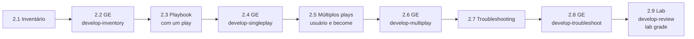

# Capítulo 2 — Introduction to Developing Automation Content

**Título em português:** Introdução ao desenvolvimento de conteúdo de automação
**Status:** ✅ documentado e validado (documentação; o estudo é marcado por você no checklist)
**Referência:** PDF p. 62–140 · arquivo `AU294_AAP2.6_C02_Desenvolvendo_Automacao_p062-140.pdf` (não versionado)

## Objetivo do capítulo

Construir inventários estáticos, escrever e executar playbooks com um ou vários
plays e diagnosticar problemas nos playbooks e nos managed hosts.

> Nota: a página de abertura do capítulo no PDF (p. 62) repete o objetivo do
> Capítulo 1. O objetivo acima foi reescrito a partir das seções e do resumo do
> próprio Capítulo 2 (p. 140).

## Por que este capítulo importa

É aqui que o Ansible começa a **fazer** algo. O Capítulo 1 montou o ambiente; o
Capítulo 2 ensina a dizer onde agir (inventário), o que fazer (playbook) e como
descobrir por que não funcionou (troubleshooting). Tudo o que vem depois
(variáveis, loops, templates, roles) é escrito dentro dessa estrutura.

## Seções e atividades (ordem oficial)

| Seção | Tipo | Título original | Material | PDF |
|-------|------|-----------------|----------|-----|
| 2.1 | Conceito | Building an Ansible Inventory | [lição](2.1-construindo-um-inventario.md) | p. 63–69 |
| 2.2 | Guided Exercise | Building an Ansible Inventory | [prática](PRATICA-OFICIAL.md#22-guided-exercise-building-an-ansible-inventory) | p. 70–75 |
| 2.3 | Conceito | Developing Playbooks | [lição](2.3-desenvolvendo-playbooks.md) | p. 76–85 |
| 2.4 | Guided Exercise | Developing Playbooks | [prática](PRATICA-OFICIAL.md#24-guided-exercise-developing-playbooks) | p. 86–93 |
| 2.5 | Conceito | Developing Playbooks with Multiple Plays | [lição](2.5-playbooks-com-multiplos-plays.md) | p. 94–102 |
| 2.6 | Guided Exercise | Developing Playbooks with Multiple Plays | [prática](PRATICA-OFICIAL.md#26-guided-exercise-developing-playbooks-with-multiple-plays) | p. 103–109 |
| 2.7 | Conceito | Troubleshooting Playbooks and Managed Hosts | [lição](2.7-troubleshooting-de-playbooks-e-hosts.md) | p. 110–118 |
| 2.8 | Guided Exercise | Troubleshooting Playbooks and Managed Hosts | [prática](PRATICA-OFICIAL.md#28-guided-exercise-troubleshooting-playbooks-and-managed-hosts) | p. 119–126 |
| 2.9 | Lab | Developing Automation Content | [prática](PRATICA-OFICIAL.md#29-lab-developing-automation-content) | p. 127–139 |
| 2.10 | Summary | Summary | [RESUMO.md](RESUMO.md) | p. 140 |

O capítulo não tem quiz. Só o lab 2.9 aceita `lab grade`.

## Arquivos do capítulo

- [PRATICA-OFICIAL.md](PRATICA-OFICIAL.md): ponte com os quatro guided exercises e o lab.
- [REVISAO.md](REVISAO.md): 23 questões autorais (conceito, escrita, diagnóstico).
- [RESUMO.md](RESUMO.md): síntese, comandos e modelos em uma tela.
- Exemplo validado: [exemplos-originais/cap02-inventario-e-playbooks](../../exemplos-originais/cap02-inventario-e-playbooks/).

## Pré-requisitos recomendados

[Capítulo 1](../01-introducao-ansible/README.md) ·
[F2 — YAML para Ansible](../../01-fundamentos-essenciais/yaml-para-ansible.md) ·
[F3 — Idempotência](../../01-fundamentos-essenciais/automacao-idempotencia.md)

## Checklist (marcado por você)

- [ ] 2.1 lida e Parte H respondida
- [ ] 2.2 Guided Exercise `develop-inventory` concluído
- [ ] 2.3 lida e Parte H respondida
- [ ] 2.4 Guided Exercise `develop-singleplay` concluído
- [ ] 2.5 lida e Parte H respondida
- [ ] 2.6 Guided Exercise `develop-multiplay` concluído
- [ ] 2.7 lida e Parte H respondida
- [ ] 2.8 Guided Exercise `develop-troubleshoot` concluído
- [ ] 2.9 Lab `develop-review` com `lab grade` aprovado
- [ ] [REVISAO.md](REVISAO.md) respondida
- [ ] Registro no [diário de laboratórios](../../progresso/diario-de-laboratorios.md)

---
[← Capítulo 1](../01-introducao-ansible/README.md) | [Índice geral](../../README.md) | [Próximo: 2.1 Inventário →](2.1-construindo-um-inventario.md)
