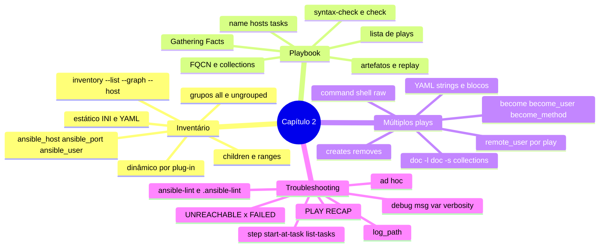

# Resumo — Capítulo 2

Síntese autoral para revisão rápida. Correspondência oficial: seção 2.10 Summary
(PDF p. 140).

## Em uma frase por seção

| Seção | Ideia central |
|-------|---------------|
| 2.1 | O inventário diz **onde**: hosts em vários grupos, `:children`, ranges e variáveis de conexão, conferidos com `ansible-navigator inventory` |
| 2.3 | O playbook diz **o quê**: lista de plays (`name`, `hosts`, `tasks`), tasks com módulos por FQCN, validado com `--syntax-check`/`--check` e reexecutado para provar a idempotência |
| 2.5 | Vários plays orquestram etapas em alvos diferentes, cada um com seu `remote_user` e `become`; prefira módulos específicos a `command`/`shell`/`raw` |
| 2.7 | Diagnostique por camada: escrita (lint, sintaxe), lógica (`debug`, `--step`), conexão (`-vvvv`, inventário) e host (mensagem do módulo, log, artefato) |

## Mapa do capítulo



## Tabela de comandos do capítulo

| Tarefa | Comando |
|--------|---------|
| Árvore do inventário | `ansible-navigator inventory -m stdout --graph [grupo]` |
| Inventário em JSON | `ansible-navigator inventory -m stdout --list` |
| Variáveis de um host | `ansible-navigator inventory -m stdout --host <host>` |
| Inventário interativo | `ansible-navigator inventory` (`:0` grupos, `:1` hosts) |
| Inventário alternativo | `... -i <caminho>` |
| Executar | `ansible-navigator run <pb>.yml` |
| Sintaxe | `ansible-navigator run <pb>.yml --syntax-check` |
| Simulação | `ansible-navigator run <pb>.yml --check` |
| Verbosidade | `ansible-navigator run <pb>.yml -v` … `-vvvvvv` |
| Passo a passo | `ansible-navigator run <pb>.yml -m stdout --pae false --step` |
| Começar em uma task | `ansible-navigator run <pb>.yml --start-at-task "<nome>"` |
| Listar tasks | `ansible-navigator run <pb>.yml --list-tasks` |
| Rever execução | `ansible-navigator replay <pb>-artifact-<data>.json` |
| Módulos do EE | `ansible-navigator doc -l -m stdout` |
| Documentação / snippet | `ansible-navigator doc <fqcn> -m stdout` · `... -s` |
| Collections do EE | `ansible-navigator collections` |
| Lint | `ansible-lint <pb>.yml` |
| Ad hoc | `ansible <padrão> -m <fqcn> [-a '<args>'] [-i <inv>]` |

## Modelos em uma tela

```ini
# inventory
solto.example.net            # hosts sem grupo no topo

[web]
web[01:04].example.net

[db]
db[1:2].example.net ansible_port=2200

[dc:children]
web
db
```

```yaml
---
- name: Play com escalada
  hosts: web
  become: true
  tasks:
    - name: Garantir pacote
      ansible.builtin.dnf:
        name: chrony
        state: present

- name: Play sem escalada, outro usuário
  hosts: db
  remote_user: monitor
  become: false
  gather_facts: false
  tasks:
    - name: Testar porta
      ansible.builtin.wait_for:
        host: web01.example.net
        port: 80
```

## Alertas operacionais

- ⚠️ Hosts listados depois de `[grupo:vars]` quebram o parse do inventário inteiro.
- ⚠️ Zeros à esquerda fazem parte do nome gerado pelo range.
- ⚠️ No inventário INI, comentário é `#`; um `;` no meio da linha quebra o parse (no `ansible.cfg` é o contrário).
- ⚠️ Host e grupo não podem ter o mesmo nome.
- ⚠️ `command`/`shell`/`raw` não são idempotentes: use `creates`/`removes` ou um módulo.
- ⚠️ `--start-at-task` pula as tasks anteriores; `--check` é uma simulação, não uma garantia.
- ⚠️ Prompts (`--step`, senhas) exigem `-m stdout --pae false`.
- ⚠️ `ansible_user` no inventário vence o `remote_user` do play.
- ⚠️ Se todos os hosts de um play falham, os plays seguintes não rodam.

## Ligação com o próximo capítulo

O Capítulo 3 aprofunda o que aqui apareceu de passagem: **variáveis** (inclusive as
de inventário), **facts** coletados pelo `Gathering Facts`, `register` e a proteção
de dados sensíveis com **Ansible Vault**.

---
[← Revisão](REVISAO.md) | [Índice do capítulo](README.md) | [Próximo capítulo →](../03-variaveis-e-vault/README.md)
