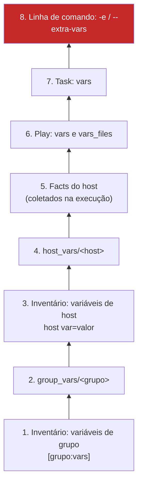

# 3.1 — Usando variáveis

| Campo | Valor |
|-------|-------|
| Curso | AU294 — Ansible Automation Platform 2.6 (edição 2) |
| Capítulo / seção | Capítulo 3 · Seção 3.1 |
| Título original | Using Variables |
| Título em português | Usando variáveis |
| Objetivo | Criar e referenciar variáveis de host, de grupo, de play e da linha de comando, e explicar como funciona a precedência |
| Pré-requisitos | [2.1 — inventário](../02-desenvolvendo-automacao/2.1-construindo-um-inventario.md), [2.3 — playbooks](../02-desenvolvendo-automacao/2.3-desenvolvendo-playbooks.md), [F2 — YAML](../../01-fundamentos-essenciais/yaml-para-ansible.md) |
| Referência | PDF p. 142–155 · Guided Exercise 3.2 p. 156–168 |

## Parte A — O problema que a tecnologia resolve

No Capítulo 2, os valores ficavam escritos dentro das tasks: `name: chrony`,
`port: 3306`, `/etc/chrony.conf`. Isso funciona até o dia em que:

- produção usa uma porta e homologação outra;
- um host específico foge do padrão;
- o mesmo valor aparece em dez tasks e alguém esquece de mudar uma delas.

**Variáveis** tiram os valores de dentro da lógica. O playbook descreve o *como*;
as variáveis guardam o *com quais valores*. Usos típicos citados no curso: usuários
a criar, pacotes a instalar, serviços a reiniciar, arquivos a remover, pacotes a
baixar da internet.

## Parte B — Modelo mental e arquitetura



*Da menor (embaixo) para a maior (em cima) precedência, na versão simplificada do curso.*

Duas regras resumem a tabela:

1. **Escopo mais estreito vence escopo mais largo:** host vence grupo; task vence play.
2. **Playbook vence inventário; `-e` vence tudo.**

A recomendação do curso é usar **nomes globalmente únicos** para não depender de
precedência. Use a precedência de propósito, quando quiser que um grupo ou host
específico fuja do padrão.

> 📘 *Fonte externa:* a lista oficial de precedência do Ansible tem mais de 20
> níveis (inclui roles, `include_vars`, `set_fact`, `register`). A versão do curso
> é a necessária para este capítulo.

## Parte C — Entendimento progressivo

### 1. Nomes válidos

Letras, números e `_`; começa com letra ou `_`; **nunca** com número. Palavras
reservadas do Python e palavras-chave de playbook (`hosts`, `tasks`, `name`...)
não podem ser nomes de variável.

| Inválido | Válido | Por quê |
|----------|--------|---------|
| `porta banco` | `porta_banco` | Espaço não é permitido |
| `arquivo.remoto` | `arquivo_remoto` | Ponto não é permitido |
| `2o_servidor` | `servidor_2` | Não pode começar com número |
| `custo$total` | `custo_total` | `$` não é permitido |

### 2. Onde definir (visão geral)

| Lugar | Escopo | Formato |
|-------|--------|---------|
| Inventário (`host var=valor`, `[grupo:vars]`) | Host / grupo | INI `chave=valor` |
| `group_vars/<grupo>.yml` ou `group_vars/<grupo>/*.yml` | Grupo | YAML |
| `host_vars/<host>.yml` ou `host_vars/<host>/*.yml` | Host | YAML |
| `vars:` no play | Play | YAML |
| `vars_files:` no play | Play | Arquivos YAML externos |
| `vars:` na task | Task | YAML |
| `-e chave=valor` / `--extra-vars` | Execução inteira | Linha de comando |
| Facts | Host | Coletados automaticamente (3.3) |

> Opções de linha de comando como `-u usuario` ou `-b` **não** são variáveis.

Dica do curso para achar onde uma variável é **definida** (e não só usada):
`grep -Rw porta_banco:` (os dois-pontos no fim filtram definições).

### 3. Variáveis no playbook: `vars` e `vars_files`

```yaml
- name: Exemplo de variáveis de play
  hosts: app
  vars:                         # poucas variáveis, específicas deste play
    pacote_web: nginx
  vars_files:                   # muitas variáveis, ou reaproveitadas entre playbooks
    - vars/app.yml              # caminho relativo ao diretório do playbook
```

O arquivo de `vars_files` é YAML puro, sem play:

```yaml
---
app_porta: 8443
app_diretorio: /srv/estoque
```

### 4. Usar: `{{ variavel }}` e a regra das aspas

As chaves duplas vêm do **Jinja2**, o motor de templates que o Ansible usa para
substituir valores (e, mais adiante, aplicar filtros). O Ansible avalia a expressão
na hora da execução da task.

```yaml
- name: Garantir o pacote {{ pacote_web }}   # no meio do texto: aspas opcionais
  ansible.builtin.dnf:
    name: "{{ pacote_web }}"                 # INÍCIO do valor: aspas OBRIGATÓRIAS
    state: present
```

⚠️ Sem aspas, `name: {{ pacote_web }}` é lido pelo YAML como um dicionário. O Ansible
avisa que parece ser falta de aspas. A regra vale para qualquer valor que **comece**
com `{{`: parâmetros, caminhos, itens de lista, loops.

### 5. Variáveis de host e de grupo no inventário (forma antiga)

```ini
[db]
db01.sp.example.net porta_banco=5433     # variável de host

[db:vars]
banco_nome=estoque                       # variável de grupo
```

Funciona, mas mistura hosts e dados no mesmo arquivo, deixa o inventário difícil
de manter e usa uma sintaxe considerada obsoleta.

### 6. `group_vars` e `host_vars` (forma recomendada)

Diretórios ao lado do inventário **ou** do playbook, com arquivos YAML cujo nome é
o do grupo ou do host:

```text
projeto/
├── ansible.cfg
├── inventory
├── group_vars/
│   ├── all/              # forma de diretório: todos os .yml dentro valem
│   │   └── vars.yml
│   └── db/
│       ├── vars.yml      # texto puro
│       └── vault.yml     # cifrado (3.5)
├── host_vars/
│   └── db02.sp.example.net.yml   # forma de arquivo único
└── site.yml
```

| Vantagem | Por quê |
|----------|---------|
| Escala e manutenção | Arquivos pequenos e focados, fáceis de achar e revisar |
| Reuso | Dados definidos uma vez, em um lugar |
| Combinar inventários | Com `-i <diretório>`, arquivos estáticos, dinâmicos e `group_vars`/`host_vars` funcionam juntos |
| Colaboração | Menos conflitos de merge quando várias pessoas editam |

Regras importantes:

- `group_vars/all.yml` (ou `group_vars/all/`) vale para **todos** os hosts.
- Se inventário e playbook estão em diretórios diferentes, o Ansible procura nos
  **dois**; os do diretório do **playbook** têm precedência maior.
- Na forma de diretório, os nomes dos arquivos internos (`vars.yml`, `vault.yml`)
  são livres: todos são carregados.

### 7. Extra vars: `-e`

```bash
ansible-navigator run site.yml -e pacote_web=httpd
```

Maior precedência de todas. Útil para uma execução pontual ("só desta vez, use outro
pacote"). Abusar de `-e` esconde a configuração real fora do Git.

### 8. Dicionários

Em vez de seis variáveis soltas (`app1_nome`, `app1_porta`, `app2_nome`...), um
dicionário agrupa dados relacionados:

```yaml
servicos:
  estoque:
    porta: 8443
    diretorio: /srv/estoque
  relatorios:
    porta: 9443
    diretorio: /srv/relatorios
```

| Notação | Exemplo | Recomendação |
|---------|---------|--------------|
| **Colchetes** | `servicos['estoque']['porta']` | **Recomendada pela Red Hat** |
| Ponto | `servicos.estoque.porta` | Funciona, mas quebra se a chave tem nome de método/atributo Python |

O curso alerta que a notação de ponto causa problemas quando a chave tem o mesmo
nome de um método ou atributo do Python, como `discard`, `copy` ou `add`. Os
colchetes evitam esses conflitos.

### 9. Listas (inclusive de dicionários)

```yaml
contas_servico:
  - nome: estoque
    uid: 2101
  - nome: relatorios
    uid: 2102
```

| Expressão | Resultado |
|-----------|-----------|
| `contas_servico[0]['nome']` | `estoque` (primeiro item, índice 0) |
| `contas_servico[1]['uid']` | `2102` |

Nos playbooks, a chave vai entre aspas dentro dos colchetes, como no exemplo do
curso: `"{{ contas_servico[0]['nome'] }}"`.

Acessar por índice serve para entender a estrutura; em projetos reais, **loops**
(Capítulo 4) escalam melhor.

### 10. `register`: guardar o resultado de uma task

```yaml
- name: Garantir o diretório da aplicação
  ansible.builtin.file:
    path: /srv/estoque
    state: directory
    mode: '0750'
  register: resultado_dir        # dicionário com o retorno do módulo

- name: Inspecionar o retorno
  ansible.builtin.debug:
    var: resultado_dir
```

O conteúdo depende do módulo, mas quase sempre inclui `changed` e `failed`. Use
para depurar ou para decidir algo depois (condicionais no Capítulo 4).

### 11. `debug`: `msg` × `var`

| Opção | Recebe | Exemplo |
|-------|--------|---------|
| `msg` | Texto com expressões `{{ }}` | `msg: "Porta: {{ porta_banco }}"` |
| `var` | O **nome** da variável, sem chaves | `var: porta_banco` |

`msg` para mensagens formatadas; `var` para despejar o conteúdo bruto. (Há também
`verbosity`, visto em 2.7, que controla quando a task aparece.)

### 12. Diferenças que confundem

| A | B | Diferença essencial |
|---|---|--------------------|
| `vars` | `vars_files` | Valores no play × valores em arquivos externos, reaproveitáveis |
| `group_vars/x.yml` | `group_vars/x/` | Um arquivo × diretório com vários arquivos (todos carregados) |
| Variável de host | Variável de grupo | Host vence grupo |
| Variável de play | Variável de inventário | Play vence inventário |
| `-e x=1` | `-u usuario`, `-b` | Extra var (maior precedência) × opções de execução, que não são variáveis |
| `['chave']` | `.chave` | Recomendado e seguro × pode colidir com métodos Python |
| `debug: msg` | `debug: var` | Texto com `{{ }}` × nome da variável |

## Parte D — Exemplo autoral incremental

Projeto completo e validado:
[exemplos-originais/cap03-variaveis-fatos-vault](../../exemplos-originais/cap03-variaveis-fatos-vault/).

**Passo 1 — padrão para todos e exceção para um host:**

```yaml
# group_vars/all/vars.yml
porta_banco: 5432
```

```yaml
# host_vars/db02.sp.example.net.yml
porta_banco: 5433
```

**Passo 2 — dados estruturados em `vars_files`:**

```yaml
# vars/app.yml
app_servico:
  nome: estoque-api
  porta: 8443
  diretorio: /srv/estoque
contas_servico:
  - nome: estoque
    uid: 2101
  - nome: relatorios
    uid: 2102
```

**Passo 3 — o play que consome tudo:**

```yaml
- name: Preparar contas e diretório da aplicação
  hosts: app
  become: true
  vars:
    pacotes_app:
      - java-21-openjdk-headless
      - unzip
  vars_files:
    - vars/app.yml
  tasks:
    - name: Garantir os pacotes da aplicação
      ansible.builtin.dnf:
        name: "{{ pacotes_app }}"
        state: present

    - name: Garantir a primeira conta de serviço
      ansible.builtin.user:
        name: "{{ contas_servico[0]['nome'] }}"
        uid: "{{ contas_servico[0]['uid'] }}"
        system: true
        state: present

    - name: Garantir o diretório {{ app_servico['diretorio'] }}
      ansible.builtin.file:
        path: "{{ app_servico['diretorio'] }}"
        state: directory
        owner: "{{ contas_servico[0]['nome'] }}"
        mode: '0750'
      register: resultado_dir
```

## Parte E — Execução e verificação

```bash
# Ver o valor efetivo de cada variável de inventário por host (antes de executar)
ansible-navigator inventory -m stdout --host db02.sp.example.net

ansible-navigator run variaveis.yml --syntax-check
ansible-navigator run variaveis.yml
ansible-navigator run variaveis.yml -v                        # mostra resultado_dir (verbosity: 1)
ansible-navigator run variaveis.yml -e porta_banco=6000       # extra var vence tudo
```

| Item | Valor |
|------|-------|
| Resultado esperado do `--host db02...` | `porta_banco: 5433` (de `host_vars`), demais valores de `group_vars` |
| Status | ✅ YAML, `--syntax-check` e `ansible-lint` (perfil *production*) sem erros · ⚠️ não executado contra hosts |

## Parte F — Troubleshooting

| Sintoma | Causa provável | Como verificar / corrigir |
|---------|----------------|---------------------------|
| `We could be wrong, but this one looks like it might be an issue with missing quotes` | Valor começa com `{{` sem aspas | `"{{ variavel }}"` |
| `'x' is undefined` | Variável não definida para aquele host, nome digitado errado | `ansible-navigator inventory -m stdout --host <h>`; `grep -Rw x:`|
| Valor "errado" para um host | Outro nível com precedência maior | Percorra a escada: `-e` → task → play → facts → host_vars → host no inventário → group_vars → grupo no inventário |
| `group_vars/<grupo>.yml` ignorado | Nome do arquivo diferente do nome do grupo, ou diretório no lugar errado | Mesmo nome do grupo; ao lado do inventário ou do playbook |
| Valor inesperado com notação de ponto | Chave com nome de método/atributo Python (`copy`, `add`...) | Use colchetes |
| Nome de variável rejeitado | Começa com número, tem espaço/ponto/`$` ou é palavra reservada | Renomeie com letras, números e `_` |

## Parte G — Preparação para o laboratório

Atividade associada: **3.2 Guided Exercise — Using Variables** (`variables-vars`,
PDF p. 156–168). Ver
[PRATICA-OFICIAL.md](PRATICA-OFICIAL.md#32-guided-exercise-using-variables).

Você deve conseguir:

- declarar variáveis de play e usá-las em nomes de tasks e parâmetros;
- mover variáveis do playbook para `group_vars/<grupo>/` sem mudar o resultado;
- explicar qual valor vence quando a mesma variável aparece em vários lugares;
- conferir o valor efetivo por host antes de executar.

## Parte H — Fixação

1. Quais destes nomes são válidos: `porta-web`, `_temp`, `3_tentativas`, `max_conexoes`, `hosts`?
2. `porta=80` está em `group_vars/all.yml`, `porta=8080` em `group_vars/web.yml` e `porta=9090` em `vars:` do play. Qual valor um host do grupo `web` recebe? E com `-e porta=1`?
3. Por que `name: {{ pacote }}` falha e `name: "{{ pacote }}"` funciona?
4. Escreva a expressão que retorna o `uid` do segundo item de `contas_servico`.
5. Diagnóstico: `msg: "{{ servicos.estoque.copy }}"` não mostra o valor esperado da chave `copy`. Explique.
6. Quando usar `vars_files` em vez de `vars`?

<details>
<summary>Respostas comentadas</summary>

1. Válidos: `_temp`, `max_conexoes`. Inválidos: `porta-web` (hífen), `3_tentativas` (começa com número), `hosts` (palavra-chave de playbook).
2. `9090`: variável de play vence `group_vars`. Com `-e porta=1`, vale `1`, pois extra vars vencem tudo.
3. Sem aspas, o YAML interpreta `{` no início do valor como um dicionário em linha. Com aspas, é uma string, que o Ansible avalia como Jinja2.
4. `contas_servico[1]['uid']`
5. `copy` é nome de método de dicionário em Python; com notação de ponto, a expressão pode não chegar à chave. Use `servicos['estoque']['copy']`.
6. Quando há muitas variáveis, quando elas devem ser reaproveitadas por vários playbooks, ou quando parte delas precisa ir para um arquivo cifrado (3.5).

</details>

## Parte I — Essencial para memorizar

- Nome: letras, números, `_`; não começa com número; não é palavra reservada.
- Precedência (curso): grupo no inventário < `group_vars` < host no inventário < `host_vars` < facts < play (`vars`/`vars_files`) < task < `-e`.
- Prefira `group_vars/` e `host_vars/` ao lado do inventário/playbook; o do playbook vence.
- `"{{ var }}"` com aspas quando o valor começa com chaves.
- Dicionários e listas: colchetes com aspas, `x[0]['chave']`.
- `register` guarda o retorno; `debug` com `msg` (texto) ou `var` (nome).
- Valor efetivo por host: `ansible-navigator inventory -m stdout --host <h>`.

---
[← Capítulo 3 (índice)](README.md) | [Índice do capítulo](README.md) | [Próximo: 3.3 Facts →](3.3-coletando-informacoes-com-facts.md)
