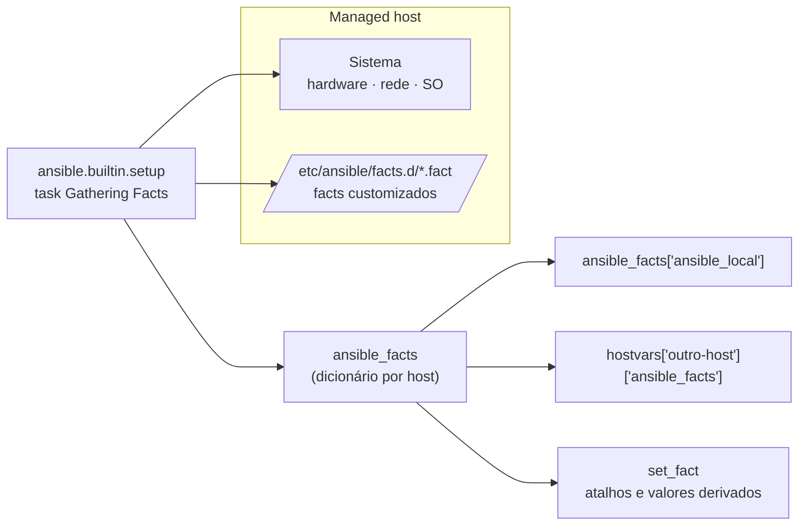

# 3.3 — Coletando informações dos hosts com facts

| Campo | Valor |
|-------|-------|
| Curso | AU294 — Ansible Automation Platform 2.6 (edição 2) |
| Capítulo / seção | Capítulo 3 · Seção 3.3 |
| Título original | Gathering Host Information from Facts |
| Título em português | Coletando informações dos hosts com facts |
| Objetivo | Usar facts dos managed hosts, criar facts customizados e usar variáveis mágicas para obter dados do inventário e de outros hosts |
| Pré-requisitos | [3.1](3.1-usando-variaveis.md), [2.3 — Gathering Facts](../02-desenvolvendo-automacao/2.3-desenvolvendo-playbooks.md#7-ler-a-saída) |
| Referência | PDF p. 169–178 · Guided Exercise 3.4 p. 179–187 |

## Parte A — O problema que a tecnologia resolve

Muitas decisões dependem do **próprio host**: o IP principal para colocar em um
arquivo de configuração, a memória disponível para dimensionar um banco, a versão
do sistema operacional. Escrever esses valores à mão em `host_vars` seria
trabalhoso e ficaria desatualizado.

**Facts** são variáveis que o Ansible descobre sozinho em cada managed host
(hostname, FQDN, interfaces, IPs, versão do SO, CPUs, memória, discos...). Você os
usa como qualquer outra variável: em parâmetros, mensagens, condicionais e loops.

> **Ponte com RHCSA:** é como rodar `hostnamectl`, `ip addr`, `free`, `lsblk` e
> `cat /etc/os-release` em cada servidor e guardar tudo em um dicionário por host,
> automaticamente.

## Parte B — Modelo mental e arquitetura



| Fonte | Variável | Quem define |
|-------|----------|-------------|
| Facts do sistema | `ansible_facts['...']` | Módulo `ansible.builtin.setup` |
| Facts customizados | `ansible_facts['ansible_local']['<arquivo>']` | Arquivos `.fact` no próprio host |
| Facts por `set_fact` | Nome que você escolher | Uma task da execução |
| Variáveis mágicas | `hostvars`, `group_names`, `groups`, `inventory_hostname` | O próprio Ansible (nomes reservados) |

## Parte C — Entendimento progressivo

### 1. Ver todos os facts

```yaml
- name: Despejar os facts
  hosts: db01.sp.example.net
  tasks:
    - name: Mostrar ansible_facts
      ansible.builtin.debug:
        var: ansible_facts
```

A saída é um dicionário JSON grande. Navegue por ela para descobrir o nome do fact
que você precisa. A coleta acontece na task **`Gathering Facts`** (desde o Ansible
2.3; antes, aparecia como `setup`).

### 2. Facts úteis

| Informação | Expressão |
|------------|-----------|
| Hostname curto | `ansible_facts['hostname']` |
| FQDN | `ansible_facts['fqdn']` |
| IPv4 principal (pela rota padrão) | `ansible_facts['default_ipv4']['address']` |
| Nomes das interfaces | `ansible_facts['interfaces']` |
| Tamanho de uma partição | `ansible_facts['devices']['vda']['partitions']['vda1']['size']` |
| Servidores DNS | `ansible_facts['dns']['nameservers']` |
| Kernel em execução | `ansible_facts['kernel']` |
| Distribuição e versão (📘) | `ansible_facts['distribution']`, `ansible_facts['distribution_version']` |

A Red Hat recomenda **colchetes**: a notação de ponto (`ansible_facts.default_ipv4.address`)
funciona, mas falha de formas difíceis de diagnosticar quando as chaves mudam ou
têm nomes inesperados.

### 3. Facts injetados como variáveis (`ansible_*`)

Antes do Ansible 2.5, cada fact virava uma variável solta com prefixo `ansible_`:

| Forma atual (recomendada) | Forma antiga (injetada) |
|---------------------------|--------------------------|
| `ansible_facts['hostname']` | `ansible_hostname` |
| `ansible_facts['fqdn']` | `ansible_fqdn` |
| `ansible_facts['default_ipv4']['address']` | `ansible_default_ipv4['address']` |
| `ansible_facts['kernel']` | `ansible_kernel` |

As duas funcionam hoje. O parâmetro `inject_facts_as_vars` em `[defaults]` do
`ansible.cfg` controla a forma antiga (padrão `true`). Com `false`, só
`ansible_facts[...]` funciona e as variáveis `ansible_*` dão erro.

A comunidade desencoraja a forma injetada pelo risco de **colisão** entre facts e
variáveis com o mesmo nome.

O curso explica o risco: um fact tem precedência alta e pode sobrepor variáveis
de host e de grupo do playbook e do inventário, com efeitos colaterais inesperados
(PDF p. 172). Por isso, prefira sempre `ansible_facts[...]`.

### 4. Desligar ou limitar a coleta

| Necessidade | Como |
|-------------|------|
| Play mais rápido, sem uso de facts | `gather_facts: false` no play |
| Host não consegue rodar o `setup` ainda (falta pré-requisito) | `gather_facts: false` e coletar depois |
| Coletar manualmente em qualquer ponto | Task com `ansible.builtin.setup:` |
| Só um subconjunto | `ansible.builtin.setup:` com `gather_subset: [hardware]` |
| Tudo menos um subconjunto | `gather_subset: ["!hardware"]` (**aspas obrigatórias**) |

```yaml
- name: Coletar tudo menos hardware
  ansible.builtin.setup:
    gather_subset:
      - "!hardware"     # sem aspas, o YAML lê "!" como tag e o arquivo não carrega
```

Em YAML, `!` não pode iniciar uma string sem aspas: por isso o curso coloca `"!hardware"` entre aspas.

### 5. Facts customizados

Valores que **o próprio host** declara sobre si (função, responsável, ambiente),
armazenados nele e somados aos facts comuns pelo `setup`.

| Regra | Detalhe |
|-------|---------|
| Diretório padrão | `/etc/ansible/facts.d/` no managed host |
| Nome do arquivo | Deve terminar em **`.fact`** |
| Formato estático | **INI** (seções viram chaves) ou **JSON**. YAML **não** é aceito |
| Formato dinâmico | Script **executável** que imprime JSON |
| Onde aparecem | `ansible_facts['ansible_local']['<nome-do-arquivo-sem-.fact>']` |

Exemplo autoral, arquivo `/etc/ansible/facts.d/papel.fact`:

```ini
[servidor]
funcao=db
responsavel=equipe-plataforma
```

Acesso: `ansible_facts['ansible_local']['papel']['servidor']['funcao']` → `db`.

Fluxo típico em um playbook: criar o diretório, publicar o `.fact` e **recoletar**
(`ansible.builtin.setup`) para que o fact novo apareça na mesma execução.

### 6. Guardar facts no control node

Para auditoria, relatório ou depuração sem recoletar, grave os facts em arquivos
**no control node** com `delegate_to: localhost`:

```yaml
- name: Garantir um diretório por host no control node
  ansible.builtin.file:
    path: "/var/tmp/inventario-facts/{{ inventory_hostname }}"
    state: directory
    mode: '0755'
  delegate_to: localhost          # executa no control node, não no host

- name: Gravar os facts em JSON legível
  ansible.builtin.copy:
    content: "{{ ansible_facts | to_nice_json }}"   # filtro (Cap. 5) que formata o JSON
    dest: "/var/tmp/inventario-facts/{{ inventory_hostname }}/facts.json"
    mode: '0644'
  delegate_to: localhost
```

> Com `ansible-navigator`, "control node" para `delegate_to: localhost` é o
> **container do execution environment**. 📘 Grave em um caminho dentro do projeto
> (montado no container) se quiser ver os arquivos depois na workstation.

### 7. `set_fact`: criar variáveis a partir de outras

Encurta caminhos longos e cria valores derivados, por host, durante a execução:

```yaml
- name: Criar atalho para o fato customizado
  ansible.builtin.set_fact:
    papel: "{{ ansible_facts['ansible_local']['papel']['servidor'] }}"
```

Depois: `papel['funcao']` em vez de `ansible_facts['ansible_local']['papel']['servidor']['funcao']`.

### 8. Variáveis mágicas

Definidas pelo Ansible; os nomes são **reservados** (não os use para suas variáveis).

| Variável | Conteúdo |
|----------|----------|
| `inventory_hostname` | Nome do host atual **como está no inventário** (pode diferir do hostname real) |
| `group_names` | Lista dos grupos do host atual |
| `groups` | Todos os grupos e seus hosts |
| `hostvars` | Variáveis de todos os hosts, inclusive de **outros**: `hostvars['db02.sp.example.net']['porta_banco']` |

```yaml
- name: Ler um dado de outro host
  ansible.builtin.debug:
    msg: "db02 escuta na porta {{ hostvars['db02.sp.example.net']['porta_banco'] }}"
```

⚠️ `hostvars['x']['ansible_facts']` só existe se os facts de `x` já foram coletados
nesta execução (no mesmo play ou em um play anterior).

### 9. Diferenças que confundem

| A | B | Diferença essencial |
|---|---|--------------------|
| Fact | Variável comum | Descoberto no host × definido por você |
| `ansible_facts['fqdn']` | `inventory_hostname` | Nome real do host × nome usado no inventário |
| `ansible_facts['kernel']` | `ansible_kernel` | Forma atual × forma injetada (depende de `inject_facts_as_vars`) |
| Fact customizado | `set_fact` | Mora no host e persiste × existe só durante a execução |
| `gather_facts: false` | `gather_subset` | Não coleta nada × coleta parte |
| `group_names` | `groups` | Grupos **deste** host × todos os grupos do inventário |

## Parte D — Exemplo autoral incremental

Arquivo validado:
[exemplos-originais/cap03-variaveis-fatos-vault/fatos.yml](../../exemplos-originais/cap03-variaveis-fatos-vault/fatos.yml).

**Passo 1 — publicar o fato customizado e recoletar:**

```yaml
- name: Publicar fato customizado e banner com facts
  hosts: producao
  become: true
  tasks:
    - name: Garantir o diretório de fatos customizados
      ansible.builtin.file:
        path: /etc/ansible/facts.d
        state: directory
        mode: '0755'

    - name: Publicar o fato customizado papel.fact (formato INI)
      ansible.builtin.copy:
        dest: /etc/ansible/facts.d/papel.fact
        mode: '0644'
        content: |
          [servidor]
          funcao={{ group_names[0] }}
          responsavel=equipe-plataforma

    - name: Recoletar facts para enxergar o fato novo
      ansible.builtin.setup:
        filter: ansible_local
```

**Passo 2 — atalho com `set_fact` e uso de facts do sistema:**

```yaml
    - name: Criar atalho para o fato customizado
      ansible.builtin.set_fact:
        papel: "{{ ansible_facts['ansible_local']['papel']['servidor'] }}"

    - name: Publicar banner de login com dados do host
      ansible.builtin.copy:
        dest: /etc/motd
        mode: '0644'
        content: |
          {{ banner_texto }}
          Host: {{ ansible_facts['fqdn'] }} ({{ ansible_facts['default_ipv4']['address'] }})
          Função: {{ papel['funcao'] }}
```

**Passo 3 — variáveis mágicas em outro play:**

```yaml
- name: Consultar dados de outro host com hostvars
  hosts: app
  gather_facts: false
  tasks:
    - name: Mostrar grupos deste host e a porta configurada para db02
      ansible.builtin.debug:
        msg: >-
          {{ inventory_hostname }} está em {{ group_names }};
          db02 escuta na porta {{ hostvars['db02.sp.example.net']['porta_banco'] }}
```

## Parte E — Execução e verificação

```bash
ansible-navigator run fatos.yml --syntax-check
ansible-navigator run fatos.yml
```

| Item | Valor |
|------|-------|
| Play 1 | Grupo `producao`, com `become` (escreve em `/etc`) |
| Play 2 | Grupo `app`, sem facts e sem `become` |
| Verificação no host (📘) | `cat /etc/ansible/facts.d/papel.fact` · `cat /etc/motd` |
| Saída esperada do play 2 | Uma mensagem por host de `app` com seus grupos e a porta de `db02` (`5433`, de `host_vars`) |
| Status | ✅ `--syntax-check` e `ansible-lint` (perfil *production*) · ⚠️ não executado contra hosts |

## Parte F — Troubleshooting

| Sintoma | Causa provável | Como verificar / corrigir |
|---------|----------------|---------------------------|
| `'dict object' has no attribute 'ansible_local'` ou `ansible_local` vazio | Arquivo sem extensão `.fact`, em YAML, sem permissão de leitura, ou facts não recoletados após criar o arquivo | Confira nome/formato; rode `ansible.builtin.setup` depois de publicar o arquivo |
| Fact customizado dinâmico não aparece | Script sem permissão de execução ou que não imprime JSON válido | `chmod +x`; rode o script no host e valide a saída |
| `'ansible_facts' is undefined` / fact ausente | Play com `gather_facts: false` | Ative a coleta ou rode `ansible.builtin.setup` |
| `hostvars['x']['ansible_facts']` vazio | Facts de `x` ainda não coletados nesta execução | Inclua `x` em um play anterior que colete facts |
| `ansible_hostname` indefinido | `inject_facts_as_vars = false` | Use `ansible_facts['hostname']` |
| Erro de YAML em `gather_subset` | `!hardware` sem aspas | `"!hardware"` |

## Parte G — Preparação para o laboratório

Atividade associada: **3.4 Guided Exercise — Gathering Host Information from
Facts** (`variables-facts`, PDF p. 179–187). Ver
[PRATICA-OFICIAL.md](PRATICA-OFICIAL.md#34-guided-exercise-gathering-host-information-from-facts).

Você deve conseguir:

- despejar `ansible_facts` e encontrar o caminho de um fact específico;
- mostrar `ansible_local` antes e depois de criar um fato customizado;
- publicar um `.fact` com um playbook;
- encurtar um caminho longo com `set_fact` e usá-lo em tasks seguintes.

## Parte H — Fixação

1. Qual expressão retorna o IPv4 principal de um host? E o FQDN?
2. Você criou `/etc/ansible/facts.d/rede.fact` com a seção `[dmz]` e a chave `gateway`. Qual é a expressão completa?
3. Qual a diferença entre `inventory_hostname` e `ansible_facts['hostname']`?
4. Diagnóstico: o play cria o `.fact` e a task seguinte falha porque `ansible_local` está vazio. O que falta?
5. Um play com `gather_facts: false` precisa de facts só na última task. Qual a solução mais barata?
6. Por que a comunidade desencoraja `ansible_hostname` em favor de `ansible_facts['hostname']`?

<details>
<summary>Respostas comentadas</summary>

1. `ansible_facts['default_ipv4']['address']` e `ansible_facts['fqdn']`.
2. `ansible_facts['ansible_local']['rede']['dmz']['gateway']`.
3. `inventory_hostname` é o nome como está no inventário (pode ser um alias ou um nome com `ansible_host`); `ansible_facts['hostname']` é o hostname curto reportado pelo próprio sistema.
4. Recoletar os facts depois de criar o arquivo: uma task `ansible.builtin.setup` (pode ser com `filter: ansible_local`).
5. Uma task `ansible.builtin.setup` antes da última task, se possível com `gather_subset` limitado ao que for preciso.
6. Pelo risco de colisão com variáveis de mesmo nome e porque a forma injetada pode ser desligada (`inject_facts_as_vars = false`), quebrando o playbook.

</details>

## Parte I — Essencial para memorizar

- Facts = `ansible_facts[...]`, coletados pelo `ansible.builtin.setup` (task `Gathering Facts`).
- Use colchetes: `ansible_facts['default_ipv4']['address']`.
- `ansible_*` injetado = forma antiga; controlado por `inject_facts_as_vars`.
- `gather_facts: false` desliga; `ansible.builtin.setup` coleta quando quiser; `gather_subset` limita (`"!x"` entre aspas).
- Customizados: `/etc/ansible/facts.d/*.fact`, INI ou JSON (ou script executável com JSON) → `ansible_facts['ansible_local']['arquivo']`.
- `set_fact` cria variáveis por host durante a execução.
- Mágicas: `inventory_hostname`, `group_names`, `groups`, `hostvars`.

---
[← 3.1 Variáveis](3.1-usando-variaveis.md) | [Índice do capítulo](README.md) | [Próximo: 3.5 Ansible Vault →](3.5-protegendo-dados-com-ansible-vault.md)
