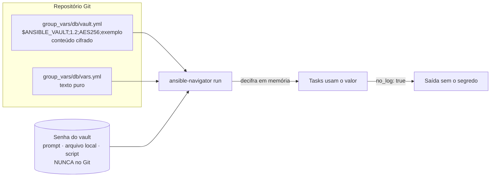

# 3.5 — Protegendo dados sensíveis com Ansible Vault

| Campo | Valor |
|-------|-------|
| Curso | AU294 — Ansible Automation Platform 2.6 (edição 2) |
| Capítulo / seção | Capítulo 3 · Seção 3.5 |
| Título original | Protecting Sensitive Data with Ansible Vault |
| Título em português | Protegendo dados sensíveis com Ansible Vault |
| Objetivo | Cifrar dados de variáveis e arquivos com o Ansible Vault e executar playbooks que os decifram e usam |
| Pré-requisitos | [3.1 — group_vars e vars_files](3.1-usando-variaveis.md), [1.5 — ansible-navigator.yml](../01-introducao-ansible/1.5-configurando-ajustes-do-ansible.md) |
| Referência | PDF p. 188–198 · Guided Exercise 3.6 p. 199–208 |

## Parte A — O problema que a tecnologia resolve

Automação real precisa de segredos: senhas de banco, chaves de API, certificados.
Se ficarem em texto puro em `group_vars` ou em um playbook, **qualquer pessoa com
acesso ao repositório Git** (ou a um clone antigo, ou a um backup) lê tudo.

O **Ansible Vault**, incluído no Ansible, cifra esses dados. O arquivo continua no
Git, mas ilegível; o Ansible só o decifra **na execução**, com a senha certa.

> ⚠️ O Vault protege dados **em repouso**. Depois de decifrado, o valor vira dado
> **em uso**: pode aparecer na saída, em logs, em artefatos do navigator. Proteger
> essa etapa é responsabilidade de quem escreve o playbook (`no_log`, artefatos
> desligados).

## Parte B — Modelo mental e arquitetura



| O que pode ser cifrado | Exemplos |
|------------------------|----------|
| Arquivos de dados estruturados | Variáveis de inventário, arquivos de variáveis incluídos no playbook, arquivos de variáveis passados como argumento na execução, variáveis de roles; o curso cita como exemplos um `ansible.cfg` ou um arquivo de inventário |
| Arquivos arbitrários e binários | Certificados, configurações; com `decrypt: true`, módulos como `copy` entregam o arquivo **decifrado** no host |
| Valores isolados | Uma única variável dentro de um YAML (`encrypt_string`) |

**Criptografia:** o Vault não implementa criptografia própria; usa a biblioteca
Python `cryptography`, com **AES de 256 bits** e chave derivada da senha (cifra
simétrica). Segundo o curso, a implementação não passou por auditoria formal de
terceiros.

## Parte C — Entendimento progressivo

### 1. O comando `ansible-vault`

| Subcomando | Faz |
|------------|-----|
| `create <arq>` | Cria um arquivo já cifrado e abre no editor (padrão `vi`; mude com `export EDITOR=nano`) |
| `encrypt <arq>...` | Cifra arquivos existentes (aceita vários; `--output=<novo>` com um só) |
| `encrypt_string` | Cifra um valor para colar em um YAML |
| `view <arq>` | Mostra o conteúdo decifrado, sem alterar o arquivo |
| `edit <arq>` | Decifra para um temporário, abre no editor e **recifra ao salvar** |
| `decrypt <arq>` | Decifra de vez (`--output=<novo>` mantém o original cifrado) |
| `rekey <arq>...` | Troca a senha (`--new-vault-password-file` ou `--new-vault-id`) |

Notas do curso:

- `edit` **sempre reescreve** o arquivo, gerando diferença no Git mesmo sem mudança
  real. Para só olhar, use `view`.
- Evite digitar segredos na linha de comando: ficam no histórico do shell
  (`history -c` limpa). Prefira `--stdin-name` no `encrypt_string`.

```bash
ansible-vault create group_vars/db/vault.yml               # pede a senha nova e abre o editor
ansible-vault view group_vars/db/vault.yml
ansible-vault edit group_vars/db/vault.yml
ansible-vault encrypt_string --stdin-name api_chave        # lê o valor da entrada padrão
ansible-vault decrypt vault.yml --output=vault-claro.yml   # original continua cifrado
```

Saída de `encrypt_string` (para colar em um arquivo de variáveis):

```text
api_chave: !vault |
          $ANSIBLE_VAULT;1.1;AES256
          6638...  (linhas hexadecimais)
```

### 2. Senha: prompt ou arquivo

| Forma | Opção | Cuidados |
|-------|-------|----------|
| Interativa | `--ask-vault-pass` | Com o navigator, exige `-m stdout` e `--pae false` |
| Arquivo | `--vault-password-file=<arq>` | Arquivo com a senha em **texto puro** em uma linha: `chmod 600` e **fora do Git** |
| Configuração | `vault_password_file = <arq>` em `[defaults]` | Dispensa a opção na linha de comando |
| Variável de ambiente | `ANSIBLE_VAULT_PASSWORD_FILE=<arq>` | Idem |

### 3. Vault IDs: várias senhas no mesmo projeto

Para separar, por exemplo, segredos de desenvolvimento e de produção, cada arquivo
recebe um **rótulo** (vault ID) gravado no cabeçalho:

| Cabeçalho | Significado |
|-----------|-------------|
| `$ANSIBLE_VAULT;1.1;AES256` | Formato 1.1: senha única, **sem** rótulo (modo legado, compatível) |
| `$ANSIBLE_VAULT;1.2;AES256;dev` | Formato 1.2: cifrado com o vault ID `dev` (desde o Ansible 2.4) |

Sintaxe: `--vault-id rotulo@origem`, em que origem é:

| Origem | Exemplo | Significado |
|--------|---------|-------------|
| `prompt` | `dev@prompt` | Pergunta a senha |
| arquivo | `dev@.vault-dev` | Lê a senha do arquivo |
| script | `dev@obter-senha.sh` | Executa e lê a senha da saída |

```bash
ansible-vault encrypt group_vars/dev/vault.yml  --vault-id dev@.vault-dev
ansible-vault encrypt group_vars/prod/vault.yml --vault-id prod@prompt
```

Resultado: os cabeçalhos passam a ser `$ANSIBLE_VAULT;1.2;AES256;dev` e
`$ANSIBLE_VAULT;1.2;AES256;prod`.

`--vault-id @prompt` sem rótulo equivale a `default@prompt`. O rótulo `default` não
é gravado no cabeçalho, por compatibilidade.

### 4. Executar playbooks com conteúdo cifrado

Sem senha, a execução para logo:

```text
ERROR! ... Attempting to decrypt but no vault secrets found
```

Formas de fornecer:

```bash
# Senha única, interativa (navigator precisa de stdout e sem artefatos)
ansible-navigator run site.yml -m stdout --pae false --ask-vault-pass

# Senha única, de arquivo
ansible-navigator run site.yml --vault-password-file=.vault-senha

# Vários vault IDs
ansible-navigator run site.yml -m stdout --pae false \
  --vault-id dev@prompt --vault-id prod@prompt
ansible-navigator run site.yml --vault-id dev@.vault-dev --vault-id prod@.vault-prod
```

Ou deixe no `ansible.cfg`, e rode sem opções:

```ini
[defaults]
; senha única
vault_password_file = .vault-senha
; ou vários IDs (o Ansible escolhe pelo rótulo do cabeçalho)
vault_identity_list = dev@.vault-dev,prod@.vault-prod
```

Equivalentes em variável de ambiente: `ANSIBLE_VAULT_PASSWORD_FILE` e
`ANSIBLE_VAULT_IDENTITY_LIST` (lista separada por vírgulas).

Com `vault_identity_list` configurado, os playbooks rodam sem opções de vault: o
Ansible escolhe a senha certa pelo rótulo no cabeçalho de cada arquivo.

> ⚠️ Com o `ansible-navigator`, prompts **travam** se os artefatos estiverem ligados.
> Deixe `mode: stdout` e `playbook-artifact.enable: false` no `ansible-navigator.yml`
> do projeto, o que também evita gravar valores decifrados em JSON. 📘 Mantenha o
> arquivo de senha **dentro do diretório do projeto** (ignorado pelo Git), para que
> ele seja visível no execution environment.

### 5. Módulos que aceitam arquivos cifrados

`ansible.builtin.copy`, `template`, `unarchive`, `script` e `assemble` podem receber
um arquivo cifrado como `src` e entregá-lo decifrado com `decrypt: true`:

```yaml
- name: Entregar o certificado privado decifrado
  ansible.builtin.copy:
    src: files/servidor.key.vault      # cifrado no repositório
    dest: /etc/pki/tls/private/servidor.key
    mode: '0600'
    decrypt: true
```

Sem `decrypt: true`, o arquivo continua cifrado no host. A opção só funciona com a
senha (e o vault ID, se houver) correta; caso contrário, a task falha com erro de
decifração.

### 6. Limitações dos vault IDs

| Situação | O que acontece | Como evitar |
|----------|----------------|-------------|
| Mesmo rótulo, senhas diferentes | O Ansible **não impede** (acontece ao errar a senha no prompt) | `rekey` do arquivo divergente para a senha correta |
| Várias senhas fornecidas | O Ansible tenta todas até uma funcionar | `vault_id_match = true` em `[defaults]`: cada senha só tenta arquivos do mesmo rótulo |
| Rótulo omitido | Vira `default` | Rotule sempre que houver mais de uma senha |

### 7. Não vazar na saída: `no_log`

```yaml
- name: Publicar arquivo de conexão com a senha decifrada
  ansible.builtin.copy:
    dest: /etc/estoque/banco.conf
    mode: '0600'
    content: |
      usuario={{ banco_usuario_app }}
      senha={{ banco_senha_app }}
  no_log: true          # oculta argumentos e resultado, mesmo em caso de falha
```

`no_log` vale para task, block, role ou play. Use **só** onde há segredo: ele
esconde toda a saída e os erros, o que dificulta o diagnóstico.

O exemplo do curso aplica `no_log: true` à task que cria um usuário de banco com
senha, com o usuário em `group_vars/db_servers/vars.yml` (texto puro) e a senha em
`group_vars/db_servers/vault.yml` (cifrado).

### 8. Organização recomendada de arquivos

```text
group_vars/
└── db/
    ├── vars.yml      # texto puro: banco_senha_app: "{{ vault_banco_senha_app }}"
    └── vault.yml     # cifrado:    vault_banco_senha_app: ...
host_vars/
└── db01.sp.example.net/
    ├── vars.yml
    └── vault.yml
```

- Separe variáveis sensíveis em arquivos próprios e cifre **só esses**.
- Os nomes `vars.yml`/`vault.yml` são convenção; todos os arquivos do diretório são lidos.
- 📘 Padrão da documentação ("keep vaulted variables safely visible"): o arquivo em
  texto puro **referencia** a variável cifrada (prefixo `vault_`). Assim, `grep`
  encontra onde a variável é usada sem precisar decifrar nada.
- Para segredos de playbook, use um arquivo cifrado em `vars_files` (variáveis de play
  vencem as de inventário).
- Com várias senhas, **rotule** cada arquivo: o Ansible acha a senha certa de primeira.

### 9. Diferenças que confundem

| A | B | Diferença essencial |
|---|---|--------------------|
| `encrypt` | `encrypt_string` | Arquivo inteiro × um valor para colar em YAML |
| `view` | `edit` | Só lê × reescreve o arquivo (gera diff no Git) |
| `decrypt` | `decrypt --output` | Decifra no lugar × gera cópia decifrada e mantém o original |
| `--vault-password-file` | `--vault-id rotulo@arquivo` | Senha única × senha associada a um rótulo |
| `vault_password_file` | `vault_identity_list` | Uma senha × lista `rotulo@origem` |
| Formato 1.1 | Formato 1.2 | Sem rótulo × com rótulo no cabeçalho |
| Vault | `no_log` | Protege em repouso (arquivo) × protege em uso (saída) |

## Parte D — Exemplo autoral incremental

Projeto validado:
[exemplos-originais/cap03-variaveis-fatos-vault](../../exemplos-originais/cap03-variaveis-fatos-vault/)
(senha de estudo **fictícia** documentada no README do projeto; o arquivo de senha
não é versionado).

**Passo 1 — arquivo de senha local e protegido:**

```bash
umask 077
echo 'estudo-au294-ficticia' > .vault-exemplo     # ignorado pelo .gitignore (.vault-*)
```

**Passo 2 — configurar o projeto para achar a senha pelo rótulo:**

```ini
[defaults]
vault_identity_list = exemplo@.vault-exemplo
```

**Passo 3 — separar texto puro e segredo, e cifrar só o segredo:**

```yaml
# group_vars/db/vars.yml (texto puro)
banco_usuario_app: app_estoque
banco_senha_app: "{{ vault_banco_senha_app }}"
```

```bash
ansible-vault create group_vars/db/vault.yml --encrypt-vault-id exemplo
# conteúdo: vault_banco_senha_app: S3nha-Ficticia-Apenas-Estudo
head -1 group_vars/db/vault.yml          # $ANSIBLE_VAULT;1.2;AES256;exemplo
```

**Passo 4 — usar sem vazar:**

```yaml
- name: Publicar arquivo de conexão com a senha decifrada
  ansible.builtin.copy:
    dest: /etc/estoque/banco.conf
    mode: '0600'
    content: |
      usuario={{ banco_usuario_app }}
      senha={{ banco_senha_app }}
  no_log: true
```

## Parte E — Execução e verificação

```bash
ansible-navigator run segredos.yml --syntax-check   # já precisa decifrar o vault.yml
ansible-navigator run segredos.yml                  # senha vem do vault_identity_list
git status --short                                  # .vault-exemplo NÃO pode aparecer
```

| Item | Valor |
|------|-------|
| `become` | Sim: escreve em `/etc/estoque` |
| Saída esperada da task sensível | Só `changed`/`ok`, sem conteúdo (efeito do `no_log`) |
| Verificação no host (📘) | `ls -l /etc/estoque/banco.conf` → `-rw-------` |
| Status | ✅ `vault.yml` cifrado com vault ID `exemplo`; `--syntax-check` e `ansible-lint` (perfil *production*) sem erros; arquivo de senha coberto pelo `.gitignore` · ⚠️ não executado contra hosts |

## Parte F — Troubleshooting

| Sintoma | Causa provável | Como verificar / corrigir |
|---------|----------------|---------------------------|
| `Attempting to decrypt but no vault secrets found` | Nenhuma senha fornecida | `--ask-vault-pass`, `--vault-password-file`, `--vault-id` ou `ansible.cfg` |
| `Decryption failed (no vault secrets were found that could decrypt)` | Senha errada, ou falta o vault ID daquele arquivo | `head -1 <arq>` mostra o rótulo; forneça o ID certo |
| Navigator trava ao pedir a senha | Artefatos ligados / modo interativo | `-m stdout --pae false` |
| Senha aparece na saída | Task sem `no_log` | `no_log: true` nas tasks que manipulam segredos |
| Diff no Git sem mudança real | Uso de `edit` só para ler | Use `view` |
| Arquivo de senha apareceu no `git status` | Padrão ausente no `.gitignore` | Adicione o padrão **antes** do primeiro commit; se já commitou, troque a senha (`rekey`) |

## Parte G — Preparação para o laboratório

Atividade associada: **3.6 Guided Exercise — Protecting Sensitive Data with Ansible
Vault** (`variables-vault`, PDF p. 199–208). Ver
[PRATICA-OFICIAL.md](PRATICA-OFICIAL.md#36-guided-exercise-protecting-sensitive-data-with-ansible-vault).

Você deve conseguir:

- cifrar um arquivo e reconhecer a versão do formato pelo cabeçalho;
- executar um playbook com senha interativa e com arquivo de senha;
- trabalhar com vault IDs e configurar o `ansible.cfg` para dispensar opções;
- explicar por que artefatos devem estar desligados quando há segredos.

## Parte H — Fixação

1. Que comando mostra um arquivo cifrado sem alterá-lo? E qual deles altera o arquivo mesmo sem mudanças?
2. Um arquivo começa com `$ANSIBLE_VAULT;1.2;AES256;prod`. O que cada campo significa?
3. Escreva a linha do `ansible.cfg` que associa `dev` ao arquivo `.vault-dev` e `prod` ao `.vault-prod`.
4. Diagnóstico: o playbook falha com `Decryption failed (no vault secrets were found that could decrypt)` só em um dos arquivos. O que verificar?
5. Por que separar `vars.yml` (texto puro) e `vault.yml` (cifrado) no mesmo diretório de grupo?
6. Diagnóstico: a senha do banco apareceu no log de uma execução que falhou. O que faltou?

<details>
<summary>Respostas comentadas</summary>

1. `ansible-vault view`. O `ansible-vault edit` sempre reescreve o arquivo.
2. `$ANSIBLE_VAULT` (marcador), `1.2` (versão do formato, com rótulo), `AES256` (cifra), `prod` (vault ID usado na cifragem).
3. `vault_identity_list = dev@.vault-dev,prod@.vault-prod`
4. O rótulo no cabeçalho do arquivo (`head -1`) e se a senha daquele rótulo foi fornecida e está correta (pode ter sido cifrado com outra senha sob o mesmo rótulo; corrija com `rekey`).
5. Para cifrar só o necessário, manter os demais valores legíveis e revisáveis no Git e, com a indireção `vault_*`, conseguir buscar onde cada segredo é usado sem decifrar nada.
6. `no_log: true` na task que manipulava o segredo (e, no navigator, artefatos desligados).

</details>

## Parte I — Essencial para memorizar

- `ansible-vault create | encrypt | encrypt_string | view | edit | decrypt | rekey`.
- Vault protege em repouso; `no_log` e artefatos desligados protegem em uso.
- Senha: `--ask-vault-pass`, `--vault-password-file`, `--vault-id rotulo@origem`, `vault_password_file`/`vault_identity_list`, `ANSIBLE_VAULT_PASSWORD_FILE`/`ANSIBLE_VAULT_IDENTITY_LIST`.
- Cabeçalho 1.1 = sem rótulo; 1.2 = com rótulo.
- Navigator + prompt = `-m stdout --pae false`.
- `decrypt: true` em `copy`/`template`/`unarchive`/`script`/`assemble`.
- `group_vars/<g>/vars.yml` + `vault.yml`; arquivo de senha com `chmod 600` e no `.gitignore`.

---
[← 3.3 Facts](3.3-coletando-informacoes-com-facts.md) | [Índice do capítulo](README.md) | [Próximo: Prática oficial →](PRATICA-OFICIAL.md)
