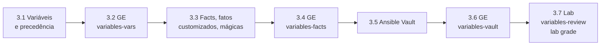

# Capítulo 3 — Developing Automation Content: Variables

**Título em português:** Desenvolvendo conteúdo de automação: variáveis
**Status:** ✅ documentado e validado (documentação; o estudo é marcado por você no checklist)
**Referência:** PDF p. 141–225 · arquivo `AU294_AAP2.6_C03_Variaveis_p141-225.pdf` (não versionado)

## Objetivo do capítulo

Escrever playbooks que usam variáveis para simplificar a manutenção, usam facts e
variáveis mágicas para obter dados dos hosts e protegem dados sensíveis com o
Ansible Vault.

## Por que este capítulo importa

Até aqui, os playbooks tinham valores fixos. Com variáveis, o mesmo playbook passa a
servir para ambientes, grupos e hosts diferentes; com facts, ele se adapta ao que
encontra no host; com o Vault, segredos podem ir para o Git com segurança. A
precedência de variáveis é um dos temas mais cobrados em troubleshooting e no EX294.

## Seções e atividades (ordem oficial)

| Seção | Tipo | Título original | Material | PDF |
|-------|------|-----------------|----------|-----|
| 3.1 | Conceito | Using Variables | [lição](3.1-usando-variaveis.md) | p. 142–155 |
| 3.2 | Guided Exercise | Using Variables | [prática](PRATICA-OFICIAL.md#32-guided-exercise-using-variables) | p. 156–168 |
| 3.3 | Conceito | Gathering Host Information from Facts | [lição](3.3-coletando-informacoes-com-facts.md) | p. 169–178 |
| 3.4 | Guided Exercise | Gathering Host Information from Facts | [prática](PRATICA-OFICIAL.md#34-guided-exercise-gathering-host-information-from-facts) | p. 179–187 |
| 3.5 | Conceito | Protecting Sensitive Data with Ansible Vault | [lição](3.5-protegendo-dados-com-ansible-vault.md) | p. 188–198 |
| 3.6 | Guided Exercise | Protecting Sensitive Data with Ansible Vault | [prática](PRATICA-OFICIAL.md#36-guided-exercise-protecting-sensitive-data-with-ansible-vault) | p. 199–208 |
| 3.7 | Lab | Developing Automation Content: Variables | [prática](PRATICA-OFICIAL.md#37-lab-developing-automation-content-variables) | p. 209–224 |
| 3.8 | Summary | Summary | [RESUMO.md](RESUMO.md) | p. 225 |

O capítulo não tem quiz. Só o lab 3.7 aceita `lab grade`.

## Arquivos do capítulo

- [PRATICA-OFICIAL.md](PRATICA-OFICIAL.md): ponte com os três guided exercises e o lab.
- [REVISAO.md](REVISAO.md): 25 questões autorais (conceito, escrita, diagnóstico).
- [RESUMO.md](RESUMO.md): síntese, precedência, comandos e modelos em uma tela.
- Exemplo validado: [exemplos-originais/cap03-variaveis-fatos-vault](../../exemplos-originais/cap03-variaveis-fatos-vault/).

## Pré-requisitos recomendados

[Capítulo 2](../02-desenvolvendo-automacao/README.md) ·
[F2 — YAML para Ansible](../../01-fundamentos-essenciais/yaml-para-ansible.md)

## Checklist (marcado por você)

- [ ] 3.1 lida e Parte H respondida
- [ ] 3.2 Guided Exercise `variables-vars` concluído
- [ ] 3.3 lida e Parte H respondida
- [ ] 3.4 Guided Exercise `variables-facts` concluído
- [ ] 3.5 lida e Parte H respondida
- [ ] 3.6 Guided Exercise `variables-vault` concluído
- [ ] 3.7 Lab `variables-review` com `lab grade` aprovado
- [ ] [REVISAO.md](REVISAO.md) respondida
- [ ] Registro no [diário de laboratórios](../../progresso/diario-de-laboratorios.md)

---
[← Capítulo 2](../02-desenvolvendo-automacao/README.md) | [Índice geral](../../README.md) | [Próximo: 3.1 Variáveis →](3.1-usando-variaveis.md)
