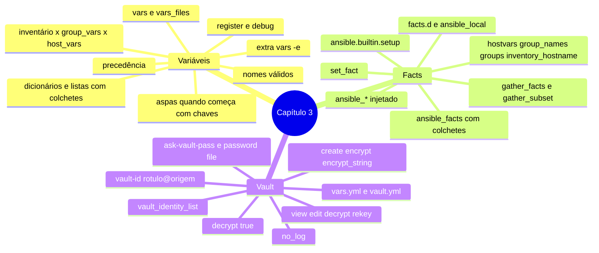

# Resumo — Capítulo 3

Síntese autoral para revisão rápida. Correspondência oficial: seção 3.8 Summary
(PDF p. 225).

## Em uma frase por seção

| Seção | Ideia central |
|-------|---------------|
| 3.1 | Variáveis tiram valores de dentro da lógica; defina-as em `group_vars`/`host_vars`, `vars`/`vars_files` ou `-e`, sabendo que escopo estreito e playbook vencem escopo largo e inventário |
| 3.3 | Facts trazem dados do próprio host (`ansible_facts[...]`); facts customizados (`.fact`), `set_fact` e variáveis mágicas (`hostvars`, `group_names`...) completam o quadro |
| 3.5 | O Ansible Vault cifra variáveis e arquivos em repouso; a senha vem de prompt, arquivo, vault ID ou `ansible.cfg`, e `no_log` evita o vazamento em uso |

## Mapa do capítulo



## Precedência (versão do curso)

| De baixo para cima | |
|---|---|
| 1 | Variáveis de grupo no inventário |
| 2 | `group_vars/` |
| 3 | Variáveis de host no inventário |
| 4 | `host_vars/` |
| 5 | Facts |
| 6 | `vars` e `vars_files` do play |
| 7 | `vars` da task |
| 8 | `-e` / `--extra-vars` |

## Tabela de comandos do capítulo

| Tarefa | Comando |
|--------|---------|
| Valor efetivo das variáveis de inventário | `ansible-navigator inventory -m stdout --host <h>` |
| Achar onde uma variável é definida | `grep -Rw <var>:` |
| Extra var | `ansible-navigator run <pb>.yml -e chave=valor` |
| Criar / cifrar arquivo | `ansible-vault create <arq>` · `ansible-vault encrypt <arq>...` |
| Cifrar um valor | `ansible-vault encrypt_string --stdin-name <var>` |
| Ver / editar | `ansible-vault view <arq>` · `ansible-vault edit <arq>` |
| Decifrar (cópia) | `ansible-vault decrypt <arq> --output=<novo>` |
| Trocar senha | `ansible-vault rekey <arq> [--new-vault-password-file <f> \| --new-vault-id r@f]` |
| Cifrar com rótulo | `ansible-vault encrypt <arq> --vault-id <rótulo>@<origem>` |
| Executar com prompt | `ansible-navigator run <pb>.yml -m stdout --pae false --ask-vault-pass` |
| Executar com arquivo | `ansible-navigator run <pb>.yml --vault-password-file=<arq>` |
| Executar com vários IDs | `ansible-navigator run <pb>.yml --vault-id dev@<f1> --vault-id prod@<f2>` |

## Modelos em uma tela

```yaml
# Play com variáveis, facts e register
- name: Exemplo
  hosts: db
  vars:
    pacote: postgresql-server
  vars_files:
    - vars/app.yml
  tasks:
    - name: Garantir {{ pacote }}
      ansible.builtin.dnf:
        name: "{{ pacote }}"
        state: present
      register: resultado

    - name: Mostrar dados do host
      ansible.builtin.debug:
        msg: "{{ ansible_facts['fqdn'] }} / {{ ansible_facts['default_ipv4']['address'] }}"
```

```ini
# ansible.cfg
[defaults]
vault_identity_list = dev@.vault-dev,prod@.vault-prod
```

## Alertas operacionais

- ⚠️ Valor que começa com `{{` precisa de aspas.
- ⚠️ `x[0][chave]` sem aspas procura uma variável chamada `chave`.
- ⚠️ Notação de ponto colide com métodos Python (`items`, `keys`...).
- ⚠️ Facts injetados vencem o inventário, mas perdem para `vars` do play.
- ⚠️ `"!hardware"` em `gather_subset` precisa de aspas.
- ⚠️ Arquivos de senha do vault: texto puro, `chmod 600`, fora do Git.
- ⚠️ `ansible.cfg` não pode ser cifrado; o inventário pode.
- ⚠️ `inventory --host` mostra valores decifrados quando a senha está disponível.
- ⚠️ Segredos em uso: `no_log: true` e artefatos desligados.

## Ligação com o próximo capítulo

O Capítulo 4 usa variáveis, facts e `register` para **controlar a execução**: loops
sobre listas, condicionais (`when`), handlers e tratamento de falhas.

---
[← Revisão](REVISAO.md) | [Índice do capítulo](README.md) | [Próximo capítulo →](../04-controle-de-tarefas/README.md)
