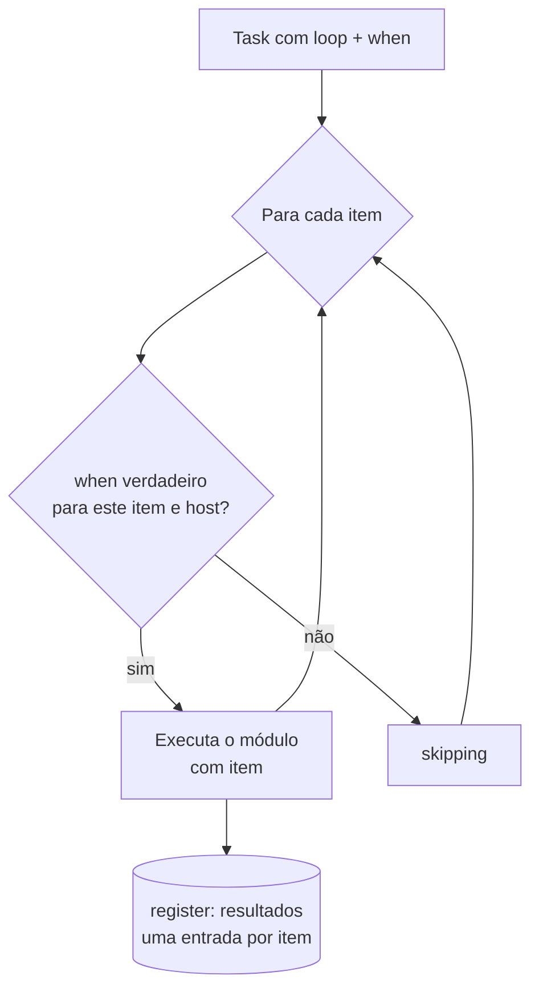

# 4.1 — Usando loops e tarefas condicionais

| Campo | Valor |
|-------|-------|
| Curso | AU294 — Ansible Automation Platform 2.6 (edição 2) |
| Capítulo / seção | Capítulo 4 · Seção 4.1 |
| Título original | Using Loops and Conditional Tasks |
| Título em português | Usando loops e tarefas condicionais |
| Objetivo | Usar loops para escrever tasks de forma eficiente e condições para controlar quando as tasks rodam |
| Pré-requisitos | [3.1 — variáveis, listas e dicionários](../03-variaveis-e-vault/3.1-usando-variaveis.md), [3.3 — facts](../03-variaveis-e-vault/3.3-coletando-informacoes-com-facts.md) |
| Referência | PDF p. 227–238 · Guided Exercise 4.2 p. 239–244 |

## Parte A — O problema que a tecnologia resolve

Garantir cinco usuários com cinco tasks quase iguais é repetitivo e frágil: ao
mudar um detalhe, é fácil esquecer uma das cópias. E nem toda task deve rodar em
todo host: instalar um pacote só onde a distribuição é suportada, só onde há
memória suficiente, só se um serviço estiver ativo.

- **Loops** aplicam a mesma lógica a cada item de uma lista. O playbook fica mais
  curto e menos sujeito a erros.
- **Condicionais** (`when`) decidem, por host, se a task roda ou é pulada.

## Parte B — Modelo mental e arquitetura



| Peça | Papel |
|------|-------|
| `loop` | Lista sobre a qual a task itera |
| `item` | Variável que guarda o valor da iteração atual |
| `when` | Condição avaliada (por host e, em loops, por item) |
| `register` | Com loop, guarda uma lista `results` com o resultado de cada item |

## Parte C — Entendimento progressivo

### 1. Sobre o que dá para iterar

Segundo o curso: itens de uma lista (arquivos, usuários, pacotes, serviços), um
dicionário com duas ou mais chaves, o valor de uma variável registrada, uma
sequência numérica e estruturas mais complexas. Loops também se combinam com
condicionais.

### 2. Loop simples

Duas tasks quase iguais viram uma:

```yaml
- name: Garantir chronyd e rsyslog ativos
  ansible.builtin.systemd_service:
    name: "{{ item }}"
    state: started
  loop:
    - chronyd
    - rsyslog
```

A lista também pode vir de uma variável:

```yaml
vars:
  servicos_base:
    - chronyd
    - rsyslog
tasks:
  - name: Garantir os serviços base ativos
    ansible.builtin.systemd_service:
      name: "{{ item }}"
      state: started
    loop: "{{ servicos_base }}"
```

`loop` é uma palavra-chave **da task** (mesmo nível de `name` e do módulo), não
um parâmetro do módulo.

### 3. Loop sobre lista de dicionários

Cada item pode ser um dicionário; acesse as chaves com colchetes:

```yaml
- name: Garantir usuários nos grupos certos
  ansible.builtin.user:
    name: "{{ item['nome'] }}"
    groups: "{{ item['grupos'] }}"
    state: present
  loop:
    - nome: carla
      grupos: wheel
    - nome: diego
      grupos: operadores
```

### 4. Sintaxe antiga: `with_*`

Antes do Ansible 2.5, os loops usavam palavras-chave `with_` seguidas do nome de um
plug-in de lookup. A Red Hat recomenda usar (ou migrar para) `loop`, mas você vai
encontrar a forma antiga em playbooks existentes:

| Palavra-chave | Comportamento |
|---------------|---------------|
| `with_items` | Como `loop` para listas simples; diferente de `loop`, **achata** listas aninhadas em uma lista de um nível |
| `with_file` | Recebe uma lista de arquivos; `item` contém o **conteúdo** de cada arquivo |
| `with_sequence` | Gera uma sequência numérica a partir de parâmetros; `item` contém cada valor |

```yaml
- name: Criar usuários (sintaxe antiga)
  ansible.builtin.user:
    name: "{{ item }}"
    state: present
  with_items: "{{ lista_usuarios }}"
```

Qualquer `with_*` pode ser convertido para `loop` com filtros (📘 documentação
"Migrating from with_X to loop").

### 5. `register` com loops

Com loop, a variável registrada tem as chaves `changed`, `msg` e **`results`**:
uma lista com um dicionário por item, na ordem. Cada dicionário traz a chave
`item` (o valor daquela iteração) e o retorno do módulo (por exemplo, `stdout`,
`rc`).

```yaml
- name: Consultar a versão de cada utilitário
  ansible.builtin.command:
    cmd: "{{ item }} --version"
  loop:
    - rsyslogd
    - logrotate
  register: versoes
  changed_when: false

- name: Mostrar a primeira linha de cada resultado
  ansible.builtin.debug:
    msg: "{{ item['item'] }}: {{ item['stdout_lines'][0] }}"
  loop: "{{ versoes['results'] }}"
```

Note o padrão: o segundo loop percorre `versoes['results']`; dentro dele,
`item['item']` é o valor original e `item['stdout']`/`item['stdout_lines']` é a saída.

### 6. Tarefas condicionais com `when`

Uma condição é uma expressão que resulta em verdadeiro ou falso. Podem ser
testadas variáveis do playbook, variáveis registradas e facts. Se a condição é
verdadeira, a task roda; senão, é **pulada** (`skipping`).

```yaml
- name: Instalar o pacote opcional, se pedido
  ansible.builtin.dnf:
    name: tuned
    state: present
  when: instalar_tuned          # booleano: true / false
```

Booleanos: `True`, `yes`, `on` e `1` também valem como verdadeiro; `False`, `no`,
`off` e `0` como falso. Use `true`/`false` para máxima compatibilidade com outras
ferramentas, como o `ansible-lint`.

Variável definida ou não:

```yaml
- name: Instalar o pacote informado
  ansible.builtin.dnf:
    name: "{{ pacote_extra }}"
    state: present
  when: pacote_extra is defined
```

### 7. Operadores

| Operação | Exemplo |
|----------|---------|
| Igual (string) | `ansible_facts['machine'] == "x86_64"` |
| Igual (número) | `max_memory == 512` |
| Menor / maior | `min_memory < 128` · `min_memory > 256` |
| Menor ou igual / maior ou igual | `min_memory <= 256` · `min_memory >= 512` |
| Diferente | `min_memory != 512` |
| Variável existe / não existe | `min_memory is defined` · `min_memory is not defined` |
| Booleano verdadeiro / falso | `memory_available` · `not memory_available` |
| Valor presente em uma lista | `ansible_facts['distribution'] in supported_distros` |

O último caso: o fact (descoberto no host) é comparado com uma lista criada por
você; a task só roda se o valor estiver na lista.

> **Indentação:** `when` não é parâmetro do módulo. É mais uma chave da task, no
> mesmo nível de `name` e do módulo. Convenção comum: colocá-lo depois do nome, do
> módulo e de seus argumentos.

### 8. Várias condições

| Forma | Exemplo | Significado |
|-------|---------|-------------|
| `or` | `when: ansible_facts['distribution'] == "RedHat" or ansible_facts['distribution'] == "Fedora"` | Basta uma ser verdadeira |
| `and` | `when: ansible_facts['distribution_version'] == "10.0" and ansible_facts['kernel'] == "..."` | Todas precisam ser verdadeiras |
| Lista | `when:` seguido de itens `- ...` | Todos os itens combinados com **`and`**; mais legível |
| Parênteses | `( ... and ... ) or ( ... and ... )` | Agrupa e define a ordem de avaliação |

Condição longa em várias linhas com `>`:

```yaml
when: >
  ( ansible_facts['distribution'] == "RedHat" and
    ansible_facts['distribution_major_version'] == "10" )
  or
  ( ansible_facts['distribution'] == "Fedora" and
    ansible_facts['distribution_major_version'] == "42" )
```

### 9. Loops e condicionais juntos

Com `loop`, o `when` é avaliado **para cada item**:

```yaml
- name: Instalar o banco se a raiz tiver mais de 300 MB livres
  ansible.builtin.dnf:
    name: mariadb-server
    state: present
  loop: "{{ ansible_facts['mounts'] }}"
  when:
    - item['mount'] == "/"
    - item['size_available'] > 300000000
```

`ansible_facts['mounts']` é uma lista de dicionários, um por sistema de arquivos
montado. A task só roda para o item que satisfaz as duas condições.

Condição sobre o estado de serviços com `ansible.builtin.service_facts`, que grava
os dados em `ansible_facts['services']` (uma chave por serviço):

```yaml
- name: Coletar o estado dos serviços
  ansible.builtin.service_facts:

- name: Reiniciar o httpd só se o postfix estiver rodando
  ansible.builtin.systemd_service:
    name: httpd
    state: restarted
  when:
    - ansible_facts['services']['postfix.service'] is defined
    - ansible_facts['services']['postfix.service']['state'] == "running"
```

### 10. Diferenças que confundem

| A | B | Diferença essencial |
|---|---|--------------------|
| `loop` | `with_items` | Forma recomendada × forma antiga (que achata listas aninhadas) |
| `item` | `item['item']` | Valor da iteração × valor original dentro de um item de `results` |
| `when` com lista | `when` com `or` | Itens combinados com `and` × basta uma condição |
| `is defined` | `== ""` | A variável existe × a variável tem valor vazio |
| Task pulada (`skipping`) | Task falha (`failed`) | Condição falsa × erro na execução |

## Parte D — Exemplo autoral incremental

Projeto validado:
[exemplos-originais/cap04-controle-de-tarefas](../../exemplos-originais/cap04-controle-de-tarefas/)
(cenário próprio: servidor central de logs com rsyslog).

**Passo 1 — dados em `vars/logs.yml`:**

```yaml
log_min_ram_mb: 1024
log_distros_suportadas:
  - RedHat
log_diretorios:
  - path: /srv/logs/remotos
    mode: '0750'
  - path: /srv/logs/arquivo
    mode: '0700'
log_firewall_portas:
  - 514/tcp
  - 514/udp
```

**Passo 2 — condição de requisitos com `fail` + `when`:**

```yaml
- name: Interromper se o host não atende aos requisitos mínimos
  ansible.builtin.fail:
    msg: "Host fora do requisito: precisa de RedHat e {{ log_min_ram_mb }} MiB de RAM"
  when: >
    ansible_facts['memtotal_mb'] < log_min_ram_mb or
    ansible_facts['distribution'] not in log_distros_suportadas
```

**Passo 3 — loops sobre lista de dicionários e lista simples:**

```yaml
- name: Garantir os diretórios de armazenamento
  ansible.builtin.file:
    path: "{{ item['path'] }}"
    state: directory
    mode: "{{ item['mode'] }}"
  loop: "{{ log_diretorios }}"

- name: Liberar as portas de recepção no firewall
  ansible.posix.firewalld:
    port: "{{ item }}"
    permanent: true
    immediate: true
    state: enabled
  loop: "{{ log_firewall_portas }}"
```

## Parte E — Execução e verificação

```bash
ansible-navigator run servidor-logs.yml --syntax-check
ansible-navigator run servidor-logs.yml
```

| Item | Valor |
|------|-------|
| Saída de um loop | Uma linha por item: `changed: [host] => (item=...)` |
| Host fora do requisito | A task `fail` falha e o play para naquele host |
| Host dentro do requisito | A task `fail` aparece como `skipping` |
| Status | ✅ YAML, `--syntax-check` e `ansible-lint` (perfil *production*) sem erros · ⚠️ não executado contra hosts |

## Parte F — Troubleshooting

| Sintoma | Causa provável | Como verificar / corrigir |
|---------|----------------|---------------------------|
| `'item' is undefined` | `loop` indentado como parâmetro do módulo | `loop` e `when` no nível da task |
| Erro de aspas em `loop: {{ lista }}` | Valor começa com `{{` | `loop: "{{ lista }}"` |
| Task sempre `skipping` | Condição nunca verdadeira (tipo, maiúsculas, nome do fact) | Mostre os valores com `debug` antes |
| Comparação de texto falha | `"RedHat"` × `"redhat"` | Use o valor exato reportado pelo fact |
| Loop sobre `register` não encontra `stdout` | Faltou percorrer `['results']` | `loop: "{{ var['results'] }}"` e `item['stdout']` |
| `when` com várias linhas avaliado errado | Faltou agrupar com parênteses | Agrupe as condições |

## Parte G — Preparação para o laboratório

Atividade associada: **4.2 Guided Exercise — Using Loops and Conditional Tasks**
(`control-flow`, PDF p. 239–244). Ver
[PRATICA-OFICIAL.md](PRATICA-OFICIAL.md#42-guided-exercise-using-loops-and-conditional-tasks).

Você deve conseguir:

- iterar sobre uma lista de dicionários e usar suas chaves nos parâmetros;
- condicionar uma task a um fact;
- prever quais itens serão `changed` e quais serão `skipping` em cada host.

## Parte H — Fixação

1. Reescreva três tasks que instalam `vim`, `tmux` e `git` como uma task com `loop`.
2. Qual a diferença de comportamento entre `with_items` e `loop` com listas aninhadas?
3. Escreva um `when` que rode a task só em hosts RedHat com versão principal 10.
4. Por que `when` fica no mesmo nível de `name` e não dentro do módulo?
5. Diagnóstico: depois de um loop com `register: saida`, `{{ saida['stdout'] }}` não existe. Onde está a saída?
6. Em um `when` com uma lista de três condições, como elas são combinadas?

<details>
<summary>Respostas comentadas</summary>

1. Exemplo:
   ```yaml
   - name: Garantir ferramentas de uso diário
     ansible.builtin.dnf:
       name: "{{ item }}"
       state: present
     loop:
       - vim
       - tmux
       - git
   ```
   (O módulo `dnf` também aceita a lista diretamente em `name`.)
2. `with_items` achata listas aninhadas em uma lista de um nível; `loop` não achata.
3. Exemplo:
   ```yaml
   when:
     - ansible_facts['distribution'] == "RedHat"
     - ansible_facts['distribution_major_version'] == "10"
   ```
4. Porque `when` é uma palavra-chave da task (a task é um dicionário YAML), não um argumento do módulo.
5. Em `saida['results']`, uma entrada por item; a saída de cada iteração está em `saida['results'][N]['stdout']`.
6. Com `and`: todas precisam ser verdadeiras.

</details>

## Parte I — Essencial para memorizar

- `loop` + `item`; lista em variável: `loop: "{{ lista }}"`.
- Dicionários no loop: `item['chave']`.
- `with_items`, `with_file`, `with_sequence` = sintaxe antiga; prefira `loop`.
- `register` com loop → `var['results']`, cada item com `item` e o retorno do módulo.
- `when` no nível da task; booleanos `true`/`false`; `is defined`, `in`, comparadores.
- `when` em lista = `and`; parênteses para agrupar; em loops, avaliado por item.
- `ansible.builtin.service_facts` → `ansible_facts['services']`.

---
[← Capítulo 4 (índice)](README.md) | [Índice do capítulo](README.md) | [Próximo: 4.3 Handlers →](4.3-implementando-handlers.md)
