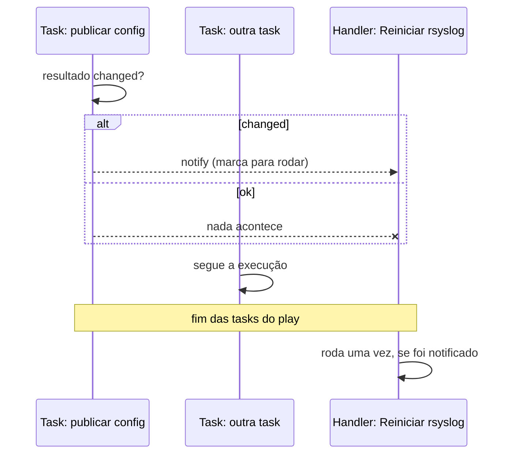

# 4.3 — Implementando handlers

| Campo | Valor |
|-------|-------|
| Curso | AU294 — Ansible Automation Platform 2.6 (edição 2) |
| Capítulo / seção | Capítulo 4 · Seção 4.3 |
| Título original | Implementing Handlers |
| Título em português | Implementando handlers |
| Objetivo | Implementar uma task que roda somente quando outra task altera o managed host |
| Pré-requisitos | [4.1](4.1-loops-e-tarefas-condicionais.md), [F3 — idempotência](../../01-fundamentos-essenciais/automacao-idempotencia.md) |
| Referência | PDF p. 245–247 · Guided Exercise 4.4 p. 248–254 |

## Parte A — O problema que a tecnologia resolve

Mudar o arquivo de configuração de um serviço só tem efeito depois de reiniciá-lo.
Mas reiniciar **sempre**, a cada execução, derruba conexões sem necessidade, e isso
contradiz a ideia de idempotência (mudar só o que for preciso).

**Handlers** resolvem isso: são tasks que ficam "em espera" e só rodam quando outra
task as **notifica**, e a notificação só acontece se essa task **mudou** algo no
host. Usos típicos: reiniciar serviços e reiniciar hosts.

## Parte B — Modelo mental e arquitetura



| Regra | Consequência |
|-------|--------------|
| Só tasks com resultado **`changed`** notificam | Pacote já instalado (`ok`) não dispara o handler |
| Handlers rodam, por padrão, **depois de todas as tasks** do play | A reinicialização acontece no fim, uma vez só |
| Handlers rodam na ordem da seção **`handlers`** | Não na ordem do `notify` nem na ordem em que foram notificados |
| Handler não notificado não roda | Seção `handlers` não é uma lista de tasks comuns |
| Vários notificadores | O handler roda **uma vez**, depois que as tasks terminam |

## Parte C — Entendimento progressivo

### 1. Estrutura: `notify` + `handlers`

```yaml
tasks:
  - name: Publicar a configuração de recepção remota
    ansible.builtin.copy:
      src: files/remoto.conf
      dest: /etc/rsyslog.d/remoto.conf
      mode: '0644'
    notify:
      - Reiniciar rsyslog          # deve casar com o name do handler

handlers:
  - name: Reiniciar rsyslog         # mesmo nível de tasks, no play
    ansible.builtin.systemd_service:
      name: rsyslog
      state: restarted
```

- `notify` é uma palavra-chave da task e é tratada como **lista** de nomes.
- `handlers` é uma seção do **play**, no mesmo nível de `tasks`.
- Handlers são tasks: usam os mesmos módulos.

### 2. Um task, vários handlers

```yaml
- name: Publicar parâmetros comuns da aplicação
  ansible.builtin.copy:
    src: files/app.env
    dest: /etc/estoque/app.env
    mode: '0640'
  notify:
    - Reiniciar estoque-api
    - Reiniciar estoque-worker
```

Os dois handlers rodam no fim, **na ordem em que aparecem na seção `handlers`**.

### 3. Nomes únicos

Dentro de um play, nomes de handlers devem ser **únicos**. Com dois handlers de
mesmo nome no mesmo play, o Ansible executa só o primeiro da lista, o que gera
comportamento inesperado. Em plays diferentes, o mesmo nome pode se repetir.

### 4. Forçar handlers antes do fim: `flush_handlers`

Às vezes é preciso reiniciar o serviço **e depois** testá-lo no mesmo play. O
módulo `ansible.builtin.meta` com `flush_handlers` executa, naquele ponto, todos os
handlers já notificados:

```yaml
- name: Publicar a configuração
  ansible.builtin.copy:
    src: files/remoto.conf
    dest: /etc/rsyslog.d/remoto.conf
    mode: '0644'
  notify: Reiniciar rsyslog

- name: Aplicar agora os handlers notificados
  ansible.builtin.meta: flush_handlers

- name: Confirmar que a porta 514/tcp está escutando
  ansible.builtin.wait_for:
    port: 514
    timeout: 10
```

### 5. O que handlers não são

O curso é explícito: use handlers para uma **ação extra quando houve mudança**;
não os use como substitutos de tasks normais.

### 6. Diferenças que confundem

| A | B | Diferença essencial |
|---|---|--------------------|
| Task | Handler | Roda sempre (ou conforme `when`) × roda só se notificado por uma task `changed` |
| Ordem do `notify` | Ordem da seção `handlers` | Irrelevante × define a ordem de execução |
| Fim do play | `meta: flush_handlers` | Momento padrão × ponto escolhido por você |
| `restarted` | `reloaded` (📘) | Reinicia o processo × pede para recarregar a configuração, quando o serviço suporta |

## Parte D — Exemplo autoral incremental

Arquivo validado:
[exemplos-originais/cap04-controle-de-tarefas/servidor-logs.yml](../../exemplos-originais/cap04-controle-de-tarefas/servidor-logs.yml).

**Passo 1 — a task que muda o host e notifica:**

```yaml
- name: Publicar a configuração de recepção remota
  ansible.builtin.copy:
    src: files/remoto.conf
    dest: /etc/rsyslog.d/remoto.conf
    owner: root
    group: root
    mode: '0644'
  notify: Reiniciar rsyslog
```

**Passo 2 — o handler, no fim do play:**

```yaml
handlers:
  - name: Reiniciar rsyslog
    ansible.builtin.systemd_service:
      name: rsyslog
      state: restarted
```

**Passo 3 — antecipar o handler para testar logo em seguida:**

```yaml
- name: Aplicar agora os handlers notificados
  ansible.builtin.meta: flush_handlers

- name: Confirmar que a porta 514/tcp está escutando
  ansible.builtin.wait_for:
    port: 514
    timeout: 10
```

## Parte E — Execução e verificação

```bash
ansible-navigator run servidor-logs.yml      # 1ª vez: config changed → RUNNING HANDLER
ansible-navigator run servidor-logs.yml      # 2ª vez: config ok → handler não roda
```

| Execução | O que esperar |
|----------|---------------|
| Primeira | A task da configuração reporta `changed`; aparece `RUNNING HANDLER [Reiniciar rsyslog]` |
| Segunda, sem mudanças | Task `ok`; nenhum handler executado |
| Depois de editar `files/remoto.conf` | Task `changed` de novo; handler roda |
| Status | ✅ YAML, `--syntax-check` e `ansible-lint` (perfil *production*) sem erros · ⚠️ não executado contra hosts |

## Parte F — Troubleshooting

| Sintoma | Causa provável | Como verificar / corrigir |
|---------|----------------|---------------------------|
| Handler nunca roda | A task notificadora reporta `ok` (nada mudou) | Esperado; confira se a mudança realmente ocorreu |
| Handler nunca roda, mesmo com `changed` | Nome no `notify` diferente do `name` do handler | Copie o nome exato |
| Só um de dois handlers homônimos roda | Nomes duplicados no mesmo play | Nomes únicos |
| Teste logo após a mudança falha | O handler só roda no fim do play | `ansible.builtin.meta: flush_handlers` antes do teste |
| Ordem de reinício inesperada | Handlers seguem a ordem da seção `handlers` | Reordene a seção |
| Handler notificado não rodou porque uma task falhou depois | Comportamento padrão após falha | `force_handlers` (seção 4.5) |

## Parte G — Preparação para o laboratório

Atividade associada: **4.4 Guided Exercise — Implementing Handlers**
(`control-handlers`, PDF p. 248–254). Ver
[PRATICA-OFICIAL.md](PRATICA-OFICIAL.md#44-guided-exercise-implementing-handlers).

Você deve conseguir:

- notificar handlers diferentes a partir de tasks de configuração diferentes;
- escrever a seção `handlers` com nomes que casem com os `notify`;
- prever, comparando duas execuções, quando cada handler roda.

## Parte H — Fixação

1. Quando um handler é executado?
2. Uma task notifica `B` e depois `A`, mas a seção `handlers` lista `A` antes de `B`. Em que ordem rodam?
3. Três tasks notificam o mesmo handler na mesma execução. Quantas vezes ele roda?
4. Para que serve `ansible.builtin.meta: flush_handlers`?
5. Diagnóstico: você editou o arquivo de configuração no repositório, executou o playbook e o serviço não foi reiniciado. O que verificar?

<details>
<summary>Respostas comentadas</summary>

1. Quando foi notificado por uma task que reportou `changed`, por padrão depois de todas as tasks do play (ou no ponto de um `flush_handlers`).
2. `A`, depois `B`: vale a ordem da seção `handlers`.
3. Uma vez, depois que as tasks terminam.
4. Para executar naquele ponto os handlers já notificados, por exemplo para reiniciar o serviço e testá-lo em seguida no mesmo play.
5. Se a task de configuração reportou `changed` (se o conteúdo no host já era igual, ela fica `ok`); se o nome no `notify` é idêntico ao do handler; e se nenhuma task falhou antes do fim do play (sem `force_handlers`, os handlers não rodam).

</details>

## Parte I — Essencial para memorizar

- `notify: <nome>` na task; seção `handlers:` no play.
- Só tasks `changed` notificam; handler roda uma vez, no fim do play.
- Ordem = ordem da seção `handlers`.
- Nomes de handlers únicos por play.
- `ansible.builtin.meta: flush_handlers` antecipa a execução.
- Handlers são para ações extras após mudança, não para substituir tasks.

---
[← 4.1 Loops e condicionais](4.1-loops-e-tarefas-condicionais.md) | [Índice do capítulo](README.md) | [Próximo: 4.5 Falhas →](4.5-tratando-falhas-de-tarefas.md)
