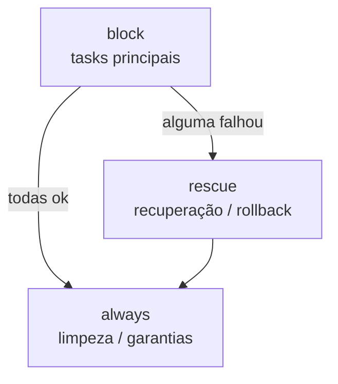

# 4.5 — Tratando falhas de tarefas

| Campo | Valor |
|-------|-------|
| Curso | AU294 — Ansible Automation Platform 2.6 (edição 2) |
| Capítulo / seção | Capítulo 4 · Seção 4.5 |
| Título original | Handling Task Failure |
| Título em português | Tratando falhas de tarefas |
| Objetivo | Controlar o que acontece quando uma task falha e quais condições fazem uma task falhar |
| Pré-requisitos | [4.1](4.1-loops-e-tarefas-condicionais.md), [4.3](4.3-implementando-handlers.md), [3.1 — register](../03-variaveis-e-vault/3.1-usando-variaveis.md) |
| Referência | PDF p. 255–260 · Guided Exercise 4.6 p. 261–276 |

## Parte A — O problema que a tecnologia resolve

Em produção, tasks falham por motivos variados: rede instável, falta de recursos,
configuração errada. E nem toda "falha" é detectada pelo código de retorno: uma API
pode responder com sucesso enquanto o recurso criado termina em erro.

A automação precisa **decidir** com clareza: quando parar, quando seguir, quando
considerar algo uma mudança e como se recuperar. Assim o playbook continua
previsível e idempotente, e cada task chega ao estado pretendido ou segue um
caminho de recuperação definido.

## Parte B — Modelo mental e arquitetura

| Palavra-chave | O que controla |
|---------------|----------------|
| `ignore_errors` | Continuar o play mesmo se a task falhar |
| `force_handlers` | Rodar os handlers já notificados mesmo se uma task posterior falhar |
| `failed_when` | Condição personalizada de **falha** a partir da saída da task |
| `changed_when` | Condição personalizada de **mudança** (e, portanto, de notificação de handlers) |
| `block` / `rescue` / `always` | Agrupar tasks e definir recuperação e limpeza |



Comportamento padrão: o Ansible avalia o retorno de cada task; se ela falha, as
tasks restantes **naquele host** são puladas e a falha é reportada.

## Parte C — Entendimento progressivo

### 1. `ignore_errors`: seguir mesmo com falha

```yaml
- name: Parar o agente de métricas opcional
  ansible.builtin.systemd_service:
    name: agente-metricas
    state: stopped
  ignore_errors: true      # se o serviço não existir, a falha é reportada, mas o play segue
```

⚠️ Use com cautela: ignorar falhas sem análise esconde problemas que afetam o
estado do sistema (por exemplo, um pacote que não foi instalado, com o playbook
"verde"). Prefira estratégias controladas (`failed_when`, `rescue`, condições) quando
a falha tem consequência; reserve `ignore_errors` para falhas realmente inofensivas
ou esperadas.

### 2. `force_handlers`: handlers mesmo após falha

Quando uma task falha e o play para no host, os handlers notificados antes **não
rodam** (para não aplicar mudanças parciais). Com `force_handlers: true` **no play**,
os handlers já notificados rodam mesmo que uma task posterior falhe.

```yaml
- name: Ajustar o banco e garantir o reinício
  hosts: db
  become: true
  force_handlers: true
  tasks:
    - name: Publicar a configuração do banco
      ansible.builtin.copy:
        src: files/banco.conf
        dest: /etc/banco/banco.conf
        mode: '0640'
      notify: Reiniciar banco

    - name: Instalar plugin opcional (pode falhar)
      ansible.builtin.dnf:
        name: banco-plugin-monitoramento
        state: present

  handlers:
    - name: Reiniciar banco
      ansible.builtin.systemd_service:
        name: banco
        state: restarted
```

Lembretes do curso:

- Handlers só rodam para tasks `changed`; nunca para `ok`, `skipped` ou `failed`.
- `force_handlers` **não** cria novas notificações: só garante os handlers que já
  tinham sido notificados antes da falha.
- `ignore_errors: true` em uma task mantém o play rodando após a falha dela, a menos
  que outro erro o interrompa.

### 3. `failed_when`: definir o que é falha

Para operações que "dão certo" no retorno, mas não no resultado. Padrão: separar o
**pedido** da **validação**.

```yaml
- name: Consultar o estado da réplica do banco
  ansible.builtin.command:
    cmd: /usr/local/bin/status-replica
  register: replica
  changed_when: false
  failed_when: "'ATIVA' not in replica['stdout']"
```

Alternativa com o módulo `ansible.builtin.fail`, que permite uma mensagem clara e
deixa espaço para tasks intermediárias (coleta de diagnóstico, limpeza) antes de
parar:

```yaml
- name: Relatar falha se a réplica estiver em erro
  ansible.builtin.fail:
    msg: "Réplica em estado de erro; verifique antes de continuar"
  when: "'ERRO' in replica['stdout']"
```

### 4. `changed_when`: definir o que é mudança

`ansible.builtin.command` e `ansible.builtin.shell` reportam `changed` **sempre**,
mesmo quando só leem algo. `changed_when` corrige o relatório e controla quando
handlers são notificados.

| Uso | Exemplo | Efeito |
|-----|---------|--------|
| Task só de leitura | `changed_when: false` | Nunca reporta `changed` (nem notifica) |
| Mudança condicionada à saída | `changed_when: "'concluída' in resultado['stdout']"` | Só reporta `changed` (e notifica) quando a saída indica mudança |
| Forçar mudança | `changed_when: true` | Sempre `changed`; útil para notificar um handler a partir de uma task como `debug` |

```yaml
- name: Validar a sintaxe da configuração do rsyslog
  ansible.builtin.command:
    cmd: rsyslogd -N1
  register: validacao
  changed_when: false

- name: Aplicar a migração do esquema
  ansible.builtin.command:
    cmd: /usr/local/bin/migrar-esquema
  register: migracao
  changed_when: "'Migração concluída' in migracao['stdout']"
  notify: Reiniciar estoque-api
```

O curso recomenda `changed_when` em produção para evitar reinícios desnecessários e
relatar o estado do sistema com precisão.

### 5. Blocos: `block`, `rescue`, `always`

**Agrupar e aplicar uma condição a várias tasks:**

```yaml
- name: Travar a versão do servidor web em hosts RedHat
  when: ansible_facts['distribution'] == "RedHat"
  block:
    - name: Instalar o plugin de trava de versão
      ansible.builtin.dnf:
        name: python3-dnf-plugin-versionlock
        state: present

    - name: Registrar a versão travada
      ansible.builtin.lineinfile:
        path: /etc/yum/pluginconf.d/versionlock.list
        line: "httpd-0:2.4.*"
        state: present
```

**Tratar erros:**

| Seção | Roda quando |
|-------|-------------|
| `block` | Sempre: são as tasks principais |
| `rescue` | Só se alguma task do `block` falhar |
| `always` | Sempre, depois do `block` (e do `rescue`, se houver), com sucesso ou falha |

```yaml
- name: Atualizar o esquema com recuperação
  block:
    - name: Executar a atualização
      ansible.builtin.command:
        cmd: /usr/local/bin/migrar-esquema
  rescue:
    - name: Reverter a atualização
      ansible.builtin.command:
        cmd: /usr/local/bin/reverter-esquema
  always:
    - name: Garantir o serviço do banco ativo
      ansible.builtin.systemd_service:
        name: mariadb
        state: started
```

O `when` aplicado a um bloco vale também para o `rescue` e o `always`.

### 6. Diferenças que confundem

| A | B | Diferença essencial |
|---|---|--------------------|
| `ignore_errors` | `rescue` | Ignora e segue × reage com tasks de recuperação |
| `failed_when` | `ansible.builtin.fail` | Condição na própria task × task dedicada com mensagem, que permite passos intermediários |
| `changed_when: false` | `ignore_errors: true` | Nunca relata mudança × não para em falha |
| `force_handlers` | `flush_handlers` | Handlers notificados rodam mesmo após falha × handlers notificados rodam agora |
| `rescue` | `always` | Só em caso de falha × sempre |

## Parte D — Exemplo autoral incremental

Arquivo validado:
[exemplos-originais/cap04-controle-de-tarefas/verificacao.yml](../../exemplos-originais/cap04-controle-de-tarefas/verificacao.yml).

**Passo 1 — play com `force_handlers` e validação só de leitura:**

```yaml
- name: Verificar a recepção de logs e recuperar se necessário
  hosts: coletores
  become: true
  force_handlers: true
  tasks:
    - name: Validar a sintaxe da configuração do rsyslog
      ansible.builtin.command:
        cmd: rsyslogd -N1
      register: validacao
      changed_when: false
      failed_when: validacao['rc'] != 0
```

**Passo 2 — bloco de verificação com recuperação e garantia final:**

```yaml
    - name: Verificar e, se preciso, recuperar o serviço
      block:
        - name: Listar as portas em escuta
          ansible.builtin.command:
            cmd: ss -ltn
          register: portas
          changed_when: false

        - name: Falhar se a porta 514 não estiver em escuta
          ansible.builtin.fail:
            msg: "rsyslog não está escutando na porta 514"
          when: "':514 ' not in portas['stdout']"

      rescue:
        - name: Registrar a falha e pedir reinício
          ansible.builtin.debug:
            msg: "Recepção de logs indisponível; o rsyslog será reiniciado"
          changed_when: true
          notify: Reiniciar rsyslog

      always:
        - name: Mostrar o resultado da validação
          ansible.builtin.debug:
            var: validacao['rc']

  handlers:
    - name: Reiniciar rsyslog
      ansible.builtin.systemd_service:
        name: rsyslog
        state: restarted
```

Repare no `changed_when: true` no `rescue`: o `debug` não altera nada por padrão,
então é preciso forçar `changed` para que ele notifique o handler.

## Parte E — Execução e verificação

```bash
ansible-navigator run verificacao.yml --syntax-check
ansible-navigator run verificacao.yml
```

| Cenário | O que esperar |
|---------|---------------|
| Porta 514 em escuta | Tasks do `block` `ok`; `rescue` não roda; `always` mostra o `rc` |
| Porta 514 fechada | `fail` no `block`; o `rescue` roda e notifica; o handler reinicia o rsyslog; `always` roda; o `PLAY RECAP` conta `rescued=1` |
| Status | ✅ YAML, `--syntax-check` e `ansible-lint` (perfil *production*) sem erros · ⚠️ não executado contra hosts |

## Parte F — Troubleshooting

| Sintoma | Causa provável | Como verificar / corrigir |
|---------|----------------|---------------------------|
| Playbook "verde", mas algo não foi aplicado | `ignore_errors` escondendo uma falha real | Troque por `failed_when`/`rescue` ou remova |
| Handler notificado não rodou | Uma task posterior falhou e o play parou | `force_handlers: true` no play |
| Task de leitura sempre `changed` | `command`/`shell` sem `changed_when` | `changed_when: false` |
| Handler não dispara a partir de `debug` | `debug` não reporta `changed` | `changed_when: true` |
| `rescue` não roda | Nenhuma task do `block` falhou | Esperado; confirme a condição de falha |
| Condição de `failed_when`/`changed_when` com erro | Variável registrada com outro nome ou chave errada | `debug: var: <registrada>` para ver a estrutura |

## Parte G — Preparação para o laboratório

Atividade associada: **4.6 Guided Exercise — Handling Task Failure**
(`control-errors`, PDF p. 261–276). Ver
[PRATICA-OFICIAL.md](PRATICA-OFICIAL.md#46-guided-exercise-handling-task-failure).

Você deve conseguir:

- explicar o efeito de `ignore_errors` comparando duas execuções;
- usar `force_handlers` e prever se um handler roda após uma falha;
- escrever `block`/`rescue`/`always` e prever qual seção roda em cada cenário;
- passar uma variável na linha de comando para mudar o resultado de uma condição.

## Parte H — Fixação

1. Qual a diferença entre `ignore_errors: true` e um `rescue`?
2. Um play notifica um handler na task 2, e a task 4 falha. O handler roda? E com `force_handlers: true`?
3. Escreva uma task que rode `systemctl is-active rsyslog`, nunca reporte `changed` e falhe se a saída não for `active`.
4. Por que um `debug` em um `rescue` precisa de `changed_when: true` para notificar um handler?
5. Em que situações `always` é útil?

<details>
<summary>Respostas comentadas</summary>

1. `ignore_errors` apenas segue em frente após a falha; `rescue` executa tasks de recuperação quando alguma task do bloco falha.
2. Sem `force_handlers`, não: o play parou no host antes do fim. Com `force_handlers: true`, sim, porque o handler já tinha sido notificado.
3. Exemplo:
   ```yaml
   - name: Verificar se o rsyslog está ativo
     ansible.builtin.command:
       cmd: systemctl is-active rsyslog
     register: estado
     changed_when: false
     failed_when: estado['stdout'] != "active"
   ```
4. Porque handlers só são notificados por tasks `changed`, e o `debug` não muda nada por padrão.
5. Para limpeza e garantias que devem acontecer com sucesso ou com falha: remover arquivos temporários, garantir que um serviço volte a rodar, registrar o resultado.

</details>

## Parte I — Essencial para memorizar

- Padrão: falha → resto do play pulado naquele host.
- `ignore_errors` (com cautela) · `force_handlers` (no play) · `failed_when` · `changed_when` · `block`/`rescue`/`always`.
- `command`/`shell` reportam `changed` sempre: use `changed_when`.
- `ansible.builtin.fail` + `when` = falha explícita com mensagem.
- `when` em um bloco vale para `rescue` e `always`.
- `force_handlers` não cria notificações; só garante as já feitas.

---
[← 4.3 Handlers](4.3-implementando-handlers.md) | [Índice do capítulo](README.md) | [Próximo: Prática oficial →](PRATICA-OFICIAL.md)
