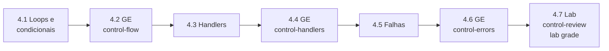

# Capítulo 4 — Developing Automation Content: Task Control

**Título em português:** Desenvolvendo conteúdo de automação: controle de tarefas
**Status:** ✅ documentado e validado (documentação; o estudo é marcado por você no checklist)
**Referência:** PDF p. 226–291 · arquivo `AU294_AAP2.6_C04_Controle_Tarefas_p226-291.pdf` (não versionado)

## Objetivo do capítulo

Escrever plays que usam recursos de controle de tarefas para executar uma task uma
vez para cada item de uma lista, rodar tasks só quando certas condições são
atendidas, reagir a mudanças com handlers e tratar falhas de forma controlada.

## Por que este capítulo importa

Com variáveis e facts (Capítulo 3), o playbook já sabe *com quais dados* trabalhar.
Agora ele decide *quantas vezes* repetir uma ação, *se* ela deve rodar em cada host,
*quando* reiniciar um serviço e *o que fazer* se algo der errado. São os recursos
que tornam um playbook robusto para produção e frequentes no EX294.

## Seções e atividades (ordem oficial)

| Seção | Tipo | Título original | Material | PDF |
|-------|------|-----------------|----------|-----|
| 4.1 | Conceito | Using Loops and Conditional Tasks | [lição](4.1-loops-e-tarefas-condicionais.md) | p. 227–238 |
| 4.2 | Guided Exercise | Using Loops and Conditional Tasks | [prática](PRATICA-OFICIAL.md#42-guided-exercise-using-loops-and-conditional-tasks) | p. 239–244 |
| 4.3 | Conceito | Implementing Handlers | [lição](4.3-implementando-handlers.md) | p. 245–247 |
| 4.4 | Guided Exercise | Implementing Handlers | [prática](PRATICA-OFICIAL.md#44-guided-exercise-implementing-handlers) | p. 248–254 |
| 4.5 | Conceito | Handling Task Failure | [lição](4.5-tratando-falhas-de-tarefas.md) | p. 255–260 |
| 4.6 | Guided Exercise | Handling Task Failure | [prática](PRATICA-OFICIAL.md#46-guided-exercise-handling-task-failure) | p. 261–276 |
| 4.7 | Lab | Developing Automation Content: Task Control | [prática](PRATICA-OFICIAL.md#47-lab-developing-automation-content-task-control) | p. 277–290 |
| 4.8 | Summary | Summary | [RESUMO.md](RESUMO.md) | p. 291 |

O capítulo não tem quiz. Só o lab 4.7 aceita `lab grade`.

## Arquivos do capítulo

- [PRATICA-OFICIAL.md](PRATICA-OFICIAL.md): ponte com os três guided exercises e o lab.
- [REVISAO.md](REVISAO.md): 22 questões autorais (conceito, escrita, diagnóstico).
- [RESUMO.md](RESUMO.md): síntese, modelo integrado e tabela de palavras-chave.
- Exemplo validado: [exemplos-originais/cap04-controle-de-tarefas](../../exemplos-originais/cap04-controle-de-tarefas/).

## Pré-requisitos recomendados

[Capítulo 3](../03-variaveis-e-vault/README.md) ·
[F3 — Idempotência](../../01-fundamentos-essenciais/automacao-idempotencia.md)

## Checklist (marcado por você)

- [ ] 4.1 lida e Parte H respondida
- [ ] 4.2 Guided Exercise `control-flow` concluído
- [ ] 4.3 lida e Parte H respondida
- [ ] 4.4 Guided Exercise `control-handlers` concluído
- [ ] 4.5 lida e Parte H respondida
- [ ] 4.6 Guided Exercise `control-errors` concluído
- [ ] 4.7 Lab `control-review` com `lab grade` aprovado
- [ ] [REVISAO.md](REVISAO.md) respondida
- [ ] Registro no [diário de laboratórios](../../progresso/diario-de-laboratorios.md)

---
[← Capítulo 3](../03-variaveis-e-vault/README.md) | [Índice geral](../../README.md) | [Próximo: 4.1 Loops e condicionais →](4.1-loops-e-tarefas-condicionais.md)
