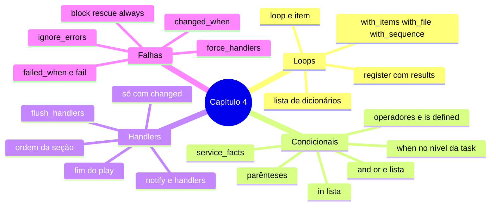

# Resumo — Capítulo 4

Síntese autoral para revisão rápida. Correspondência oficial: seção 4.8 Summary
(PDF p. 291).

## Em uma frase por seção

| Seção | Ideia central |
|-------|---------------|
| 4.1 | `loop` aplica a mesma task a cada item (inclusive dicionários e resultados registrados) e `when` decide, por host e por item, se a task roda |
| 4.3 | Handlers são tasks que só rodam quando notificadas por uma task `changed`, uma vez, no fim do play (ou num `flush_handlers`), na ordem da seção `handlers` |
| 4.5 | `ignore_errors`, `force_handlers`, `failed_when`, `changed_when` e `block`/`rescue`/`always` definem quando falhar, quando seguir, o que é mudança e como se recuperar |

## Mapa do capítulo



## Modelos em uma tela

```yaml
- name: Exemplo integrado
  hosts: coletores
  become: true
  force_handlers: true
  tasks:
    - name: Garantir diretórios
      ansible.builtin.file:
        path: "{{ item['path'] }}"
        state: directory
        mode: "{{ item['mode'] }}"
      loop: "{{ log_diretorios }}"
      when: ansible_facts['distribution'] == "RedHat"

    - name: Publicar configuração
      ansible.builtin.copy:
        src: files/remoto.conf
        dest: /etc/rsyslog.d/remoto.conf
        mode: '0644'
      notify: Reiniciar rsyslog

    - name: Validar sem relatar mudança
      ansible.builtin.command:
        cmd: rsyslogd -N1
      register: validacao
      changed_when: false
      failed_when: validacao['rc'] != 0

  handlers:
    - name: Reiniciar rsyslog
      ansible.builtin.systemd_service:
        name: rsyslog
        state: restarted
```

## Tabela de palavras-chave

| Palavra-chave | Nível | Função |
|---------------|-------|--------|
| `loop` | Task | Iterar sobre uma lista (`item`) |
| `when` | Task / bloco | Condição para rodar |
| `register` | Task | Guardar o resultado (`results` em loops) |
| `notify` | Task | Notificar handlers (se `changed`) |
| `handlers` | Play | Seção de handlers |
| `ansible.builtin.meta: flush_handlers` | Task | Rodar agora os handlers notificados |
| `ignore_errors` | Task | Seguir após falha |
| `force_handlers` | Play | Handlers notificados rodam mesmo após falha |
| `failed_when` / `changed_when` | Task | Definir falha / mudança |
| `block` / `rescue` / `always` | Task (agrupamento) | Agrupar, recuperar, garantir |

## Alertas operacionais

- ⚠️ `loop` e `when` são palavras-chave da task, não parâmetros do módulo.
- ⚠️ `loop: "{{ lista }}"` precisa de aspas.
- ⚠️ Com loop, o resultado registrado está em `['results']`.
- ⚠️ Nome do `notify` = nome do handler; nomes únicos por play.
- ⚠️ `ignore_errors` pode esconder falhas reais.
- ⚠️ `command`/`shell` sempre `changed`: use `changed_when`.
- ⚠️ `debug` só notifica handler com `changed_when: true`.

## Ligação com o próximo capítulo

O Capítulo 5 usa loops, condicionais e handlers para **gerenciar arquivos** nos
managed hosts e gerar configurações com **templates Jinja2** e filtros.

---
[← Revisão](REVISAO.md) | [Índice do capítulo](README.md) | [Próximo capítulo →](../05-deploy-de-arquivos/README.md)
