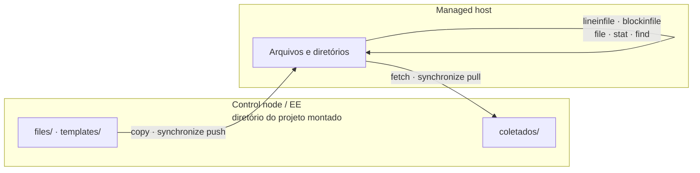

# 5.1 — Automatizando tarefas de gerenciamento de arquivos

| Campo | Valor |
|-------|-------|
| Curso | AU294 — Ansible Automation Platform 2.6 (edição 2) |
| Capítulo / seção | Capítulo 5 · Seção 5.1 |
| Título original | Automating File Management Tasks |
| Título em português | Automatizando tarefas de gerenciamento de arquivos |
| Objetivo | Criar, instalar, editar e remover arquivos nos managed hosts e gerenciar permissões, dono, contexto SELinux e outras características |
| Pré-requisitos | [4.1 — loops e condicionais](../04-controle-de-tarefas/4.1-loops-e-tarefas-condicionais.md), [4.3 — handlers](../04-controle-de-tarefas/4.3-implementando-handlers.md) |
| Referência | PDF p. 293–304 · Guided Exercise 5.2 p. 305–316 |

## Parte A — O problema que a tecnologia resolve

Boa parte da administração Linux é mexer em arquivos: publicar uma configuração,
ajustar uma linha do `sshd_config`, criar diretórios com dono e permissão certos,
criar links, coletar logs. Fazer isso com `cp`, `sed` e `echo >>` em cada servidor
não é repetível nem idempotente.

O Ansible oferece módulos específicos, a maioria em `ansible.builtin` (que vem com o
`ansible-core`) e alguns em `ansible.posix`, para **criar, copiar, recuperar, editar
e sincronizar** arquivos de forma consistente, aplicando também dono, permissões e
contexto SELinux.

## Parte B — Modelo mental e arquitetura



| Módulo | Função |
|--------|--------|
| `ansible.builtin.copy` | Copiar arquivos/diretórios para os hosts e definir atributos (inclusive SELinux); a origem pode estar no control node ou no próprio host |
| `ansible.builtin.fetch` | Trazer arquivos dos hosts para o control node, organizados por host |
| `ansible.posix.synchronize` | Sincronizar com `rsync`; facilita os usos mais comuns, não todo o poder do `rsync` |
| `ansible.builtin.lineinfile` | Garantir uma linha, ou substituir a linha que casa com um padrão |
| `ansible.builtin.blockinfile` | Adicionar, atualizar ou remover um bloco de várias linhas, com marcadores |
| `ansible.builtin.file` | Criar, remover ou alterar arquivos, diretórios e links; dono, permissões, timestamps, SELinux |
| `ansible.builtin.stat` | Coletar estado, checksum e atributos de um arquivo (como o `stat`) |
| `ansible.builtin.find` | Procurar arquivos e diretórios por critérios (como o `find`) |

> **Importante (curso):** com um execution environment, **o container do EE é o
> control node**. O `ansible-navigator` monta o diretório do projeto dentro dele:
> use **caminhos relativos** ao projeto para seus arquivos.

## Parte C — Entendimento progressivo

### 1. `copy`: publicar arquivos

```yaml
- name: Publicar a política de rotação dos logs da aplicação
  ansible.builtin.copy:
    src: files/rotacao-app.conf
    dest: /etc/logrotate.d/estoque
    owner: root
    group: root
    mode: '0644'
```

| Parâmetro | Comportamento |
|-----------|---------------|
| `force` | Padrão `true`: sobrescreve o destino se o conteúdo for diferente. Com `force: false`, só copia se o destino **não existir** |
| `src` diretório **com** `/` no fim | Copia só o **conteúdo** do diretório |
| `src` diretório **sem** `/` | Copia o **diretório e o conteúdo** (como no `rsync`) |
| `remote_src: true` | A origem está **no managed host** (cópia de um caminho para outro no próprio host) |

**Idempotência por checksum:** o módulo compara o SHA1 da origem com o do destino.
Iguais → `ok`; diferentes → sobrescreve e reporta `changed`. Mudar só a data de
modificação não provoca nova cópia.

```yaml
- name: Guardar uma cópia da configuração do journald no próprio host
  ansible.builtin.copy:
    src: /etc/systemd/journald.conf
    dest: /etc/systemd/journald.conf.orig
    remote_src: true
    mode: '0644'
```

Sem `remote_src: true`, o Ansible procuraria a origem no control node.

### 2. `fetch`: trazer arquivos dos hosts

```yaml
- name: Trazer cada configuração do journald para o control node
  ansible.builtin.fetch:
    src: /etc/systemd/journald.conf
    dest: coletados/
```

Com vários hosts, o Ansible cria um subdiretório **por host** e reproduz o caminho
completo de origem dentro dele:

```text
coletados/
├── app01.sp.example.net/etc/systemd/journald.conf
└── app02.sp.example.net/etc/systemd/journald.conf
```

Para um único host, `flat: true` grava o arquivo direto no destino
(`coletados/journald.conf`). Use **barra no fim** de `dest` para indicar que é um
diretório.

### 3. `synchronize`: transferências com rsync

Mais rápido e eficiente que o `copy` para diretórios grandes ou que mudam muito.
Exige `rsync` no control node **e** no managed host.

```yaml
- name: Manter o conteúdo estático sincronizado
  ansible.posix.synchronize:
    src: conteudo/
    dest: /srv/estoque/estatico/
```

Padrão: modo **push** (control node → hosts). Com `mode: pull`, copia dos hosts
para o control node.

### 4. `lineinfile`: uma linha por vez

| Uso | Parâmetros |
|-----|------------|
| Garantir uma linha (acrescenta no fim se faltar) | `line:` + `state: present` |
| Criar o arquivo se não existir | `create: true` (sem isso, o módulo falha se o arquivo não existir) |
| Remover uma linha exata | `line:` + `state: absent` |
| Inserir antes/depois de um padrão | `insertbefore:` / `insertafter:` (se o padrão não existir, acrescenta no fim) |
| Substituir a linha que casa com um padrão | `regexp:` + `line:` (se nada casar, acrescenta no fim) |
| Guardar cópia antes de alterar | `backup: true` |

```yaml
- name: Limitar o espaço em disco do journal
  ansible.builtin.lineinfile:
    path: /etc/systemd/journald.conf
    regexp: '^#?SystemMaxUse='     # casa a linha comentada ou não
    line: 'SystemMaxUse=500M'
    backup: true
  notify: Reiniciar journald
```

### 5. `blockinfile`: blocos de várias linhas

Trata o bloco como uma unidade e o envolve com marcadores
(`# BEGIN ANSIBLE MANAGED BLOCK` / `# END ANSIBLE MANAGED BLOCK`). Os marcadores
permitem achar o bloco nas próximas execuções: se o conteúdo mudar, o bloco é
**atualizado**, não duplicado.

Para vários blocos no mesmo arquivo, use marcadores próprios:

| Parâmetro | Função |
|-----------|--------|
| `marker` | Modelo do marcador; `{mark}` é substituído pelo início/fim |
| `marker_begin` / `marker_end` | Textos que substituem `{mark}` (padrão: `BEGIN` / `END`) |

```yaml
- name: Garantir o bloco de encaminhamento para o rsyslog
  ansible.builtin.blockinfile:
    path: /etc/systemd/journald.conf
    marker: "# {mark} ENCAMINHAMENTO"
    marker_begin: "INICIO"
    marker_end: "FIM"
    block: |
      ForwardToSyslog=yes
      MaxLevelSyslog=info
```

Resultado no arquivo:

```text
# INICIO ENCAMINHAMENTO
ForwardToSyslog=yes
MaxLevelSyslog=info
# FIM ENCAMINHAMENTO
```

Para remover **só** esse bloco: mesmos `marker`, `marker_begin` e `marker_end`, com
`state: absent`. Os outros blocos do arquivo ficam intactos.

### 6. `file`: existência, atributos e links

| `state` | Garante |
|---------|---------|
| `file` | Arquivo regular existente |
| `directory` | Diretório existente |
| `link` | Link simbólico |
| `hard` | Hard link |
| `touch` | Cria vazio se faltar; se existir, atualiza a data de modificação (como o `touch`) |
| `absent` | Remove arquivo, diretório ou link |

```yaml
- name: Garantir o diretório de logs da aplicação com contexto SELinux
  ansible.builtin.file:
    path: /srv/estoque/logs
    state: directory
    owner: root
    group: root
    mode: '0750'
    setype: var_log_t        # tipo SELinux aplicado ao arquivo

- name: Garantir um atalho para os logs da aplicação
  ansible.builtin.file:
    src: /srv/estoque/logs
    dest: /var/log/estoque
    state: link
```

Para um link, se o destino já for um arquivo comum (não um link), a task falha para
não sobrescrevê-lo. Para tornar contextos SELinux **persistentes na política**, o
curso indica a role `redhat.rhel_system_roles.selinux` (Capítulo 8). Os parâmetros
de atributo (`owner`, `group`, `mode`, `setype`...) existem em vários módulos de
arquivo: consulte `ansible-navigator doc ansible.builtin.file` ou
`ansible-navigator doc ansible.builtin.copy`.

### 7. `stat`: consultar um arquivo

Retorna um dicionário em `<registrada>['stat']` com chaves como `exists`, `pw_name`
(dono), `gr_name` (grupo), `mode` e `checksum`.

```yaml
- name: Consultar o estado do arquivo de rotação
  ansible.builtin.stat:
    path: /etc/logrotate.d/estoque
    checksum_algorithm: sha256
  register: rotacao

- name: Mostrar dono e modo do arquivo de rotação
  ansible.builtin.debug:
    msg: "Dono {{ rotacao['stat']['pw_name'] }}, modo {{ rotacao['stat']['mode'] }}"
  when: rotacao['stat']['exists']
```

### 8. `find`: procurar arquivos

Critérios como padrão de nome, tamanho, idade, tipo e recursão. Os resultados ficam
na chave **`files`** da variável registrada.

```yaml
- name: Procurar logs antigos e grandes
  ansible.builtin.find:
    paths: /srv/estoque/logs
    patterns: "*.log"
    size: 50m
    age: 7d
    recurse: true
  register: logs_grandes

- name: Listar os caminhos encontrados
  ansible.builtin.debug:
    msg: "{{ item['path'] }}"
  loop: "{{ logs_grandes['files'] }}"
```

Combine o `find` com `copy`, `fetch`, `file` ou `stat` para agir sobre o que foi
encontrado, sempre iterando sobre `['files']`.

### 9. Diferenças que confundem

| A | B | Diferença essencial |
|---|---|--------------------|
| `copy` | `copy` + `remote_src: true` | Origem no control node × origem no próprio host |
| `copy` | `fetch` | Control node → host × host → control node |
| `copy` | `synchronize` | Checksum por arquivo × rsync (exige rsync nos dois lados) |
| `lineinfile` | `blockinfile` | Uma linha × um bloco com marcadores |
| `regexp` | `insertbefore`/`insertafter` | Substitui a linha que casa × insere ao lado de um padrão |
| `state: touch` | `state: file` | Cria/atualiza timestamp × exige arquivo existente |
| `force: true` (padrão) | `force: false` | Sobrescreve se diferente × só cria se não existir |

## Parte D — Exemplo autoral incremental

Projeto validado:
[exemplos-originais/cap05-arquivos-e-templates](../../exemplos-originais/cap05-arquivos-e-templates/)
(cenário próprio: logs da aplicação de estoque e journald).

**Passo 1 — publicar e preservar:** `copy` da política de rotação e cópia de
segurança local com `remote_src: true` e `force: false`.

**Passo 2 — editar sem substituir o arquivo inteiro:** `lineinfile` com `regexp` e
`backup`, `blockinfile` com marcadores próprios, ambos notificando o handler
`Reiniciar journald`.

**Passo 3 — atributos, consulta e coleta:** `file` (diretório com `setype`, link),
`stat` + `debug` condicionado a `exists`, `find` registrando `files`, `fetch` para
`coletados/`.

O arquivo [arquivos.yml](../../exemplos-originais/cap05-arquivos-e-templates/arquivos.yml)
reúne esses passos em um play com handler.

## Parte E — Execução e verificação

```bash
ansible-navigator run arquivos.yml --syntax-check
ansible-navigator run arquivos.yml
```

| Item | Valor |
|------|-------|
| `become` | Sim: escreve em `/etc`, `/srv` e `/var/log` |
| 2ª execução | `copy`, `lineinfile`, `blockinfile` e `file` em `ok`; handler não roda |
| Verificação no host (📘) | `grep SystemMaxUse /etc/systemd/journald.conf` · `ls -lZ /srv/estoque/logs` · `ls -l /var/log/estoque` |
| Status | ✅ YAML, `--syntax-check` e `ansible-lint` (perfil *production*) sem erros · ⚠️ não executado contra hosts |

## Parte F — Troubleshooting

| Sintoma | Causa provável | Como verificar / corrigir |
|---------|----------------|---------------------------|
| `copy` procura o arquivo no lugar errado | Origem no host sem `remote_src: true`, ou caminho absoluto fora do projeto | `remote_src: true`; caminhos relativos ao projeto |
| Diretório copiado "dentro de outro" | Barra final em `src` | Com `/`: só o conteúdo; sem `/`: o diretório também |
| `lineinfile` falha com arquivo inexistente | Padrão é falhar | `create: true` |
| Linha duplicada | Faltou `regexp` para casar a linha existente | Use `regexp` |
| Blocos se sobrescrevem | Dois `blockinfile` com o mesmo marcador | Marcadores próprios por bloco |
| `synchronize` falha | `rsync` ausente em um dos lados | Instale `rsync` no control node (EE) e no host |
| Link não criado | Destino já é um arquivo comum | Remova/renomeie o arquivo ou escolha outro destino |
| Loop sobre `find` não funciona | Iterou a variável, não `['files']` | `loop: "{{ var['files'] }}"` |

## Parte G — Preparação para o laboratório

Atividade associada: **5.2 Guided Exercise — Automating File Management Tasks**
(`files-manage`, PDF p. 305–316). Ver
[PRATICA-OFICIAL.md](PRATICA-OFICIAL.md#52-guided-exercise-automating-file-management-tasks).

Você deve conseguir:

- escolher o módulo certo para cada operação de arquivo;
- aplicar dono, modo e contexto SELinux;
- editar configurações com `lineinfile`/`blockinfile` e reiniciar o serviço por handler;
- usar `stat` e `find` com `register`.

## Parte H — Fixação

1. Qual a diferença entre `src: conteudo/` e `src: conteudo` no `copy`?
2. Como o `copy` decide se precisa copiar de novo?
3. Escreva uma task que garanta `PermitRootLogin no` substituindo a linha existente (comentada ou não) e guardando backup.
4. Para que servem `marker_begin` e `marker_end`?
5. Diagnóstico: o `fetch` de três hosts criou uma árvore de diretórios profunda, mas você queria só um arquivo de um host. O que usar?
6. Onde ficam os resultados de um `find` registrado?

<details>
<summary>Respostas comentadas</summary>

1. Com barra, copia só o conteúdo do diretório; sem barra, copia o diretório e seu conteúdo.
2. Compara o checksum SHA1 da origem com o do destino: iguais → `ok`; diferentes → sobrescreve e reporta `changed`.
3. Exemplo:
   ```yaml
   - name: Desabilitar login do root via SSH
     ansible.builtin.lineinfile:
       path: /etc/ssh/sshd_config
       regexp: '^#?PermitRootLogin'
       line: 'PermitRootLogin no'
       backup: true
   ```
4. Definem os textos que substituem `{mark}` no início e no fim do bloco, permitindo vários blocos independentes no mesmo arquivo (e remover um sem afetar os outros).
5. `flat: true` (com `dest` terminado em `/`), executando para um único host.
6. Na chave `files` da variável registrada (`var['files']`), uma entrada por arquivo encontrado.

</details>

## Parte I — Essencial para memorizar

- `copy` (checksum; `force`; `remote_src`; barra final), `fetch` (por host; `flat`), `synchronize` (rsync; `mode: pull`).
- `lineinfile`: `line`, `regexp`, `insertbefore/after`, `create`, `backup`, `state: absent`.
- `blockinfile`: marcadores; `marker`, `marker_begin`, `marker_end`; remover com `state: absent`.
- `file`: `state` = `file|directory|link|hard|touch|absent`; `owner`, `group`, `mode`, `setype`.
- `stat` → `['stat']`; `find` → `['files']`.
- No EE, o container é o control node: caminhos relativos ao projeto.

---
[← Capítulo 5 (índice)](README.md) | [Índice do capítulo](README.md) | [Próximo: 5.3 Templates e filtros →](5.3-templates-jinja2-e-filtros.md)
