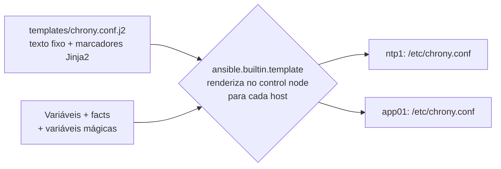

# 5.3 — Usando templates Jinja2 e filtros

| Campo | Valor |
|-------|-------|
| Curso | AU294 — Ansible Automation Platform 2.6 (edição 2) |
| Capítulo / seção | Capítulo 5 · Seção 5.3 |
| Título original | Using Jinja2 Templates and Filters |
| Título em português | Usando templates Jinja2 e filtros |
| Objetivo | Implantar nos managed hosts arquivos personalizados para cada host usando templates Jinja2 |
| Pré-requisitos | [5.1](5.1-automatizando-gerenciamento-de-arquivos.md), [3.3 — facts e variáveis mágicas](../03-variaveis-e-vault/3.3-coletando-informacoes-com-facts.md) |
| Referência | PDF p. 317–324 · Guided Exercise 5.4 p. 325–329 |

## Parte A — O problema que a tecnologia resolve

`lineinfile` e `blockinfile` servem para pequenos ajustes. Quando o arquivo inteiro
muda de host para host (nomes, IPs, portas, listas de servidores), editar linha a
linha vira um playbook longo e frágil.

Com **templates**, você escreve **um modelo** do arquivo, com marcadores para o que
varia. Ao processar o template, o Ansible gera o arquivo completo, personalizado
para cada managed host, usando variáveis e facts.

## Parte B — Modelo mental e arquitetura



Vantagens do módulo `ansible.builtin.template` citadas pelo curso:

| Vantagem | Por quê |
|----------|---------|
| Idempotência | Só muda o host se o arquivo gerado for diferente do existente |
| Eficiência | Uma task gera e implanta o arquivo inteiro |
| Flexibilidade | Loops e condicionais ficam dentro do template, não no playbook |
| Manutenção | Um modelo central, mais fácil de ler e corrigir |

## Parte C — Entendimento progressivo

### 1. Elementos de um template Jinja2

O Jinja2 é um motor de templates para Python; o Ansible usa a mesma sintaxe nas
variáveis dos playbooks. Um template pode ter:

| Elemento | Para quê |
|----------|----------|
| Variáveis | Marcadores substituídos por valores |
| Expressões | Variáveis e operadores avaliados para gerar um valor |
| Estruturas de controle | Loops e condicionais que controlam a renderização |
| Filtros | Funções que transformam valores |
| Comentários | Anotações ignoradas na renderização |

Por convenção, templates têm extensão **`.j2`** (não é obrigatório, mas deixa claro
que é um template).

### 2. Delimitadores

| Delimitador | Uso | Exemplo |
|-------------|-----|---------|
| `{{ EXPR }}` | Variável ou expressão, substituída pelo valor | `porta: {{ porta + 10 }}` |
| `{# COMENTÁRIO #}` | Comentário que **não** vai para o arquivo final | `{# gerado para o grupo ntp #}` |
| `` | Estrutura de controle (`for`, `if`) | `` |

`if` termina com `` e `for` termina com ``.

### 3. Onde fica o template e como implantar

O módulo procura templates por padrão no diretório **`templates`** do projeto; o
parâmetro `src` aponta outro local.

```yaml
- name: Publicar /etc/chrony.conf a partir do template
  ansible.builtin.template:
    src: templates/chrony.conf.j2     # no control node
    dest: /etc/chrony.conf            # no managed host
    owner: root
    group: root
    mode: '0644'
  notify: Reiniciar chronyd
```

Como o `file`, o `template` aceita dono, grupo, permissões e contexto SELinux. Tem
também a opção `validate`, que roda um comando (por exemplo, `visudo -c`) para
checar a sintaxe do arquivo antes de colocá-lo no lugar.

### 4. `ansible_managed`: avisar que o arquivo é gerenciado

Defina o texto no `ansible.cfg`:

```ini
[defaults]
ansible_managed = Arquivo gerenciado pelo Ansible. Alterações locais serão perdidas.
```

E use no topo do template, **com o caractere de comentário do arquivo de destino**:

```text
# {{ ansible_managed }}
```

### 5. Loops no template

```jinja

server {{ servidor }} iburst

```

- `loop.index` vale 1 na primeira volta e aumenta a cada iteração.
- Dá para filtrar no próprio `for`: ``.
- Com variáveis mágicas, o template percorre o inventário:

```jinja

Cliente {{ loop.index }}: {{ host | lower }}

```

O curso mostra um uso clássico: gerar o `/etc/hosts` percorrendo `groups['all']` e
lendo, por `hostvars[host]['ansible_facts']`, o IP, o FQDN e o hostname de cada host
(os facts desses hosts precisam ter sido coletados).

### 6. Condicionais no template

```jinja

allow {{ ntp_rede_clientes }}

```

> **Importante (curso):** loops e condicionais Jinja2 (``, ``) são
> usados em **templates**, não em playbooks. Nos playbooks, use `loop` e `when`
> (Capítulo 4).

### 7. Filtros

Aplicados com a barra vertical `|`:

| Filtro | Efeito |
|--------|--------|
| `to_json` / `to_yaml` | Converte o valor para JSON / YAML |
| `to_nice_json` / `to_nice_yaml` | Idem, com indentação e quebras de linha legíveis |
| `from_json` / `from_yaml` | Converte uma **string** JSON/YAML em dado utilizável pelo Ansible |
| `lower` | Texto em minúsculas (ex.: `{{ inventory_hostname \| lower }}`) |
| `default('valor')` | Valor alternativo quando a variável não está definida, para o template não falhar |

```jinja
[aplicacao]
porta = {{ app_porta | default('8443') }}
```

Exemplo do padrão "string JSON → estrutura → YAML legível":

```yaml
- name: Converter regras recebidas em JSON para um arquivo YAML
  ansible.builtin.copy:
    dest: /etc/estoque/regras.yml
    mode: '0644'
    content: |
      # {{ ansible_managed }}
      {{ regras_json | from_json | to_nice_yaml }}
```

A lista completa de filtros está na documentação "Using Filters to Manipulate
Data" (📘).

### 8. Diferenças que confundem

| A | B | Diferença essencial |
|---|---|--------------------|
| `template` | `copy` | Renderiza Jinja2 antes de enviar × envia o arquivo como está |
| `{{ }}` | `` | Insere um valor × controla o fluxo (`for`, `if`) |
| `{# #}` | `#` no template | Some do arquivo final × vira texto no arquivo final |
| `` (template) | `loop` (task) | Repete trechos do arquivo × repete a task |
| `to_yaml` | `to_nice_yaml` | Compacto × legível |
| `to_json` | `from_json` | Estrutura → texto × texto → estrutura |

## Parte D — Exemplo autoral incremental

Projeto validado:
[exemplos-originais/cap05-arquivos-e-templates](../../exemplos-originais/cap05-arquivos-e-templates/).

**Passo 1 — o template com aviso, comentário, facts, loop, condição e filtro**
([templates/chrony.conf.j2](../../exemplos-originais/cap05-arquivos-e-templates/templates/chrony.conf.j2)):

```jinja
# {{ ansible_managed }}
{# Comentário Jinja2: não aparece no arquivo gerado #}
# Host: {{ ansible_facts['fqdn'] }} ({{ ansible_facts['default_ipv4']['address'] }})

server {{ servidor }} iburst

driftfile /var/lib/chrony/drift
makestep 1.0 3
rtcsync

# Servidores do grupo ntp atendem a rede de clientes
allow {{ ntp_rede_clientes | default('198.51.100.0/24') }}

logdir /var/log/chrony
```

**Passo 2 — o play que renderiza para cada host:**

```yaml
- name: Gerar a configuração do chrony por template
  hosts: ntp:clientes
  become: true
  gather_facts: true            # o template usa facts
  vars:
    ntp_servidores:
      - a.ntp.example.net
      - b.ntp.example.net
  tasks:
    - name: Publicar /etc/chrony.conf a partir do template
      ansible.builtin.template:
        src: templates/chrony.conf.j2
        dest: /etc/chrony.conf
        mode: '0644'
      notify: Reiniciar chronyd
  handlers:
    - name: Reiniciar chronyd
      ansible.builtin.systemd_service:
        name: chronyd
        state: restarted
```

**Passo 3 — template que percorre o inventário e filtro de formatação:**
[templates/clientes.txt.j2](../../exemplos-originais/cap05-arquivos-e-templates/templates/clientes.txt.j2)
usa `groups['clientes']`, `loop.index` e `lower`; a última task de
[templates.yml](../../exemplos-originais/cap05-arquivos-e-templates/templates.yml)
grava uma estrutura com `to_nice_yaml`.

## Parte E — Execução e verificação

```bash
ansible-navigator run templates.yml --syntax-check
ansible-navigator run templates.yml
```

| Item | Valor |
|------|-------|
| Resultado esperado | `/etc/chrony.conf` diferente em cada host: FQDN/IP próprios; linha `allow` só nos hosts do grupo `ntp` |
| 2ª execução | `ok` (arquivo gerado igual ao existente); handler não roda |
| Verificação no host (📘) | `head -3 /etc/chrony.conf` · `grep allow /etc/chrony.conf` |
| Status | ✅ YAML, `--syntax-check` e `ansible-lint` (perfil *production*) sem erros · ⚠️ não executado contra hosts |

## Parte F — Troubleshooting

| Sintoma | Causa provável | Como verificar / corrigir |
|---------|----------------|---------------------------|
| Template não encontrado | Arquivo fora de `templates/` e `src` sem o caminho certo | Ajuste `src` |
| Erro de variável indefinida no template | Variável não definida para aquele host | Defina a variável ou use `default(...)` |
| Fact vazio no template | Play com `gather_facts: false` | Colete facts antes |
| `hostvars[host]['ansible_facts']` vazio | Facts de outros hosts não coletados | Inclua esses hosts em um play que colete facts |
| Bloco `for`/`if` não fecha | Faltou `` ou `` | Feche cada estrutura |
| Linha do `ansible_managed` quebra o arquivo | Sem caractere de comentário do arquivo de destino | `# {{ ansible_managed }}` (ou o comentário do formato) |
| Tentou usar `` no playbook | Estruturas de controle Jinja2 são para templates | Use `when` e `loop` no playbook |

## Parte G — Preparação para o laboratório

Atividade associada: **5.4 Guided Exercise — Using Jinja2 Templates and Filters**
(`files-templates`, PDF p. 325–329). Ver
[PRATICA-OFICIAL.md](PRATICA-OFICIAL.md#54-guided-exercise-using-jinja2-templates-and-filters).

Você deve conseguir:

- escrever um template com facts e variáveis;
- implantá-lo com `ansible.builtin.template` e aplicar dono e modo;
- conferir no host que cada arquivo ficou personalizado.

## Parte H — Fixação

1. Qual a diferença entre `{{ }}`, `` e `{# #}`?
2. Onde o módulo `template` procura os templates por padrão?
3. Escreva um trecho de template que liste cada item de `servidores_dns` como `nameserver <item>`.
4. Por que a linha com `{{ ansible_managed }}` deve começar com o caractere de comentário do arquivo?
5. Diagnóstico: o template falha porque `app_porta` não está definida em alguns hosts. Como evitar sem definir a variável em todos?
6. Em que situação `from_json` é útil?

<details>
<summary>Respostas comentadas</summary>

1. `{{ }}` insere o valor de uma variável ou expressão; `` contém estruturas de controle (`for`, `if`); `{# #}` é comentário que não vai para o arquivo final.
2. No diretório `templates` do projeto (ou no caminho informado em `src`).
3. Exemplo:
   ```jinja
   
   nameserver {{ servidor }}
   
   ```
4. Porque o texto de `ansible_managed` vai literalmente para o arquivo; sem o comentário, ele vira uma linha de configuração inválida.
5. Com o filtro `default`: `{{ app_porta | default('8443') }}`.
6. Quando um valor chega como **texto** em JSON (de uma variável ou da saída de um comando) e você precisa tratá-lo como estrutura (dicionário/lista) no Ansible.

</details>

## Parte I — Essencial para memorizar

- Template = arquivo-modelo `.j2`; `ansible.builtin.template` renderiza e implanta; procura em `templates/`.
- `{{ valor }}` · `…` · `…` · `{# comentário #}`.
- `ansible_managed` (definido no `ansible.cfg`) na primeira linha, com o comentário do formato.
- `loop.index`; `groups[...]` e `hostvars[...]` percorrem o inventário.
- Filtros: `to_json`, `to_yaml`, `to_nice_json`, `to_nice_yaml`, `from_json`, `from_yaml`, `lower`, `default`.
- Loops/condicionais Jinja2 nos templates; `loop`/`when` nos playbooks.

---
[← 5.1 Arquivos](5.1-automatizando-gerenciamento-de-arquivos.md) | [Índice do capítulo](README.md) | [Próximo: Prática oficial →](PRATICA-OFICIAL.md)
