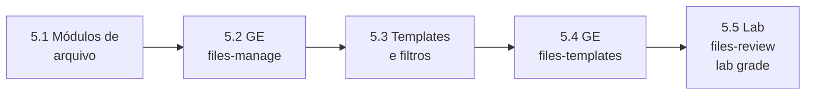

# Capítulo 5 — Developing Automation Content: Deploying Files

**Título em português:** Desenvolvendo conteúdo de automação: implantação de arquivos
**Status:** ✅ documentado e validado (documentação; o estudo é marcado por você no checklist)
**Referência:** PDF p. 292–339 · arquivo `AU294_AAP2.6_C05_Gerenciamento_Arquivos_p292-339.pdf` (não versionado)

## Objetivo do capítulo

Implantar, personalizar e ajustar arquivos nos hosts gerenciados pelo Ansible, com
os módulos de gerenciamento de arquivos e com templates Jinja2 que usam variáveis
e facts.

## Por que este capítulo importa

Configuração de sistemas é, em grande parte, configuração de arquivos. Aqui você
aprende a escolher o módulo certo para cada operação (copiar, editar uma linha,
gerenciar um bloco, criar links, coletar arquivos) e a gerar arquivos inteiros
personalizados por host com templates, recurso central em playbooks reais e no EX294.

## Seções e atividades (ordem oficial)

| Seção | Tipo | Título original | Material | PDF |
|-------|------|-----------------|----------|-----|
| 5.1 | Conceito | Automating File Management Tasks | [lição](5.1-automatizando-gerenciamento-de-arquivos.md) | p. 293–304 |
| 5.2 | Guided Exercise | Automating File Management Tasks | [prática](PRATICA-OFICIAL.md#52-guided-exercise-automating-file-management-tasks) | p. 305–316 |
| 5.3 | Conceito | Using Jinja2 Templates and Filters | [lição](5.3-templates-jinja2-e-filtros.md) | p. 317–324 |
| 5.4 | Guided Exercise | Using Jinja2 Templates and Filters | [prática](PRATICA-OFICIAL.md#54-guided-exercise-using-jinja2-templates-and-filters) | p. 325–329 |
| 5.5 | Lab | Developing Automation Content: Deploying Files | [prática](PRATICA-OFICIAL.md#55-lab-developing-automation-content-deploying-files) | p. 330–338 |
| 5.6 | Summary | Summary | [RESUMO.md](RESUMO.md) | p. 339 |

O capítulo não tem quiz. Só o lab 5.5 aceita `lab grade`.

## Arquivos do capítulo

- [PRATICA-OFICIAL.md](PRATICA-OFICIAL.md): ponte com os dois guided exercises e o lab.
- [REVISAO.md](REVISAO.md): 22 questões autorais (conceito, escrita, diagnóstico).
- [RESUMO.md](RESUMO.md): síntese, tabela de módulos e modelos em uma tela.
- Exemplo validado: [exemplos-originais/cap05-arquivos-e-templates](../../exemplos-originais/cap05-arquivos-e-templates/).

## Pré-requisitos recomendados

[Capítulo 4](../04-controle-de-tarefas/README.md) ·
[3.3 — Facts e variáveis mágicas](../03-variaveis-e-vault/3.3-coletando-informacoes-com-facts.md)

## Checklist (marcado por você)

- [ ] 5.1 lida e Parte H respondida
- [ ] 5.2 Guided Exercise `files-manage` concluído
- [ ] 5.3 lida e Parte H respondida
- [ ] 5.4 Guided Exercise `files-templates` concluído
- [ ] 5.5 Lab `files-review` com `lab grade` aprovado
- [ ] [REVISAO.md](REVISAO.md) respondida
- [ ] Registro no [diário de laboratórios](../../progresso/diario-de-laboratorios.md)

---
[← Capítulo 4](../04-controle-de-tarefas/README.md) | [Índice geral](../../README.md) | [Próximo: 5.1 Arquivos →](5.1-automatizando-gerenciamento-de-arquivos.md)
