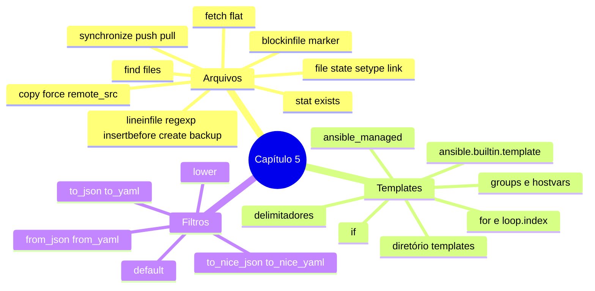

# Resumo — Capítulo 5

Síntese autoral para revisão rápida. Correspondência oficial: seção 5.6 Summary
(PDF p. 339).

## Em uma frase por seção

| Seção | Ideia central |
|-------|---------------|
| 5.1 | Módulos de `ansible.builtin` e `ansible.posix` criam, copiam, coletam, editam e sincronizam arquivos e aplicam dono, permissões e contexto SELinux de forma idempotente |
| 5.3 | Templates Jinja2 geram, a partir de um modelo, um arquivo completo e personalizado para cada host, com variáveis, facts, loops, condicionais e filtros |

## Mapa do capítulo



## Tabela de módulos

| Módulo | Quando usar |
|--------|-------------|
| `ansible.builtin.copy` | Publicar arquivo/diretório (ou conteúdo) com atributos |
| `ansible.builtin.template` | Publicar arquivo gerado de um template Jinja2 |
| `ansible.builtin.fetch` | Trazer arquivos dos hosts para o control node |
| `ansible.posix.synchronize` | Transferências grandes com rsync |
| `ansible.builtin.lineinfile` | Ajustar uma linha |
| `ansible.builtin.blockinfile` | Gerenciar um bloco de linhas |
| `ansible.builtin.file` | Diretórios, links, `touch`, remoção, atributos |
| `ansible.builtin.stat` | Consultar existência e atributos |
| `ansible.builtin.find` | Procurar arquivos por critérios |

## Modelos em uma tela

```yaml
- name: Ajustar uma linha e reiniciar
  ansible.builtin.lineinfile:
    path: /etc/systemd/journald.conf
    regexp: '^#?SystemMaxUse='
    line: 'SystemMaxUse=500M'
  notify: Reiniciar journald

- name: Publicar arquivo gerado por template
  ansible.builtin.template:
    src: templates/chrony.conf.j2
    dest: /etc/chrony.conf
    mode: '0644'
```

```jinja
# {{ ansible_managed }}

server {{ servidor }} iburst


allow {{ ntp_rede_clientes | default('198.51.100.0/24') }}

```

## Alertas operacionais

- ⚠️ No EE, o container é o control node: caminhos relativos ao projeto.
- ⚠️ Barra final em `src` do `copy` muda o resultado.
- ⚠️ `remote_src: true` para copiar dentro do próprio host.
- ⚠️ `lineinfile` sem `regexp` pode duplicar linhas.
- ⚠️ Marcadores diferentes para blocos diferentes.
- ⚠️ `ansible_managed` precisa do caractere de comentário do arquivo.
- ⚠️ ``/`` só em templates; nos playbooks, `loop`/`when`.

## Ligação com o próximo capítulo

O Capítulo 6 trata de **automação em escala**: incluir e importar arquivos (tasks,
playbooks, variáveis) e selecionar hosts com **host patterns**.

---
[← Revisão](REVISAO.md) | [Índice do capítulo](README.md) | [Próximo capítulo →](../06-automacao-em-escala/README.md)
