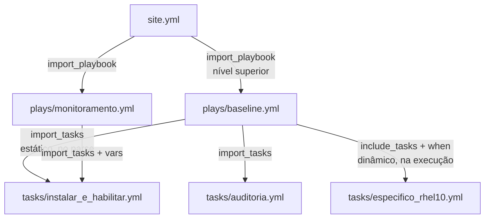

# 6.1 — Incluindo e importando arquivos

| Campo | Valor |
|-------|-------|
| Curso | AU294 — Ansible Automation Platform 2.6 (edição 2) |
| Capítulo / seção | Capítulo 6 · Seção 6.1 |
| Título original | Including and Importing Files |
| Título em português | Incluindo e importando arquivos |
| Objetivo | Gerenciar playbooks grandes importando ou incluindo outros playbooks ou tasks de arquivos externos, de forma incondicional ou com base em uma condição |
| Pré-requisitos | [4.1 — loops e condicionais](../04-controle-de-tarefas/4.1-loops-e-tarefas-condicionais.md), [4.3 — handlers](../04-controle-de-tarefas/4.3-implementando-handlers.md), [3.1 — variáveis](../03-variaveis-e-vault/3.1-usando-variaveis.md) |
| Referência | PDF p. 341–346 · Guided Exercise 6.2 p. 347–354 |

## Parte A — O problema que a tecnologia resolve

Projetos de automação crescem rápido. Um playbook único com centenas de linhas fica
difícil de ler, revisar e corrigir, e as mesmas tasks acabam copiadas entre
playbooks.

A saída é o **design modular**: quebrar a automação em arquivos menores, cada um
cuidando de um aspecto, e combiná-los em um playbook principal. Benefícios citados
pelo curso:

| Benefício | Por quê |
|-----------|---------|
| Qualidade e menos erros | Arquivos pequenos e focados são mais fáceis de ler e depurar |
| Manutenção simples | A task compartilhada fica em um lugar; corrigir ali vale para todos os playbooks que a usam |
| Reuso e consistência | Arquivos modulares, parametrizados por variáveis, servem a vários casos |
| Colaboração | Equipes trabalham em arquivos separados, com menos conflitos de merge |

Casos de uso para arquivos de tasks: organizar a configuração por função (usuários,
pacotes, serviços, hardening, monitoramento), deixar cada equipe manter seu próprio
arquivo, e aplicar uma configuração especializada só a parte dos hosts com uma
condição.

## Parte B — Modelo mental e arquitetura



| Operação | Quando o Ansible processa | Analogia |
|----------|---------------------------|----------|
| **Importar** (estático) | Ao **analisar** o playbook, antes da execução | Copiar e colar o conteúdo no playbook principal |
| **Incluir** (dinâmico) | Quando a execução **chega** à task de include | Buscar o conteúdo só na hora em que for usado |

## Parte C — Entendimento progressivo

### 1. Importar × incluir

| Característica | Importar | Incluir |
|----------------|----------|---------|
| Erro de sintaxe ou arquivo inexistente | Falha **imediata**, antes de rodar | Só falha ao chegar no include |
| Nome do arquivo em variável | A variável precisa ser **estática** (resolvida no parse) | Pode ser **dinâmica** (resolvida na execução) |
| Loops | **Não** é possível importar com loop | Pode usar loops |
| Condições com dados da execução (facts, `register`) | — | Pode usar |
| `when` na task | Aplicado a **cada** task importada | Decide **se** o arquivo é incluído |
| `--list-tasks` | Mostra as tasks importadas | Mostra só a task de include |
| `--start-at-task` | Pode começar numa task importada | **Não** pode começar numa task do arquivo incluído |
| Handlers | Dá para notificar um handler importado pelo nome | Só dá para notificar o handler que faz o include (que roda todas as tasks do arquivo como handlers) |

Módulos:

| Módulo | Faz |
|--------|-----|
| `ansible.builtin.import_playbook` | Importa todos os plays de um playbook externo |
| `ansible.builtin.import_tasks` | Importa (estático) um arquivo de tasks |
| `ansible.builtin.include_tasks` | Inclui (dinâmico) um arquivo de tasks |

> **Histórico:** versões antigas usavam `ansible.builtin.include` para playbooks e
> tasks; o comportamento mudou várias vezes (estático, dinâmico, misto) e o módulo foi
> substituído na versão 2.4 por `include_tasks`, `import_tasks` e `import_playbook`.
> Ele está **obsoleto**: você pode encontrá-lo em playbooks antigos, mas não o use.

### 2. `import_playbook`

Fica no **nível superior** do playbook (plays não podem ser aninhados). Vários
imports rodam na ordem em que aparecem; também é possível intercalar plays próprios
e imports.

```yaml
---
- name: Baseline de todos os servidores
  ansible.builtin.import_playbook: plays/baseline.yml

- name: Monitoramento dos grupos de serviço
  ansible.builtin.import_playbook: plays/monitoramento.yml
```

### 3. Arquivo de tasks

Um arquivo de tasks é só uma **lista de tasks**, sem `hosts` e sem play:

```yaml
---
- name: Publicar regra de auditoria para alterações em /etc/passwd
  ansible.builtin.copy:
    dest: /etc/audit/rules.d/50-identidade.rules
    content: "-w /etc/passwd -p wa -k identidade\n"
    mode: '0640'
```

Boa prática do curso: um **diretório dedicado** para arquivos de tasks (por
exemplo, `tasks/`).

### 4. `import_tasks`

As tasks entram exatamente onde está a task de import, no momento do parse:

```yaml
- name: Aplicar a baseline dos servidores
  hosts: sp,rj
  become: true
  tasks:
    - name: Importar as regras de auditoria
      ansible.builtin.import_tasks: ../tasks/auditoria.yml
```

Regras: `when` na task de import vale para cada task importada; se o nome do arquivo
vier de variável, ela precisa ser estática (`vars` do play, arquivo de variáveis ou
`--extra-vars`).

### 5. `include_tasks`

```yaml
- name: Incluir ajustes específicos do RHEL 10
  ansible.builtin.include_tasks: ../tasks/especifico_rhel10.yml
  when: ansible_facts['distribution_major_version'] == "10"
```

O arquivo só é processado quando a execução chega aqui; o `when` decide se ele é
incluído. É a escolha natural quando a decisão depende de facts ou de variáveis
registradas.

### 6. Condições: a diferença que mais confunde

| Com `when` em... | Efeito |
|------------------|--------|
| `import_tasks` ou `import_playbook` | A condição é aplicada a **todas** as tasks importadas, uma por uma |
| `include_tasks` | A condição vale **só** para a task de include: se for falsa, nada do arquivo roda; se for verdadeira, as tasks do arquivo rodam normalmente |

### 7. Parametrizar com variáveis

Arquivos genéricos ficam reutilizáveis quando os valores vêm de variáveis:

```yaml
# tasks/instalar_e_habilitar.yml
- name: "Garantir o pacote: {{ pacote }}"
  ansible.builtin.dnf:
    name: "{{ pacote }}"
    state: present

- name: "Garantir o serviço ativo e habilitado: {{ servico }}"
  ansible.builtin.systemd_service:
    name: "{{ servico }}"
    enabled: true
    state: started
```

E quem importa define os valores com `vars`:

```yaml
- name: Importar a instalação do chrony
  ansible.builtin.import_tasks: ../tasks/instalar_e_habilitar.yml
  vars:
    pacote: chrony
    servico: chronyd
```

O mesmo vale para `import_playbook`: passe as variáveis necessárias com `vars`.

### 8. Diferenças que confundem

| A | B | Diferença essencial |
|---|---|--------------------|
| `import_tasks` | `include_tasks` | Estático (parse) × dinâmico (execução) |
| `import_playbook` | `import_tasks` | Plays inteiros, no nível superior × lista de tasks, dentro de um play |
| Arquivo de tasks | Playbook | Lista de tasks, sem `hosts` × lista de plays |
| `include` (antigo) | `include_tasks` | Obsoleto, comportamento ambíguo × substituto atual |

## Parte D — Exemplo autoral incremental

Projeto validado:
[exemplos-originais/cap06-automacao-em-escala](../../exemplos-originais/cap06-automacao-em-escala/)
(cenário próprio: baseline de servidores dividida em arquivos).

**Passo 1 — arquivos de tasks pequenos e reutilizáveis:**
[tasks/instalar_e_habilitar.yml](../../exemplos-originais/cap06-automacao-em-escala/tasks/instalar_e_habilitar.yml)
(parametrizado), [tasks/auditoria.yml](../../exemplos-originais/cap06-automacao-em-escala/tasks/auditoria.yml)
e [tasks/especifico_rhel10.yml](../../exemplos-originais/cap06-automacao-em-escala/tasks/especifico_rhel10.yml).

**Passo 2 — um play que importa e inclui:**

```yaml
- name: Aplicar a baseline dos servidores
  hosts: sp,rj
  become: true
  tasks:
    - name: Importar a instalação do chrony
      ansible.builtin.import_tasks: ../tasks/instalar_e_habilitar.yml
      vars:
        pacote: chrony
        servico: chronyd

    - name: Importar a instalação do auditd
      ansible.builtin.import_tasks: ../tasks/instalar_e_habilitar.yml
      vars:
        pacote: audit
        servico: auditd

    - name: Importar as regras de auditoria
      ansible.builtin.import_tasks: ../tasks/auditoria.yml

    - name: Incluir ajustes específicos do RHEL 10
      ansible.builtin.include_tasks: ../tasks/especifico_rhel10.yml
      when: ansible_facts['distribution_major_version'] == "10"
```

O caminho `../tasks/` é relativo ao arquivo do play, que está em `plays/`.

**Passo 3 — o playbook principal só importa playbooks:**
[site.yml](../../exemplos-originais/cap06-automacao-em-escala/site.yml).

## Parte E — Execução e verificação

```bash
ansible-navigator run site.yml --syntax-check
ansible-navigator run site.yml --list-tasks    # tasks importadas aparecem; a incluída, não
ansible-navigator run site.yml
```

| Item | Valor |
|------|-------|
| `--list-tasks` | Mostra as tasks de `instalar_e_habilitar.yml` (duas vezes) e de `auditoria.yml`; do include, só a task "Incluir ajustes específicos do RHEL 10" |
| Hosts não RHEL 10 | A task de include aparece como `skipping` e nada do arquivo roda |
| Status | ✅ YAML, `--syntax-check` e `ansible-lint` (perfil *production*) sem erros · ⚠️ não executado contra hosts |

## Parte F — Troubleshooting

| Sintoma | Causa provável | Como verificar / corrigir |
|---------|----------------|---------------------------|
| Playbook falha antes de começar, citando um arquivo | Arquivo importado inexistente ou com erro de sintaxe | Caminho relativo ao arquivo que importa; `--syntax-check` |
| Erro ao usar `import_playbook` | Usado dentro de um play | Só no nível superior do playbook |
| Variável no nome do arquivo não resolve | `import_tasks` exige variável estática | Defina em `vars`/arquivo/`-e`, ou use `include_tasks` |
| `loop` em `import_tasks` falha | Imports não aceitam loops | Use `include_tasks` |
| Tasks do arquivo não aparecem no `--list-tasks` | O arquivo é incluído (dinâmico) | Esperado; use `import_tasks` se precisar listar |
| `--start-at-task` não acha a task | Ela está em um arquivo incluído | Use `import_tasks` ou comece em outra task |
| `notify` não acha o handler | Handler dentro de arquivo incluído | Notifique o handler que faz o include, ou importe |
| Arquivo de tasks com erro de estrutura | Tem `hosts:`/play dentro dele | Arquivo de tasks = só lista de tasks |

## Parte G — Preparação para o laboratório

Atividade associada: **6.2 Guided Exercise — Including and Importing Files**
(`scale-files`, PDF p. 347–354). Ver
[PRATICA-OFICIAL.md](PRATICA-OFICIAL.md#62-guided-exercise-including-and-importing-files).

Você deve conseguir:

- montar um playbook a partir de arquivos de tasks e de um play externo;
- escolher entre `import_tasks` e `include_tasks` e prever o efeito no `--list-tasks`;
- passar variáveis a um arquivo de tasks parametrizado.

## Parte H — Fixação

1. Qual a diferença entre importar e incluir quanto ao momento de processamento?
2. Onde `import_playbook` pode aparecer?
3. Você precisa escolher o arquivo de tasks com base em um fact. Import ou include? Por quê?
4. Um `when` falso em um `import_tasks` com três tasks: o que aparece na saída?
5. Escreva a task que importe `tasks/instalar_e_habilitar.yml` para o pacote `rsyslog` e o serviço `rsyslog`.
6. Por que não usar `ansible.builtin.include` em playbooks novos?

<details>
<summary>Respostas comentadas</summary>

1. Importar é estático: o conteúdo entra quando o playbook é analisado, antes da execução. Incluir é dinâmico: o conteúdo é processado quando a execução chega à task de include.
2. No nível superior do playbook, nunca dentro de um play.
3. Include (`include_tasks`): facts só existem durante a execução, e o nome ou a condição dinâmica só é resolvido no include.
4. As três tasks importadas aparecem como `skipping`, porque a condição é aplicada a cada uma.
5. Exemplo:
   ```yaml
   - name: Importar a instalação do rsyslog
     ansible.builtin.import_tasks: tasks/instalar_e_habilitar.yml
     vars:
       pacote: rsyslog
       servico: rsyslog
   ```
6. Está obsoleto: seu comportamento mudou entre versões (estático, dinâmico, misto) e foi substituído, na 2.4, por `include_tasks`, `import_tasks` e `import_playbook`.

</details>

## Parte I — Essencial para memorizar

- Importar = estático (parse); incluir = dinâmico (execução).
- `import_playbook` (nível superior) · `import_tasks` · `include_tasks`. `include` está obsoleto.
- `when` em import → cada task; em include → só o include.
- Import: sem loops, variável de nome estática, aparece no `--list-tasks`, aceita `--start-at-task` e handlers importados.
- Arquivos de tasks: só lista de tasks, num diretório dedicado; parametrize com `vars`.

---
[← Capítulo 6 (índice)](README.md) | [Índice do capítulo](README.md) | [Próximo: 6.3 Host patterns →](6.3-selecionando-hosts-com-host-patterns.md)
