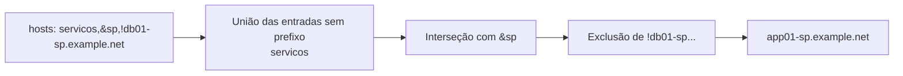

# 6.3 — Selecionando hosts com host patterns

| Campo | Valor |
|-------|-------|
| Curso | AU294 — Ansible Automation Platform 2.6 (edição 2) |
| Capítulo / seção | Capítulo 6 · Seção 6.3 |
| Título original | Selecting Hosts by Using Host Patterns |
| Título em português | Selecionando hosts com host patterns |
| Objetivo | Escrever host patterns sofisticados para selecionar com eficiência os hosts de um play |
| Pré-requisitos | [2.1 — inventário](../02-desenvolvendo-automacao/2.1-construindo-um-inventario.md), [6.1](6.1-incluindo-e-importando-arquivos.md) |
| Referência | PDF p. 355–364 · Guided Exercise 6.4 p. 365–372 |

## Parte A — O problema que a tecnologia resolve

Rodar um play no host errado pode derrubar um serviço em produção. **Host patterns**
são o mecanismo do Ansible para escolher exatamente quais managed hosts um play
atinge, pela palavra-chave `hosts`.

O curso recomenda selecionar os hosts **com patterns**, em vez de lógica condicional
(`when`) dentro das tasks, por dois motivos: **segurança e confiabilidade** (menos
risco de uma task rodar onde não devia) e **clareza** (fica evidente quais sistemas
são alvo).

## Parte B — Modelo mental e arquitetura

Inventário usado nos exemplos desta lição (fictício, com IPs de documentação):

```ini
192.0.2.10
192.0.2.11

[sp]
app01-sp.example.net
db01-sp.example.net
cache01-sp.example.net

[rj]
app02-rj.example.net
db02-rj.example.net
cache02-rj.example.net

[app]
app01-sp.example.net
app02-rj.example.net

[db]
db01-sp.example.net
db02-rj.example.net

[cache]
cache01-sp.example.net
cache02-rj.example.net

[servicos:children]
app
db
```



## Parte C — Entendimento progressivo

### 1. Um host

O pattern mais simples é um host do inventário. Um **IP** só funciona como pattern
se estiver **listado explicitamente** no inventário; não basta resolver por DNS
para um host listado pelo nome.

```yaml
hosts: 192.0.2.10
```

Referir-se a hosts por IP dificulta lembrar quem é quem. Para manter um nome lógico
e conectar por um endereço específico, use **`ansible_host`** (e, para outra porta
SSH, `ansible_port`), no inventário ou em `host_vars`:

```ini
proxy-dc.example.net ansible_host=192.0.2.50 ansible_port=2222
```

Casos típicos para `ansible_host`: o nome resolve para um IP que não é o que o
control node deve usar; o nome do inventário não está no DNS; a política de rede
exige conectar por um IP específico.

### 2. Grupos e grupos especiais

| Pattern | Alvo |
|---------|------|
| `app` | Hosts do grupo `app` |
| `all` | Todos os hosts do inventário |
| `ungrouped` | Hosts que não pertencem a nenhum outro grupo (`192.0.2.10` e `192.0.2.11`) |
| `servicos` | Grupo pai: inclui todos os hosts dos filhos (`app` e `db`) |

`--limit` (ou `-l`) restringe os alvos **na execução**, sem editar o playbook:

```bash
ansible-navigator run -m stdout site.yml --limit app
```

### 3. Curingas

O `*` casa vários hosts ou grupos pelo nome:

| Pattern | Alvo |
|---------|------|
| `'*'` | Todos (equivale a `all`) |
| `'*.example.net'` | Hosts terminados em `.example.net` |
| `192.0.2.*` | IPs que começam com `192.0.2.` |
| `'app*'` | Hosts **ou grupos** que começam com `app` |

> ⚠️ Curingas casam **nomes de host, IPs e nomes de grupo**, sem distinguir um do
> outro. Isso pode gerar casamentos inesperados (um grupo e um host com prefixos
> parecidos, por exemplo).

> ⚠️ **Aspas:** `!`, `*` e `&` têm significado especial em YAML, sobretudo no início
> do valor. Coloque o pattern entre aspas no playbook: `hosts: '!cache*'`.

### 4. Listas (OU)

Uma lista separada por **vírgulas** seleciona os hosts que casam com **qualquer**
item: hosts, IPs, grupos e curingas misturados.

| Pattern | Alvo |
|---------|------|
| `192.0.2.10,db01-sp.example.net` | Esses dois hosts |
| `app,db` | Todos os hosts de `app` e de `db` |
| `192.0.2.10,cache,db*` | O IP, o grupo `cache` e o que começar com `db` |

O `:` também funciona como separador, mas a vírgula é preferível, principalmente com
endereços IPv6 como nomes de host.

### 5. E (`&`) e NÃO (`!`)

| Operador | Significado | Exemplo | Alvo (inventário acima) |
|----------|-------------|---------|-------------------------|
| `&` | O host **também** precisa casar este item | `servicos,&sp` | `app01-sp`, `db01-sp` |
| `!` | **Exclui** quem casar este item | `'servicos,!db02-rj.example.net'` | `app01-sp`, `app02-rj`, `db01-sp` |

A ordem dos itens não importa: `&sp,servicos` dá o mesmo resultado que
`servicos,&sp`; `'!db02-rj.example.net,servicos'` dá o mesmo que
`'servicos,!db02-rj.example.net'`.

### 6. Conferir antes de executar: `--list-hosts`

```bash
ansible-navigator run -m stdout padroes.yml --list-hosts
```

Mostra, por play, o pattern e os hosts que ele casa, **sem executar nenhuma task**.
Use sempre que mudar um pattern, sobretudo com curingas, operadores lógicos ou
grupos aninhados.

### 7. Diferenças que confundem

| A | B | Diferença essencial |
|---|---|--------------------|
| Pattern em `hosts:` | `--limit` | Alvo definido no playbook × restrição pontual na execução |
| `,` | `&` | União (OU) × interseção (E) |
| `!` | `ungrouped` | Exclusão × grupo especial de hosts sem grupo |
| `all` | `'*'` | Grupo especial × curinga que casa tudo (mesmo resultado) |
| Nome no inventário | `ansible_host` | Como o host é chamado nos plays × endereço usado para conectar |
| Host pattern | `when` | Escolhe os hosts do play × decide, host a host, se uma task roda |

## Parte D — Exemplo autoral incremental

Arquivo validado:
[exemplos-originais/cap06-automacao-em-escala/padroes.yml](../../exemplos-originais/cap06-automacao-em-escala/padroes.yml),
com o [inventário](../../exemplos-originais/cap06-automacao-em-escala/inventory) acima.

**Passo 1 — curinga (entre aspas):**

```yaml
- name: Hosts que começam com app (curinga entre aspas)
  hosts: 'app*'
  gather_facts: false
  tasks:
    - name: Identificar o host
      ansible.builtin.debug:
        msg: "{{ inventory_hostname }}"
```

**Passo 2 — interseção e exclusão:**

```yaml
- name: Grupo servicos, mas só em São Paulo (AND)
  hosts: servicos,&sp
  gather_facts: false
  tasks:
    - name: Identificar o host
      ansible.builtin.debug:
        msg: "{{ inventory_hostname }}"

- name: Grupo servicos, exceto um host (NOT)
  hosts: 'servicos,!db02-rj.example.net'
  gather_facts: false
  tasks:
    - name: Identificar o host
      ansible.builtin.debug:
        msg: "{{ inventory_hostname }}"
```

**Passo 3 — grupo especial:** `hosts: ungrouped` atinge os dois IPs sem grupo.

## Parte E — Execução e verificação

```bash
ansible-navigator run -m stdout padroes.yml --list-hosts      # confira antes
ansible-navigator run -m stdout padroes.yml
ansible-navigator run -m stdout padroes.yml --limit sp        # restringe na execução
```

| Play | Hosts esperados (pelo inventário) |
|------|-----------------------------------|
| `'app*'` | `app01-sp`, `app02-rj` (e qualquer grupo que comece com `app`, como `app`) |
| `servicos,&sp` | `app01-sp`, `db01-sp` |
| `'servicos,!db02-rj.example.net'` | `app01-sp`, `app02-rj`, `db01-sp` |
| `ungrouped` | `192.0.2.10`, `192.0.2.11` |
| Status | ✅ YAML, `--syntax-check` e `ansible-lint` (perfil *production*) sem erros · ⚠️ não executado contra hosts |

## Parte F — Troubleshooting

| Sintoma | Causa provável | Como verificar / corrigir |
|---------|----------------|---------------------------|
| Erro de YAML na linha `hosts:` | Pattern começando com `!`, `*` ou `&` sem aspas | Coloque entre aspas |
| Play não atinge um IP | O IP não está listado no inventário (só resolve por DNS) | Liste o IP ou use o nome do host |
| Curinga casa hosts inesperados | Casa também nomes de grupo e IPs | `--list-hosts` e um pattern mais específico |
| Nenhum host casa | `&` exige estar nos dois conjuntos | Confira os grupos com `ansible-navigator inventory --graph` |
| Conexão no endereço errado | `ansible_host` incorreto | `ansible-navigator inventory -m stdout --host <h>` |
| Execução atingiu hosts demais | Pattern largo demais | `--list-hosts` antes; `--limit` para restringir |

## Parte G — Preparação para o laboratório

Atividade associada: **6.4 Guided Exercise — Selecting Hosts by Using Host
Patterns** (`scale-hosts`, PDF p. 365–372). Ver
[PRATICA-OFICIAL.md](PRATICA-OFICIAL.md#64-guided-exercise-selecting-hosts-by-using-host-patterns).

Você deve conseguir:

- prever o resultado de um pattern lendo o inventário;
- conferir com `--list-hosts` antes de executar;
- restringir alvos com `--limit`, inclusive com patterns que exigem aspas.

## Parte H — Fixação

1. Escreva um pattern para todos os hosts dos grupos `app` e `cache`.
2. Escreva um pattern para os hosts de `servicos` que também estão em `rj`.
3. Escreva um pattern para todos os hosts, exceto os do grupo `db`.
4. Por que `hosts: !db*` falha e `hosts: '!db*'` funciona?
5. Um host está no inventário pelo nome; o play com `hosts: 192.0.2.30` (o IP dele) não o atinge. Por quê?
6. Qual a diferença entre definir o alvo em `hosts:` e usar `--limit`?

<details>
<summary>Respostas comentadas</summary>

1. `app,cache`
2. `servicos,&rj`
3. `'all,!db'`
4. Sem aspas, o YAML interpreta o `!` no início do valor de forma especial; entre aspas, o valor é uma string que o Ansible avalia como pattern.
5. Um IP só serve como pattern se estiver listado explicitamente no inventário; resolver para um host listado por nome não basta.
6. `hosts:` define o alvo do play no playbook; `--limit` restringe esse alvo só naquela execução, sem editar o arquivo.

</details>

## Parte I — Essencial para memorizar

- Pattern em `hosts:`; prefira patterns a `when` para escolher alvos.
- Host, IP (se listado), grupo, `all`, `ungrouped`, grupo pai (`:children`).
- Curinga `*` casa hosts, IPs e grupos; aspas quando começa com `!`, `*`, `&`.
- `,` = OU · `&` = E · `!` = NÃO; ordem não importa.
- `--list-hosts` antes de executar; `--limit`/`-l` para restringir.
- `ansible_host`/`ansible_port`: nome lógico × endereço e porta de conexão.

---
[← 6.1 Includes e imports](6.1-incluindo-e-importando-arquivos.md) | [Índice do capítulo](README.md) | [Próximo: Prática oficial →](PRATICA-OFICIAL.md)
