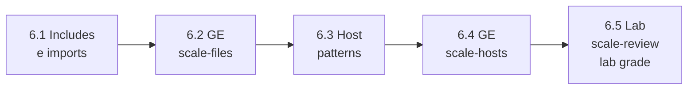

# Capítulo 6 — Developing Automation Content at Scale

**Título em português:** Desenvolvendo conteúdo de automação em escala
**Status:** ✅ documentado e validado (documentação; o estudo é marcado por você no checklist)
**Referência:** PDF p. 340–384 · arquivo `AU294_AAP2.6_C06_Automacao_Escala_p340-384.pdf` (não versionado)

## Objetivo do capítulo

Tornar playbooks complexos mais fáceis de gerenciar com imports e includes de
playbooks e arquivos de tasks, e escolher com precisão os hosts de cada play com
host patterns.

## Por que este capítulo importa

Quando a automação cresce, um playbook único deixa de ser viável. Este capítulo
ensina a dividir o trabalho em arquivos reutilizáveis e a mirar exatamente os hosts
certos, dois cuidados que evitam erros caros em produção e preparam o terreno para
as roles do Capítulo 7.

## Seções e atividades (ordem oficial)

| Seção | Tipo | Título original | Material | PDF |
|-------|------|-----------------|----------|-----|
| 6.1 | Conceito | Including and Importing Files | [lição](6.1-incluindo-e-importando-arquivos.md) | p. 341–346 |
| 6.2 | Guided Exercise | Including and Importing Files | [prática](PRATICA-OFICIAL.md#62-guided-exercise-including-and-importing-files) | p. 347–354 |
| 6.3 | Conceito | Selecting Hosts by Using Host Patterns | [lição](6.3-selecionando-hosts-com-host-patterns.md) | p. 355–364 |
| 6.4 | Guided Exercise | Selecting Hosts by Using Host Patterns | [prática](PRATICA-OFICIAL.md#64-guided-exercise-selecting-hosts-by-using-host-patterns) | p. 365–372 |
| 6.5 | Lab | Developing Automation Content at Scale | [prática](PRATICA-OFICIAL.md#65-lab-developing-automation-content-at-scale) | p. 373–383 |
| 6.6 | Summary | Summary | [RESUMO.md](RESUMO.md) | p. 384 |

O capítulo não tem quiz. Só o lab 6.5 aceita `lab grade`.

## Arquivos do capítulo

- [PRATICA-OFICIAL.md](PRATICA-OFICIAL.md): ponte com os dois guided exercises e o lab.
- [REVISAO.md](REVISAO.md): 22 questões autorais (conceito, escrita, diagnóstico).
- [RESUMO.md](RESUMO.md): síntese e tabelas de módulos, patterns e comandos.
- Exemplo validado: [exemplos-originais/cap06-automacao-em-escala](../../exemplos-originais/cap06-automacao-em-escala/).

## Pré-requisitos recomendados

[Capítulo 5](../05-deploy-de-arquivos/README.md) ·
[2.1 — Inventário](../02-desenvolvendo-automacao/2.1-construindo-um-inventario.md)

## Checklist (marcado por você)

- [ ] 6.1 lida e Parte H respondida
- [ ] 6.2 Guided Exercise `scale-files` concluído
- [ ] 6.3 lida e Parte H respondida
- [ ] 6.4 Guided Exercise `scale-hosts` concluído
- [ ] 6.5 Lab `scale-review` com `lab grade` aprovado
- [ ] [REVISAO.md](REVISAO.md) respondida
- [ ] Registro no [diário de laboratórios](../../progresso/diario-de-laboratorios.md)

---
[← Capítulo 5](../05-deploy-de-arquivos/README.md) | [Índice geral](../../README.md) | [Próximo: 6.1 Includes e imports →](6.1-incluindo-e-importando-arquivos.md)
