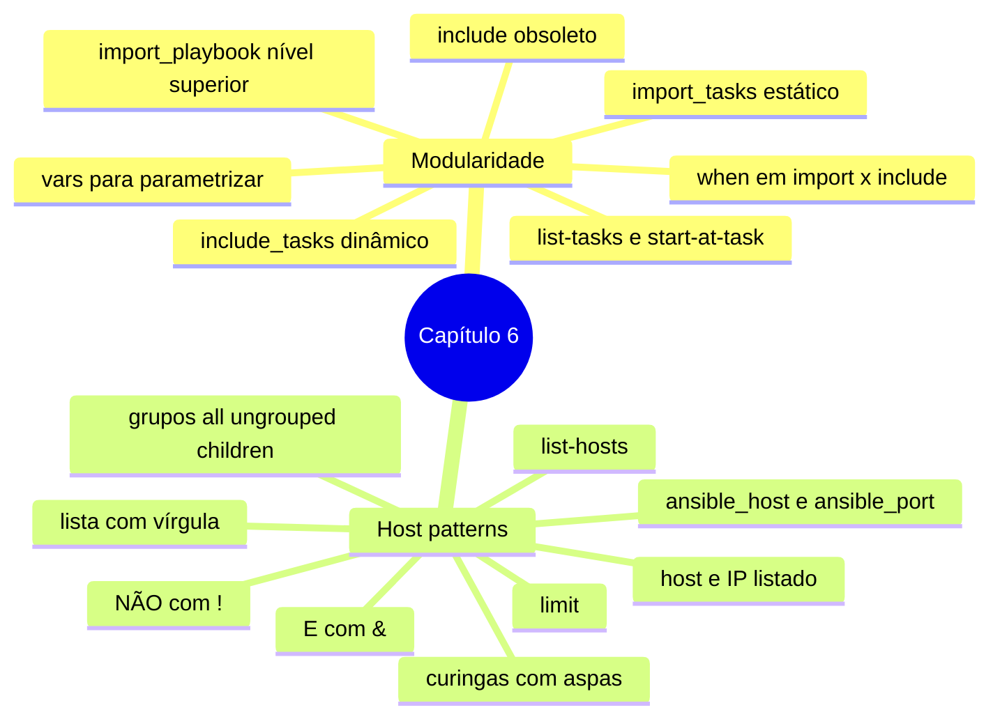

# Resumo — Capítulo 6

Síntese autoral para revisão rápida. Correspondência oficial: seção 6.6 Summary
(PDF p. 384).

## Em uma frase por seção

| Seção | Ideia central |
|-------|---------------|
| 6.1 | Divida playbooks grandes em arquivos menores: `import_playbook` e `import_tasks` trazem conteúdo de forma estática (no parse) e `include_tasks`, de forma dinâmica (na execução), com regras diferentes para condições, loops e listagens |
| 6.3 | Host patterns escolhem com precisão os hosts de um play: hosts, grupos, grupos especiais, curingas, listas (`,`), interseção (`&`) e exclusão (`!`), conferidos com `--list-hosts` |

## Mapa do capítulo

## Tabelas de consulta

| Módulo | Uso |
|--------|-----|
| `ansible.builtin.import_playbook` | Importar plays de outro playbook (nível superior) |
| `ansible.builtin.import_tasks` | Importar tasks (estático) |
| `ansible.builtin.include_tasks` | Incluir tasks (dinâmico; aceita loops e condições de execução) |

| Pattern | Seleciona |
|---------|-----------|
| `app` | Grupo |
| `all` · `'*'` | Todos |
| `ungrouped` | Hosts sem grupo |
| `'app*'` | Curinga (hosts, IPs e grupos) |
| `app,db` | União |
| `servicos,&sp` | Interseção |
| `'servicos,!db02-rj.example.net'` | Exclusão |

| Comando | Para quê |
|---------|----------|
| `ansible-navigator run <pb>.yml --list-hosts` | Conferir os hosts de cada play |
| `ansible-navigator run <pb>.yml --list-tasks` | Ver tasks (importadas aparecem; incluídas, não) |
| `ansible-navigator run <pb>.yml --limit <pattern>` | Restringir os alvos na execução |

## Alertas operacionais

- ⚠️ `import_playbook` só no nível superior.
- ⚠️ Imports falham na hora se o arquivo não existe ou tem erro; includes, só quando chegam lá.
- ⚠️ `import_tasks` não aceita loops nem variáveis dinâmicas no nome do arquivo.
- ⚠️ `when` em import vale para cada task; em include, só para o include.
- ⚠️ Patterns com `!`, `*`, `&` no início: aspas.
- ⚠️ Curingas também casam nomes de grupos e IPs.
- ⚠️ IP só funciona como pattern se estiver no inventário.

## Ligação com o próximo capítulo

O Capítulo 7 leva a modularidade adiante com **roles** (estrutura padronizada de
tasks, handlers, variáveis, arquivos e templates) e **Ansible Content Collections**.

---
[← Revisão](REVISAO.md) | [Índice do capítulo](README.md) | [Próximo capítulo →](../07-roles-e-collections/README.md)
