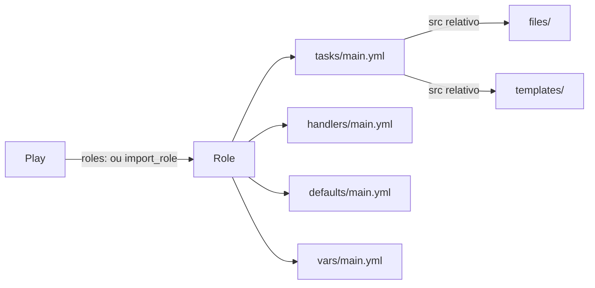

# 7.1 — Definindo a estrutura de roles

| Campo | Valor |
|-------|-------|
| Curso | AU294 — Ansible Automation Platform 2.6 (edição 2) |
| Capítulo / seção | Capítulo 7 · Seção 7.1 |
| Título original | Defining Role Structure |
| Título em português | Definindo a estrutura de roles |
| Objetivo | Entender para que serve uma role, como ela é organizada e como é usada em playbooks |
| Pré-requisitos | [6.1 — includes e imports](../06-automacao-em-escala/6.1-incluindo-e-importando-arquivos.md), [3.1 — variáveis](../03-variaveis-e-vault/3.1-usando-variaveis.md), [4.3 — handlers](../04-controle-de-tarefas/4.3-implementando-handlers.md) |
| Referência | PDF p. 386–395 · Quiz 7.2 p. 396–399 |

## Parte A — O problema que a tecnologia resolve

No Capítulo 6 você quebrou playbooks em arquivos de tasks. Isso ajuda, mas cada
projeto inventa a própria organização: onde ficam os templates, os handlers, os
valores padrão? Copiar esse conjunto entre projetos gera versões divergentes do mesmo
código.

Uma **role** (Ansible Role) resolve isso com uma **estrutura de diretórios padrão**
que reúne tasks, handlers, variáveis, arquivos e templates de uma função. Quem
conhece a convenção sabe onde está cada coisa, e a role pode ser copiada,
versionada e compartilhada como uma unidade.

Vantagens destacadas pelo curso:

| Vantagem | Ideia |
|----------|-------|
| Desacoplamento | Detalhes de configuração viram variáveis; a role continua genérica |
| Customização | Variáveis adaptam a role a cada ambiente sem alterar seu código |
| Reuso | Escrita uma vez, usada em vários playbooks e projetos |
| Controle de versão | A role tem versões próprias, independentes do projeto |
| Integração com automation hub | Publicação e consumo pelo Ansible automation hub ou private automation hub |
| Previsibilidade | `defaults` dão uma linha de base que o playbook ou o inventário podem sobrescrever |
| Organização | Unidades lógicas e autocontidas |
| Colaboração | Equipes diferentes mantêm roles diferentes em paralelo |
| Dependências | Uma role pode declarar e puxar outras roles de que precisa |

Roles são uma base de **Configuration as Code (CaC)**.

## Parte B — Modelo mental e arquitetura

Pense na role como um **pacote de função**: um diretório cujo nome é o nome da role
e cujos subdiretórios têm papéis fixos.

```text
roles/ferramentas_admin/
├── defaults/main.yml    # valores padrão (menor precedência)
├── files/               # arquivos estáticos usados pelas tasks
├── handlers/main.yml    # handlers da role
├── meta/main.yml        # metadados e dependências
├── README.md            # documentação para humanos
├── tasks/main.yml       # lista principal de tasks
├── templates/           # templates Jinja2
├── tests/               # inventário e playbook de teste
└── vars/main.yml        # variáveis internas (alta precedência)
```

| Subdiretório | Papel |
|--------------|-------|
| `defaults` | `main.yml` com os valores padrão das variáveis |
| `files` | Arquivos estáticos referenciados pelas tasks da role |
| `handlers` | `main.yml` com os handlers |
| `meta` | `main.yml` com autor, licença, plataformas e dependências opcionais |
| `tasks` | `main.yml` com as tasks principais |
| `templates` | Templates Jinja2 referenciados pelas tasks |
| `tests` | `inventory` e `test.yml` para testar a role |
| `vars` | `main.yml` com variáveis de uso interno |

> **Regra do curso:** nada disso é obrigatório. Apague subdiretórios e arquivos que a
> role não usa (sem templates, sem `templates/`) para deixá-la mais simples.



## Parte C — Entendimento progressivo

### 1. `defaults` × `vars` da role

| Tipo | Arquivo | Precedência |
|------|---------|-------------|
| Variáveis padrão | `defaults/main.yml` | **A mais baixa**: quase qualquer outra fonte (playbook, inventário...) sobrescreve |
| Variáveis da role | `vars/main.yml` | **Alta**: sobrescrevem variáveis do playbook e do inventário |

Regra prática: o que o usuário da role **deve poder mudar** vai em `defaults`; o que
é **constante ou lógica interna** vai em `vars`.

> ⚠️ Não guarde segredos (senhas, chaves) dentro da role. Ela precisa continuar
> genérica e compartilhável. Passe dados sensíveis por variáveis na chamada, por
> Ansible Vault ou outro método seguro.

### 2. Duas formas de usar uma role em um play

1. Como **task**, com `ansible.builtin.import_role` (estático) ou
   `ansible.builtin.include_role` (dinâmico). É a forma mais flexível.
2. Na seção **`roles`** do play. Também muito comum.

### 3. `import_role` e `include_role`

```yaml
- name: Preparar estações
  hosts: estacoes_admin
  tasks:
    - name: Mensagem antes da role
      ansible.builtin.debug:
        msg: primeira task

    - name: Importar a role de ferramentas
      ansible.builtin.import_role:
        name: ferramentas_admin
      vars:
        ferramentas_admin_historico: 10000
```

Com `import_role`, no parse o Ansible acrescenta ao play, se existirem, as tasks
(`tasks/main.yml`), os handlers, os `defaults` e as `vars` da role (as `vars`
sobrescrevem os `defaults`).

| | `import_role` | `include_role` |
|---|---------------|----------------|
| Quando é processada | No parse (estática) | Quando a execução chega à task (dinâmica) |
| `when`/loops na task | Aplicados a **cada** task da role | Aplicados só à decisão de incluir ou não |
| Handlers, `defaults` e `vars` da role | Visíveis para **todo** o play, até para tasks anteriores à role | **Não** ficam expostos ao resto do play |

É a mesma lógica de `import_tasks` × `include_tasks` do Capítulo 6.

### 4. Seção `roles`

```yaml
- name: Play só com roles
  hosts: coleta
  roles:
    - role: ferramentas_admin
    - role: coletor_logs
```

Cada role entra no play com suas tasks, handlers, variáveis e dependências, na ordem
listada. Parâmetros podem ser passados na própria entrada:

```yaml
roles:
  - role: ferramentas_admin
    ferramentas_admin_historico: 10000
  - role: coletor_logs
```

Também existe a forma em dicionário (`- { role: ferramentas_admin, ferramentas_admin_historico: 10000 }`),
mais compacta, mas o curso não a considera boa prática por ser menos legível.

> ⚠️ **Roles sempre rodam antes das tasks**, mesmo que `roles:` apareça depois de
> `tasks:` no arquivo. Se o play tem as duas seções, escreva `roles` primeiro ou,
> melhor, troque a seção `roles` por tasks com `import_role`/`include_role` para que a
> ordem fique explícita.

**Uma vez por conjunto de parâmetros:** se a mesma role aparece duas vezes em `roles`
com **exatamente** os mesmos parâmetros, ela roda uma vez só. Para rodar de novo, os
parâmetros precisam ser diferentes.

### 5. `pre_tasks` e `post_tasks`

Seções especiais usadas às vezes junto com `roles`. Ordem de execução de um play:

| # | Seção |
|---|-------|
| 1 | `pre_tasks` |
| 2 | Handlers notificados em `pre_tasks` |
| 3 | `roles` |
| 4 | `tasks` |
| 5 | Handlers notificados em `roles` e `tasks` |
| 6 | `post_tasks` |
| 7 | Handlers notificados em `post_tasks` |

Nota do curso: se você sente necessidade de `pre_tasks`/`post_tasks` por causa da
seção `roles`, considere importar as roles como tasks e usar só `tasks`, ou dividir em
mais plays.

### 6. Roles de collections

Roles também vêm dentro de **Ansible Content Collections**, que agrupam roles,
módulos e plug-ins. Fontes: Ansible automation hub, private automation hub, Ansible
Galaxy, repositórios Git ou arquivos compactados. Detalhes nas seções
[7.5](7.5-implantando-roles-de-fontes-externas.md) e
[7.7](7.7-roles-e-modulos-de-collections.md).

### 7. Diferenças que confundem

| A | B | Diferença essencial |
|---|---|--------------------|
| `defaults/main.yml` | `vars/main.yml` | Feito para sobrescrever (precedência mínima) × constante interna (precedência alta) |
| `import_role` | `include_role` | Estático, expõe variáveis e handlers ao play × dinâmico, não expõe |
| Seção `roles` | `import_role` em `tasks` | Roda antes de todas as tasks × roda onde está escrito |
| `files/` | `templates/` | Copiado como está × renderizado com Jinja2 |
| Role | Arquivo de tasks | Estrutura completa (tasks, handlers, variáveis, arquivos) × só lista de tasks |

## Parte D — Exemplo autoral incremental

Projeto validado:
[exemplos-originais/cap07-roles-e-collections](../../exemplos-originais/cap07-roles-e-collections/)
(cenário próprio: estações de administração e coletor de logs).

**Passo 1 — reconhecer a estrutura:** abra
[roles/ferramentas_admin](../../exemplos-originais/cap07-roles-e-collections/roles/ferramentas_admin/)
e localize `defaults`, `tasks`, `handlers`, `templates` e `meta`. Ela não tem `vars`,
`files` nem `tests`, porque não usa.

**Passo 2 — `defaults` × `vars`:** compare
[ferramentas_admin/defaults/main.yml](../../exemplos-originais/cap07-roles-e-collections/roles/ferramentas_admin/defaults/main.yml)
(valores para o usuário ajustar) com
[coletor_logs/vars/main.yml](../../exemplos-originais/cap07-roles-e-collections/roles/coletor_logs/vars/main.yml)
(nome de pacote, serviço e arquivo: constantes internas).

**Passo 3 — ordem das seções:**
[ordem.yml](../../exemplos-originais/cap07-roles-e-collections/ordem.yml) tem
`pre_tasks`, `roles`, `tasks` e `post_tasks`. As mensagens numeradas mostram a
sequência esperada.

## Parte E — Execução e verificação

```bash
ansible-navigator run ordem.yml --syntax-check
ansible-navigator run ordem.yml --list-tasks   # tasks da role aparecem com o prefixo "ferramentas_admin :"
```

| Item | Valor |
|------|-------|
| Saída esperada | Tasks da role aparecem como `TASK [ferramentas_admin : ...]` |
| Ordem | `pre_tasks` → role → `tasks` → handler da role → `post_tasks` |
| Status | ✅ YAML, `--syntax-check` e `ansible-lint` (perfil *production*) sem erros · ⚠️ não executado contra hosts |

## Parte F — Troubleshooting

| Sintoma | Causa provável | Como verificar / corrigir |
|---------|----------------|---------------------------|
| Task escrita antes de `roles:` roda depois da role | Roles sempre rodam antes de `tasks` | Use `import_role` em `tasks` para ordem explícita |
| Role listada duas vezes roda uma vez | Mesmos parâmetros | Parâmetros diferentes, se for intencional |
| Valor do playbook ignorado | Variável definida em `vars/main.yml` da role (precedência alta) | Mova para `defaults/main.yml` se deve ser ajustável |
| Variável da role indefinida em task posterior | Role incluída com `include_role` (não expõe variáveis) | Use `import_role` ou defina a variável no play |
| Template não encontrado | Arquivo fora de `templates/` da role | Mova para `templates/`; o `src` é relativo a ele |

## Parte G — Preparação para o laboratório

Atividade associada: **7.2 Quiz — Defining Role Structure** (PDF p. 396–399, sem
comando `lab`). Ver [PRATICA-OFICIAL.md](PRATICA-OFICIAL.md#72-quiz-defining-role-structure).

Antes do quiz você deve conseguir explicar, sem consulta:

- o propósito de uma role e cada subdiretório;
- a precedência de `defaults` e `vars`;
- a diferença entre `import_role` e `include_role`;
- a ordem de `pre_tasks`, `roles`, `tasks`, `post_tasks` e handlers.

## Parte H — Fixação

1. Em qual arquivo você coloca a porta padrão de um serviço que o usuário da role pode mudar?
2. Uma role não usa templates. O que fazer com `templates/`?
3. Um play tem `tasks:` escrita antes de `roles:`. O que roda primeiro?
4. Escreva uma task que inclua dinamicamente a role `coletor_logs`.
5. Quais variáveis de uma role ficam visíveis para tasks anteriores a ela no play: com `import_role` ou com `include_role`?
6. Por que não guardar uma senha em `vars/main.yml` de uma role?

<details>
<summary>Respostas comentadas</summary>

1. `defaults/main.yml`: precedência mínima, feito para ser sobrescrito.
2. Apagar: o curso recomenda remover subdiretórios não usados.
3. As roles. A seção `roles` sempre roda antes de `tasks`, independentemente da posição no arquivo.
4. Exemplo:
   ```yaml
   - name: Incluir a role do coletor
     ansible.builtin.include_role:
       name: coletor_logs
   ```
5. Com `import_role`: como é estática, `defaults`, `vars` e handlers ficam disponíveis para todo o play.
6. A role precisa ser genérica e compartilhável; segredos devem vir na chamada (variáveis, Ansible Vault).

</details>

## Parte I — Essencial para memorizar

- Role = diretório padrão: `tasks`, `handlers`, `defaults`, `vars`, `files`, `templates`, `meta`, `tests`, `README.md`.
- `defaults` = precedência mínima (para sobrescrever); `vars` = alta (constantes internas).
- `import_role` estático (expõe variáveis e handlers ao play) · `include_role` dinâmico.
- Seção `roles` roda **antes** de `tasks`; mesma role com mesmos parâmetros roda uma vez.
- Ordem: `pre_tasks` → handlers → `roles` → `tasks` → handlers → `post_tasks` → handlers.

---
[← Capítulo 7 (índice)](README.md) | [Índice do capítulo](README.md) | [Próximo: 7.3 Criando roles →](7.3-criando-roles.md)
