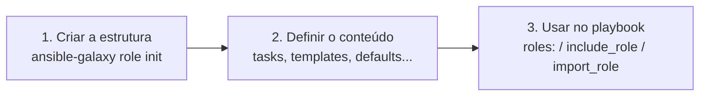

# 7.3 — Criando roles

| Campo | Valor |
|-------|-------|
| Curso | AU294 — Ansible Automation Platform 2.6 (edição 2) |
| Capítulo / seção | Capítulo 7 · Seção 7.3 |
| Título original | Creating Roles |
| Título em português | Criando roles |
| Objetivo | Criar uma role no diretório do projeto e executá-la em um dos plays do playbook |
| Pré-requisitos | [7.1 — estrutura de roles](7.1-definindo-a-estrutura-de-roles.md), [5.3 — templates Jinja2](../05-deploy-de-arquivos/5.3-templates-jinja2-e-filtros.md) |
| Referência | PDF p. 400–405 · Guided Exercise 7.4 p. 406–412 |

## Parte A — O problema que a tecnologia resolve

Saber como uma role é organizada não basta: é preciso **criá-la** de forma
consistente, preenchê-la, torná-la configurável por variáveis e chamá-la de um
playbook. Também é comum uma role precisar de outra (um portal precisa de um
servidor web, por exemplo). Esta seção cobre esse ciclo e as boas práticas de
desenvolvimento.

## Parte B — Modelo mental e arquitetura

Três passos, segundo o curso:



Dentro da role, caminhos são **relativos à própria role**: um `template` com
`src: admin.sh.j2` procura em `templates/` da role; um `copy` com
`src: 10-coletor.conf` procura em `files/` da role.

## Parte C — Entendimento progressivo

### 1. Criar o esqueleto

```bash
cd roles
ansible-galaxy role init ferramentas_admin
ls ferramentas_admin/
# defaults  files  handlers  meta  README.md  tasks  templates  tests  vars
```

O comando garante a estrutura esperada desde o início. Depois, apague o que a role
não vai usar. Também funciona a partir da raiz do projeto: `ansible-galaxy role init roles/<nome>`.

| Item | Para quê |
|------|----------|
| `defaults/main.yml` | Valores padrão das variáveis |
| `files/` | Arquivos estáticos para os managed hosts |
| `handlers/` | Handlers da role |
| `meta/main.yml` | Dependências e metadados (autor, licença, plataformas) |
| `README.md` | Descrição, uso, exemplos e requisitos não Ansible |
| `tasks/` | Tasks principais (`main.yml`) ou arquivos incluídos a partir dele |
| `templates/` | Templates Jinja2 |
| `vars/main.yml` | Variáveis internas, com precedência maior que `defaults` |
| `tests/` | Testes funcionais automatizados |

### 2. Definir o conteúdo

Comece por `tasks/main.yml`:

```yaml
---
- name: Garantir os pacotes de administração
  ansible.builtin.dnf:
    name: "{{ ferramentas_admin_pacotes }}"
    state: present

- name: Publicar o perfil de shell dos administradores
  ansible.builtin.template:
    src: admin.sh.j2          # procurado em roles/ferramentas_admin/templates/
    dest: /etc/profile.d/admin.sh
    owner: root
    group: root
    mode: '0644'
  notify: Registrar alteração do perfil
```

O template usa uma variável cujo valor padrão fica em `defaults/main.yml`:

```yaml
---
ferramentas_admin_historico: 5000
ferramentas_admin_responsavel: Equipe de Plataforma
```

### 3. Boas práticas de desenvolvimento

| Grupo | Práticas |
|-------|----------|
| Design | Uma role, **um propósito**; várias roles pequenas em vez de uma que faz tudo; se uma role existente quase atende, refatore-a; planeje crescimento |
| Desenvolvimento | Cada role no **seu repositório** de controle de versão (Git); variáveis para configurar; considerar contexto corporativo (conformidade, segurança, integração); testes de integração e regressão; lint e testes automáticos |
| Manutenção | **Poucas dependências**; manter `README.md` e `meta/main.yml`; **sem segredos** na role; nomes consistentes; revisão periódica |

📘 Fonte externa: há um guia comunitário de boas práticas para roles,
"Roles Good Practices for Ansible", citado pelo curso. O `ansible-lint`, por exemplo,
espera que variáveis de uma role tenham o nome da role como prefixo
(`ferramentas_admin_...`), o que evita colisões.

### 4. Mudar o comportamento com variáveis

Precedência das quatro fontes principais no contexto de uma role (da maior para a menor):

| # | Fonte | Observação |
|---|-------|------------|
| 1 | Parâmetros na seção `roles` do play | Sobrescrevem todas as outras fontes |
| 2 | `vars/main.yml` da role | Acima de `defaults`, inventário, `host_vars`/`group_vars` e `vars` do play |
| 3 | `vars` do play | Sobrescreve os `defaults` da role |
| 4 | `defaults/main.yml` da role | Valor de reserva; qualquer outra fonte sobrescreve |

A ideia é proteger o funcionamento interno: valores de plataforma, que o usuário
normalmente não muda, ficam em `vars`; valores customizáveis, em `defaults`.

Sobrescrevendo pelo `vars` do play:

```yaml
- name: Estações com histórico maior
  hosts: estacoes_admin
  become: true
  vars:
    ferramentas_admin_historico: 20000
  roles:
    - role: ferramentas_admin
```

Sobrescrevendo pelo parâmetro da role (vence todas as fontes):

```yaml
- name: Estações com histórico maior
  hosts: estacoes_admin
  become: true
  roles:
    - role: ferramentas_admin
      ferramentas_admin_historico: 20000
```

Ou chamando como task, para controlar o momento:

```yaml
- name: Estações com a role incluída como task
  hosts: estacoes_admin
  become: true
  tasks:
    - name: Incluir a role de ferramentas
      ansible.builtin.include_role:
        name: ferramentas_admin
```

### 5. Dependências de roles

Ficam na lista `dependencies` de `meta/main.yml`, e podem receber parâmetros:

```yaml
dependencies:
  - role: ferramentas_admin
    ferramentas_admin_pacotes:
      - tmux
      - lnav
```

- `galaxy_info`, no mesmo arquivo, documenta a role (autor, descrição, licença,
  plataformas). O Ansible o ignora ao processar dependências, mas preenchê-lo é boa prática.
- Uma dependência que aparece várias vezes no play com os mesmos parâmetros roda **uma
  vez**. `allow_duplicates: true` no `meta/main.yml` da role muda isso.
- ⚠️ Limite o número de dependências: cadeias longas complicam o projeto e o troubleshooting.

### 6. Diferenças que confundem

| A | B | Diferença essencial |
|---|---|--------------------|
| `vars` do play | Parâmetro em `roles:` | Perde para `vars/main.yml` da role × vence todas as fontes |
| `galaxy_info` | `dependencies` | Documentação × roles executadas antes desta |
| `ansible-galaxy role init` | Criar diretórios à mão | Estrutura garantida × risco de erro de nome |
| `src` em task de role | `src` em task de playbook | Relativo a `files/`/`templates/` da role × relativo ao playbook |

## Parte D — Exemplo autoral incremental

Projeto: [exemplos-originais/cap07-roles-e-collections](../../exemplos-originais/cap07-roles-e-collections/).

**Passo 1 — role simples:**
[ferramentas_admin](../../exemplos-originais/cap07-roles-e-collections/roles/ferramentas_admin/):
`defaults`, `tasks`, `templates`, `handlers`, `meta` com `galaxy_info` e
[README.md](../../exemplos-originais/cap07-roles-e-collections/roles/ferramentas_admin/README.md)
documentando as variáveis.

**Passo 2 — role com arquivo estático, constantes e dependência:**
[coletor_logs](../../exemplos-originais/cap07-roles-e-collections/roles/coletor_logs/):
`files/10-coletor.conf`, `vars/main.yml` com nome de pacote e serviço, e
[meta/main.yml](../../exemplos-originais/cap07-roles-e-collections/roles/coletor_logs/meta/main.yml)
declarando `ferramentas_admin` como dependência com outra lista de pacotes.

**Passo 3 — sobrescrever um default pelo inventário:**
[group_vars/coleta/coletor.yml](../../exemplos-originais/cap07-roles-e-collections/group_vars/coleta/coletor.yml)
troca a porta padrão (`defaults`) do coletor para o grupo `coleta`.

**Passo 4 — playbook:** [site.yml](../../exemplos-originais/cap07-roles-e-collections/site.yml)
usa a seção `roles` com parâmetro no primeiro play e `include_role` no segundo.

## Parte E — Execução e verificação

```bash
ansible-navigator run site.yml --syntax-check
ansible-navigator run site.yml
```

| Item | Valor |
|------|-------|
| Segundo play | A dependência `ferramentas_admin` roda antes das tasks de `coletor_logs` |
| Porta usada em `coleta` | O valor de `group_vars` (sobrescreve o `defaults`) |
| Status | ✅ YAML, `--syntax-check` e `ansible-lint` (perfil *production*) sem erros · ⚠️ não executado contra hosts |

## Parte F — Troubleshooting

| Sintoma | Causa provável | Como verificar / corrigir |
|---------|----------------|---------------------------|
| `the role 'x' was not found` | Role fora de `roles/` ou do `roles_path` | Confira o diretório e o `ansible.cfg` |
| Template ou arquivo não encontrado | Arquivo fora de `templates/`/`files/` da role | Mova; `src` é relativo à role |
| Lint reclama de `min_ansible_version` | Número sem aspas no `meta/main.yml` | Coloque entre aspas |
| Lint reclama de nome de variável | Variável da role sem o prefixo da role | Renomeie (`<role>_<var>`) |
| Valor do play não muda o comportamento | Variável está em `vars/main.yml` | Use parâmetro em `roles:` ou mova para `defaults` |
| Dependência roda uma vez só | Mesmos parâmetros | Esperado; `allow_duplicates: true` se necessário |

## Parte G — Preparação para o laboratório

Atividade associada: **7.4 Guided Exercise — Creating Roles** (`roles-create`,
PDF p. 406–412). Ver [PRATICA-OFICIAL.md](PRATICA-OFICIAL.md#74-guided-exercise-creating-roles).

Você deve conseguir:

- gerar o esqueleto com `ansible-galaxy role init` e remover o que não será usado;
- colocar arquivos, templates, handlers e tasks no lugar certo;
- preencher `meta/main.yml` e `README.md`;
- chamar a role em um playbook.

## Parte H — Fixação

1. Qual comando cria o esqueleto de uma role chamada `backup_diario` dentro de `roles/`?
2. Uma task da role usa `src: motd.j2` com `ansible.builtin.template`. Onde o arquivo deve estar?
3. Ordene da maior para a menor precedência: `vars` do play, `defaults/main.yml`, parâmetro em `roles:`, `vars/main.yml`.
4. Escreva a seção `dependencies` que faça a role atual depender de `ferramentas_admin`.
5. Por que limitar dependências?
6. O que `allow_duplicates: true` muda?

<details>
<summary>Respostas comentadas</summary>

1. `ansible-galaxy role init roles/backup_diario` (ou `cd roles` e `ansible-galaxy role init backup_diario`).
2. Em `templates/` da role: `roles/<role>/templates/motd.j2`.
3. Parâmetro em `roles:` > `vars/main.yml` > `vars` do play > `defaults/main.yml`.
4. Exemplo:
   ```yaml
   dependencies:
     - role: ferramentas_admin
   ```
5. Dependências complexas aumentam a complexidade do projeto e dificultam o troubleshooting.
6. Permite que a role rode mais de uma vez no play mesmo com os mesmos parâmetros.

</details>

## Parte I — Essencial para memorizar

- `ansible-galaxy role init <nome>` cria o esqueleto; apague o que não usar.
- Caminhos de `src` em tasks de role são relativos a `files/` e `templates/` da role.
- Precedência: parâmetro em `roles:` > `vars/main.yml` > `vars` do play > `defaults/main.yml`.
- Dependências em `meta/main.yml` (`dependencies`); `galaxy_info` documenta; `allow_duplicates`.
- Uma role, um propósito; sem segredos; poucas dependências; README e meta atualizados.

---
[← 7.1 Estrutura de roles](7.1-definindo-a-estrutura-de-roles.md) | [Índice do capítulo](README.md) | [Próximo: 7.5 Roles de fontes externas →](7.5-implantando-roles-de-fontes-externas.md)
