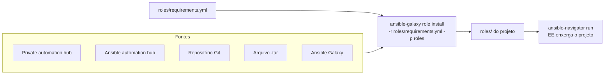

# 7.5 — Implantando roles de fontes externas

| Campo | Valor |
|-------|-------|
| Curso | AU294 — Ansible Automation Platform 2.6 (edição 2) |
| Capítulo / seção | Capítulo 7 · Seção 7.5 |
| Título original | Deploying Roles from External Content Sources |
| Título em português | Implantando roles de fontes externas de conteúdo |
| Objetivo | Selecionar e obter roles de fontes externas (repositórios Git, Ansible automation hub, Ansible Galaxy) e usá-las nos playbooks |
| Pré-requisitos | [7.3 — criando roles](7.3-criando-roles.md) |
| Referência | PDF p. 413–419 · Guided Exercise 7.6 p. 420–425 |

## Parte A — O problema que a tecnologia resolve

Muitas roles já existem: feitas pela sua organização, por parceiros ou pela
comunidade. Copiar o diretório manualmente não registra **de onde** veio nem **qual
versão** é usada. O projeto precisa de um **manifesto de dependências** que permita
reinstalar as mesmas roles, na mesma versão, em qualquer máquina.

## Parte B — Modelo mental e arquitetura



| Fonte | Característica |
|-------|----------------|
| **Private automation hub** | Repositório interno de conteúdo confiável e verificado; pode espelhar o automation hub. **Fonte recomendada** pela Red Hat |
| **Ansible automation hub** | Fonte oficial de Red Hat Ansible Certified Content Collections e Ansible validated content, auditado e suportado pela Red Hat |
| **Repositórios Git** | GitHub, GitLab etc.; roles da própria organização costumam ficar em Git privado |
| **Ansible Galaxy** | Site público da comunidade com milhares de roles |

> ⚠️ Conteúdo do Ansible Galaxy é mantido principalmente por voluntários e **não** é
> auditado nem suportado pela Red Hat. O curso desaconselha fortemente o uso direto;
> se usar, revise qualidade, segurança e compatibilidade antes de produção.

## Parte C — Entendimento progressivo

### 1. `ansible-galaxy role`: subcomandos

| Subcomando | Faz | Exemplo |
|------------|-----|---------|
| `install` | Baixa e instala roles | `ansible-galaxy role install -r roles/requirements.yml -p roles` |
| `list` | Lista roles instaladas | `ansible-galaxy role list` |
| `remove` | Remove uma role local | `ansible-galaxy role remove <role>` |
| `search` | Busca roles no Ansible Galaxy | `ansible-galaxy role search <termo>` |
| `init` | Cria o esqueleto | `ansible-galaxy role init <role>` |

A busca aceita filtros como `--author`, `--platforms` e `--galaxy-tags`
(ex.: `ansible-galaxy role search ntp --platforms EL`).

### 2. Onde o Ansible procura roles

Por padrão, nesta ordem:

1. Diretório `roles/` relativo ao arquivo do playbook.
2. Diretórios do `roles_path` no `ansible.cfg` (padrão
   `~/.ansible/roles:/usr/share/ansible/roles:/etc/ansible/roles`).
3. O diretório onde está o playbook.

### 3. `roles/requirements.yml`

Manifesto das roles de que o projeto precisa. Permite desenvolver e testar o
playbook separado das roles de apoio.

```yaml
---
# do Ansible Galaxy, versão mais recente
- src: equipe.ntp_basico

# do Ansible Galaxy, com nome local e versão fixa
- src: equipe.ntp_basico
  version: "2.3.1"
  name: ntp_basico

# de um repositório Git via HTTPS
- src: https://git.example.net/infra/ansible-role-coletor.git
  scm: git
  version: main
  name: coletor

# de um arquivo .tar (http, https ou file)
- src: file:///srv/roles/auditoria.tar
  name: auditoria
```

| Chave | Significado |
|-------|-------------|
| `src` | Nome no Ansible Galaxy ou URL da role (Git aceita também SSH, como `git@git.example.net:infra/role.git`) |
| `scm` | **Obrigatória** para repositório de controle de versão (`git`); omitida para Galaxy e `.tar` |
| `version` | Opcional: branch, tag ou hash de commit; sem ela, último commit do branch padrão |
| `name` | Sobrescreve o nome local da role |

> ⚠️ **Fixe a versão** (`version`), principalmente em produção. Sem ela, você recebe a
> versão mais recente no momento da instalação, e uma mudança incompatível do autor
> pode quebrar o playbook. A Red Hat recomenda manter roles em controle de versão
> (Git), o que permite voltar a uma versão estável.

### 4. Instalar no lugar certo

```bash
ansible-galaxy role install -r roles/requirements.yml -p roles
```

- `-r`: arquivo de requisitos.
- `-p roles`: instala em `roles/` do projeto.

> ⚠️ Sem `-p roles`, o destino é o primeiro diretório do `roles_path`, por padrão
> `~/.ansible/roles`: **fora do projeto** e invisível para o execution environment do
> `ansible-navigator`. Alternativa: `roles_path = roles` (ou `./roles:...`) na seção
> `[defaults]` do `ansible.cfg` do projeto.

| Como você executa | Instalação das roles |
|-------------------|----------------------|
| `ansible-navigator run` | **Você** instala antes de executar |
| Automation controller | Baixa automaticamente o que está em `roles/requirements.yml` |

### 5. Gerenciar roles baixadas

```bash
ansible-galaxy role list          # roles por diretório de busca, com versão ou "(unknown version)"
ansible-galaxy role remove auditoria
```

### 6. Ler a documentação antes de usar

No `README.md` da role, procure: propósito, variáveis disponíveis e seus valores
padrão, dependências e exemplos de playbook.

### 7. Usar a role instalada

Três formas, como em [7.1](7.1-definindo-a-estrutura-de-roles.md):

```yaml
- name: Seção roles
  hosts: estacoes_admin
  roles:
    - ntp_basico

- name: include_role (dinâmico, controla o momento)
  hosts: estacoes_admin
  tasks:
    - name: Incluir a role de NTP
      ansible.builtin.include_role:
        name: ntp_basico

- name: import_role (estático, no parse)
  hosts: estacoes_admin
  vars:
    ntp_basico_servidores:
      - ntp1.example.net
  tasks:
    - name: Importar a role de NTP
      ansible.builtin.import_role:
        name: ntp_basico
```

Variáveis documentadas pela role são definidas, por exemplo, no `vars` do play. Com a
seção `roles`, a ordem é `pre_tasks` → `roles` → `tasks` → `post_tasks`; use
`pre_tasks` para preparar o ambiente e `post_tasks` para verificar.

### 8. Diferenças que confundem

| A | B | Diferença essencial |
|---|---|--------------------|
| `roles/requirements.yml` | `collections/requirements.yml` | Lista de roles (itens com `src`) × chave `collections:` (seção 7.7) |
| `ansible-galaxy role install` | `ansible-galaxy collection install` | Roles avulsas × collections |
| Private automation hub | Ansible Galaxy | Conteúdo confiável e recomendado × comunidade, sem suporte |
| `version` em branch | `version` em tag | Muda a cada commit × referência fixa |

## Parte D — Exemplo autoral incremental

Projeto: [exemplos-originais/cap07-roles-e-collections](../../exemplos-originais/cap07-roles-e-collections/).

**Passo 1 — manifesto:**
[roles/requirements.yml](../../exemplos-originais/cap07-roles-e-collections/roles/requirements.yml)
declara uma role Git fictícia (`git.example.net`) com `scm: git` e versão fixa.

**Passo 2 — destino dentro do projeto:**
[ansible.cfg](../../exemplos-originais/cap07-roles-e-collections/ansible.cfg) tem
`roles_path = ./roles`, então a instalação cai em `roles/` mesmo sem `-p`.

**Passo 3 — conferir:** `ansible-galaxy role list` deve mostrar o diretório `roles/`
do projeto e as roles locais.

## Parte E — Execução e verificação

```bash
ansible-galaxy role install -r roles/requirements.yml -p roles
ansible-galaxy role list
```

| Item | Valor |
|------|-------|
| Instalação | Não realizada: a fonte do exemplo é fictícia |
| Status | ✅ YAML validado por parser · ⚠️ não executado |

## Parte F — Troubleshooting

| Sintoma | Causa provável | Como verificar / corrigir |
|---------|----------------|---------------------------|
| Role instalada, mas o playbook não acha | Instalada em `~/.ansible/roles` (fora do EE) | `-p roles` ou `roles_path` no `ansible.cfg` |
| `ansible-galaxy role list` não mostra `roles/` | `roles/` não está no `roles_path` | Ajuste o `ansible.cfg` |
| Playbook quebrou após reinstalar | Versão não fixada; autor mudou a role | Defina `version` (tag ou commit) |
| Falha ao instalar de Git | Falta `scm: git` | Acrescente `scm` |
| Variável da role ignorada | Nome diferente do documentado | Releia o `README.md` da role |

## Parte G — Preparação para o laboratório

Atividade associada: **7.6 Guided Exercise — Deploying Roles from External Content
Sources** (`roles-external`, PDF p. 420–425). Ver
[PRATICA-OFICIAL.md](PRATICA-OFICIAL.md#76-guided-exercise-deploying-roles-from-external-content-sources).

Você deve conseguir:

- configurar o `roles_path` para incluir o `roles/` do projeto;
- escrever um `roles/requirements.yml` e instalar a partir dele;
- achar as variáveis da role no `README.md` e usá-las num playbook.

## Parte H — Fixação

1. Qual a fonte recomendada pela Red Hat para conteúdo de automação?
2. Escreva uma entrada de `roles/requirements.yml` para a role Git `https://git.example.net/infra/role-dns.git`, tag `v1.2.0`, nome local `dns`.
3. Por que `-p roles` importa ao usar `ansible-navigator`?
4. Quando `scm` é omitido?
5. Com automation controller, quem instala as roles do `roles/requirements.yml`?
6. Qual comando lista as roles instaladas?

<details>
<summary>Respostas comentadas</summary>

1. O private automation hub.
2. Exemplo:
   ```yaml
   - src: https://git.example.net/infra/role-dns.git
     scm: git
     version: v1.2.0
     name: dns
   ```
3. Sem ele, a role vai para o primeiro diretório do `roles_path` (por padrão `~/.ansible/roles`), fora do projeto e inacessível ao execution environment.
4. Para roles do Ansible Galaxy e arquivos `.tar`.
5. O próprio automation controller, ao executar o playbook.
6. `ansible-galaxy role list`.

</details>

## Parte I — Essencial para memorizar

- Fontes: private automation hub (recomendado), automation hub, Git, `.tar`, Galaxy (com cautela).
- `roles/requirements.yml`: `src`, `scm` (Git), `version` (fixe!), `name`.
- `ansible-galaxy role install -r roles/requirements.yml -p roles`.
- Busca: `roles/` do playbook → `roles_path` → diretório do playbook.
- `ansible-navigator`: instale antes; controller instala sozinho.

---
[← 7.3 Criando roles](7.3-criando-roles.md) | [Índice do capítulo](README.md) | [Próximo: 7.7 Collections →](7.7-roles-e-modulos-de-collections.md)
