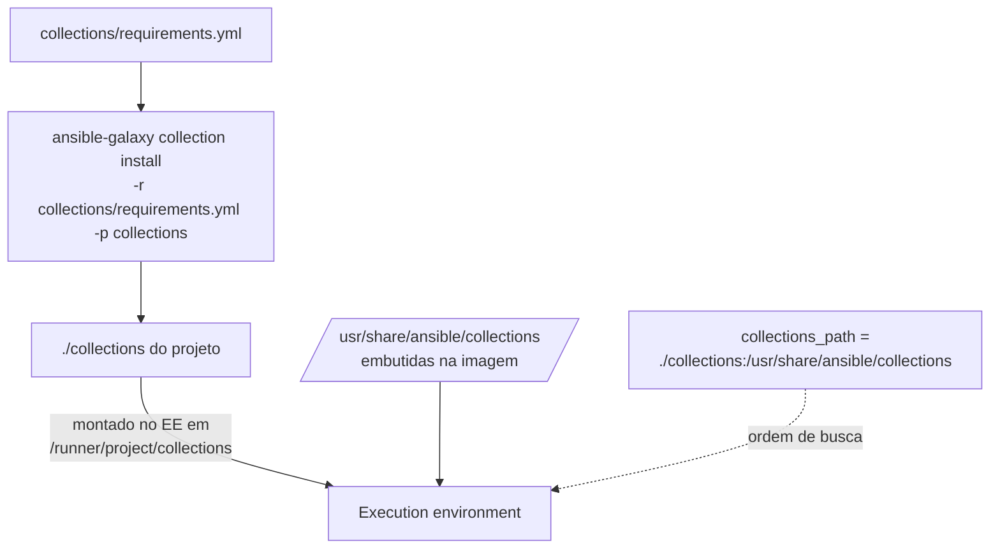

# 7.7 — Obtendo roles e módulos de Ansible Content Collections

| Campo | Valor |
|-------|-------|
| Curso | AU294 — Ansible Automation Platform 2.6 (edição 2) |
| Capítulo / seção | Capítulo 7 · Seção 7.7 |
| Título original | Obtaining Roles and Modules from Ansible Content Collections |
| Título em português | Obtendo roles e módulos de Ansible Content Collections |
| Objetivo | Obter um conjunto de roles, módulos e outros conteúdos de uma collection e usá-los em um playbook |
| Pré-requisitos | [7.5 — roles de fontes externas](7.5-implantando-roles-de-fontes-externas.md), [1.5 — configuração do Ansible](../01-introducao-ansible/1.5-configurando-ajustes-do-ansible.md) |
| Referência | PDF p. 426–433 · Guided Exercise 7.8 p. 434–440 |

## Parte A — O problema que a tecnologia resolve

No início, todos os módulos vinham dentro do pacote principal do Ansible. Com
milhares de módulos, ficou difícil manter nomes únicos e sincronizar atualizações
dos módulos com as do núcleo.

**Ansible Content Collections** separam o código do núcleo (ansible-core) do código
de módulos e plug-ins. Uma collection é uma **estrutura padronizada** que entrega
módulos, roles e plug-ins relacionados; cada fornecedor publica no seu ritmo.

| Benefício | Ideia |
|-----------|-------|
| Desacoplamento | Atualizações independentes das versões do núcleo |
| Flexibilidade | Instala só o conteúdo necessário |
| Controle de versão | Escolhe a versão da collection |
| Suporte do fornecedor | Cada fornecedor mantém e distribui o próprio conteúdo |

## Parte B — Modelo mental e arquitetura

**Nomes qualificados:** `namespace.collection`, e dentro dela `namespace.collection.recurso`.

| Namespace | Quem publica | Exemplo |
|-----------|--------------|---------|
| `redhat` | Red Hat | `redhat.insights` |
| `community` | Comunidade Ansible | `community.crypto` |
| `cisco` | Fornecedor terceiro | `cisco.ios` |

| Termo | Formato | Exemplo |
|-------|---------|---------|
| FQCN (collection) | `namespace.collection` | `ansible.posix` |
| FQMN (módulo) | `namespace.collection.módulo` | `ansible.posix.firewalld` |
| FQRN (role) | `namespace.collection.role` | `redhat.rhel_system_roles.firewall` |

> Módulos de `ansible.builtin` funcionam sem o prefixo (`copy`), mas a Red Hat
> recomenda **sempre** o nome qualificado: evita ambiguidade quando collections
> diferentes têm módulos com o mesmo nome.



## Parte C — Entendimento progressivo

### 1. Fontes de collections

| Fonte | Característica |
|-------|----------------|
| Ansible automation hub | Red Hat Ansible Certified Content e Ansible validated content; exige assinatura do AAP |
| Private automation hub | Hub local (on-premise) com conteúdo da organização ou curado; incluído no AAP |
| Ansible Galaxy | Site público da comunidade, sem garantia formal de suporte |
| Git ou arquivo compactado | Instalação direta |

### 2. Configurar as fontes no `ansible.cfg`

Por padrão, `ansible-galaxy` usa o Ansible Galaxy. Para priorizar o automation hub:

```ini
[galaxy]
server_list = automation_hub, galaxy

[galaxy_server.automation_hub]
url = https://console.redhat.com/api/automation-hub/
auth_url = https://sso.redhat.com/auth/realms/redhat-external/protocol/openid-connect/token

[galaxy_server.galaxy]
url = https://galaxy.ansible.com/
```

- `server_list` define a ordem de tentativa; cada nome tem uma seção `[galaxy_server.<nome>]`.
- O acesso ao automation hub exige um **token**, gerado na interface web do automation hub.
- ⚠️ Não grave o token no `ansible.cfg` (o controle de versão o exporia). A Red Hat
  recomenda variáveis de ambiente no formato
  `ANSIBLE_GALAXY_SERVER_<SERVER_ID>_<CHAVE>`, em maiúsculas:

```bash
export ANSIBLE_GALAXY_SERVER_AUTOMATION_HUB_TOKEN='<seu-token>'
```

### 3. `collections_path`

Lista separada por `:` de diretórios de busca; a **ordem importa**: a primeira
collection encontrada com um nome vence as de mesmo nome que aparecem depois.

Com execution environment, inclua as duas localizações, nesta ordem:

```ini
[defaults]
collections_path = ./collections:/usr/share/ansible/collections
```

| Caminho | O que é |
|---------|---------|
| `./collections` | Collections do projeto, montadas no EE em `/runner/project/collections` |
| `/usr/share/ansible/collections` | Collections embutidas na imagem do EE |

Assim o conteúdo local em desenvolvimento sobrescreve o da imagem. ⚠️ Faltando um
dos dois caminhos, o Ansible pode não achar collections e o playbook falha.

### 4. Diretório compartilhado com `--volume`

Para reaproveitar um diretório de collections entre projetos sem copiá-lo:

```bash
ansible-navigator run site.yml \
  --volume /home/aluno/collections_comuns:/opt/compartilhado/collections \
  --mode stdout
```

E acrescente `/opt/compartilhado/collections` ao `collections_path` (depois de
`./collections` e `/usr/share/ansible/collections`).

### 5. Instalar collections

```bash
ansible-galaxy collection install community.crypto -p collections
ansible-galaxy collection install /tmp/exemplo-colecao-1.0.0.tar.gz -p collections
ansible-galaxy collection install https://www.example.net/exemplo-colecao-1.0.0.tar.gz -p collections
ansible-galaxy collection install git@git.example.net:infra/colecao.git -p collections
```

> ⚠️ Sem `collections_path` e sem `-p`, a instalação vai para
> `~/.ansible/collections/`, que o `ansible-navigator` **não** monta no EE: o
> playbook não encontra a collection.

Um repositório Git precisa ter a estrutura de collection, com `galaxy.yml` ou
`MANIFEST.json` (metadados como namespace e versão).

### 6. `collections/requirements.yml`

```yaml
---
collections:
  - name: community.crypto            # da primeira fonte disponível
  - name: ansible.posix
    version: 1.5.4                    # versão específica
  - name: /tmp/exemplo-colecao-1.0.0.tar.gz
  - name: https://www.example.net/exemplo-colecao-1.0.0.tar.gz
  - name: git+https://git.example.net/infra/colecao.git
    version: main                     # branch, tag ou commit
```

```bash
ansible-galaxy collection install -r collections/requirements.yml -p collections
```

### 7. Ver o que está instalado

```bash
ansible-galaxy collection list
ansible-navigator collections list            # visão do EE (collections_path)
ansible-navigator collections -m interactive  # TUI: roles, módulos e documentação
```

Na visão do `ansible-navigator`, a mesma collection pode aparecer duas vezes: a do
projeto (tipo `bind_mount`) e a da imagem (tipo `contained`, marcada como
*shadowed* quando é sobreposta pela do projeto).

### 8. Estratégias de gerenciamento

| Estratégia | Quando |
|------------|--------|
| Collections montadas do projeto (`./collections`) | Desenvolvimento e testes: troca rápida sem reconstruir imagem |
| **EE customizado** com as collections embutidas | Produção: estável e igual para todos. **Recomendação da Red Hat** |

O EE customizado é construído com `ansible-builder` (exige Podman ou Docker),
normalmente uma vez por um arquiteto de plataforma ou por pipeline de CI/CD. Fora do
escopo do AU294 (tratado no AU374).

### 9. Usar módulos e roles de collections

Módulo: sempre pelo FQMN.

```yaml
- name: Abrir a porta do coletor
  hosts: coleta
  become: true
  tasks:
    - name: Liberar 10514/tcp
      ansible.posix.firewalld:
        port: 10514/tcp
        permanent: true
        immediate: true
        state: enabled
```

Role: **não** use a seção `roles` para roles de collections (ela depende de busca
implícita e pode confundir roles homônimas). Use `include_role`/`import_role` com o
**FQRN**:

```yaml
- name: Configurar o firewall com uma role de collection
  hosts: coleta
  become: true
  tasks:
    - name: Aplicar a role de firewall
      ansible.builtin.include_role:
        name: redhat.rhel_system_roles.firewall
      vars:
        firewall:
          - port: 10514/tcp
            state: enabled
```

📘 Fonte externa: a role `redhat.rhel_system_roles.firewall` e sua variável
`firewall` estão documentadas no README da collection `redhat.rhel_system_roles`.
Confira sempre a documentação da versão instalada.

### 10. Diferenças que confundem

| A | B | Diferença essencial |
|---|---|--------------------|
| ansible-core | Collection | Motor e `ansible.builtin` × conteúdo adicional versionado à parte |
| `roles_path` | `collections_path` | Busca de roles avulsas × busca de collections |
| `./collections` | `/usr/share/ansible/collections` | Do projeto (montado) × embutido na imagem |
| Seção `roles` | `include_role` com FQRN | Busca implícita × referência explícita (recomendada para collections) |
| Montar collections | EE customizado | Desenvolvimento × produção |

## Parte D — Exemplo autoral incremental

Projeto: [exemplos-originais/cap07-roles-e-collections](../../exemplos-originais/cap07-roles-e-collections/).

**Passo 1 — `collections_path`:**
[ansible.cfg](../../exemplos-originais/cap07-roles-e-collections/ansible.cfg) com
`./collections:/usr/share/ansible/collections`.

**Passo 2 — manifesto:**
[collections/requirements.yml](../../exemplos-originais/cap07-roles-e-collections/collections/requirements.yml)
fixa a versão de `ansible.posix`.

**Passo 3 — módulo de collection dentro de uma role:**
[coletor_logs/tasks/main.yml](../../exemplos-originais/cap07-roles-e-collections/roles/coletor_logs/tasks/main.yml)
usa `ansible.posix.firewalld` pelo FQMN.

## Parte E — Execução e verificação

```bash
ansible-galaxy collection install -r collections/requirements.yml -p collections
ansible-navigator collections list
ansible-navigator run site.yml --syntax-check
```

| Item | Valor |
|------|-------|
| Validação | `--syntax-check` e `ansible-lint` com `ansible.posix` disponível localmente |
| Status | ✅ YAML, `--syntax-check` e `ansible-lint` (perfil *production*) sem erros · ⚠️ não executado contra hosts |

## Parte F — Troubleshooting

| Sintoma | Causa provável | Como verificar / corrigir |
|---------|----------------|---------------------------|
| `couldn't resolve module/action` | Collection não instalada ou fora do `collections_path` | `ansible-navigator collections list`; instale com `-p collections` |
| Collection instalada, mas o EE não vê | Instalada em `~/.ansible/collections` | `-p collections` e `collections_path` correto |
| Versão errada sendo usada | Ordem do `collections_path` | Projeto antes da imagem; confira *shadowed* no navigator |
| Falha de autenticação no automation hub | Token ausente ou inválido | Variável `ANSIBLE_GALAXY_SERVER_<ID>_TOKEN` |
| Role errada executada | Role de collection chamada pela seção `roles` sem FQRN | `include_role` com FQRN |
| Instalação de Git falha | Repositório sem `galaxy.yml`/`MANIFEST.json` | Estrutura de collection válida |

## Parte G — Preparação para o laboratório

Atividade associada: **7.8 Guided Exercise — Obtaining Roles and Modules from Ansible
Content Collections** (`roles-collections`, PDF p. 434–440). Ver
[PRATICA-OFICIAL.md](PRATICA-OFICIAL.md#78-guided-exercise-obtaining-roles-and-modules-from-ansible-content-collections).

Você deve conseguir:

- configurar o `collections_path` e instalar uma collection de um arquivo;
- navegar na documentação da collection com `ansible-navigator collections`;
- chamar uma role de collection pelo FQRN, com variáveis em `group_vars`.

## Parte H — Fixação

1. Diferencie FQCN, FQMN e FQRN com um exemplo de cada.
2. Por que `./collections` vem antes de `/usr/share/ansible/collections`?
3. Onde não guardar o token do automation hub, e qual a alternativa?
4. Escreva um `collections/requirements.yml` com `community.general` na versão `8.0.0`.
5. Por que evitar a seção `roles` para roles de collections?
6. Qual estratégia a Red Hat recomenda para produção?

<details>
<summary>Respostas comentadas</summary>

1. FQCN `ansible.posix` (collection); FQMN `ansible.posix.firewalld` (módulo); FQRN `redhat.rhel_system_roles.firewall` (role).
2. Collections encontradas antes vencem as de mesmo nome; assim, o conteúdo do projeto sobrescreve o da imagem.
3. Não no `ansible.cfg` versionado; use a variável de ambiente `ANSIBLE_GALAXY_SERVER_AUTOMATION_HUB_TOKEN` (para o servidor `automation_hub`).
4. Exemplo:
   ```yaml
   ---
   collections:
     - name: community.general
       version: 8.0.0
   ```
5. Depende de busca implícita e pode executar a role errada se houver roles homônimas; `include_role`/`import_role` com FQRN é explícito.
6. Um execution environment customizado com as collections embutidas.

</details>

## Parte I — Essencial para memorizar

- Collection = módulos + roles + plug-ins, versionados fora do ansible-core.
- Sempre nomes qualificados: `namespace.collection.recurso`.
- `collections_path = ./collections:/usr/share/ansible/collections` (ordem importa).
- `ansible-galaxy collection install -r collections/requirements.yml -p collections`.
- Roles de collection: `include_role`/`import_role` com FQRN. Produção: EE customizado.
- Token do hub em variável de ambiente, nunca no `ansible.cfg` versionado.

---
[← 7.5 Roles de fontes externas](7.5-implantando-roles-de-fontes-externas.md) | [Índice do capítulo](README.md) | [Próximo: Prática oficial →](PRATICA-OFICIAL.md)
