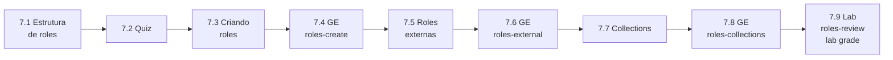

# Capítulo 7 — Reusing Code with Ansible Roles and Content Collections

**Título em português:** Reutilizando código com roles e Ansible Content Collections
**Status:** ✅ documentado e validado (documentação; o estudo é marcado por você no checklist)
**Referência:** PDF p. 385–452 · arquivo `AU294_AAP2.6_C07_Roles_Collections_p385-452.pdf` (não versionado)

## Objetivo do capítulo

Usar roles e Ansible Content Collections para desenvolver playbooks mais rápido e
reaproveitar código Ansible.

## Por que este capítulo importa

Roles são a unidade de reuso do Ansible e collections são a forma de distribuir
módulos e roles fora do ansible-core. Criar uma role, consumir roles externas e usar
conteúdo de collections no execution environment são habilidades usadas em todo o
restante do curso, a começar pelas System Roles do Capítulo 8.

## Seções e atividades (ordem oficial)

| Seção | Tipo | Título original | Material | PDF |
|-------|------|-----------------|----------|-----|
| 7.1 | Conceito | Defining Role Structure | [lição](7.1-definindo-a-estrutura-de-roles.md) | p. 386–395 |
| 7.2 | Quiz | Defining Role Structure | [prática](PRATICA-OFICIAL.md#72-quiz-defining-role-structure) | p. 396–399 |
| 7.3 | Conceito | Creating Roles | [lição](7.3-criando-roles.md) | p. 400–405 |
| 7.4 | Guided Exercise | Creating Roles | [prática](PRATICA-OFICIAL.md#74-guided-exercise-creating-roles) | p. 406–412 |
| 7.5 | Conceito | Deploying Roles from External Content Sources | [lição](7.5-implantando-roles-de-fontes-externas.md) | p. 413–419 |
| 7.6 | Guided Exercise | Deploying Roles from External Content Sources | [prática](PRATICA-OFICIAL.md#76-guided-exercise-deploying-roles-from-external-content-sources) | p. 420–425 |
| 7.7 | Conceito | Obtaining Roles and Modules from Ansible Content Collections | [lição](7.7-roles-e-modulos-de-collections.md) | p. 426–433 |
| 7.8 | Guided Exercise | Obtaining Roles and Modules from Ansible Content Collections | [prática](PRATICA-OFICIAL.md#78-guided-exercise-obtaining-roles-and-modules-from-ansible-content-collections) | p. 434–440 |
| 7.9 | Lab | Reusing Code with Ansible Roles and Content Collections | [prática](PRATICA-OFICIAL.md#79-lab-reusing-code-with-ansible-roles-and-content-collections) | p. 441–451 |
| 7.10 | Summary | Summary | [RESUMO.md](RESUMO.md) | p. 452 |

Só o lab 7.9 aceita `lab grade`. O quiz 7.2 não usa o comando `lab`.

## Arquivos do capítulo

- [PRATICA-OFICIAL.md](PRATICA-OFICIAL.md): ponte com o quiz, os três guided exercises e o lab.
- [REVISAO.md](REVISAO.md): 23 questões autorais (conceito, escrita, diagnóstico).
- [RESUMO.md](RESUMO.md): síntese, precedência e comandos.
- Exemplo validado: [exemplos-originais/cap07-roles-e-collections](../../exemplos-originais/cap07-roles-e-collections/).

## Pré-requisitos recomendados

[Capítulo 6](../06-automacao-em-escala/README.md) ·
[3.1 — Variáveis](../03-variaveis-e-vault/3.1-usando-variaveis.md) ·
[4.3 — Handlers](../04-controle-de-tarefas/4.3-implementando-handlers.md)

## Checklist (marcado por você)

- [ ] 7.1 lida e Parte H respondida
- [ ] 7.2 Quiz respondido antes de ver a solução
- [ ] 7.3 lida e Parte H respondida
- [ ] 7.4 Guided Exercise `roles-create` concluído
- [ ] 7.5 lida e Parte H respondida
- [ ] 7.6 Guided Exercise `roles-external` concluído
- [ ] 7.7 lida e Parte H respondida
- [ ] 7.8 Guided Exercise `roles-collections` concluído
- [ ] 7.9 Lab `roles-review` com `lab grade` aprovado
- [ ] [REVISAO.md](REVISAO.md) respondida
- [ ] Registro no [diário de laboratórios](../../progresso/diario-de-laboratorios.md)

---
[← Capítulo 6](../06-automacao-em-escala/README.md) | [Índice geral](../../README.md) | [Próximo: 7.1 Estrutura de roles →](7.1-definindo-a-estrutura-de-roles.md)
