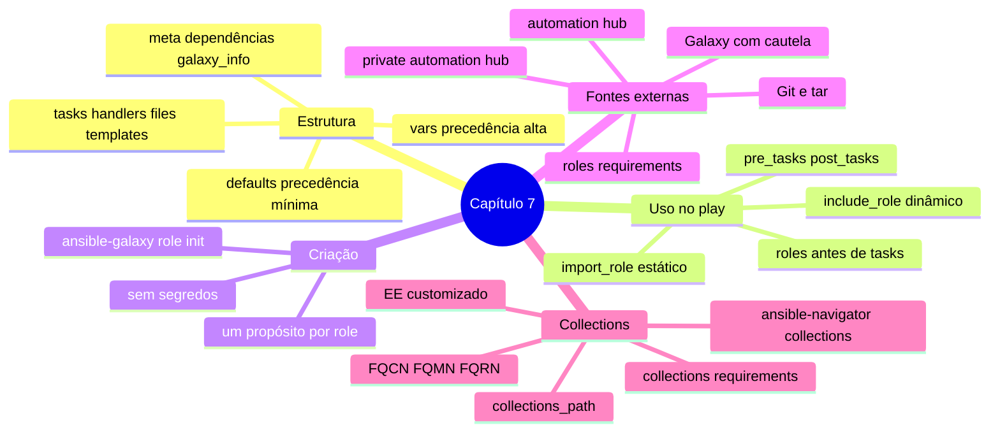

# Resumo — Capítulo 7

Síntese autoral para revisão rápida. Correspondência oficial: seção 7.10 Summary
(PDF p. 452).

## Em uma frase por seção

| Seção | Ideia central |
|-------|---------------|
| 7.1 | Uma role empacota tasks, handlers, variáveis, arquivos e templates em uma estrutura padrão; entra no play pela seção `roles` (antes das tasks) ou por `import_role`/`include_role` |
| 7.3 | Crie com `ansible-galaxy role init`, preencha o conteúdo, torne-a configurável com `defaults` e declare dependências em `meta/main.yml` |
| 7.5 | Roles externas são declaradas em `roles/requirements.yml` (com versão fixa) e instaladas com `ansible-galaxy role install -r ... -p roles` |
| 7.7 | Collections entregam módulos, roles e plug-ins versionados fora do ansible-core; instale no `collections_path` do projeto e use nomes qualificados (FQMN/FQRN) |

## Mapa do capítulo

## Tabelas de consulta

| Módulo | Uso |
|--------|-----|
| `ansible.builtin.import_role` | Importar role como task (estático) |
| `ansible.builtin.include_role` | Incluir role como task (dinâmico) |

| Precedência (maior → menor) | Fonte |
|-----------------------------|-------|
| 1 | Parâmetro na seção `roles` |
| 2 | `vars/main.yml` da role |
| 3 | `vars` do play |
| 4 | `defaults/main.yml` da role |

| Comando | Para quê |
|---------|----------|
| `ansible-galaxy role init <role>` | Criar o esqueleto |
| `ansible-galaxy role install -r roles/requirements.yml -p roles` | Instalar roles no projeto |
| `ansible-galaxy role list` / `remove <role>` / `search <termo>` | Gerenciar e buscar roles |
| `ansible-galaxy collection install -r collections/requirements.yml -p collections` | Instalar collections no projeto |
| `ansible-galaxy collection list` | Listar collections instaladas |
| `ansible-navigator collections` (`list` ou `-m interactive`) | Ver collections e documentação no EE |

## Alertas operacionais

- ⚠️ A seção `roles` roda **antes** de `tasks`, qualquer que seja a posição no arquivo.
- ⚠️ `vars/main.yml` da role vence `vars` do play e inventário.
- ⚠️ Sem `-p`, roles e collections vão para `~/.ansible/...`, fora do EE.
- ⚠️ `collections_path` precisa de `./collections` **e** `/usr/share/ansible/collections`.
- ⚠️ Fixe versões nos requirements.
- ⚠️ Sem segredos nas roles; token do hub em variável de ambiente.
- ⚠️ Roles de collections: `include_role`/`import_role` com FQRN, não a seção `roles`.

## Ligação com o próximo capítulo

O Capítulo 8 aplica roles, collections e módulos à administração do Linux. Pelo
sumário da apostila, começa com System Roles e segue para software e assinaturas,
usuários e autenticação, boot e processos agendados, armazenamento e rede.

---
[← Revisão](REVISAO.md) | [Índice do capítulo](README.md) | [Próximo capítulo →](../08-administracao-linux/README.md)
