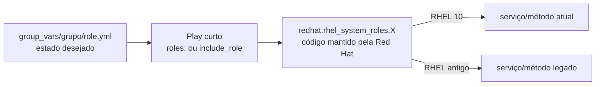

# 8.1 — Usando system roles

| Campo | Valor |
|-------|-------|
| Curso | AU294 — Ansible Automation Platform 2.6 (edição 2) |
| Capítulo / seção | Capítulo 8 · Seção 8.1 |
| Título original | Using System Roles |
| Título em português | Usando system roles |
| Objetivo | Escrever playbooks que usam as RHEL system roles para automatizar tarefas comuns de administração Linux |
| Pré-requisitos | [7.7 — collections](../07-roles-e-collections/7.7-roles-e-modulos-de-collections.md), [7.1 — estrutura de roles](../07-roles-e-collections/7.1-definindo-a-estrutura-de-roles.md), [4.5 — block/rescue](../04-controle-de-tarefas/4.5-tratando-falhas-de-tarefas.md) |
| Referência | PDF p. 454–462 · Guided Exercise 8.2 p. 463–470 |

## Parte A — O problema que a tecnologia resolve

Sincronização de horário, firewall, rede, SELinux, logs: são configurações que todo
servidor RHEL precisa, e cuja implementação **muda entre versões** do sistema
(serviço diferente, back end diferente, arquivos diferentes). Escrever isso à mão
para um parque misto exige muitos condicionais.

As **RHEL system roles** são roles mantidas e suportadas pela Red Hat, entregues na
collection **`redhat.rhel_system_roles`**. Você descreve o estado desejado em
**variáveis** e a role decide como aplicá-lo em cada versão do RHEL.

| Role | Como se adapta à versão |
|------|-------------------------|
| `redhat.rhel_system_roles.timesync` | `chronyd` no RHEL 8 e posteriores; `ntpd` em versões anteriores |
| `redhat.rhel_system_roles.firewall` | `firewalld` (back end `nftables`) no RHEL 7 e posteriores; `iptables` em versões anteriores |
| `redhat.rhel_system_roles.network` | API do NetworkManager no RHEL 7 e posteriores; serviço `network` e arquivos `ifcfg` em versões anteriores |

Resultado: **um playbook** para várias versões, sem lógica condicional complexa.

## Parte B — Modelo mental e arquitetura



Separação recomendada: **role** (código da Red Hat) · **playbook** (quem recebe o
quê) · **variáveis no inventário** (configuração de cada grupo).

### Suporte e níveis de maturidade

| Item | Detalhe |
|------|---------|
| Distribuição para clientes AAP | Collection certificada `redhat.rhel_system_roles`, pelo automation hub, incluída na assinatura |
| Distribuição no RHEL | Pacote RPM `rhel-system-roles`, para uso com o ansible-core do próprio RHEL (control node atualizado, versões mais recentes de `ansible-core` e `rhel-system-roles`) |
| "Fully Supported" | Maioria das roles; interface estável: nomes e comportamento das variáveis tendem a se manter |
| "Technology Preview" | Testadas e estáveis, mas podem mudar de forma incompatível; faça testes de integração a cada atualização |
| Upstream | Projeto Linux System Roles, publicado no Ansible Galaxy como `fedora.linux_system_roles`: **sem** suporte da Red Hat |

## Parte C — Entendimento progressivo

### 1. Obter as system roles

| Situação | Como |
|----------|------|
| EE `ee-supported-rhel9` do curso | A collection **já vem** na imagem; instalar só para atualizar |
| Assinatura do AAP | `collections/requirements.yml` com `redhat.rhel_system_roles` e `ansible-galaxy collection install -p collections/ -r collections/requirements.yml` |
| Sem AAP, com RHEL | Baixar o arquivo da collection no automation hub e `ansible-galaxy collection install -p collections/ redhat.rhel_system_roles-<versão>.tar.gz` |
| ansible-core do RHEL, sem container | `dnf install rhel-system-roles` (AppStream habilitado; no RHEL 10 x86_64, `rhel-10-for-x86_64-appstream-rpms`) |

```yaml
---
# collections/requirements.yml
collections:
  - name: redhat.rhel_system_roles
```

Com o RPM, a collection vai para
`/usr/share/ansible/collections/ansible_collections/redhat/rhel_system_roles` e cada
role também aparece em `/usr/share/ansible/roles` com o nome upstream
(`linux-system-roles.<role>`), por compatibilidade.

### 2. Documentação

- Oficial: guia "Automating System Administration by Using RHEL System Roles".
- Com o RPM: `/usr/share/doc/rhel-system-roles/<role>/README.md` (variáveis, exemplos
  de playbook) e, às vezes, playbooks de exemplo no mesmo diretório.
- No EE: `ansible-navigator collections` e o README da role (Capítulo 7).

### 3. Usar uma system role

Igual a qualquer role: seção `roles`, ou `include_role`/`import_role` em uma task.
Exemplo com `timesync`, cuja variável `timesync_ntp_servers` é uma lista de servidores
com os atributos `hostname` e `iburst` (sincronização inicial rápida; padrão `no` na
role):

```yaml
- name: Sincronizar horário dos servidores de análise
  hosts: analise
  vars:
    timesync_ntp_servers:
      - hostname: ntp1.example.net
        iburst: true
      - hostname: ntp2.example.net
        iburst: true
  roles:
    - redhat.rhel_system_roles.timesync
```

A Red Hat recomenda mover essas variáveis para o **inventário**
(`group_vars/<grupo>/timesync.yml` ou `host_vars`). O play fica mínimo e grupos
diferentes (por exemplo, um por data center) recebem valores diferentes sem mudar o
playbook.

### 4. Roles + tasks no mesmo play

A seção `roles` roda antes de `tasks`; para algo antes ou depois, use `pre_tasks` e
`post_tasks` (ordem completa em [7.1](../07-roles-e-collections/7.1-definindo-a-estrutura-de-roles.md)).
Cada handler roda uma vez, depois que as tasks da seção que o notificou terminam.

```yaml
- name: Horário e fuso dos servidores de análise
  hosts: analise
  roles:
    - redhat.rhel_system_roles.timesync
  post_tasks:
    - name: Ajustar o fuso horário
      ansible.builtin.command: "timedatectl set-timezone {{ fuso_horario }}"
      notify: Reiniciar o host
      changed_when: true
  handlers:
    - name: Reiniciar o host
      ansible.builtin.reboot:
```

Ou, com a ordem explícita, `include_role` com `name: redhat.rhel_system_roles.timesync`
dentro de `tasks`.

### 5. A role de SELinux

`redhat.rhel_system_roles.selinux` substitui tasks individuais de SELinux. Ela pode:
definir o modo (enforcing/permissive), executar `restorecon`, ajustar booleans,
definir contextos de arquivo persistentes e mapeamentos de usuário SELinux.

| Variável | Uso |
|----------|-----|
| `selinux_state` | `enforcing`, `permissive` ou `disabled`; sem ela, o modo não muda |
| `selinux_booleans` | Lista com `name`, `state` e `persistent` |
| `selinux_fcontexts` | Lista com `target`, `setype`, `state` (como `semanage fcontext`) |
| `selinux_restore_dirs` | Diretórios em que rodar `restorecon` |
| `selinux_ports` | Lista com `ports`, `setype`, `proto`, `state` |

```yaml
selinux_state: enforcing
selinux_fcontexts:
  - target: '/srv/relatorios(/.*)?'
    setype: httpd_sys_content_t
    state: present
selinux_restore_dirs:
  - /srv/relatorios
```

**Reinicialização:** algumas mudanças só valem após reboot, mas a role **nunca**
reinicia o host. Ela define `selinux_reboot_required: true` e **falha**. Trate com
`block`/`rescue`:

```yaml
- name: Aplicar a role de SELinux, reiniciando se ela exigir
  block:
    - name: Aplicar a role de SELinux
      ansible.builtin.include_role:
        name: redhat.rhel_system_roles.selinux
  rescue:
    - name: Falhar se o motivo não for reinicialização pendente
      ansible.builtin.fail:
      when: not selinux_reboot_required

    - name: Reiniciar o host
      ansible.builtin.reboot:

    - name: Reaplicar a role para concluir as mudanças
      ansible.builtin.include_role:
        name: redhat.rhel_system_roles.selinux
```

### 6. Diferenças que confundem

| A | B | Diferença essencial |
|---|---|--------------------|
| `redhat.rhel_system_roles` | `fedora.linux_system_roles` | Certificada e suportada × upstream, sem suporte |
| Collection | RPM `rhel-system-roles` | Para AAP/EE × para o ansible-core do RHEL |
| Fully Supported | Technology Preview | Interface estável × pode mudar de forma incompatível |
| Variáveis no `vars` do play | Variáveis em `group_vars` | Funciona × recomendado (separa código e configuração) |
| Falha da role de SELinux | Erro real | `selinux_reboot_required` verdadeiro × outra causa |

## Parte D — Exemplo autoral incremental

Projeto: [exemplos-originais/cap08-administracao-linux](../../exemplos-originais/cap08-administracao-linux/)
(cenário próprio: servidores de análise e de relatórios).

**Passo 1 — configuração no inventário:**
[group_vars/relatorios/selinux.yml](../../exemplos-originais/cap08-administracao-linux/group_vars/relatorios/selinux.yml)
define modo, boolean, contexto de arquivo, `restorecon` e porta.

**Passo 2 — play curto com tratamento de reboot:**
[selinux.yml](../../exemplos-originais/cap08-administracao-linux/selinux.yml) cria o
diretório e aplica a role dentro de `block`/`rescue`.

**Passo 3 — dependência declarada:**
[collections/requirements.yml](../../exemplos-originais/cap08-administracao-linux/collections/requirements.yml)
lista a collection (necessário só para atualizar a versão do EE).

## Parte E — Execução e verificação

```bash
ansible-navigator run selinux.yml --syntax-check
ansible-navigator run selinux.yml
```

| Item | Valor |
|------|-------|
| Saída esperada | Tasks com prefixo `redhat.rhel_system_roles.selinux : ...` |
| Se exigir reboot | A role falha, o `rescue` reinicia e reaplica |
| Status | ✅ YAML, `--syntax-check` e `ansible-lint` (perfil *production*) sem erros · ⚠️ não executado contra hosts |

## Parte F — Troubleshooting

| Sintoma | Causa provável | Como verificar / corrigir |
|---------|----------------|---------------------------|
| Role não encontrada | Collection ausente no EE/`collections_path` | `ansible-navigator collections list` |
| Variável ignorada | Nome diferente do README da role | Confira o README da versão instalada |
| Role de SELinux falha sempre | Reboot pendente sem `rescue` | `block`/`rescue` com `selinux_reboot_required` |
| Task de `tasks` roda depois da role | Seção `roles` vem antes de `tasks` | `pre_tasks`, ou `include_role` em `tasks` |
| Comportamento mudou após atualizar | Role em Technology Preview | Testes de integração; revise as variáveis |

## Parte G — Preparação para o laboratório

Atividade associada: **8.2 Guided Exercise — Using System Roles** (`system-roles`,
PDF p. 463–470). Ver [PRATICA-OFICIAL.md](PRATICA-OFICIAL.md#82-guided-exercise-using-system-roles).

Você deve conseguir:

- instalar a collection e confirmar a instalação;
- achar as variáveis necessárias na documentação da role;
- combinar a role com tasks próprias e com variáveis por grupo de hosts.

## Parte H — Fixação

1. Qual a vantagem de uma system role em um parque com várias versões do RHEL?
2. Onde a Red Hat recomenda definir as variáveis das system roles?
3. Qual a diferença entre `redhat.rhel_system_roles` e `fedora.linux_system_roles`?
4. Escreva o `group_vars` que faça `restorecon` em `/srv/dados` e coloque o SELinux em enforcing.
5. Por que a role de SELinux é chamada dentro de `block`/`rescue`?
6. O que muda entre uma role "Fully Supported" e uma "Technology Preview"?

<details>
<summary>Respostas comentadas</summary>

1. Um único playbook: a role escolhe o serviço ou método adequado para cada versão, sem condicionais complexos.
2. Como variáveis de inventário (`group_vars`/`host_vars`), separando configuração de código.
3. A primeira é a collection certificada e suportada pela Red Hat; a segunda é a versão upstream de desenvolvimento, no Ansible Galaxy, sem suporte.
4. Exemplo:
   ```yaml
   selinux_state: enforcing
   selinux_restore_dirs:
     - /srv/dados
   ```
5. Porque, quando precisa de reboot, ela define `selinux_reboot_required` e falha sem reiniciar; o `rescue` decide entre falhar (outra causa) e reiniciar e reaplicar.
6. Fully Supported tem interface estável; Technology Preview é estável mas pode mudar de forma incompatível, exigindo testes e possível refatoração.

</details>

## Parte I — Essencial para memorizar

- System roles = collection `redhat.rhel_system_roles` (AAP) ou RPM `rhel-system-roles` (RHEL).
- O EE `ee-supported-rhel9` já inclui a collection.
- Variáveis no inventário; play curto; README da role define as variáveis.
- `timesync_ntp_servers` (`hostname`, `iburst`); `selinux_state`, `selinux_booleans`, `selinux_fcontexts`, `selinux_restore_dirs`, `selinux_ports`.
- Role de SELinux não reinicia: `selinux_reboot_required` + `block`/`rescue`.

---
[← Capítulo 8 (índice)](README.md) | [Índice do capítulo](README.md) | [Próximo: 8.3 Software e assinaturas →](8.3-automatizando-software-e-assinaturas.md)
