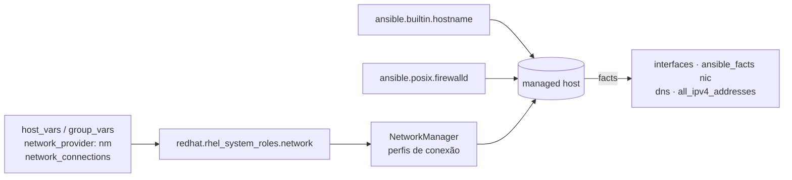

# 8.11 — Automatizando a configuração de rede

| Campo | Valor |
|-------|-------|
| Curso | AU294 — Ansible Automation Platform 2.6 (edição 2) |
| Capítulo / seção | Capítulo 8 · Seção 8.11 |
| Título original | Automating Network Configuration Tasks |
| Título em português | Automatizando tarefas de configuração de rede |
| Objetivo | Configurar rede e resolução de nomes nos managed hosts e coletar facts relacionados à rede |
| Pré-requisitos | [8.1 — system roles](8.1-usando-system-roles.md), [2.1 — inventário](../02-desenvolvendo-automacao/2.1-construindo-um-inventario.md), [3.3 — facts](../03-variaveis-e-vault/3.3-coletando-informacoes-com-facts.md) |
| Referência | PDF p. 541–548 · Guided Exercise 8.12 p. 549–555 |

## Parte A — O problema que a tecnologia resolve

Configurar interfaces, endereços, gateways, DNS e zonas de firewall em muitos hosts,
cada um com nomes de interface possivelmente diferentes, é lento e propenso a erro,
e um erro de rede pode deixar o host **inacessível**. A role
`redhat.rhel_system_roles.network` descreve as conexões em variáveis e aplica pelo
NetworkManager; módulos complementam (hostname, firewall) e os facts revelam o que
cada host tem.

## Parte B — Modelo mental e arquitetura



A role suporta interfaces Ethernet, bridge, bond, VLAN, MACVLAN, InfiniBand e wireless.

| Variável | Papel |
|----------|-------|
| `network_provider` | Back end: `nm` (NetworkManager) ou `initscripts`. **No RHEL 10, só `nm` é suportado** |
| `network_connections` | Lista de conexões; use o nome da interface como nome da conexão |

> `initscripts` foi descontinuado no RHEL 8 e removido no RHEL 9 e posteriores. Hosts
> antigos que ainda o usem precisam do serviço `network` legado.

## Parte C — Entendimento progressivo

### 1. Parâmetros de `network_connections`

| Parâmetro | Função |
|-----------|--------|
| `name` | NetworkManager: identifica o perfil (`connection.id`); initscripts: nome do `ifcfg-<name>` |
| `state` | Estado em execução: `up` (ativo) ou `down` |
| `persistent_state` | `present` (padrão, perfil persistente) ou `absent` (remove o perfil) |
| `type` | `ethernet`, `bridge`, `bond`, `team`, `vlan`, `macvlan`, `infiniband`, `wireless` |
| `autoconnect` | Sobe automaticamente (padrão `yes`) |
| `mac` | Restringe o perfil ao dispositivo com esse MAC |
| `interface_name` | Restringe o perfil a uma interface |
| `zone` | Zona do firewalld da interface |
| `ip` | Configuração IP (tabela seguinte) |

| Opção de `ip` | Função |
|---------------|--------|
| `address` | Lista de endereços IPv4/IPv6 com prefixo |
| `gateway4` / `gateway6` | Roteador padrão IPv4 / IPv6 |
| `dns` | Lista de servidores DNS |
| `dns_search` | Lista de domínios de busca |
| `dhcp4` | DHCPv4 |
| `auto6` | Autoconfiguração IPv6 (SLAAC) |

As opções se combinam e nenhuma é obrigatória: só `address`, ou só `dhcp4: true`, por
exemplo.

### 2. Casos típicos

IPv4 estático, ativado na hora:

```yaml
network_connections:
  - name: enp1s0
    type: ethernet
    ip:
      address:
        - 192.0.2.25/24
    state: up
```

DHCP e SLAAC:

```yaml
network_connections:
  - name: enp1s0
    type: ethernet
    ip:
      dhcp4: true
      auto6: true
    state: up
```

Desativar temporariamente (`state: down`) e remover o perfil
(`state: down` + `persistent_state: absent`):

```yaml
network_connections:
  - name: enp1s0
    type: ethernet
    state: down
    persistent_state: absent
```

Completo (MAC, zona, DNS e busca):

```yaml
network_provider: nm
network_connections:
  - name: rede-relatorios
    type: ethernet
    mac: 00:00:5e:00:53:2a
    autoconnect: true
    persistent_state: present
    state: up
    zone: internal
    ip:
      address:
        - 198.51.100.20/24
      gateway4: 198.51.100.1
      dns:
        - 198.51.100.53
      dns_search:
        - example.net
```

`dns_search`: ao resolver um nome curto, o host acrescenta cada domínio de busca para
formar o FQDN da consulta.

### 3. Chamar a role

```yaml
- name: Rede dos servidores de relatórios
  hosts: relatorios
  become: true
  tasks:
    - name: Aplicar a role de rede
      ansible.builtin.include_role:
        name: redhat.rhel_system_roles.network
```

As variáveis podem ficar no `vars` do play ou, melhor, em `group_vars`/`host_vars`
(endereços costumam ser **por host**).

### 4. Módulos complementares

```yaml
- name: Garantir o nome do host
  ansible.builtin.hostname:
    name: rel01.example.net        # não altera /etc/hosts

- name: Liberar o serviço http na zona padrão (public)
  ansible.posix.firewalld:
    service: http
    permanent: true
    state: enabled

- name: Colocar a interface na zona internal
  ansible.posix.firewalld:
    zone: internal
    interface: enp2s0
    permanent: true
    state: enabled
```

### 5. Facts de rede

| Fact | Conteúdo |
|------|----------|
| `ansible_facts['interfaces']` | Lista dos nomes de interface (`lo`, `eth0`...) |
| `ansible_facts['<nic>']` | Detalhes de uma interface: `active`, `device`, `ipv4` (`address`, `netmask`, `network`, `prefix`), `ipv6`, `macaddress`, `mtu`, `type`... |
| `ansible_facts['dns']` | Servidores de nomes e domínios de busca |
| `ansible_facts['domain']` | Subdomínio do host |
| `ansible_facts['all_ipv4_addresses']` / `all_ipv6_addresses` | Todos os endereços |
| `ansible_facts['fqdn']` | Nome completo |
| `ansible_facts['hostname']` | Parte antes do primeiro ponto |
| `ansible_facts['nodename']` | Nome informado pelo sistema |

> ⚠️ Nomes de interface variam entre hosts (hardware, software). Use os facts para
> descobrir as diferenças; restringir o perfil por `mac` evita aplicar na placa errada.

### 6. Variáveis especiais de conexão

| Variável | Função |
|----------|--------|
| `inventory_hostname` | Nome do host no inventário |
| `ansible_host` | IP ou FQDN para conectar, se diferente do nome do inventário |
| `ansible_connection` | Plug-in de conexão (`ssh` por padrão; `local` para `localhost`) |
| `ansible_port` | Porta (SSH: 22 por padrão) |

### 7. Diferenças que confundem

| A | B | Diferença essencial |
|---|---|--------------------|
| `state: down` | `persistent_state: absent` | Desativa agora × apaga o perfil |
| `name` | `interface_name` / `mac` | Nome do perfil × restrição do dispositivo |
| `nm` | `initscripts` | Único suportado no RHEL 10 × removido no RHEL 9+ |
| `ansible_facts['hostname']` | `ansible_facts['fqdn']` | Curto × completo |
| `inventory_hostname` | `ansible_host` | Nome no inventário × endereço de conexão |
| `hostname` (módulo) | `/etc/hosts` | Define o nome × não é alterado pelo módulo |

## Parte D — Exemplo autoral incremental

Projeto: [exemplos-originais/cap08-administracao-linux](../../exemplos-originais/cap08-administracao-linux/).

**Passo 1 — configuração por host:**
[host_vars/rel01.example.net/network.yml](../../exemplos-originais/cap08-administracao-linux/host_vars/rel01.example.net/network.yml)
com `nm`, perfil restrito por MAC de documentação, zona, endereço, gateway e DNS
(RFC 5737).

**Passo 2 — play:** [rede.yml](../../exemplos-originais/cap08-administracao-linux/rede.yml)
lista interfaces pelos facts, define o hostname, aplica a role, abre uma porta na
zona `internal` e mostra os endereços IPv4.

## Parte E — Execução e verificação

```bash
ansible-navigator run rede.yml --syntax-check
ansible-navigator run rede.yml
ssh rel01.example.net 'nmcli connection show; ip -4 address; firewall-cmd --zone=internal --list-all'
```

| Item | Valor |
|------|-------|
| Segunda execução | Role sem mudanças |
| Status | ✅ YAML, `--syntax-check` e `ansible-lint` (perfil *production*) sem erros · ⚠️ não executado contra hosts |

## Parte F — Troubleshooting

| Sintoma | Causa provável | Como verificar / corrigir |
|---------|----------------|---------------------------|
| Host perdeu acesso após a role | Mudou a interface usada pelo Ansible | Teste antes em outra interface; confira `ansible_host` |
| Perfil aplicado na placa errada | Nome de interface difere entre hosts | `ansible_facts['interfaces']`; restrinja por `mac` |
| Erro sobre provider | `initscripts` no RHEL 10 | `network_provider: nm` |
| Interface não sobe | Falta `state: up` | Acrescente `state: up` |
| Nome curto não resolve | Sem `dns_search` | Acrescente o domínio de busca |
| Regra de firewall some após reload | Sem `permanent: true` | `permanent: true` (e `immediate: true` para já valer) |

## Parte G — Preparação para o laboratório

Atividade associada: **8.12 Guided Exercise — Automating Network Configuration
Tasks** (`system-network`, PDF p. 549–555). Ver
[PRATICA-OFICIAL.md](PRATICA-OFICIAL.md#812-guided-exercise-automating-network-configuration-tasks).

Você deve conseguir:

- consultar a documentação da role de rede no `ansible-navigator`;
- escrever `network_connections` em `group_vars` e aplicar a role;
- confirmar o endereço resultante.

## Parte H — Fixação

1. Qual o único `network_provider` suportado no RHEL 10?
2. Escreva a conexão `enp7s0` com DHCPv4, ativa.
3. Como remover de vez o perfil `enp7s0`?
4. Por que restringir um perfil por `mac`?
5. Qual fact lista as interfaces de um host?
6. O módulo `ansible.builtin.hostname` altera o `/etc/hosts`?

<details>
<summary>Respostas comentadas</summary>

1. `nm` (NetworkManager).
2. Exemplo:
   ```yaml
   network_connections:
     - name: enp7s0
       type: ethernet
       ip:
         dhcp4: true
       state: up
   ```
3. `state: down` com `persistent_state: absent`.
4. Nomes de interface podem variar entre hosts; o MAC garante que o perfil só vale para aquele dispositivo.
5. `ansible_facts['interfaces']`.
6. Não; ele define só o hostname.

</details>

## Parte I — Essencial para memorizar

- Role `redhat.rhel_system_roles.network`: `network_provider: nm` + `network_connections`.
- Conexão: `name`, `type`, `state` (`up`/`down`), `persistent_state`, `autoconnect`, `mac`, `zone`, `ip`.
- `ip`: `address`, `gateway4/6`, `dns`, `dns_search`, `dhcp4`, `auto6`.
- Módulos: `ansible.builtin.hostname`, `ansible.posix.firewalld` (`service`/`port`/`zone`/`interface`, `permanent`).
- Facts: `interfaces`, `ansible_facts['<nic>']`, `dns`, `fqdn`, `hostname`, `all_ipv4_addresses`.

---
[← 8.9 Armazenamento](8.9-automatizando-armazenamento.md) | [Índice do capítulo](README.md) | [Próximo: Prática oficial →](PRATICA-OFICIAL.md)
