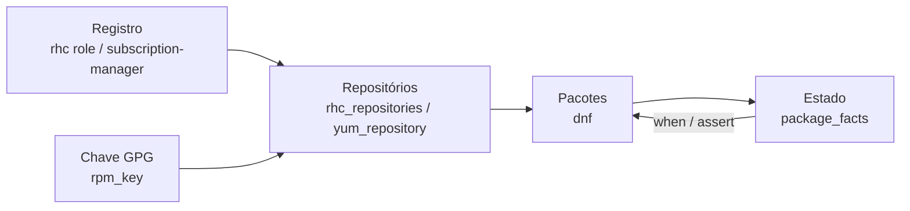

# 8.3 — Automatizando tarefas de software e assinaturas

| Campo | Valor |
|-------|-------|
| Curso | AU294 — Ansible Automation Platform 2.6 (edição 2) |
| Capítulo / seção | Capítulo 8 · Seção 8.3 |
| Título original | Automating Software and Subscription Tasks |
| Título em português | Automatizando tarefas de software e assinaturas |
| Objetivo | Registrar sistemas, configurar canais de software e repositórios e gerenciar pacotes RPM nos managed hosts |
| Pré-requisitos | [8.1 — system roles](8.1-usando-system-roles.md), [4.1 — loops e condicionais](../04-controle-de-tarefas/4.1-loops-e-tarefas-condicionais.md), [3.5 — Vault](../03-variaveis-e-vault/3.5-protegendo-dados-com-ansible-vault.md) |
| Referência | PDF p. 471–483 · Guided Exercise 8.4 p. 484–492 |

## Parte A — O problema que a tecnologia resolve

Instalar software parece trivial, mas em escala envolve: o host estar **registrado**
e com os **repositórios** certos habilitados, a **chave GPG** que garante a origem
dos pacotes, a instalação **eficiente** de vários pacotes, e decisões baseadas no que
**já está instalado**. Esta seção cobre cada peça com módulos e com a role `rhc`.

## Parte B — Modelo mental e arquitetura



| Etapa | Módulo / role |
|-------|---------------|
| Registrar no Red Hat Subscription Management | `redhat.rhel_system_roles.rhc` |
| Repositório de terceiros | `ansible.builtin.yum_repository` |
| Chave GPG | `ansible.builtin.rpm_key` |
| Pacotes | `ansible.builtin.dnf` |
| Pacotes instalados como facts | `ansible.builtin.package_facts` |

## Parte C — Entendimento progressivo

### 1. `ansible.builtin.dnf`

| `state` | Efeito |
|---------|--------|
| `present` | Instala se não estiver instalado |
| `absent` | Remove se estiver instalado |
| `latest` | Instala, ou atualiza até a versão mais recente disponível |

`name` aceita uma versão exata (ex.: `httpd-2.4.63-1.el10`).

| Task | Equivalente `dnf` |
|------|-------------------|
| `name: httpd`, `state: present` | `dnf install httpd` |
| `name: httpd`, `state: latest` | `dnf install httpd` / `dnf upgrade httpd` |
| `name: '*'`, `state: latest` | `dnf upgrade` |
| `name: httpd`, `state: absent` | `dnf remove httpd` |
| `name: '@Development Tools'`, `state: present` | `dnf group install "Development Tools"` |
| `name: '@perl:5.26/minimal'`, `state: present` | `dnf module install perl:5.26/minimal` |

- Grupos e módulos DNF usam o prefixo `@` (grupos disponíveis: `dnf group list`).
- ⚠️ No RHEL 10, versões alternativas de componentes passam a ser entregues com
  abordagens baseadas em containers, substituindo o conteúdo modular das versões
  anteriores.

Parâmetros adicionais:

| Parâmetro | Efeito |
|-----------|--------|
| `disable_gpg_check: true` | Desliga a verificação de assinatura (só para repositórios confiáveis) |
| `skip_broken: true` | Pula pacotes com problema de dependência em vez de falhar a transação |
| `enablerepo` / `disablerepo` | Habilita/desabilita repositórios só nesta transação |
| `download_only: true` | Só baixa, não instala |
| `autoremove: true` | Remove dependências que deixaram de ser necessárias |

### 2. Vários pacotes: lista, não loop

```yaml
- name: Instalar as ferramentas em uma única transação
  ansible.builtin.dnf:
    name:
      - postgresql
      - sqlite
      - jq
    state: present
```

Equivale a `dnf install postgresql sqlite jq`. Um `loop` com `name: "{{ item }}"`
funciona, mas faz **uma transação por pacote**: evite.

### 3. `ansible.builtin.package_facts`

Preenche `ansible_facts['packages']`: um dicionário cujo valor, para cada pacote, é
uma **lista** (uma entrada por versão instalada) com `name`, `version`, `release`,
`epoch`, `arch` e `source`. Com uma só versão, use `[0]`.

```yaml
- name: Coletar os pacotes instalados
  ansible.builtin.package_facts:
    manager: auto

- name: Mostrar a versão do sqlite
  ansible.builtin.debug:
    msg: "sqlite {{ ansible_facts['packages']['sqlite'][0]['version'] }}"
  when: ansible_facts['packages']['sqlite'] is defined
```

Uso típico: decidir com `when` (`is defined` / `is not defined`) e validar com
`ansible.builtin.assert` (`that`, `success_msg`, `fail_msg`).

> ⚠️ O fact **não** se atualiza sozinho quando um pacote é instalado depois da
> coleta: rode `package_facts` de novo para ver o estado atual. (É um dos pontos
> explorados no guided exercise.)

### 4. Outros gerenciadores

| Módulo | Onde |
|--------|------|
| `ansible.builtin.dnf` | **Recomendado** para RHEL 8 e posteriores |
| `ansible.builtin.yum` | RHEL, CentOS e Fedora antigos |
| `ansible.builtin.zypper` | SUSE Linux Enterprise |
| `ansible.builtin.apt` | Debian e Ubuntu |
| `ansible.windows.win_package` | Microsoft Windows |
| `ansible.builtin.package` | Genérico: detecta o gerenciador, mas não tem todos os recursos dos específicos |

Com parque misto, condicione por `ansible_facts['distribution']` e
`ansible_facts['distribution_major_version'] | int`. Mesmo com `package`, nomes de
pacote mudam entre sistemas (`httpd` no RHEL, `apache2` no Ubuntu).

### 5. Registro no Red Hat Subscription Management

Três caminhos: `subscription-manager`; role `rhel-system-roles.rhc` do RPM (1.21.1+,
RHEL 9.2+); role `redhat.rhel_system_roles.rhc` da collection (1.21.1+), já presente
no EE `ee-supported-rhel9`.

Pela linha de comando (sem Ansible), no RHEL 10 o **Simple Content Access (SCA)**
dispensa o pool ID:

```bash
sudo subscription-manager register
sudo subscription-manager attach --auto
sudo subscription-manager repos --enable "rhel-10-for-x86_64-baseos-rpms" \
  --enable "rhel-10-for-x86_64-appstream-rpms"
```

Com a role:

```yaml
- name: Registrar os sistemas
  hosts: all
  become: true
  tasks:
    - name: Incluir a role rhc
      ansible.builtin.include_role:
        name: redhat.rhel_system_roles.rhc
```

Variáveis (no play, em `group_vars`/`host_vars` ou em arquivo separado):

```yaml
rhc_state: present
rhc_auth:
  login:
    username: "{{ vault_rhsm_usuario }}"
    password: "{{ vault_rhsm_senha }}"
rhc_repositories:
  - name: rhel-10-for-x86_64-baseos-rpms
    state: enabled
  - name: rhel-10-for-x86_64-appstream-rpms
    state: enabled
```

| Variável | Significado |
|----------|-------------|
| `rhc_state` | `present`, `absent` ou `reconnect`; com `present`/`reconnect`, tenta anexar assinatura automaticamente |
| `rhc_auth` | Autenticação: usuário e senha (proteja com Ansible Vault) ou **activation keys** da organização |
| `rhc_repositories` | Repositórios a habilitar/desabilitar |

### 6. Repositório com `yum_repository` e chave com `rpm_key`

```yaml
- name: Importar a chave GPG do repositório interno
  ansible.builtin.rpm_key:
    key: https://repo.example.net/chaves/RPM-GPG-KEY-analise
    state: present

- name: Declarar o repositório interno
  ansible.builtin.yum_repository:
    file: analise-interno            # vira /etc/yum.repos.d/analise-interno.repo
    name: analise-interno            # seção [analise-interno]
    description: Repositório interno da equipe de análise
    baseurl: https://repo.example.net/el10/analise/
    enabled: true
    gpgcheck: true
    state: present                   # absent apaga o arquivo
```

| `rpm_key` | Uso |
|-----------|-----|
| `key` | URL (HTTP/HTTPS), caminho absoluto local ou arquivo do control node (ex.: `"{{ playbook_dir }}/files/RPM-GPG-KEY-x"`) |
| `state` | `present` ou `absent` no banco RPM |
| `fingerprint` | Opcional: só importa se a impressão digital bater (proteção extra) |
| `validate_certs` | `false` só em sites próprios com certificado autoassinado |

Verificação de pacotes = importar a chave (`rpm_key`) **e** `gpgcheck: true` no
repositório. Alguns repositórios de terceiros (como o EPEL) entregam `.repo` e chave
em um RPM: nesse caso, instale o RPM com `dnf` em vez de usar `yum_repository`.

### 7. Boas práticas

| Grupo | Práticas |
|-------|----------|
| Segurança | `gpgcheck` + chave importada; credenciais com Vault, de preferência activation keys; HTTPS nos repositórios; `fingerprint` no `rpm_key` |
| Operação | Lista em `name` em vez de loop; `package_facts` antes de mudar; plays ou roles dedicados a pacotes e serviços; nomes claros e comentários nos repositórios |
| Versões | Testar em cada versão do SO; condicionar por `distribution_major_version`; fixar versões em produção; checar o repositório com `ansible.builtin.uri` antes de operações críticas |
| Desempenho | `download_only: true` antes da janela de manutenção; agrupar operações em poucas transações |

### 8. Diferenças que confundem

| A | B | Diferença essencial |
|---|---|--------------------|
| `present` | `latest` | Garante instalado × garante a versão mais recente |
| Lista em `name` | `loop` | Uma transação × uma por pacote |
| `yum_repository` | RPM de release (EPEL) | Cria o `.repo` × o pacote já traz `.repo` e chave |
| `rpm_key` | `gpgcheck` | Importa a chave × exige assinatura válida |
| `package` | `dnf` | Genérico × recursos completos no RHEL |
| `rhc_auth` com senha | Activation key | Precisa de Vault × preferida pela segurança |

## Parte D — Exemplo autoral incremental

Projeto: [exemplos-originais/cap08-administracao-linux](../../exemplos-originais/cap08-administracao-linux/).

**Passo 1 — confiança:** em [software.yml](../../exemplos-originais/cap08-administracao-linux/software.yml),
a chave GPG é importada antes do repositório, que usa `gpgcheck: true` e HTTPS.

**Passo 2 — instalação eficiente:** três pacotes em uma transação.

**Passo 3 — decisão pelo estado:** `package_facts`, uma task condicionada a um pacote
existente e outro ausente, e um `assert` final.

## Parte E — Execução e verificação

```bash
ansible-navigator run software.yml --syntax-check
ansible-navigator run software.yml
```

| Item | Valor |
|------|-------|
| Segunda execução | Chave, repositório e pacotes como `ok`; nenhuma mudança |
| Status | ✅ YAML, `--syntax-check` e `ansible-lint` (perfil *production*) sem erros · ⚠️ não executado (repositório fictício) |

## Parte F — Troubleshooting

| Sintoma | Causa provável | Como verificar / corrigir |
|---------|----------------|---------------------------|
| Falha de assinatura ao instalar | Chave GPG não importada | `rpm_key` antes; confira `gpgcheck` |
| `No package ... available` | Repositório não habilitado ou host não registrado | `rhc_repositories`/`yum_repository`; `dnf repolist` no host |
| `KeyError`/`undefined` em `ansible_facts['packages']` | Pacote ausente ou `package_facts` não executado | `is defined` no `when`; rode `package_facts` |
| Fact não mostra o pacote recém-instalado | Fact coletado antes da instalação | Rode `package_facts` de novo |
| Instalação lenta de muitos pacotes | Loop | Lista em `name` |
| Senha do RHSM exposta | Variável em texto puro | Ansible Vault ou activation key |

## Parte G — Preparação para o laboratório

Atividade associada: **8.4 Guided Exercise — Automating Software and Subscription
Tasks** (`system-software`, PDF p. 484–492). Ver
[PRATICA-OFICIAL.md](PRATICA-OFICIAL.md#84-guided-exercise-automating-software-and-subscription-tasks).

Você deve conseguir:

- declarar um repositório e importar sua chave GPG;
- instalar um pacote desse repositório;
- usar `package_facts` e entender quando o fact está desatualizado.

## Parte H — Fixação

1. Escreva a task que atualize todos os pacotes.
2. Como instalar o grupo "Server with GUI" com `ansible.builtin.dnf`?
3. Por que preferir lista em `name` a um loop?
4. Como saber, numa task, se o pacote `nginx` está instalado?
5. Quais duas coisas garantem a verificação de assinatura de um repositório de terceiros?
6. Qual forma de autenticação a Red Hat prefere para o registro, e como proteger usuário e senha se usá-los?

<details>
<summary>Respostas comentadas</summary>

1. Exemplo:
   ```yaml
   - name: Atualizar todos os pacotes
     ansible.builtin.dnf:
       name: '*'
       state: latest
   ```
2. `name: '@Server with GUI'` com `state: present`.
3. Lista = uma transação (mais rápida e confiável); loop = uma transação por pacote.
4. Rode `ansible.builtin.package_facts` e use `when: ansible_facts['packages']['nginx'] is defined`.
5. Importar a chave com `ansible.builtin.rpm_key` e definir `gpgcheck: true` no repositório.
6. Activation keys; usuário e senha devem ser protegidos com Ansible Vault.

</details>

## Parte I — Essencial para memorizar

- `dnf`: `present`/`absent`/`latest`; `@grupo`; `'*'` + `latest` = atualizar tudo; lista em `name`.
- `package_facts` → `ansible_facts['packages']['pkg'][0]['version']`; recoletar após instalar.
- `rpm_key` (`fingerprint`) + `yum_repository` (`file`, `name`, `baseurl`, `gpgcheck`).
- Registro: `redhat.rhel_system_roles.rhc` com `rhc_state`, `rhc_auth`, `rhc_repositories`; SCA no RHEL 10.
- Credenciais com Vault; prefira activation keys; HTTPS.

---
[← 8.1 System roles](8.1-usando-system-roles.md) | [Índice do capítulo](README.md) | [Próximo: 8.5 Usuários e autenticação →](8.5-automatizando-usuarios-e-autenticacao.md)
