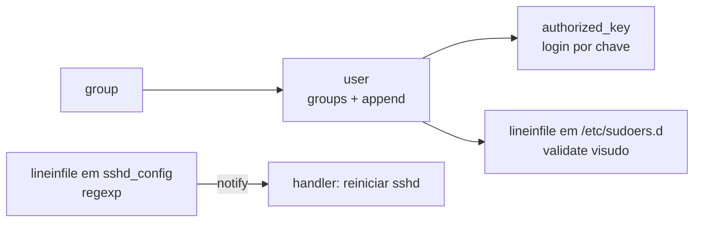

# 8.5 — Automatizando usuários e autenticação

| Campo | Valor |
|-------|-------|
| Curso | AU294 — Ansible Automation Platform 2.6 (edição 2) |
| Capítulo / seção | Capítulo 8 · Seção 8.5 |
| Título original | Automating User Management and Authentication Tasks |
| Título em português | Automatizando tarefas de gerenciamento de usuários e autenticação |
| Objetivo | Gerenciar usuários e grupos Linux, configurar SSH e alterar a configuração do sudo nos managed hosts |
| Pré-requisitos | [8.3 — software](8.3-automatizando-software-e-assinaturas.md), [5.1 — módulos de arquivo](../05-deploy-de-arquivos/5.1-automatizando-gerenciamento-de-arquivos.md), [4.3 — handlers](../04-controle-de-tarefas/4.3-implementando-handlers.md) |
| Referência | PDF p. 493–499 · Guided Exercise 8.6 p. 500–508 |

## Parte A — O problema que a tecnologia resolve

Criar contas, grupos, chaves SSH e regras de sudo à mão, host por host, gera erros
que viram **falhas de segurança**: usuário esquecido, grupo errado, sudo amplo
demais, arquivo `sudoers` quebrado. Automatizar garante **consistência** e torna o
acesso auditável e reproduzível.

## Parte B — Modelo mental e arquitetura

| Necessidade | Módulo |
|-------------|--------|
| Contas de usuário | `ansible.builtin.user` |
| Grupos e associação | `ansible.builtin.group` (+ `groups` em `user`) |
| Chaves autorizadas para login | `ansible.posix.authorized_key` |
| Identidade de hosts SSH | `ansible.builtin.known_hosts` |
| Sudo e ajustes de configuração | `ansible.builtin.lineinfile` (com `validate`) |



## Parte C — Entendimento progressivo

### 1. `ansible.builtin.user`

```yaml
- name: Garantir a conta da analista
  ansible.builtin.user:
    name: ana.souza            # único parâmetro obrigatório
    shell: /bin/bash
    groups: analistas, auditoria
    append: true               # acrescenta; sem append, substitui os grupos suplementares
```

| Parâmetro | Função |
|-----------|--------|
| `comment` | Descrição da conta |
| `group` | Grupo **primário** |
| `groups` | Grupos **suplementares** (valor nulo remove todos, exceto o primário) |
| `append` | Com `groups`, acrescenta em vez de substituir |
| `home` / `create_home` | Diretório home / criar o home |
| `system` | Conta de sistema (só na criação; não muda em contas existentes) |
| `uid` | UID |
| `password` | Senha **já em hash** (ex.: filtro `password_hash('sha512')` sobre variável do Vault) |
| `state` | `present` (padrão) ou `absent` |

O módulo também devolve valores (home, grupos) que podem ser registrados com
`register`.

Boas práticas do curso: nomes que sigam a convenção da organização, UIDs de sistema
abaixo de 1000, permissões corretas no home, `system: true` para contas de serviço
sem login interativo, auditoria periódica e remoção de contas sem uso.

**Gerar chave SSH para o usuário:**

```yaml
- name: Gerar chave SSH para a conta de serviço
  ansible.builtin.user:
    name: svc_relatorios
    generate_ssh_key: true
    ssh_key_bits: 4096
    ssh_key_file: .ssh/id_relatorios
```

Não sobrescreve chave existente (a menos que `force: true`); a pública recebe `.pub`
e as chaves ficam em `.ssh/` no home, com permissões seguras. Útil para contas de
serviço que autenticam sem senha.

### 2. `ansible.builtin.group`

```yaml
- name: Garantir o grupo da equipe
  ansible.builtin.group:
    name: analistas
    state: present
```

| Parâmetro | Função |
|-----------|--------|
| `name` | Nome (obrigatório) |
| `state` | `present` (padrão) ou `absent` |
| `gid` | GID (automático se omitido) |
| `system` | Grupo de sistema (GID normalmente abaixo de 1000) |
| `local` | Força comandos locais em plataformas que usam fontes centrais |

Depende de `groupadd`, `groupdel` e `groupmod` (pacote `shadow-utils` no RHEL 10).
Grupos são a base de um controle de acesso por papéis (RBAC).

### 3. `ansible.builtin.known_hosts`

Gerencia entradas em um arquivo `known_hosts`, evitando prompts interativos e
confirmando a identidade dos hosts.

| Parâmetro | Função |
|-----------|--------|
| `name` | Hostname ou IP do host |
| `key` | Chave no formato `<host[,IP]> <tipo> <chave>` |
| `state` | `present` ou `absent` |
| `path` | Arquivo (padrão `~/.ssh/known_hosts`; para todo o sistema, `/etc/ssh/ssh_known_hosts`) |

Padrão do curso para SSH entre hosts: ler a chave pública de host de cada máquina
(`stat` + `slurp`), registrar, e distribuir para todos com `known_hosts` em loop
sobre `groups['all']`, usando `hostvars[item]` e o filtro `b64decode`.

### 4. `ansible.posix.authorized_key`

```yaml
- name: Autorizar a chave pública da analista
  ansible.posix.authorized_key:
    user: ana.souza
    state: present
    key: "{{ lookup('ansible.builtin.file', 'files/chaves/ana.souza.pub') }}"
```

- `user`: conta cujo `authorized_keys` é alterado; `state`: `present` (padrão)/`absent`.
- `key`: a chave pública. O lookup `ansible.builtin.file` lê um arquivo **do
  projeto** (no control node); também é aceita uma **URL** de arquivo de chave.
- Lookups disponíveis: `ansible-navigator doc -l -t lookup`.
- Garanta antes o diretório `.ssh` do usuário com `mode: '0700'` quando necessário.

### 5. Sudo com `lineinfile`

```yaml
- name: Permitir sudo sem senha para o grupo analistas
  ansible.builtin.lineinfile:
    path: /etc/sudoers.d/analistas
    state: present
    create: true
    mode: '0440'
    line: "%analistas ALL=(ALL) NOPASSWD: ALL"
    validate: /usr/sbin/visudo -cf %s
```

| Detalhe | Por quê |
|---------|---------|
| Arquivo em `/etc/sudoers.d/` com o nome do grupo/usuário | Facilita a manutenção |
| `create: true` | Cria o arquivo se não existir (padrão `false`) |
| `%` antes do nome | Indica **grupo**; sem `%`, é usuário |
| `validate` | O conteúdo é gravado num temporário, validado pelo comando (`%s` = temporário) e só então copiado; um `sudoers` inválido nunca entra no lugar |

### 6. Alterar uma linha existente com `regexp`

```yaml
- name: Desabilitar login direto do root por SSH
  ansible.builtin.lineinfile:
    path: /etc/ssh/sshd_config
    regexp: '^PermitRootLogin'
    line: PermitRootLogin no
  notify: Reiniciar o sshd
```

A linha que casa com a expressão é substituída por `line`. Depois de mudar o
`sshd_config`, o serviço precisa ser reiniciado: handler.

### 7. Diferenças que confundem

| A | B | Diferença essencial |
|---|---|--------------------|
| `group` (em `user`) | `groups` | Primário × suplementares |
| `groups` sem `append` | `groups` com `append: true` | Substitui × acrescenta |
| `authorized_key` | `known_hosts` | Quem pode entrar na conta × quais hosts são confiáveis |
| `%nome` no sudoers | `nome` | Grupo × usuário |
| `line` sozinho | `line` + `regexp` | Garante a linha × substitui a linha que casa |
| `password` em texto | `password` com hash | Inválido/inseguro × correto (`password_hash` + Vault) |

## Parte D — Exemplo autoral incremental

Projeto: [exemplos-originais/cap08-administracao-linux](../../exemplos-originais/cap08-administracao-linux/).

**Passo 1 — dados fora do playbook:**
[vars/equipe.yml](../../exemplos-originais/cap08-administracao-linux/vars/equipe.yml)
lista grupo e membros.

**Passo 2 — grupo, contas e chaves:**
[usuarios.yml](../../exemplos-originais/cap08-administracao-linux/usuarios.yml) cria
o grupo, as contas com `append: true` e autoriza a chave pública de cada membro a
partir de uma URL fictícia.

**Passo 3 — sudo e SSH com validação:** `lineinfile` com `visudo -cf %s` no
`sudoers.d` e com `sshd -t -f %s` no `sshd_config`, notificando o handler que
reinicia o `sshd`.

## Parte E — Execução e verificação

```bash
ansible-navigator run usuarios.yml --syntax-check
ansible-navigator run usuarios.yml
ssh ana.souza@ana01.example.net 'id; sudo -n true && echo sudo-ok'
```

| Item | Valor |
|------|-------|
| Segunda execução | Tudo `ok`; handler não roda |
| Login do root por SSH | Recusado depois da mudança |
| Status | ✅ YAML, `--syntax-check` e `ansible-lint` (perfil *production*) sem erros · ⚠️ não executado contra hosts |

## Parte F — Troubleshooting

| Sintoma | Causa provável | Como verificar / corrigir |
|---------|----------------|---------------------------|
| Usuário perdeu grupos antigos | `groups` sem `append: true` | Acrescente `append: true` |
| Senha não funciona | `password` sem hash | `password_hash('sha512')` sobre variável do Vault |
| Task de sudo falha | Linha inválida rejeitada pelo `visudo` | Corrija a sintaxe; `%` para grupo |
| Sudo não vale para o grupo | Faltou `%` | `%grupo ALL=...` |
| Mudança no `sshd_config` sem efeito | Serviço não reiniciado | Handler notificado pela task |
| Chave não encontrada pelo lookup | Caminho relativo ao projeto errado | Confira `files/...` no control node |
| `couldn't resolve module` em `authorized_key` | Collection `ansible.posix` ausente | Já vem no EE suportado; confira o `collections_path` |

## Parte G — Preparação para o laboratório

Atividade associada: **8.6 Guided Exercise — Automating User Management and
Authentication Tasks** (`system-user`, PDF p. 500–508). Ver
[PRATICA-OFICIAL.md](PRATICA-OFICIAL.md#86-guided-exercise-automating-user-management-and-authentication-tasks).

Você deve conseguir:

- criar grupo e usuários a partir de um arquivo de variáveis;
- autorizar chaves, configurar sudo e restringir o login do root;
- usar um handler para reiniciar o `sshd`.

## Parte H — Fixação

1. Qual a diferença entre `group` e `groups` no módulo `user`?
2. O que acontece com `groups: auditoria` sem `append`?
3. Escreva uma task que crie a conta de serviço `svc_backup` como conta de sistema.
4. Escreva a task que dê sudo sem senha ao usuário `operador` (não grupo), validando o arquivo.
5. Para que serve `validate` no `lineinfile`?
6. `authorized_key` e `known_hosts` resolvem o mesmo problema?

<details>
<summary>Respostas comentadas</summary>

1. `group` define o grupo primário; `groups`, os suplementares.
2. Os grupos suplementares da conta são substituídos pela lista informada (só `auditoria`).
3. Exemplo:
   ```yaml
   - name: Garantir a conta de serviço de backup
     ansible.builtin.user:
       name: svc_backup
       system: true
       state: present
   ```
4. Exemplo:
   ```yaml
   - name: Sudo sem senha para o operador
     ansible.builtin.lineinfile:
       path: /etc/sudoers.d/operador
       line: "operador ALL=(ALL) NOPASSWD: ALL"
       create: true
       mode: '0440'
       validate: /usr/sbin/visudo -cf %s
   ```
5. Valida um arquivo temporário com o comando informado antes de colocá-lo no destino; se a validação falhar, o arquivo original não é alterado.
6. Não: `authorized_key` define quais chaves podem entrar em uma conta; `known_hosts` registra as chaves dos hosts confiáveis para conexões de saída.

</details>

## Parte I — Essencial para memorizar

- `user`: `name` obrigatório; `group` × `groups` + `append`; `system`; `password` com hash; `generate_ssh_key`.
- `group`: `name`, `state`, `gid`, `system`.
- `ansible.posix.authorized_key` (`user`, `key` com lookup `file` ou URL) · `ansible.builtin.known_hosts`.
- Sudo: arquivo em `/etc/sudoers.d/`, `%grupo`, `mode: '0440'`, `validate: /usr/sbin/visudo -cf %s`.
- `lineinfile` + `regexp` substitui linha existente; mudou `sshd_config` → handler reinicia `sshd`.

---
[← 8.3 Software e assinaturas](8.3-automatizando-software-e-assinaturas.md) | [Índice do capítulo](README.md) | [Próximo: 8.7 Boot e agendamentos →](8.7-automatizando-boot-e-agendamentos.md)
