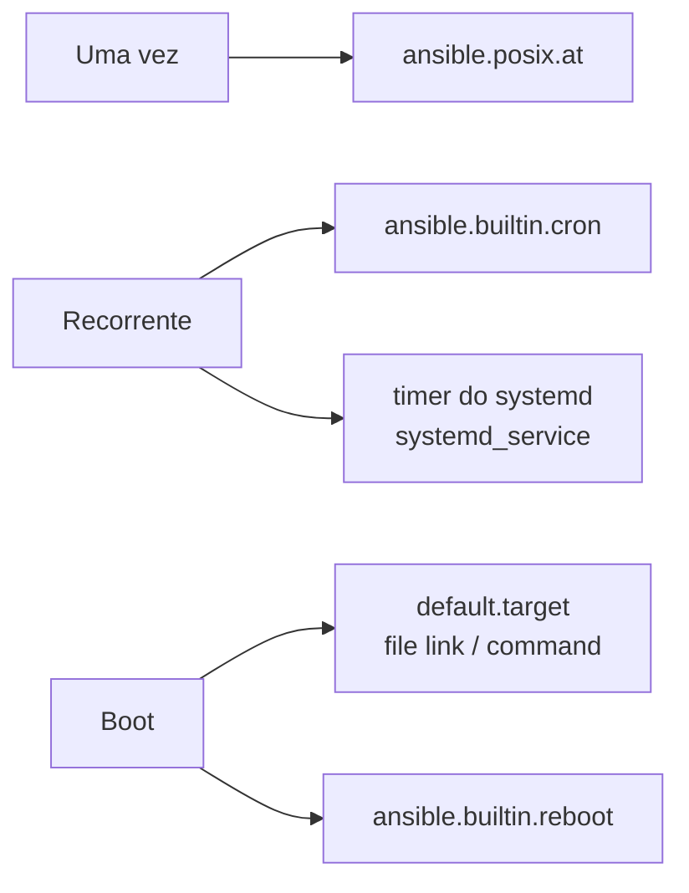

# 8.7 — Automatizando o boot e processos agendados

| Campo | Valor |
|-------|-------|
| Curso | AU294 — Ansible Automation Platform 2.6 (edição 2) |
| Capítulo / seção | Capítulo 8 · Seção 8.7 |
| Título original | Automating the Boot Process and Scheduled Processes |
| Título em português | Automatizando o processo de boot e processos agendados |
| Objetivo | Gerenciar a inicialização de serviços, agendar processos com `at`, cron e systemd, reiniciar managed hosts e controlar o alvo de boot padrão |
| Pré-requisitos | [8.5 — usuários](8.5-automatizando-usuarios-e-autenticacao.md), [4.3 — handlers](../04-controle-de-tarefas/4.3-implementando-handlers.md), [5.1 — módulos de arquivo](../05-deploy-de-arquivos/5.1-automatizando-gerenciamento-de-arquivos.md) |
| Referência | PDF p. 509–515 · Guided Exercise 8.8 p. 516–524 |

## Parte A — O problema que a tecnologia resolve

Agendar rotinas (backup, limpeza, relatórios), ajustar serviços, mudar o alvo de boot
e reiniciar servidores são tarefas repetidas em todo o parque. Feitas à mão, geram
crontabs divergentes, jobs duplicados e reinícios sem controle. Os módulos desta
seção tornam isso **declarativo e idempotente**.

## Parte B — Modelo mental e arquitetura

| Mecanismo do RHEL | Para quê | Módulo |
|-------------------|----------|--------|
| `at` | Executar **uma vez** em um momento futuro | `ansible.posix.at` |
| Cron (crontab do usuário, `/etc/crontab`, `/etc/cron.d/`) | Execução **recorrente** | `ansible.builtin.cron` |
| Timers do systemd | Iniciar units de serviço em agenda recorrente | `ansible.builtin.systemd_service` |
| Units do systemd | Iniciar, parar, reiniciar, recarregar, habilitar | `ansible.builtin.systemd_service` |
| Alvo de boot | Qual target sobe no boot | `ansible.builtin.command` ou `ansible.builtin.file` (link) |
| Reinício | Reiniciar e esperar o host voltar | `ansible.builtin.reboot` |



## Parte C — Entendimento progressivo

### 1. Jobs únicos com `ansible.posix.at`

| Parâmetro | Função |
|-----------|--------|
| `command` | Comando a agendar |
| `count` + `units` | Daqui a quantas unidades (`minutes`, `hours`, `days`, `weeks`); usados juntos |
| `script_file` | Script existente a agendar |
| `state` | `present` (padrão) adiciona; `absent` remove o job correspondente |
| `unique` | Com `true`, não adiciona se já houver job igual |

```yaml
- name: Remover a conta temporária daqui a 2 horas
  ansible.posix.at:
    command: userdel -r visitante
    count: 2
    units: hours
    unique: true
```

### 2. Jobs recorrentes com `ansible.builtin.cron`

`name` é **obrigatório**: vira o comentário do job no crontab e é a chave que o
módulo usa para saber se o job já existe, qual alterar ou remover.

| Parâmetro | Função |
|-----------|--------|
| `name` | Comentário que identifica o job |
| `job` | Comando |
| `minute`, `hour`, `day`, `month`, `weekday` | Campos de tempo; omitido = `*` |
| `state` | `present` (padrão) ou `absent` |
| `user` | Usuário que executa; sem `cron_file`, vai para o crontab desse usuário |
| `cron_file` | Cria um job de sistema nesse arquivo (relativo = em `/etc/cron.d`); exige `user` e horário |

Crontab do usuário (confira depois com `crontab -l` como esse usuário):

```yaml
- name: Exportar métricas diárias
  ansible.builtin.cron:
    name: Exportar métricas diárias
    user: ana.souza
    job: /home/ana.souza/bin/exportar-metricas
    minute: "30"
    hour: "2"
```

Arquivo de sistema em `/etc/cron.d/`:

```yaml
- name: Limpar temporários em dias úteis
  ansible.builtin.cron:
    name: Limpar temporários de análise
    cron_file: limpeza_analise
    user: root
    minute: "*/15"
    hour: "8-18"
    weekday: "1-5"
    job: find /srv/analise/tmp -type f -mmin +120 -delete
```

> ⚠️ Não use `cron_file` para alterar `/etc/crontab`. O arquivo indicado deve ser
> mantido **só** pelo Ansible e conter apenas a entrada da task.

### 3. Timers e serviços com `ansible.builtin.systemd_service`

```yaml
- name: Desabilitar o timer de cache do dnf
  ansible.builtin.systemd_service:
    name: dnf-makecache.timer
    state: stopped
    enabled: false

- name: Recarregar o servidor web após recarregar o systemd
  ansible.builtin.systemd_service:
    name: httpd
    state: reloaded
    daemon_reload: true      # equivale a systemctl daemon-reload antes da ação
```

O módulo gerencia qualquer tipo de unit: `started`, `stopped`, `restarted`,
`reloaded`, `enabled`.

### 4. Alvo de boot padrão

| Abordagem | Observação |
|-----------|------------|
| `ansible.builtin.command` com `systemctl set-default <target>` | Simples, mas não verifica o atual e sempre reporta `changed` |
| `ansible.builtin.file` com `state: link` | Link de `/usr/lib/systemd/system/<target>` para `/etc/systemd/system/default.target`, `force: true`; idempotente |

```yaml
- name: Garantir o alvo de boot sem interface gráfica
  ansible.builtin.file:
    src: /usr/lib/systemd/system/multi-user.target
    dest: /etc/systemd/system/default.target
    state: link
    force: true
```

### 5. `ansible.builtin.reboot`

Reinicia o host e **espera** ele voltar (até conseguir executar um comando) antes de
seguir o playbook.

`reboot_timeout` (padrão 600 s) vale **para cada uma** das duas fases:

| Fase | O que acontece |
|------|----------------|
| 1 | Desligar e subir de novo |
| 2 | Reconectar e rodar o comando de teste (`test_command`, padrão `whoami`) |

Espera máxima = 2 × `reboot_timeout` (padrão: 1200 s). Se o host responder antes, o
Ansible segue imediatamente.

| Parâmetro | Função |
|-----------|--------|
| `reboot_timeout` | Limite por fase, em segundos |
| `pre_reboot_delay` | Espera antes do reboot (no Linux, em segundos; abaixo de 60 vira 0) |
| `msg` | Mensagem aos usuários antes do reboot |
| `test_command` | Comando que indica que o host está pronto |

### 6. Diferenças que confundem

| A | B | Diferença essencial |
|---|---|--------------------|
| `ansible.posix.at` | `ansible.builtin.cron` | Uma vez × recorrente |
| `cron` sem `cron_file` | `cron` com `cron_file` | Crontab do usuário × arquivo em `/etc/cron.d` |
| Timer do systemd | Job cron | Unit `.timer` que dispara um serviço × linha no crontab |
| `command: systemctl set-default` | `file` com link | Sempre `changed` × idempotente |
| `reboot_timeout: 600` | Tempo total | Por fase × até 2 × o valor |

## Parte D — Exemplo autoral incremental

Projeto: [exemplos-originais/cap08-administracao-linux](../../exemplos-originais/cap08-administracao-linux/).

[agendamentos.yml](../../exemplos-originais/cap08-administracao-linux/agendamentos.yml):

**Passo 1:** um job no crontab de uma usuária e outro em `/etc/cron.d/limpeza_analise`.

**Passo 2:** um job único com `at` e `unique: true`.

**Passo 3:** desabilitar um timer, garantir o alvo de boot por link e, se o link
mudar, notificar um handler com `ansible.builtin.reboot` (`msg` e `reboot_timeout`).

## Parte E — Execução e verificação

```bash
ansible-navigator run agendamentos.yml --syntax-check
ansible-navigator run agendamentos.yml
ssh ana01.example.net 'sudo crontab -l -u ana.souza; cat /etc/cron.d/limpeza_analise; atq; systemctl get-default'
```

| Item | Valor |
|------|-------|
| Segunda execução | Jobs e link `ok`; `at` não duplica; sem reboot |
| Status | ✅ YAML, `--syntax-check` e `ansible-lint` (perfil *production*) sem erros · ⚠️ não executado contra hosts |

## Parte F — Troubleshooting

| Sintoma | Causa provável | Como verificar / corrigir |
|---------|----------------|---------------------------|
| Job cron duplicado | `name` mudou entre execuções | Mantenha o mesmo `name`; remova o antigo com `state: absent` |
| Erro com `cron_file` | Faltou `user` ou horário | Informe ambos |
| Jobs `at` acumulando | Sem `unique: true` | Acrescente `unique: true` |
| Alvo de boot sempre `changed` | Uso de `command` | Link com `ansible.builtin.file` |
| Playbook "travado" no reboot | Host demora a voltar | Ajuste `reboot_timeout` (lembre: por fase) |
| Mudança em unit ignorada | systemd não recarregado | `daemon_reload: true` |

## Parte G — Preparação para o laboratório

Atividade associada: **8.8 Guided Exercise — Automating the Boot Process and
Scheduled Processes** (`system-process`, PDF p. 516–524). Ver
[PRATICA-OFICIAL.md](PRATICA-OFICIAL.md#88-guided-exercise-automating-the-boot-process-and-scheduled-processes).

Você deve conseguir:

- criar e remover jobs cron em arquivo de sistema;
- agendar um comando único com `at`;
- mudar o alvo de boot e reiniciar os hosts com o módulo próprio.

## Parte H — Fixação

1. Qual módulo agenda uma tarefa que deve rodar só uma vez?
2. Por que `name` é obrigatório em `ansible.builtin.cron`?
3. Escreva a task que rode `/usr/local/bin/backup` às 23h todo domingo como `root`, em `/etc/cron.d/backup`.
4. Como remover esse job depois?
5. Com `reboot_timeout: 300`, qual a espera máxima?
6. Por que preferir o link com `file` a `systemctl set-default` via `command`?

<details>
<summary>Respostas comentadas</summary>

1. `ansible.posix.at`.
2. É o comentário que identifica o job; o módulo o usa para saber se o job existe e qual alterar ou remover.
3. Exemplo:
   ```yaml
   - name: Backup semanal
     ansible.builtin.cron:
       name: Backup semanal
       cron_file: backup
       user: root
       minute: "0"
       hour: "23"
       weekday: "0"
       job: /usr/local/bin/backup
   ```
4. A mesma task (mesmo `name`, `cron_file` e `user`) com `state: absent`.
5. 600 segundos: até 300 para desligar e subir e até 300 para reconectar e testar.
6. O link é idempotente (só muda se for preciso); o `command` sempre reporta `changed`.

</details>

## Parte I — Essencial para memorizar

- Uma vez: `ansible.posix.at` (`command`, `count`, `units`, `unique`).
- Recorrente: `ansible.builtin.cron` (`name` obrigatório, `job`, campos de tempo, `user`, `cron_file`).
- Timers e serviços: `ansible.builtin.systemd_service` (`state`, `enabled`, `daemon_reload`).
- Alvo de boot: link para `/etc/systemd/system/default.target` (`force: true`).
- `ansible.builtin.reboot`: espera voltar; `reboot_timeout` por fase; `test_command` padrão `whoami`.

---
[← 8.5 Usuários e autenticação](8.5-automatizando-usuarios-e-autenticacao.md) | [Índice do capítulo](README.md) | [Próximo: 8.9 Armazenamento →](8.9-automatizando-armazenamento.md)
