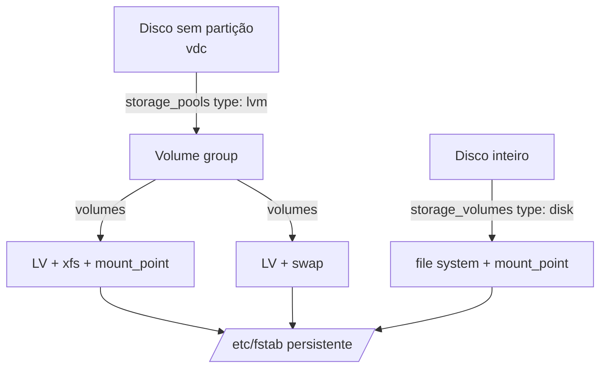

# 8.9 — Automatizando tarefas de armazenamento

| Campo | Valor |
|-------|-------|
| Curso | AU294 — Ansible Automation Platform 2.6 (edição 2) |
| Capítulo / seção | Capítulo 8 · Seção 8.9 |
| Título original | Automating Storage Tasks |
| Título em português | Automatizando tarefas de armazenamento |
| Objetivo | Particionar dispositivos, configurar LVM, formatar partições ou volumes lógicos, montar file systems e adicionar swap |
| Pré-requisitos | [8.1 — system roles](8.1-usando-system-roles.md), [3.3 — facts](../03-variaveis-e-vault/3.3-coletando-informacoes-com-facts.md), [4.1 — loops e condicionais](../04-controle-de-tarefas/4.1-loops-e-tarefas-condicionais.md) |
| Referência | PDF p. 525–533 · Guided Exercise 8.10 p. 534–540 |

## Parte A — O problema que a tecnologia resolve

Criar volume group, volumes lógicos, file systems, entradas no `/etc/fstab` e swap
envolve muitos comandos (`pvcreate`, `vgcreate`, `lvcreate`, `mkfs`, `mount`...) e um
erro pode **destruir dados**. A role `redhat.rhel_system_roles.storage` descreve o
resultado desejado em variáveis, de forma **idempotente**; `ansible.posix.mount`
cuida de montagens; e os facts mostram o que existe antes de agir.

## Parte B — Modelo mental e arquitetura



| Necessidade | Ferramenta |
|-------------|------------|
| Montar file system existente (local, por UUID/LABEL, NFS) | `ansible.posix.mount` |
| File system em disco inteiro | role `storage` com `storage_volumes` |
| LVM: VG, LVs, file systems, swap | role `storage` com `storage_pools` |
| Partições sem a role | `community.general.parted` ou `ansible.builtin.command` |
| Descobrir discos e montagens | facts `devices`, `device_links`, `mounts` |

## Parte C — Entendimento progressivo

### 1. `ansible.posix.mount`

| Parâmetro | Função |
|-----------|--------|
| `path` | Ponto de montagem (caminho absoluto) |
| `src` | Dispositivo (`/dev/vdb1`), `UUID=...`, `LABEL=...` ou compartilhamento de rede (`servidor:/export`) |
| `fstype` | `xfs`, `ext4`, `nfs`, `swap`... |
| `opts`, `dump`, `passno` | Campos da linha do `fstab` |
| `backup` | Cópia com data/hora do `/etc/fstab` antes de mudar |
| `state` | Ver tabela abaixo |

| `state` | Efeito |
|---------|--------|
| `present` | Garante a linha no `fstab`, sem exigir montado |
| `mounted` | Linha no `fstab` **e** montado |
| `unmounted` | Linha no `fstab` e desmontado |
| `absent` | Remove do `fstab` e desmonta se estiver montado |
| `remounted` | Remonta (aplica novas opções sem desmontar antes) |
| `ephemeral` | Monta temporariamente, sem tocar no `fstab` |

```yaml
- name: Montar o compartilhamento NFS de modelos
  ansible.posix.mount:
    path: /mnt/modelos
    src: nfs.example.net:/exports/modelos
    fstype: nfs
    opts: ro,defaults
    state: mounted
    backup: true
```

> ⚠️ Com UUID ou LABEL, use `UUID=<uuid>` / `LABEL=<rótulo>` exatamente como
> apareceria no `/etc/fstab`.

### 2. A role `redhat.rhel_system_roles.storage`

Suporte formal para gerenciar file systems e montagens em: **discos físicos**,
**volume groups LVM** e **pools Stratis** (v3 e posteriores). Outros casos podem
exigir `ansible.posix.mount` ou `ansible.builtin.command`. A role é **idempotente**:
reexecutar não recria file systems nem remonta sem necessidade.

#### Disco inteiro: `storage_volumes`

| Item | Descrição |
|------|-----------|
| `name` | Nome do volume |
| `type` | `disk` (file system no disco inteiro) |
| `disks` | Lista com **exatamente um** dispositivo sem partição |
| `mount_point` | Diretório de montagem |
| `fs_type` | `xfs` (padrão), `ext4`, `ext3` ou `swap` |
| `mount_options` | Opções (padrão `defaults`) |
| `fs_label` | Rótulo (opcional) |
| `state` | `present` (padrão) ou `absent` |

```yaml
- name: File system em disco inteiro
  hosts: relatorios
  become: true
  tasks:
    - name: Aplicar a role de armazenamento
      ansible.builtin.include_role:
        name: redhat.rhel_system_roles.storage
      vars:
        storage_volumes:
          - name: temporarios
            type: disk
            disks:
              - vdd
            fs_type: xfs
            mount_point: /srv/temporarios
```

#### LVM: `storage_pools`

| Item do pool | Descrição |
|--------------|-----------|
| `name` | Nome do volume group |
| `type` | `lvm` |
| `disks` | Dispositivos usados como PVs (**só** dispositivos sem partição) |
| `volumes` | Lista de volumes lógicos |

| Item do volume | Descrição |
|----------------|-----------|
| `name` | Nome do LV |
| `size` | Absoluto (`128m`, `1g`, `5g`, `1t`), `%` do VG (`50%VG`) ou do livre (`100%FREE`) |
| `mount_point` | Montagem do file system |
| `fs_type` | Tipo do file system (inclusive `swap`) |
| `state` | `present` ou `absent` |

> ⚠️ Unidades de tamanho em **minúsculas** (`m`, `g`, `t`): a role diferencia
> maiúsculas de minúsculas.

```yaml
storage_pools:
  - name: vg_relatorios
    type: lvm
    disks:
      - vdc
    volumes:
      - name: lv_dados
        size: 2g
        fs_type: xfs
        mount_point: /srv/relatorios
        state: present
      - name: lv_swap
        size: 512m
        fs_type: swap
        state: present
```

- **Aumentar:** mudar `size` de um LV existente (ex.: de `2g` para `4g`) faz a role
  aumentar o LV **e** o file system, se o VG tiver espaço.
- **Swap:** com `fs_type: swap`, a role cria o LV, formata, coloca no `fstab` e
  **ativa na hora**; persiste entre reboots.

### 3. Partições sem a role

`community.general.parted` (mantido pela comunidade) ou `ansible.builtin.command`
com o comando nativo e `creates` para não repetir:

```yaml
- name: Garantir a partição /dev/vde1
  ansible.builtin.command:
    cmd: parted --script /dev/vde mklabel gpt mkpart primary 1MiB 100%
    creates: /dev/vde1
```

> ⚠️ Cuidado ao particionar e formatar com Ansible, especialmente com
> `ansible.builtin.command`: um erro em sistema importante significa **perda de dados**.

### 4. Facts de armazenamento

| Fact | Conteúdo |
|------|----------|
| `ansible_facts['devices']` | Dicionário por dispositivo: `host` (controladora), `partitions`, `sectors`, `sectorsize`, `size` (texto legível) |
| `ansible_facts['device_links']` | Todos os links de cada dispositivo (útil com multipath) |
| `ansible_facts['mounts']` | Lista de montagens: `mount`, `device`, `fstype`, `options`, `size_total`, `size_available`, `block_size`, `block_total`, `block_available`, `inode_available` |

Exemplos de expressões:

```text
{{ ansible_facts['devices']['vdc']['sectors'] * ansible_facts['devices']['vdc']['sectorsize'] }}   # bytes
{{ ansible_facts['devices']['vda']['partitions']['vda1']['size'] }}
```

Espaço livre de uma montagem, filtrando a lista com `loop` + `when`:

```yaml
- name: Informar o espaço livre em /srv/relatorios
  ansible.builtin.debug:
    msg: >-
      {{ (item['block_available'] * item['block_size'] / 1000000) | round(1) }}
      MB livres em {{ item['mount'] }}
  loop: "{{ ansible_facts['mounts'] }}"
  when: item['mount'] == '/srv/relatorios'
```

### 5. Diferenças que confundem

| A | B | Diferença essencial |
|---|---|--------------------|
| `storage_volumes` | `storage_pools` | Disco inteiro (`type: disk`) × LVM (`type: lvm` + `volumes`) |
| `mount` `present` | `mount` `mounted` | Só `fstab` × `fstab` + montado |
| `absent` | `unmounted` | Remove do `fstab` × mantém no `fstab`, desmontado |
| `ephemeral` | `mounted` | Sem `fstab` × persistente |
| `50%VG` | `100%FREE` | Metade do VG × todo o espaço livre restante |
| `2G` | `2g` | Inválido para a role × correto |

## Parte D — Exemplo autoral incremental

Projeto: [exemplos-originais/cap08-administracao-linux](../../exemplos-originais/cap08-administracao-linux/).

**Passo 1 — configuração no inventário:**
[group_vars/relatorios/storage.yml](../../exemplos-originais/cap08-administracao-linux/group_vars/relatorios/storage.yml)
cria um VG com três LVs: dados (tamanho absoluto), arquivo (`50%VG`) e swap.

**Passo 2 — play:** [armazenamento.yml](../../exemplos-originais/cap08-administracao-linux/armazenamento.yml)
mostra o disco pelos facts, aplica a role, monta um NFS somente leitura com backup
do `fstab` e informa o espaço livre a partir de `ansible_facts['mounts']`.

## Parte E — Execução e verificação

```bash
ansible-navigator run armazenamento.yml --syntax-check
ansible-navigator run armazenamento.yml
ssh rel01.example.net 'lsblk; sudo vgs; sudo lvs; findmnt --fstab; swapon --show'
```

| Item | Valor |
|------|-------|
| Segunda execução | Role sem mudanças (idempotente) |
| Status | ✅ YAML, `--syntax-check` e `ansible-lint` (perfil *production*) sem erros · ⚠️ não executado contra hosts |

## Parte F — Troubleshooting

| Sintoma | Causa provável | Como verificar / corrigir |
|---------|----------------|---------------------------|
| Role recusa o disco | Disco com partições | `disks` só aceita dispositivos sem partição |
| Erro de tamanho | Unidade maiúscula (`1G`) | Use `1g` |
| LV não cresce | VG sem espaço livre | `vgs`; acrescente disco ao pool |
| Disco errado | Nome do dispositivo varia entre hosts | Confira `ansible_facts['devices']` antes |
| Montagem some após reboot | `state: ephemeral` ou montagem manual | `state: mounted` |
| `KeyError` no fact do disco | Dispositivo não existe no host | `default(...)` ou `when: '... in ansible_facts["devices"]'` |

## Parte G — Preparação para o laboratório

Atividade associada: **8.10 Guided Exercise — Automating Storage Tasks**
(`system-storage`, PDF p. 534–540). Ver
[PRATICA-OFICIAL.md](PRATICA-OFICIAL.md#810-guided-exercise-automating-storage-tasks).

Você deve conseguir:

- descrever um VG com LVs, file systems, montagens e swap em `storage_pools`;
- aplicar a role e conferir o resultado com um playbook de verificação.

## Parte H — Fixação

1. Diferencie `state: present` e `state: mounted` em `ansible.posix.mount`.
2. Escreva o `storage_pools` de um VG `vg_app` em `vdb` com um LV `lv_app` de `1g` em XFS montado em `/app`.
3. Como aumentar esse LV para `3g`?
4. O que a role faz quando um LV tem `fs_type: swap`?
5. Qual fact mostra o espaço livre das montagens?
6. Como evitar que um `parted` via `command` rode de novo?

<details>
<summary>Respostas comentadas</summary>

1. `present` só garante a linha no `/etc/fstab`; `mounted` garante a linha e o file system montado.
2. Exemplo:
   ```yaml
   storage_pools:
     - name: vg_app
       type: lvm
       disks:
         - vdb
       volumes:
         - name: lv_app
           size: 1g
           fs_type: xfs
           mount_point: /app
           state: present
   ```
3. Mudar `size` para `3g` e reaplicar: a role aumenta o LV e o file system (se houver espaço no VG).
4. Cria o LV, formata como swap, adiciona ao `/etc/fstab` e ativa imediatamente.
5. `ansible_facts['mounts']` (`size_available`, ou `block_available` × `block_size`).
6. Com `creates:` apontando para a partição que o comando cria.

</details>

## Parte I — Essencial para memorizar

- `ansible.posix.mount`: `present`/`mounted`/`unmounted`/`absent`/`remounted`/`ephemeral`; `backup`.
- Role `storage`: `storage_volumes` (`type: disk`) e `storage_pools` (`type: lvm` + `volumes`).
- Tamanhos: `128m`, `1g`, `50%VG`, `100%FREE` (minúsculas). Aumentar = mudar `size`.
- Swap: `fs_type: swap` → ativo e no `fstab`.
- Facts: `devices`, `device_links`, `mounts`. Cuidado com `command` em disco.

---
[← 8.7 Boot e agendamentos](8.7-automatizando-boot-e-agendamentos.md) | [Índice do capítulo](README.md) | [Próximo: 8.11 Rede →](8.11-automatizando-rede.md)
