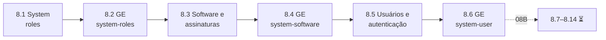

# Capítulo 8 — Automating Linux Administration Tasks

**Título em português:** Automatizando tarefas de administração Linux
**Status:** 🟡 parcial: parte A (8.1–8.6) documentada e validada; parte B (8.7–8.14) ⏳ aguardando PDF
**Referência:** PDF p. 453–569 · arquivos `AU294_AAP2.6_C08A_Administracao_Linux_Parte1_p453-508.pdf` (recebido) e `AU294_AAP2.6_C08B_...` (p. 509–569, aguardando); não versionados

> **Atenção:** o Capítulo 8 chega em **duas partes**. Com a 08A, o status é 🟡 parcial;
> `REVISAO.md`, `RESUMO.md` e o status concluído só depois da 08B.

## Objetivo do capítulo

Automatizar tarefas comuns de administração de sistemas Linux com Ansible.

## Por que este capítulo importa

É onde o Ansible encontra o dia a dia do administrador RHEL: system roles suportadas,
pacotes e repositórios, contas e acesso, boot e agendamentos, armazenamento e rede.
Também é a parte do curso mais próxima das tarefas práticas do EX294.

## Seções e atividades (ordem oficial)

| Seção | Tipo | Título original | Material | PDF |
|-------|------|-----------------|----------|-----|
| 8.1 | Conceito | Using System Roles | [lição](8.1-usando-system-roles.md) | p. 454–462 |
| 8.2 | Guided Exercise | Using System Roles | [prática](PRATICA-OFICIAL.md#82-guided-exercise-using-system-roles) | p. 463–470 |
| 8.3 | Conceito | Automating Software and Subscription Tasks | [lição](8.3-automatizando-software-e-assinaturas.md) | p. 471–483 |
| 8.4 | Guided Exercise | Automating Software and Subscription Tasks | [prática](PRATICA-OFICIAL.md#84-guided-exercise-automating-software-and-subscription-tasks) | p. 484–492 |
| 8.5 | Conceito | Automating User Management and Authentication Tasks | [lição](8.5-automatizando-usuarios-e-autenticacao.md) | p. 493–499 |
| 8.6 | Guided Exercise | Automating User Management and Authentication Tasks | [prática](PRATICA-OFICIAL.md#86-guided-exercise-automating-user-management-and-authentication-tasks) | p. 500–508 |
| 8.7 | Conceito | Automating the Boot Process and Scheduled Processes | ⏳ PDF 08B | — |
| 8.8 | Guided Exercise | Automating the Boot Process and Scheduled Processes | ⏳ PDF 08B | — |
| 8.9 | Conceito | Automating Storage Tasks | ⏳ PDF 08B | — |
| 8.10 | Guided Exercise | Automating Storage Tasks | ⏳ PDF 08B | — |
| 8.11 | Conceito | Automating Network Configuration Tasks | ⏳ PDF 08B | — |
| 8.12 | Guided Exercise | Automating Network Configuration Tasks | ⏳ PDF 08B | — |
| 8.13 | Lab | Automating Linux Administration Tasks | ⏳ PDF 08B | — |
| 8.14 | Summary | Summary | ⏳ PDF 08B | — |

A abertura do capítulo está na p. 453. Nenhuma atividade da parte A aceita
`lab grade`; o lab de fim de capítulo (8.13) está na parte B.

## Arquivos do capítulo

- [PRATICA-OFICIAL.md](PRATICA-OFICIAL.md): ponte com os guided exercises da parte A.
- `REVISAO.md` e `RESUMO.md`: ⏳ após a parte B.
- Exemplo validado (parte A): [exemplos-originais/cap08-administracao-linux](../../exemplos-originais/cap08-administracao-linux/).

## Pré-requisitos recomendados

[Capítulo 7](../07-roles-e-collections/README.md) ·
[4.5 — Tratamento de falhas](../04-controle-de-tarefas/4.5-tratando-falhas-de-tarefas.md) ·
[3.5 — Ansible Vault](../03-variaveis-e-vault/3.5-protegendo-dados-com-ansible-vault.md)

## Checklist (marcado por você)

- [ ] 8.1 lida e Parte H respondida
- [ ] 8.2 Guided Exercise `system-roles` concluído
- [ ] 8.3 lida e Parte H respondida
- [ ] 8.4 Guided Exercise `system-software` concluído
- [ ] 8.5 lida e Parte H respondida
- [ ] 8.6 Guided Exercise `system-user` concluído
- [ ] ⏳ Parte B (8.7–8.14)
- [ ] Registro no [diário de laboratórios](../../progresso/diario-de-laboratorios.md)

---
[← Capítulo 7](../07-roles-e-collections/README.md) | [Índice geral](../../README.md) | [Próximo: 8.1 System roles →](8.1-usando-system-roles.md)
