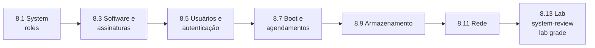

# Capítulo 8 — Automating Linux Administration Tasks

**Título em português:** Automatizando tarefas de administração Linux
**Status:** ✅ documentado e validado (partes A e B; o estudo é marcado por você no checklist)
**Referência:** PDF p. 453–569 · arquivos `AU294_AAP2.6_C08A_Administracao_Linux_Parte1_p453-508.pdf` e `AU294_AAP2.6_C08B_Administracao_Linux_Parte2_p509-569.pdf` (não versionados)

## Objetivo do capítulo

Automatizar tarefas comuns de administração de sistemas Linux com Ansible.

## Por que este capítulo importa

É onde o Ansible encontra o dia a dia do administrador RHEL: system roles suportadas,
pacotes e repositórios, contas e acesso, boot e agendamentos, armazenamento e rede.
Também é a parte do curso mais próxima das tarefas práticas do EX294.

## Seções e atividades (ordem oficial)

| Seção | Tipo | Título original | Material | PDF |
|-------|------|-----------------|----------|-----|
| 8.1 | Conceito | Using System Roles | [lição](8.1-usando-system-roles.md) | p. 454–462 |
| 8.2 | Guided Exercise | Using System Roles | [prática](PRATICA-OFICIAL.md#82-guided-exercise-using-system-roles) | p. 463–470 |
| 8.3 | Conceito | Automating Software and Subscription Tasks | [lição](8.3-automatizando-software-e-assinaturas.md) | p. 471–483 |
| 8.4 | Guided Exercise | Automating Software and Subscription Tasks | [prática](PRATICA-OFICIAL.md#84-guided-exercise-automating-software-and-subscription-tasks) | p. 484–492 |
| 8.5 | Conceito | Automating User Management and Authentication Tasks | [lição](8.5-automatizando-usuarios-e-autenticacao.md) | p. 493–499 |
| 8.6 | Guided Exercise | Automating User Management and Authentication Tasks | [prática](PRATICA-OFICIAL.md#86-guided-exercise-automating-user-management-and-authentication-tasks) | p. 500–508 |
| 8.7 | Conceito | Automating the Boot Process and Scheduled Processes | [lição](8.7-automatizando-boot-e-agendamentos.md) | p. 509–515 |
| 8.8 | Guided Exercise | Automating the Boot Process and Scheduled Processes | [prática](PRATICA-OFICIAL.md#88-guided-exercise-automating-the-boot-process-and-scheduled-processes) | p. 516–524 |
| 8.9 | Conceito | Automating Storage Tasks | [lição](8.9-automatizando-armazenamento.md) | p. 525–533 |
| 8.10 | Guided Exercise | Automating Storage Tasks | [prática](PRATICA-OFICIAL.md#810-guided-exercise-automating-storage-tasks) | p. 534–540 |
| 8.11 | Conceito | Automating Network Configuration Tasks | [lição](8.11-automatizando-rede.md) | p. 541–548 |
| 8.12 | Guided Exercise | Automating Network Configuration Tasks | [prática](PRATICA-OFICIAL.md#812-guided-exercise-automating-network-configuration-tasks) | p. 549–555 |
| 8.13 | Lab | Automating Linux Administration Tasks | [prática](PRATICA-OFICIAL.md#813-lab-automating-linux-administration-tasks) | p. 556–568 |
| 8.14 | Summary | Summary | [RESUMO.md](RESUMO.md) | p. 569 |

A abertura do capítulo está na p. 453. O capítulo não tem quiz. Só o lab 8.13 aceita
`lab grade`.

## Arquivos do capítulo

- [PRATICA-OFICIAL.md](PRATICA-OFICIAL.md): ponte com os seis guided exercises e o lab.
- [REVISAO.md](REVISAO.md): 26 questões autorais sobre o capítulo inteiro.
- [RESUMO.md](RESUMO.md): síntese, módulos, roles e variáveis.
- Exemplo validado: [exemplos-originais/cap08-administracao-linux](../../exemplos-originais/cap08-administracao-linux/).

## Pré-requisitos recomendados

[Capítulo 7](../07-roles-e-collections/README.md) ·
[4.5 — Tratamento de falhas](../04-controle-de-tarefas/4.5-tratando-falhas-de-tarefas.md) ·
[3.5 — Ansible Vault](../03-variaveis-e-vault/3.5-protegendo-dados-com-ansible-vault.md)

## Checklist (marcado por você)

- [ ] 8.1 lida e Parte H respondida
- [ ] 8.2 Guided Exercise `system-roles` concluído
- [ ] 8.3 lida e Parte H respondida
- [ ] 8.4 Guided Exercise `system-software` concluído
- [ ] 8.5 lida e Parte H respondida
- [ ] 8.6 Guided Exercise `system-user` concluído
- [ ] 8.7 lida e Parte H respondida
- [ ] 8.8 Guided Exercise `system-process` concluído
- [ ] 8.9 lida e Parte H respondida
- [ ] 8.10 Guided Exercise `system-storage` concluído
- [ ] 8.11 lida e Parte H respondida
- [ ] 8.12 Guided Exercise `system-network` concluído
- [ ] 8.13 Lab `system-review` com `lab grade` aprovado
- [ ] [REVISAO.md](REVISAO.md) respondida
- [ ] Registro no [diário de laboratórios](../../progresso/diario-de-laboratorios.md)

---
[← Capítulo 7](../07-roles-e-collections/README.md) | [Índice geral](../../README.md) | [Próximo: 8.1 System roles →](8.1-usando-system-roles.md)
