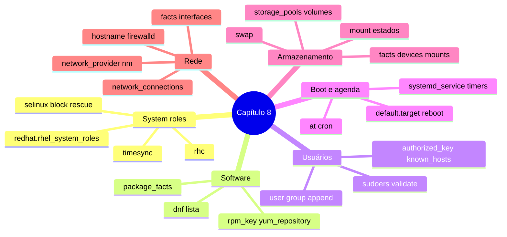

# Resumo — Capítulo 8

Síntese autoral para revisão rápida. Correspondência oficial: seção 8.14 Summary
(PDF p. 569).

## Em uma frase por seção

| Seção | Ideia central |
|-------|---------------|
| 8.1 | As RHEL system roles (`redhat.rhel_system_roles`) configuram componentes do RHEL de forma consistente entre versões; variáveis no inventário e play curto |
| 8.3 | `dnf` (lista em `name`), `package_facts`, `rpm_key`, `yum_repository` e a role `rhc` cobrem pacotes, repositórios e registro |
| 8.5 | `user`, `group`, `authorized_key`, `known_hosts` e `lineinfile` com `validate` cobrem contas, chaves SSH e sudo |
| 8.7 | `at` (uma vez), `cron` (recorrente), `systemd_service` (serviços e timers), link de `default.target` e `reboot` |
| 8.9 | `ansible.posix.mount` monta; a role `storage` cria VG, LVs, file systems, montagens e swap de forma idempotente; facts mostram discos e montagens |
| 8.11 | A role `network` (`nm` + `network_connections`) configura interfaces, IP e DNS; `hostname` e `firewalld` complementam; facts revelam interfaces |

## Mapa do capítulo

## Tabelas de consulta

| Módulo | Uso |
|--------|-----|
| `ansible.builtin.dnf` | Pacotes (`present`/`absent`/`latest`, `@grupo`) |
| `ansible.builtin.package_facts` | `ansible_facts['packages']` |
| `ansible.builtin.yum_repository` / `ansible.builtin.rpm_key` | Repositório / chave GPG |
| `ansible.builtin.user` / `ansible.builtin.group` | Contas / grupos |
| `ansible.posix.authorized_key` / `ansible.builtin.known_hosts` | Chaves de usuário / de host |
| `ansible.builtin.lineinfile` | Sudo e ajustes de configuração (`regexp`, `validate`) |
| `ansible.posix.at` / `ansible.builtin.cron` | Agendamento único / recorrente |
| `ansible.builtin.systemd_service` | Serviços e timers |
| `ansible.builtin.reboot` | Reiniciar e esperar |
| `ansible.posix.mount` | Montagens e `/etc/fstab` |
| `ansible.builtin.hostname` / `ansible.posix.firewalld` | Hostname / firewall |

| System role | Variáveis principais |
|-------------|----------------------|
| `redhat.rhel_system_roles.timesync` | `timesync_ntp_servers` |
| `redhat.rhel_system_roles.selinux` | `selinux_state`, `selinux_booleans`, `selinux_fcontexts`, `selinux_restore_dirs`, `selinux_ports` |
| `redhat.rhel_system_roles.rhc` | `rhc_state`, `rhc_auth`, `rhc_repositories` |
| `redhat.rhel_system_roles.storage` | `storage_volumes`, `storage_pools` (`volumes`) |
| `redhat.rhel_system_roles.network` | `network_provider`, `network_connections` |

| Fact | Conteúdo |
|------|----------|
| `ansible_facts['packages']` | Pacotes instalados (após `package_facts`) |
| `ansible_facts['devices']` / `['mounts']` | Discos / montagens |
| `ansible_facts['interfaces']` / `['<nic>']` | Interfaces / detalhes |
| `ansible_facts['fqdn']` / `['hostname']` / `['dns']` | Nomes e DNS |

## Alertas operacionais

- ⚠️ Role de SELinux não reinicia: `block`/`rescue` com `selinux_reboot_required`.
- ⚠️ Credenciais de registro com Vault; prefira activation keys.
- ⚠️ `groups` sem `append` substitui grupos; sudoers com `validate`.
- ⚠️ `cron` identifica o job pelo `name`; não use `cron_file` para `/etc/crontab`.
- ⚠️ `reboot_timeout` vale por fase.
- ⚠️ Tamanhos da role `storage` em minúsculas; `disks` só sem partições; cuidado com `command` em discos.
- ⚠️ RHEL 10: `network_provider: nm`; confira a interface antes de mudar a rede.

## Ligação com o próximo capítulo

O Capítulo 9 é a revisão geral (comprehensive review), que combina o conteúdo de
todo o curso.

---
[← Revisão](REVISAO.md) | [Índice do capítulo](README.md) | [Próximo capítulo →](../09-revisao-geral/README.md)
